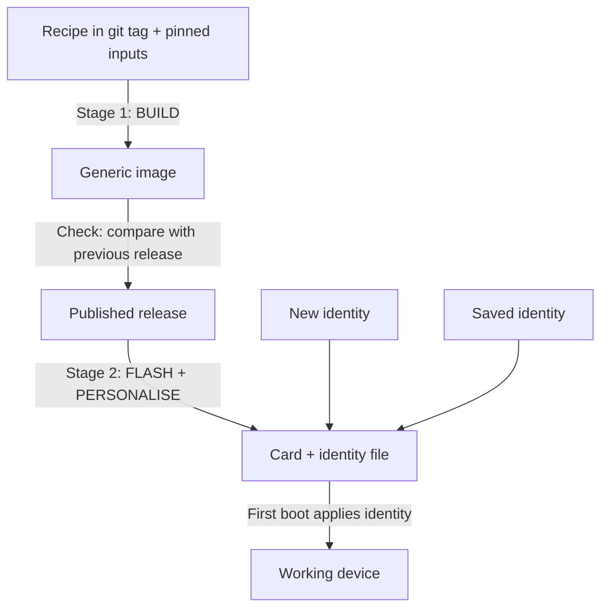

# How IDEA device images are released

**Status:** Approved approach (idea#322, Koen, 29 Oct 2026) · **Maintained by:** Atlas / Steve
**Full proposal:** [proposals/2026-10-27-image-releases-and-reproducibility.md](../proposals/2026-10-27-image-releases-and-reproducibility.md)

Every IDEA device (client, router, Engine) starts from an image on a card or disk. We make these in **two stages**.

## Stage 1: Build (slow, only when something changes)

We build a new release only when the code or the software updates change.

1. Take the recipe from a fixed version in git (a tag). Every input is pinned to an exact version.
2. Build one **generic image** per device type. It is the same for every school and holds no names or keys.
3. Compare it with the previous release and check the list of differences.
4. Publish it as the new **release**.

## Stage 2: Flash and personalise (fast, once per device)

1. The flash tool writes the release image to the card, plus a small private **identity file** (the device's name, time zone, home mode and Tailscale key).
2. On first boot the device reads the identity file, sets itself up, and deletes the file.

Identity files are kept on the bot computer, never on GitHub.

## Which route to take

- **Something changed:** go through both stages. Build a new release, then flash.
- **Nothing changed:** start at the published release and only flash.
  - With a **new identity file** you get a new device.
  - With a **saved identity file** you get an exact replacement for a device that broke.

To fix a device in the field, the default is the **latest release**.

## Yearly check

Once a year, and before handing a system over, we rebuild Stage 1 from an old tag on a clean computer and check that the result has the same content as the published release.
