# IDEA System Architecture — Concepts and Vision

**Status:** Draft (written from the ground up, 25 November 2026) · **Maintained by:** Steve (Lead Bot) · **Audience:** IDEA partners, field coordinators, new team members and engineers

This document explains *how IDEA works and why it is built the way it is*. It stays at the level of
concepts, views and principles. It does not replace the detailed, as-implemented technical documents:
the Engine's [`ARCHITECTURE.md`](https://github.com/koenswings/agent-engine-dev/blob/main/docs/ARCHITECTURE.md),
the Console's [`ARCHITECTURE.md`](https://github.com/koenswings/agent-console-dev/blob/main/docs/ARCHITECTURE.md),
the App contracts in [`agent-app-dev/docs`](https://github.com/koenswings/agent-app-dev/tree/main/docs) and the
runbooks in [`docs/ops/`](../ops/). When you need a file name, a command or a number, go there. When you need to
understand the shape of the system, start here.

Sections 1 to 9 describe the system as it runs today (Engine `c1cc4bb` line, Console `df13dbfa`, root helper v25,
November 2026). Section 10 is explicitly forward-looking and marks what is not built yet.

# 1. Mission and design principles

## Why IDEA exists

**IDEA** (Initiative for Digital Education in Africa) brings digital learning to rural schools that have
**no reliable internet, unreliable electricity and no IT staff**. Most educational technology quietly assumes all
three. IDEA assumes none of them.

A school receives a small **kit**: a school server (a Raspberry Pi running the IDEA **Engine**), a Wi-Fi router,
a network switch, a handful of classroom computers and one or more **disks** that carry the learning Apps —
Kolibri for curriculum content and exercises, Nextcloud for sharing files, and Kiwix for offline Wikipedia and
other reference works. Teachers and students open these Apps in a web browser on the school's own Wi-Fi.
Nothing needs the internet to work.

## The principles that shape every decision

| # | Principle | What it means in practice |
|---|---|---|
| P1 | **Offline first** | Every feature works with no internet at all. The internet, when it is there, is only a bonus for remote support and reporting. |
| P2 | **No IT staff needed** | A teacher must be able to run the kit with a power button, a browser and a disk. Anything that needs a terminal is our job, not the school's. |
| P3 | **Plug-and-play disks** | Software and its data travel on physical disks. Plugging a disk in installs and starts the Apps on it; unplugging takes them away. The disk *is* the installer. |
| P4 | **Engines meet and part** | School servers find each other on a network, share one picture of the world, and keep working on their own when they are apart. There is no central server that must be reachable. |
| P5 | **Reliability over features** | The Engine runs unattended for months. A smaller feature that never breaks beats a richer one that sometimes does. Unknown situations fail *closed* and say so. |
| P6 | **Never lose school data** | Data is quarantined, never silently deleted. Backups, snapshots and rollbacks exist so a mistake is always recoverable. |
| P7 | **Reproducible and replaceable** | Every device starts from a released image plus a small identity file. A broken device is replaced, not repaired in place. |
| P8 | **Privacy by design** | What leaves a school is the minimum needed for support and programme reporting: role-level, daily summaries, never usernames or content. |

These principles are often in tension with "the usual way" of building software. For example, P4 rules out a
cloud database, P2 rules out a command-line installer, and P6 rules out "just delete the folder". When a design
question comes up, these eight lines are the tie-breakers.

# 2. Core concepts and vocabulary

The whole system can be explained with about a dozen ideas. Learn these and the rest of the document follows.

| Concept | One-line explanation |
|---|---|
| **Kit** | Everything a school receives: school server, router, switch, classroom computers, disks, and (planned) a UPS. |
| **Engine** | The IDEA software on a school server, and by extension the server itself. Each Engine has a friendly *sticker name* such as `kind-panda` or `sunny-robin`. |
| **Disk** | Any USB SSD or stick the Engine recognises as an IDEA disk. It carries a small identity file (`META.yaml`) with a permanent **disk ID**. |
| **Disk roles** | A disk can be an **App Disk** (carries Apps), a **Backup Disk** (carries backups), a **Files Disk** (a shared file folder), any combination of these, or an **empty IDEA disk**. |
| **App** | A packaged educational application (Kolibri, Nextcloud, Kiwix…) defined by a Docker Compose bundle plus IDEA metadata (`x-app`). |
| **Instance** | One installed, runnable copy of an App on a specific disk, with its own data. A disk can hold several instances; the same App can have several instances (for example a real and a demo Kolibri). |
| **Docking / undocking** | Plugging a disk into an Engine (the Engine mounts it and starts its instances) and removing it (the Engine stops them and unmounts cleanly). |
| **Store** | One shared, conflict-free document (Automerge) that describes the whole network: Engines, disks, Apps, instances, operator accounts and running operations. Every Engine keeps a full copy. |
| **Command** | A request ("start this instance", "back up that App") written into the store and addressed to one Engine, which carries it out. |
| **Operation** | A long-running piece of work (copy, move, backup, restore, update) with a visible status, so anyone can follow it and an interrupted one can be recovered. |
| **Console** | The web interface served by every Engine. Users browse and open Apps; operators log in to manage disks, Apps and backups. |
| **Fleet / store family** | Engines that share one store document. All field kits share the *kit store*; development Pis and the hub each have their own. Engines only ever talk to Engines of their own store. |
| **Root helper** | A small, root-owned program with a fixed list of allowed actions. It is the only way the Engine does anything that needs administrator rights. |
| **Hub (`idea`)** | IDEA's own server at home base. It runs the programme dashboard and support tooling; schools never depend on it. |
| **Tailscale** | An encrypted private network that lets the IDEA team reach kits for support *when* they happen to have internet. |

# 3. System context

The system context view shows IDEA as a box and everything around it: who uses it and what it touches.

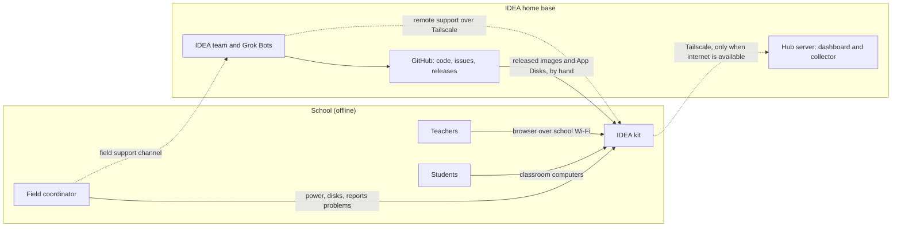

Three things stand out:

1. **Everything inside the school is self-sufficient.** The dotted lines are optional. A school that never sees
   the internet still gets the full learning experience.
2. **Software arrives physically.** New Apps and App versions reach schools on disks and freshly flashed cards,
   carried by people. Remote updates over Tailscale are possible and used, but they are an optimisation, not a
   requirement.
3. **People are part of the system.** The field coordinator is the eyes and hands at the school; the team at
   home base (people and Grok Bots) watch, support and improve. The architecture deliberately keeps the
   coordinator's job to "power, plug in, report".

## The kit at a school

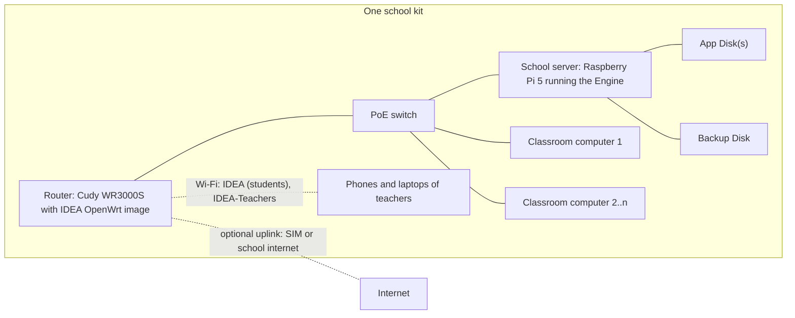

- **Router.** Creates the school network and two Wi-Fi networks: one for students, one for teachers (whose
  optional internet access can be switched on and off). It relays the local name service so that devices can find
  `idea.local`, and it carries its own Tailscale link for remote support.
- **School server.** A Raspberry Pi 5 with an SSD system disk, running the Engine. More than one server can be in a
  school; they find each other and act as one.
- **Classroom computers.** Raspberry Pi 400/500 machines with a locked-down student desktop image: one shared
  `learner` account, no administrator rights, desktop icons that open each App in the browser. Updates happen by
  flashing a new tested image, not by downloading packages.
- **Disks.** The App Disks carry the Apps and their data; a Backup Disk keeps nightly copies.

# 4. Component view

Inside the school server, a small number of components cooperate. Everything that changes the machine runs
through narrow, well-guarded doors.

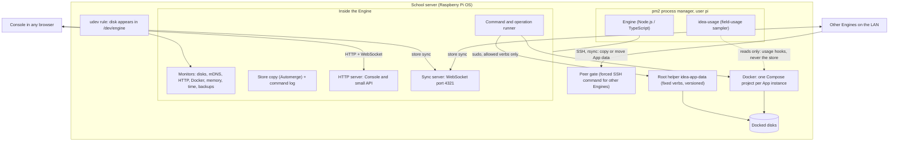

| Component | Responsibility | Why it is shaped like this |
|---|---|---|
| **Engine** | Detects disks, starts and stops Apps, keeps the store, runs commands and operations, serves the Console. | One long-running program that owns the machine's IDEA state. It runs natively (not in a container) so it can see disks and Docker directly. |
| **Monitors** | Turn events in the world (a disk appears, a peer is announced, the clock ticks, memory runs low) into store changes or actions. | Everything the Engine does starts with an observed event or a command. There is no hidden scheduler elsewhere. |
| **Store copy** | The Engine's full local copy of the shared network picture. | Lets every Engine and every Console work locally and agree later (see section 5). |
| **Command runner** | Executes commands addressed to this Engine and records each long job as an Operation, with a trace in the command log. | A command is just data in the store, so it reaches the right Engine even through another Engine. |
| **HTTP server** | Serves the Console web app and a few endpoints (the store address, the command-log address). | The Console needs no installation: open a browser, type `idea.local`. |
| **Console** | Solid.js web app; user mode (open Apps) and operator mode (manage). | A second copy of the store lives in the browser, so the interface reacts instantly and works from any Engine. |
| **Root helper** | The only path to administrator actions: mounting, copying App data, Borg backups, SSH key files, usage export. Every verb validates its arguments; the helper carries a version number the Engine checks. | Keeps the Engine itself unprivileged. A bug in the Engine cannot become "delete anything as root". |
| **Peer gate** | The forced command behind every other Engine's SSH key. It allows only "receive a new folder", "delete what you sent me" and a few housekeeping verbs. | Cross-Engine copy and move need a data channel; this keeps that channel narrow. |
| **Docker** | Runs each App instance as its own Compose project with its own network. | Apps are written by others and packaged as containers; IDEA does not have to change them. |
| **idea-usage** | A separate process that samples presence and calls each App's usage hook, writing daily role-level summaries. Off by default. | Monitoring must never be able to disturb teaching, so it is a separate process that never opens the store. |

## The App as a contract

An App bundle is a normal Docker Compose file with an extra block of IDEA metadata, the **`x-app`**
section. That block is the contract between App authors and the Engine. It declares, among other things:

- which port the App's web page uses, and how to tell it is healthy;
- how to back it up (`stop` for a short stop-and-copy, `hook` for an App-specific consistent dump, or `none` when the
  content can be rebuilt from the App Disk, as with Kiwix's encyclopaedia files);
- whether it wants the shared Files folder mounted (`filesMount`);
- how to update it safely, demo-content hooks, and its usage hook for field monitoring.

This keeps Apps independent: adding a new App means writing a bundle that honours the contract, testing it with
the App Harness (a real Engine started in test mode against a fixture disk), and putting it on a disk.

# 5. Data and synchronisation concepts

## One shared picture, many copies

The heart of IDEA is a single shared document: the **store**. It holds six collections:

| Collection | What it describes |
|---|---|
| `engineDB` | Every Engine: its name, addresses, software versions, health and its queue of commands |
| `diskDB` | Every disk ever seen: its roles, size and where it is docked now |
| `appDB` | Every App version known to the network |
| `instanceDB` | Every installed App instance: which disk stores it, whether it runs, on which port |
| `userDB` | Operator accounts (passwords only as hashes) |
| `operationDB` | Long-running jobs and their progress |

Every Engine keeps a full copy and every open Console keeps one too. Copies exchange changes whenever they can
reach each other. The document is an **Automerge CRDT** — a data structure designed so that copies edited
independently can always be merged, automatically and in the same way everywhere, without a central referee.

This gives IDEA its defining property: **a Console connected to any Engine shows the whole network**, including
Apps running on another Engine, and a command typed on one Engine reaches the Engine that owns the disk.

## Meeting and parting

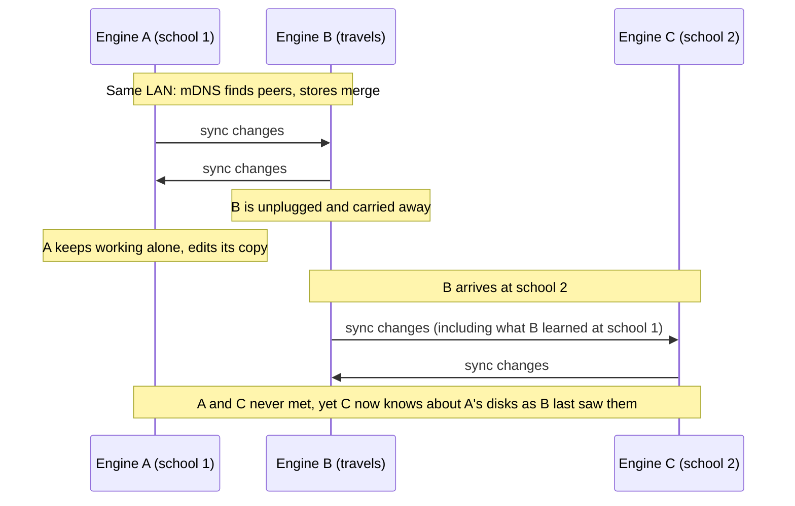

- **Discovery** is local: Engines announce themselves with mDNS on the school LAN and connect over WebSocket.
  Engines never sync with each other over Tailscale; remote access is for people, not for store traffic.
- **Same family only.** For two copies to merge they must descend from the *same* original document. All field
  Engines are installed with the same starting template and the same document identity (the *kit store*). The
  development pool and the hub use their own stores. Every Engine checks the other side's store tag before any
  data moves and refuses Engines of another family, so a test Pi can never leak into the schools' picture.
- **Facts versus chatter.** Lasting facts (a disk was docked, an instance is running) are stored. Frequent signals
  (a heartbeat every 10 seconds, live CPU and progress figures) travel as *ephemeral* messages and are never
  stored. This keeps the document from growing without limit; "last seen" is written at most hourly.
- **Logs apart.** Command traces and their log lines live in a separate, disposable command-log document, so
  troubleshooting detail never bloats the shared store.

## Commands through the store

There is no separate remote-control protocol. An action is a change to the shared document:

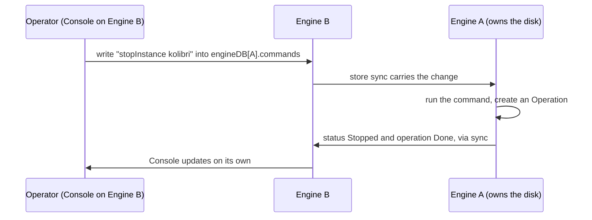

The benefits are simple routing (whoever owns the disk does the work), visibility (everyone sees the
operation's progress) and robustness (a command written while the target is briefly unreachable is executed
when it comes back). The cost is that anything allowed to write the store can ask Engines to act. That is why the
store's address is treated as a secret, peers are checked by store family, and every privileged step goes through
the root helper's fixed verbs.

## Disks carry their own truth

The store is a *shared view*; the disks are the *physical truth*. Each disk carries its identity (`META.yaml`),
its Apps and instances, and — for a Backup Disk — its own configuration file (`BACKUP.yaml`). When a disk is
docked, the Engine reads the disk and brings the store in line with it, not the other way round. A disk taken to
another school brings its Apps, data and settings along, and the receiving Engine simply publishes what it finds.

## Data the school owns

| Data | Where it lives | Leaves the school? |
|---|---|---|
| Learner progress, classes (Kolibri) | Instance data on the App Disk | No |
| Teachers' files (Nextcloud) | Instance data or the Files Disk | No |
| Backups | Backup Disk (Borg archives) | No |
| Network picture (store) | Every Engine's SSD | Only to the IDEA team during remote support |
| Usage summaries | `/var/lib/idea/usage` on the server | Yes, role-level daily counts only, when monitoring is switched on |

# 6. Lifecycle views

## 6.1 Installing a kit

Every IDEA device — school server, router, classroom computer — follows the same two-stage pattern.

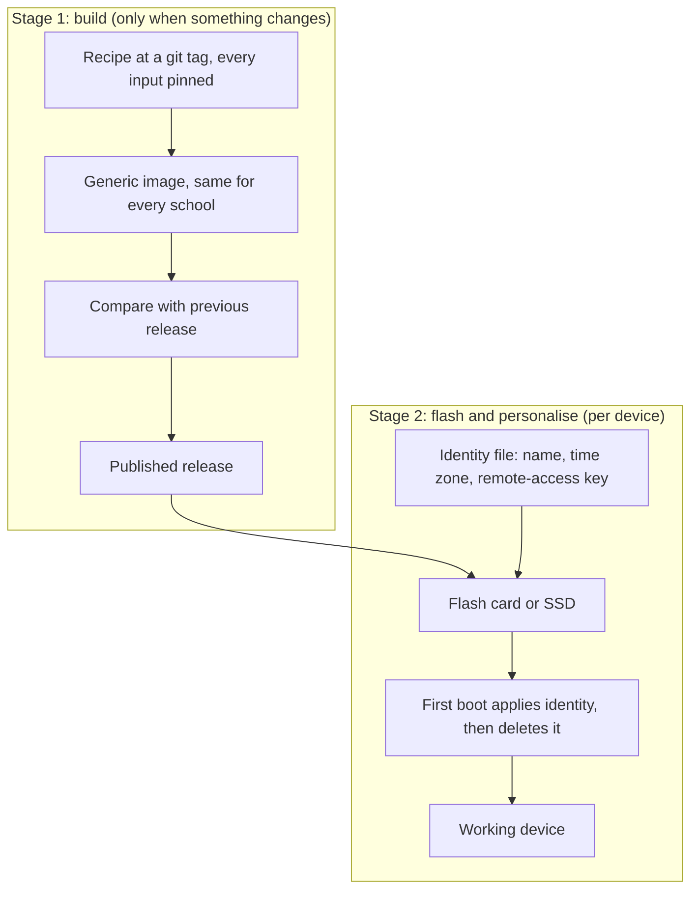

- The generic image holds **no names, no keys and no school data**. Personality arrives as a small identity file
  that is consumed and wiped at first boot. A saved identity file recreates an exact replacement for a device
  that broke.
- At first start the Engine creates its own identity (from the system drive's serial number) and its own
  peer key, and joins the store family it was shipped with.
- The kit is then assembled, tested end-to-end ("cover-all" walks on the development pool, kit checks on the
  actual hardware) and recorded in `deployments/` and `fleet-state.json` before it travels.

## 6.2 The journey of an App Disk

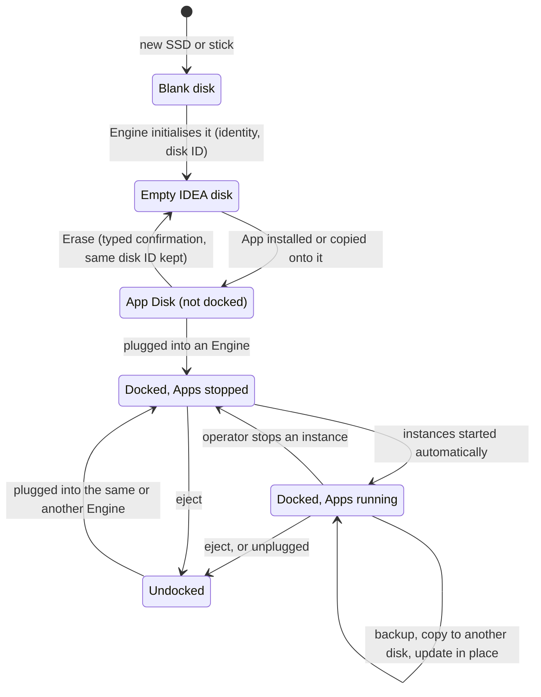

Key ideas along the journey:

- **Identity is permanent.** A disk is always addressed by its disk ID, never by its label; labels repeat.
- **Docking is automatic and safe.** The Engine mounts through the root helper, reads the disk, starts its
  instances and publishes them. Undocking stops the instances and unmounts with retries; a disk that refuses to
  let go is flagged ("restart this Pi") rather than forced.
- **Copy and move.** An instance can be copied to another disk, or moved, also to a disk on another Engine. A move
  keeps the instance's identity; data travels over the narrow peer channel; the source is quarantined only after
  the target is verified, and an interrupted move can resume.
- **Erase** is deliberate: a content summary and a typed confirmation, and the system disk can never be erased.

## 6.3 Updates

There are three different kinds of update, each with its own safety net.

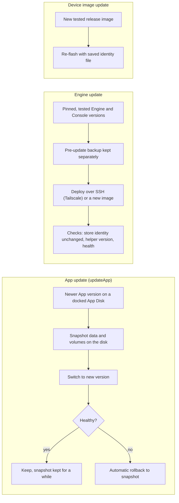

- **Apps** update in place from a disk that carries the newer version. The update takes a snapshot first, checks
  the App's health afterwards, and rolls back automatically if it is not healthy.
- **Engine software** on field kits is *pinned*: kits run a specific, tested combination of Engine, Console and
  root helper, and are only moved forward in a planned field update with explicit approval (for example idea#374).
  Every field update takes a pre-update backup first, keeps the store identity untouched, and pauses when the
  server is too hot.
- **Router and classroom computers** are never patched in place: a new tested image is flashed.

## 6.4 Backup and restore

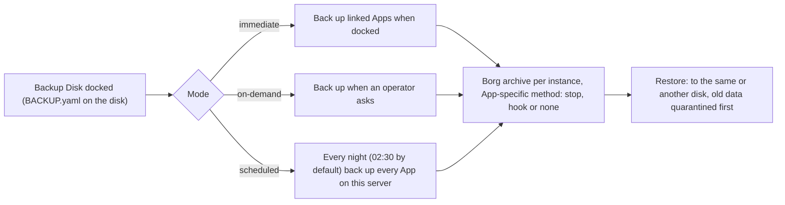

- The **Backup Disk carries its own configuration and history**, so it can be moved between servers and still
  knows what it does.
- Each App decides **how** it is backed up through its contract: a short stop, an App-specific hook, or nothing
  when the content is rebuildable.
- The schedule runs inside the Engine, only on the Engine the disk is docked to, and is careful about clocks: a
  school server often has no trustworthy time after a power cut, so the scheduler only trusts the clock when it has
  good reason to.
- **Restore never overwrites blindly**: what is replaced is first moved aside (quarantined).

## 6.5 Field support

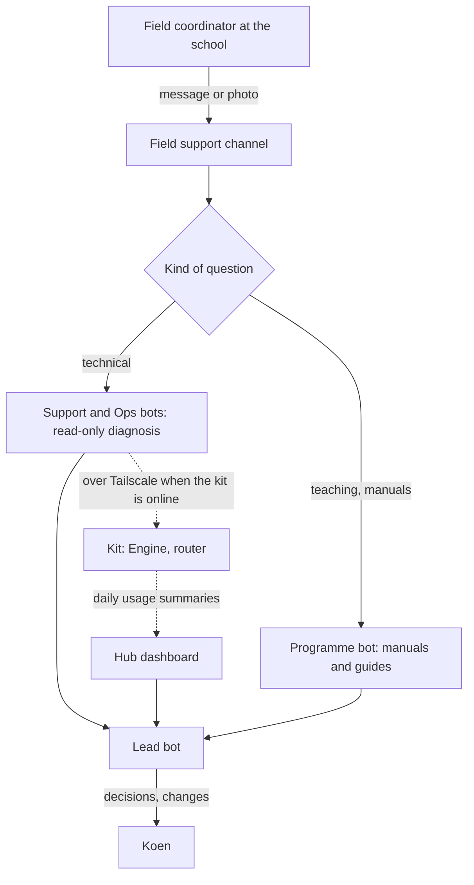

- **One contact point** for the field: a single channel, with the team routing each question.
- Remote access exists for people only, through Tailscale, which is always on at schools but only works when the
  school happens to have internet. Agents diagnose by *reading*; changes go through review and approval.
- **Field-usage monitoring** answers the programme question "is the kit used as taught?". When switched on per
  kit, the server keeps daily role-level summaries; the hub pulls them over a restricted SSH command. Turning it
  off is one switch per kit, or one rule fleet-wide.

# 7. Security and trust model

IDEA's threat model is pragmatic: shared classroom machines, curious students, devices that travel, and a small
remote team.

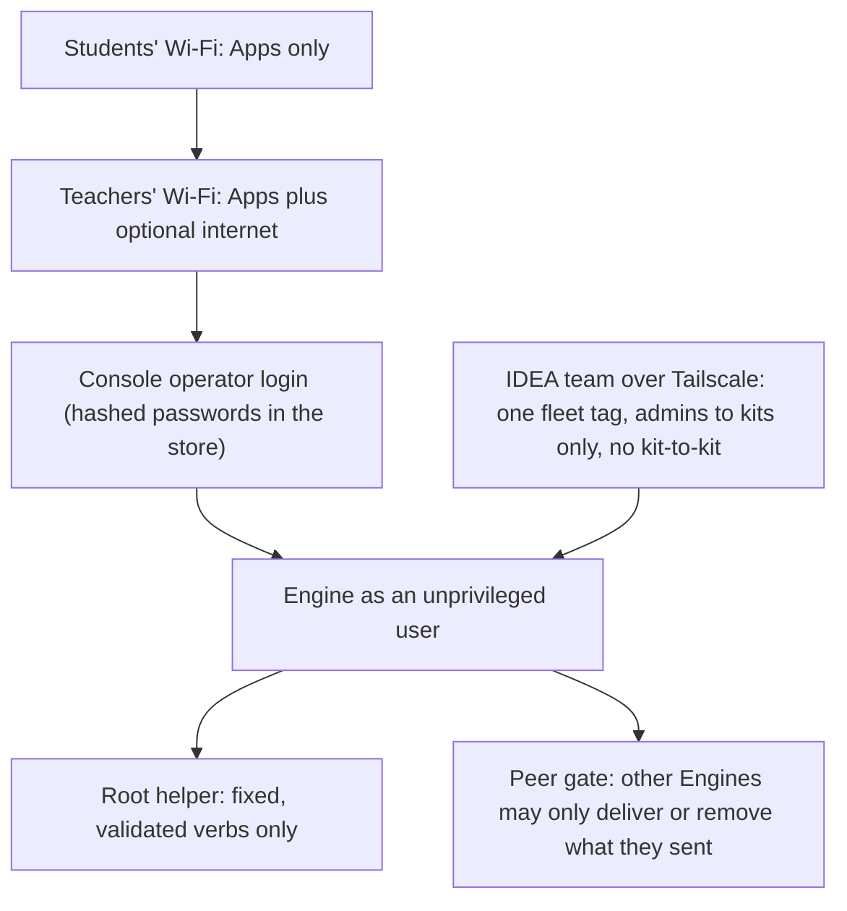

- **Least privilege everywhere.** The Engine is not root; root actions go through the helper; peers go through the
  gate; the usage collector gets one forced command.
- **Per-server keys.** Each Engine creates its own key and publishes the public half in the store; peers accept
  only Engines of the same store family that were seen in the last seven days.
- **Fail closed.** If an Engine is unsure it is in the right store family, it stops offering peer access and says
  so loudly. If a store file is damaged, it is quarantined and rebuilt from the common template rather than
  replaced by a stranger's.
- **Secrets stay off GitHub.** Identity files, keys and passwords live on the device or the bot computer, never in
  repositories, chats or documents.

# 8. Operating realities

The architecture has to survive the place it lives in. These are the conditions we design for, with what the
system does about each.

## Power

Power cuts are normal. One field server counted 13 unsafe shutdowns in its first month.

- The store is written so that a half-written file is detected at start, set aside (never deleted) and the
  document reloaded from the healthy parts or rebuilt from the shared template.
- Operations interrupted by a power cut are marked and can be resumed by the operator rather than silently
  retried.
- Docker images and App data are on SSDs, which tolerate sudden power loss far better than SD cards.
- Planned: a UPS per kit and a simple, safe way for a coordinator to shut the kit down.

## Heat

Classrooms are hot. Field servers idle around 70 °C with their fan already working hard, about 10 °C below the
point where the Pi starts slowing itself down (80 °C).

- Field updates pause automatically at 75 °C and resume below 72 °C.
- SSD temperatures are watched; so far they stay well under their limits.
- The cheapest fix is placement: out of the sun, open air around the case, no stacking. Future kits need cooling
  sized for a hot classroom, not a lab bench.

## Intermittent connectivity

- Inside the school, the LAN is the only network the system needs.
- Remote access appears and disappears with the school's internet; nothing in the school waits for it.
- Reporting to the hub is a *pull* by the hub when it can reach the kit; missed days are simply pulled later.

## Time

A Pi has no battery-backed clock. After a power cut without internet, the time can be wrong. Anything that
depends on time (nightly backups, quarantine expiry, update gates) asks first whether the clock can be trusted, and
the store's merge rules do not depend on wall-clock time at all.

## Memory and storage growth

- The Engine watches its own memory and the event loop; the operating system's memory accounting is switched on so
  that Docker limits work.
- The system journal survives reboots, so problems before a crash can be read afterwards.
- The shared store is kept small by design (ephemeral chatter, hourly "last seen", archived operations) and can be
  compacted when needed.

## People and distance

The coordinator is not an IT person and the team is far away. So: one disk, one button, one web address
(`idea.local`, which whichever server is present answers); printed manuals in the house style; and diagnosis that
reads first and asks before it changes anything.

# 9. How the system is built and kept healthy

IDEA is developed by Koen with a team of Grok Bots, each owning a domain: the Lead Bot (coordination, design),
Engine, Console and App development bots, an Ops bot (fleet, images, deployments) and a programme bot (field
coordination, manuals).

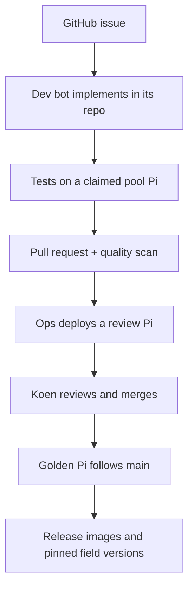

- **Repositories:** `idea` (organisation, proposals, docs, fleet tooling), `agent-engine-dev`,
  `agent-console-dev`, `agent-app-dev` and one `app-<name>` repo per App.
- **Proposals before code** for anything architectural; `docs/` describes only what is implemented.
- **Test hardware is separate from production.** A golden Pi always runs the latest merged code; pool Pis are
  claimed for tests; field kits are never used for experiments.
- **Long walks.** A "cover-all" walk exercises every Console and Engine path on real Pis and disks before a release.

# 10. Evolution and vision

This section is forward-looking. Items here are directions, not commitments, unless they have an approved
proposal.

## Where we are

Three field kits in two Zimbabwean schools (October 2026), running a tested, pinned software line; a development
pool; a hub with a usage dashboard; reproducible images for every device type.

## Directions

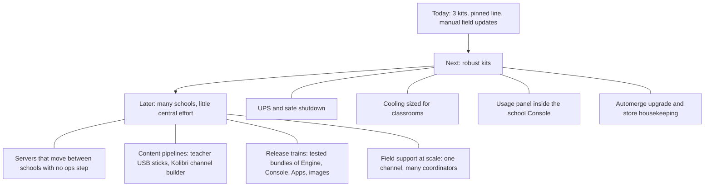

1. **Robust kits first.** Power protection, cooling and a safe shutdown path matter more than new features. The
   most common failures are physical.
2. **The school sees its own usage.** The same daily summaries that reach the programme dashboard can be shown to
   teachers inside the school, with no internet.
3. **Keep the shared store healthy as it ages.** Move to current Automerge releases, keep the document small, and
   keep the "same family" guarantee simple.
4. **Content that teachers bring.** A teacher's USB stick shows up read-only in Nextcloud and as a source for
   Kolibri channels; local content becomes as easy as plugging in a stick. The first pieces (the Engine's USB-stick
   detection and a Kolibri channel builder) exist; the end-to-end teacher experience is still being designed.
5. **Release trains.** Treat "Engine + Console + helper + Apps + images" as one tested bundle with a name, so
   that a field update is "move this kit to train N", with a recorded before-and-after.
6. **Scale without a central point.** More schools should mean more kits and disks, not more servers at home base.
   The hub stays optional; the kits stay self-sufficient.

## Open architectural questions

- One kit store for all schools, or one store per region or programme, as numbers grow?
- How far should remote updates go before a physical visit is still required?
- Which App-level data (if any) should ever be shared between schools?

# 11. Glossary

| Term | Meaning |
|---|---|
| App | A packaged educational application (Docker Compose plus `x-app` metadata). |
| App Disk | A disk that carries one or more Apps and their instances. |
| App Harness | Test framework that starts a real Engine in test mode against a fixture disk. |
| Automerge | The CRDT library behind the store; merges independent edits automatically. |
| Backup Disk | A disk holding Borg backups and its own `BACKUP.yaml` configuration. |
| Borg | The deduplicating backup tool used for App backups. |
| Console | The web interface served by every Engine. |
| Cover-all walk | An end-to-end test run over every Console and Engine path on real hardware. |
| CRDT | Conflict-free replicated data type: data that merges without a referee. |
| Disk ID | Permanent identifier of an IDEA disk, stored in its `META.yaml`. |
| Docking | Plugging a disk into an Engine, which mounts it and starts its instances. |
| Empty IDEA disk | A disk with an IDEA identity but no role yet. |
| Engine | The IDEA server software, and the school server running it. |
| Ephemeral message | A sync message that is relayed but never stored (heartbeats, progress). |
| Field update | A planned, approved move of a field kit to a new pinned software line. |
| Files Disk | A disk whose `files/` folder is shared into Apps such as Nextcloud. |
| Golden Pi | Development Pi that always runs the latest merged code. |
| Hub | IDEA's home-base server (`idea`): dashboard, collector, support tooling. |
| `idea.local` | Shared local web address answered by whichever Engine is present. |
| Identity file | Small private file that personalises a generic image at first boot. |
| Instance | One installed copy of an App with its own data. |
| Kit | Everything delivered to one school. |
| Kit store | The store family shared by all field Engines. |
| mDNS | Local-network name and service discovery; how Engines find each other. |
| Operation | A tracked long-running job (copy, move, backup, restore, update). |
| Peer gate | Forced SSH command that limits what another Engine may do. |
| pm2 | Process manager that keeps the Engine and `idea-usage` running. |
| Pool Pi | Development Pi claimed for tests and reviews. |
| Quarantine | Moving data aside instead of deleting it. |
| Root helper | `idea-app-data`, the only path to administrator actions. |
| Sticker name | Friendly two-word name of a device, such as `kind-panda`. |
| Store | The shared Automerge document describing the network. |
| Tailscale | Encrypted private network used for remote support and reporting. |
| `x-app` | IDEA's metadata block in an App's Compose file: the App contract. |
