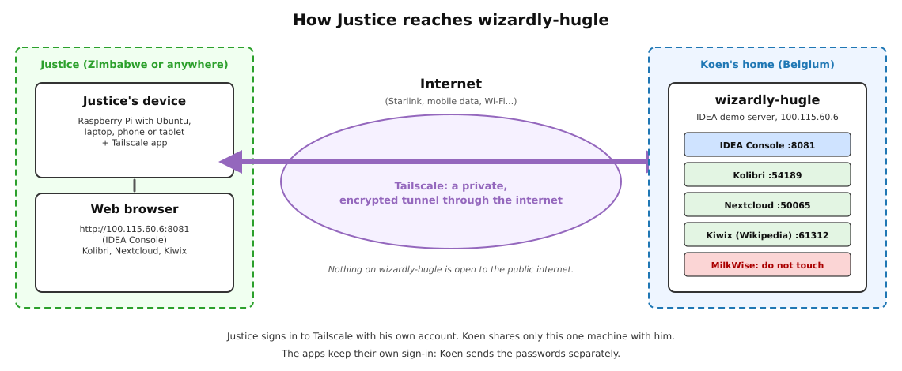
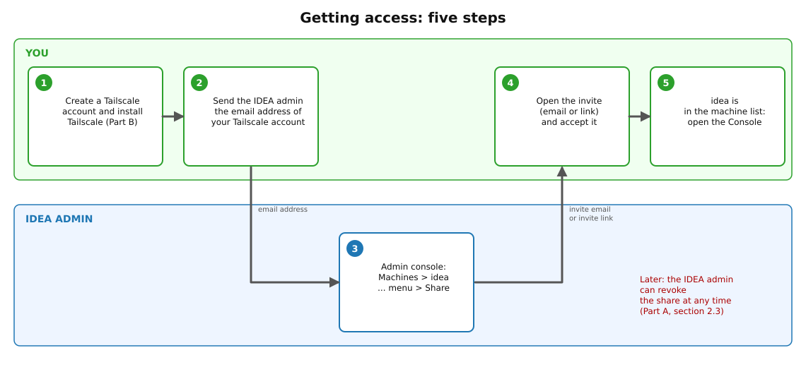
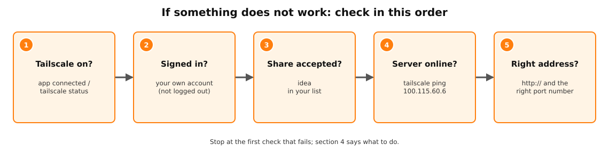
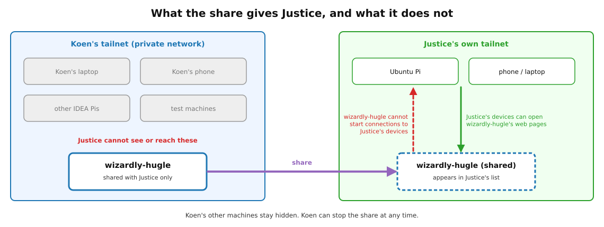

**Status:** Authoritative · **Maintained by:** Marco (with Atlas) · 22 October 2026 (v1.1: demo apps by default, Telegram support bot, Accounts and Passwords sheet for logins, cover version + date only, no personal names)

# How to use this guide

This guide explains how a field engineer can use the IDEA demo server, **wizardly-hugle**, from anywhere in the world: from Zimbabwe, from a hotel, or from home. Use it to give demos and to follow the teacher and operator tutorials without being in Belgium.

The guide has two parts:

- **Part A, for the IDEA admin** (section 2): share the one machine wizardly-hugle with the field engineer, and stop the share later. The IDEA admin is the person who manages the IDEA Tailscale network (tailnet).
- **Part B, for the field engineer** (sections 3 to 9): install Tailscale, accept the share, open the IDEA Console and the demo apps, get help from the IDEA support bot, and fix common problems.

Each step has:

1. **Do:** what to do.
2. **✔ Check:** how to see that it worked.

<div class="note" markdown="1">
**Logins: use the Accounts and Passwords sheet.** The usernames and passwords for the IDEA Console and the demo accounts in Kolibri and Nextcloud are in the private sheet **IDEA Kit: Accounts and Passwords**, the same one used for the school kits. All IDEA default passwords follow one rule: account name + `911!`. Keep the sheet private and do not leave it at a school.
</div>

<div class="warn" markdown="1">
**wizardly-hugle is also a real working server.** Next to the demo apps it runs **MilkWise**, a private app that is used every day. Use only the IDEA Console and the demo apps (Kolibri, Nextcloud, Wikipedia). **Never open, stop or remove MilkWise**, and never stop or remove any app that you did not install yourself. See section 9.
</div>

# 1. What this is and why

## 1.1 In plain words

wizardly-hugle is a Raspberry Pi in Belgium. It runs the same IDEA software as the school servers (Engines) that go to the schools: the **IDEA Console** and the apps **Kolibri**, **Nextcloud** and **Wikipedia** (offline, through Kiwix).

Like every Engine, wizardly-hugle comes with the **demo setup** on by default: a **Kolibri Demo** with the school "IDEA Demo School", class Grade 5, demo teachers and learners and some content, and Nextcloud with demo teachers and learners. You can show IDEA straight away, without creating accounts first.

wizardly-hugle is **not** open to the public internet. To reach it from far away, we use **Tailscale**. Tailscale is a free app that builds a private, encrypted connection ("tunnel") between devices over the normal internet. Each Tailscale user has their own private network of devices, called a **tailnet**.

- You install Tailscale on your own devices and sign in with **your own** Tailscale account. You get your own tailnet.
- The IDEA admin **shares** only the one machine wizardly-hugle with your account. You do **not** join the IDEA tailnet and cannot see its other devices.
- After that, you open wizardly-hugle's web pages in a normal web browser, using the address `100.115.60.6`.



## 1.2 The steps at a glance



## 1.3 What you need

| ☐ | What | Notes |
|---|---|---|
| ☐ | A device with a web browser | A Raspberry Pi with Ubuntu, or a Windows PC, Mac, Android phone or tablet, iPhone or iPad. |
| ☐ | Internet access | Any internet works: Starlink, mobile data, hotel Wi-Fi. |
| ☐ | A Google, Microsoft, Apple or GitHub account | Tailscale has no passwords of its own: you sign in with one of these accounts [3]. |
| ☐ | The IDEA Accounts and Passwords sheet | For the Console and demo logins. Not in this guide. |
| ☐ | Telegram (optional) | To chat with the IDEA support bot, section 7. |

## 1.4 The addresses

| Service | Address to type in the browser |
|---|---|
| IDEA Console | `http://100.115.60.6:8081` |
| Kolibri Demo | `http://100.115.60.6:54189` |
| Nextcloud | `http://100.115.60.6:50065` |
| Wikipedia (Kiwix, offline) | `http://100.115.60.6:61312` |

`100.115.60.6` is wizardly-hugle's Tailscale address. The number after the colon (`:8081` and so on) is the **port**: it chooses the app. These addresses only work while Tailscale is running and connected on your device.

<div class="part"><h1 class="parttitle" id="part-a">Part A: For the IDEA admin</h1></div>

# 2. Sharing wizardly-hugle with a field engineer

This part is for the IDEA admin. It takes about five minutes. The menu names below are from Tailscale's sharing documentation [1].

## 2.1 Before you start

1. **Do:** Wait for the field engineer's email with the address of **their** Tailscale account (Part B, section 3.1).
2. **Do:** Sign in to the Tailscale admin console at `https://login.tailscale.com/admin/machines` with the IDEA admin account. Only an **Owner**, **Admin** or **IT admin** of the tailnet can share a machine [1].
3. **Do:** Find wizardly-hugle on the **Machines** page. Type `100.115.60.6` in the search box.

<div class="note" markdown="1">
**Name in Tailscale.** In the IDEA Machines list, wizardly-hugle is currently listed under its Tailscale machine name **idea** (full name `idea.tail2d60.ts.net`), with the address `100.115.60.6`. The IDEA Console calls the same box wizardly-hugle. Always check the address `100.115.60.6` before you share, so you share the right machine.
</div>

**✔ Check:** you see one row with the address `100.115.60.6`.

## 2.2 Share the machine

**Option 1: share by email (recommended).** Tailscale sends the field engineer a single-use invite link [1].

1. **Do:** In the row of wizardly-hugle, select the **...** menu (three dots), then select **Share**. The **Share** dialog opens.
2. **Do:** Select the **Share by email** tab.
3. **Do:** Type the field engineer's email address.
4. **Do:** Select **Share**.

**Option 2: share with a link.** Use this if the email does not arrive.

1. **Do:** In the row of wizardly-hugle, select the **...** menu, then **Share**.
2. **Do:** Select the **Copy invite link** tab. Leave **Reusable link** switched **off**: the link is then single-use, so only one person can accept it.
3. **Do:** Select **Copy share link**. The link is now on your clipboard.
4. **Do:** Send the link to the field engineer in a private message (Telegram, Signal or email).

<div class="warn" markdown="1">
**Treat the invite link like a password.** Whoever accepts it first can reach wizardly-hugle [1]. Do not post it in a group chat. An unused invite link expires after **30 days** [1].
</div>

**✔ Check:** after the field engineer has accepted, their picture and email address appear in the **Share** dialog of wizardly-hugle, and the Machines list shows that wizardly-hugle is shared with an external user [1].

Make sure the field engineer has the IDEA Accounts and Passwords sheet. Never send it in the same message as the invite link.

## 2.3 Stop the share later (revoke)

Revoke the share when the field engineer no longer needs it, or at once if one of their devices is lost or stolen.

1. **Do:** Open the **Machines** page of the admin console.
2. **Do:** For wizardly-hugle, select the **...** menu, then **Share**.
3. **Do:** In the **Share** dialog, select the **...** menu next to the field engineer's invite, then select **Revoke invite** [1].

**✔ Check:** the field engineer's name is gone from the Share dialog. From now on they cannot reach wizardly-hugle. To give access again, send a new invite; they must accept the new one [1].

## 2.4 Good to know for the IDEA admin

- **The field engineer sees only this one machine.** A shared machine is visible only to the person who accepted it. The other IDEA machines stay hidden [1].
- **Quarantine.** A shared machine can answer connections from the field engineer, but it **cannot start** connections to their devices [1].
- **Access rules.** Sharing follows the access control policy of the IDEA tailnet [1]. If the field engineer sees wizardly-hugle but no page loads, check that the tailnet policy file allows their email address (or `autogroup:shared`) to reach `100.115.60.6` on ports 8081, 54189, 50065 and 61312 [1].
- **Key expiry.** If wizardly-hugle's Tailscale key expires, nobody can reach it until it signs in again. For an always-on server, Tailscale suggests **Disable key expiry** in the machine's **...** menu on the Machines page [2].
- **Keep the Pi on.** The field engineer can only use wizardly-hugle while it is powered on and online. Tell them before you switch it off or move it.

<div class="part"><h1 class="parttitle" id="part-b">Part B: For the field engineer</h1></div>

# 3. Setting up Tailscale on your devices

Do 3.1 once. Then install Tailscale on each device you want to use: 3.2 for your Raspberry Pi with Ubuntu, and 3.3 to 3.6 for other devices. Sign in with **the same account** on every device.

## 3.1 Create your Tailscale account

Tailscale has no passwords of its own. You sign in with an account you already have: **Google** (Gmail), **Microsoft** (Outlook, Hotmail), **Apple** or **GitHub** [3]. The first time you sign in, Tailscale creates your own tailnet. You do this during the install on your first device (3.2, step 5).

- Use a **personal** address such as Gmail or Outlook. With such an address Tailscale puts you on the free **Personal** plan [4].
- If you sign in with a work or school address that has its own domain, Tailscale starts a business trial instead [4]. Avoid this.

**Do:** Send the IDEA admin the email address of the account you will use for Tailscale, for example "my Tailscale account is the Gmail address ...". The admin needs it to share wizardly-hugle with you (Part A).

**✔ Check:** the IDEA admin has your email address.

## 3.2 Install on Ubuntu (your Raspberry Pi)

These commands come from Tailscale's Linux install guide [2]. They work on Ubuntu on a Raspberry Pi. You need internet and the password of your Ubuntu user (for `sudo`).

1. **Do:** Open a terminal: press **Ctrl + Alt + T**.

2. **Do:** Make sure `curl` (a small download tool) is installed:

```
sudo apt update
sudo apt install -y curl
```

**✔ Check:** the last line says `curl` is already the newest version, or that it was installed.

3. **Do:** Install Tailscale with the official install script:

```
curl -fsSL https://tailscale.com/install.sh | sh
```

The script asks for your Ubuntu password. Type it and press **Enter** (the password does not show while you type).

**✔ Check:** the script ends without an error message. `tailscale version` now prints a version number.

4. **Do:** Start Tailscale:

```
sudo tailscale up
```

**✔ Check:** the terminal shows `To authenticate, visit:` followed by a web address that starts with `https://login.tailscale.com/`.

5. **Do:** Open that web address in a browser: right-click it and choose **Open Link**, or copy it into the browser. Sign in with the account from 3.1 (for example **Sign in with Google**) and confirm that you want to connect this device. If your Pi has no browser, you can type the address on your phone instead.

**✔ Check:** the terminal prints `Success.` [2].

6. **Do:** Check that your Pi is in your tailnet:

```
tailscale status
tailscale ip -4
```

**✔ Check:** `tailscale status` shows a line with your own Pi and a `100.x.y.z` address. `tailscale ip -4` prints that address [2].

<div class="note" markdown="1">
**After a reboot** Tailscale starts again by itself; you do not need to run `sudo tailscale up` every time. To disconnect for a while, run `sudo tailscale down`; to connect again, run `sudo tailscale up` [5].
</div>

## 3.3 Install on Windows

Tailscale needs Windows 10 or later [6].

1. **Do:** Download the Windows installer (`.exe`) from `https://tailscale.com/download` and run it.
2. **Do:** A Tailscale icon appears in the system tray (bottom right, next to the clock; select the small up arrow if you do not see it). Right-click the icon.
3. **Do:** Select **Log in**. A browser window opens. Sign in with the account from 3.1 [6].

**✔ Check:** right-click the tray icon again: it shows your account and that Tailscale is connected.

## 3.4 Install on macOS

Tailscale needs macOS 12 (Monterey) or later [7].

1. **Do:** Download Tailscale from `https://tailscale.com/download` (or from the Mac App Store) and install it.
2. **Do:** Open Tailscale and follow the steps on screen. Allow the **VPN configuration** when the Mac asks.
3. **Do:** Sign in with the account from 3.1 [7].

**✔ Check:** the Tailscale icon in the menu bar at the top of the screen shows that you are connected.

## 3.5 Install on Android

Tailscale needs Android 8.0 or later [8].

1. **Do:** Install **Tailscale** from the Google Play Store.
2. **Do:** Open the app and tap **Get Started**. Accept the request to add a **VPN configuration** and allow notifications [8].
3. **Do:** Tap **Sign in with Google**, or **Sign in with other** for a Microsoft, Apple or GitHub account [8]. Use the account from 3.1.

**✔ Check:** the app shows that you are connected, and a list of your devices.

## 3.6 Install on iPhone or iPad

Tailscale needs iOS 15 or later [9].

1. **Do:** Install **Tailscale** from the App Store.
2. **Do:** Open the app and tap **Get Started**. Accept the request to add a **VPN configuration** and allow notifications [9].
3. **Do:** Tap **Log in** and sign in with the account from 3.1 [9].

**✔ Check:** the app shows that you are connected and lists your devices.

<div class="note" markdown="1">
**Phones and tablets allow only one VPN at a time.** If you use another VPN app, switch it off while you use Tailscale.
</div>

# 4. Accepting the share invite

The IDEA admin sends you an invite (Part A). It comes as an **email from Tailscale**, or as a **link** in a private message.

1. **Do:** Open the invite link (in the email, or the link you were sent) in a web browser.
2. **Do:** If Tailscale asks you to sign in, sign in with **the same account that you use on your devices** (3.1). The invite does not have to match the email address it was sent to: it is added to whichever Tailscale account accepts it [1].
3. **Do:** Read the invitation and accept it.

**✔ Check:** wizardly-hugle now appears in your list of machines: on the **Machines** page of your own admin console (`https://login.tailscale.com/admin/machines`) and in the Tailscale app on your devices [1]. It is listed with the address `100.115.60.6` and the name **idea** (the name it has in the IDEA tailnet), shown as shared with you.

<div class="warn" markdown="1">
**Each invite works once.** An invite sent by email, or a single-use link, can be accepted only once and expires after 30 days if it is not used [1]. If you accepted it with the wrong account, or it has expired, ask the IDEA admin for a new invite.
</div>

# 5. Checking that it works

## 5.1 On your Ubuntu Pi (terminal)

1. **Do:** Run:

```
tailscale status
```

**✔ Check:** there is a line with `100.115.60.6`, the name `idea.tail2d60.ts.net` and the IDEA account as the owner [1]. If the line ends in `offline`, wizardly-hugle is switched off or has no internet (see 8.5).

2. **Do:** Test the connection:

```
tailscale ping 100.115.60.6
```

**✔ Check:** you see lines that start with `pong from`. The first ones may say `via DERP(...)`; that is normal while Tailscale looks for the fastest route [10]. Press **Ctrl + C** to stop if it keeps going.

The normal `ping 100.115.60.6` also works; it shows lines with `time=... ms`. Press **Ctrl + C** to stop it.

## 5.2 On a phone, tablet, Windows PC or Mac

1. **Do:** Open the Tailscale app and look at the list of machines.

**✔ Check:** wizardly-hugle (listed as **idea**, address `100.115.60.6`) is in the list. Then go straight to section 6: if the IDEA Console opens, everything works.

<div class="note" markdown="1">
**Use the number `100.115.60.6`.** In rare cases, Tailscale gives a shared machine a different `100.x.y.z` address in your tailnet, because your tailnet already uses that number [1]. If the address shown for wizardly-hugle (idea) in your Tailscale app is not `100.115.60.6`, use the address shown in the app everywhere in this guide, and tell IDEA support (section 7).
</div>

# 6. Opening the IDEA Console and the apps

## 6.1 The IDEA Console

1. **Do:** Make sure Tailscale is connected on your device (section 5).
2. **Do:** Open a web browser (Firefox, Chrome, Safari or Edge) and type exactly:

```
http://100.115.60.6:8081
```

Type `http://`, not `https://`, and do not forget `:8081`.

3. **Do:** Wait. At the top the Console first says **Connecting…**. After a few seconds (up to half a minute on a slow connection) it connects and the **Apps** page shows one card per app, including the demo apps **Kolibri Demo**, **Nextcloud** and **Wikipedia**, and **MilkWise**.

**✔ Check:** the page title is **IDEA Console** and the app cards are visible.

4. **Do:** To open an app, click the blue **Open** button on its card. The app opens in a new browser tab, at the `100.115.60.6` address with the app's own port (for example `http://100.115.60.6:54189/...` for Kolibri).

<div class="warn" markdown="1">
**Do not click Open on MilkWise.** Use only the demo app cards. Do not use **Stop**, **Remove**, **Erase** or **Back up** on wizardly-hugle unless IDEA support has asked you to (section 9).
</div>

You can use the Console without logging in. Operator tasks need **Operator Login** (person icon, top right); the login is in the Accounts and Passwords sheet.

## 6.2 Kolibri Demo

1. **Do:** Click **Open** on the **Kolibri Demo** card, or type `http://100.115.60.6:54189`.

**✔ Check:** the Kolibri sign-in page opens. Choose the school **IDEA Demo School** and sign in with a demo account, for example `teacher1` (coach of class Grade 5) or `learner1` (learners type their username only, no password). All demo accounts are in the Accounts and Passwords sheet.

## 6.3 Nextcloud

1. **Do:** Click **Open** on the **Nextcloud** card, or type `http://100.115.60.6:50065`.

**✔ Check:** the Nextcloud sign-in page opens (the address ends in `/login`). Sign in with a demo account from the Accounts and Passwords sheet, for example `teacher1`.

<div style="page-break-before: always"></div>

## 6.4 Wikipedia (offline)

1. **Do:** Click **Open** on the **Wikipedia** card, or type `http://100.115.60.6:61312`.

**✔ Check:** the Kiwix library opens and shows the available books, such as Wikipedia. It needs no login.

## 6.5 Bookmarks

Save these addresses as bookmarks in your browser (press **Ctrl + D**, or **⌘ + D** on a Mac), so you do not need to type them again.

| Bookmark name | Address | Sign in with |
|---|---|---|
| IDEA Console (demo) | `http://100.115.60.6:8081` | No login; Operator Login from the sheet |
| Kolibri Demo | `http://100.115.60.6:54189` | IDEA Demo School, e.g. `teacher1` |
| Nextcloud (demo) | `http://100.115.60.6:50065` | Demo account, e.g. `teacher1` |
| Wikipedia (demo) | `http://100.115.60.6:61312` | No login |

The bookmarks work only while Tailscale is connected on that device.

## 6.6 Following the tutorials remotely

The teacher tutorial (**IDEA for Teachers**) was made with screenshots of wizardly-hugle, so what you see matches the tutorial.

- Where a tutorial gives a Console address, use `http://100.115.60.6:8081`.
- The tutorial tells teachers not to type ports and to use **Open** in the Console. That rule is for teachers at school. For you, working remotely, the bookmarks in 6.5 are fine.
- The teacher tutorial (Kolibri, Nextcloud, Wikipedia offline) can be followed on wizardly-hugle with the demo accounts. Use only the demo apps and demo accounts.
- The operator tutorial (**IDEA for Operators**) covers Files Disk, Backup Disk and other operator tasks that need USB disks plugged into the server. You cannot do that remotely. On wizardly-hugle, only look at those screens; practise the disk steps on an Engine in front of you.

# 7. Getting help: the IDEA support bot

IDEA support answers you in a private Telegram chat with the bot **@IDEA_SupportBot** (`https://t.me/IDEA_SupportBot`). Email to `idea-support@agentmail.to` also works, but Telegram is faster.

1. **Do:** Install Telegram on your phone, open `https://t.me/IDEA_SupportBot` and press **Start**.

**✔ Check:** the bot answers that you need to be approved first. Once the IDEA admin approves you, the bot tells you that you can write any time.

2. **Do:** Write your question in plain words. Say which machine it is about (wizardly-hugle, or the name on an Engine's sticker) and what the screen shows. Photos help.

**✔ Check:** the bot answers within a few minutes. Simple fixes it answers by itself, naming the manual section. For anything else it says it has passed the question on, and comes back to you with the answer.

<div class="warn" markdown="1">
**Never send passwords through Telegram or email.** Bot chats are not end-to-end encrypted. For logins, use the Accounts and Passwords sheet.
</div>

# 8. Troubleshooting



## 8.1 Tailscale is not connected or you are logged out

**What you see:** no page opens; the Tailscale app says you are logged out or disconnected; or `tailscale status` prints `Logged out.` or `Tailscale is stopped.` [5].

**What to do:**

1. On Ubuntu, run `sudo tailscale up`. If it shows a web address, open it and sign in again with **your** account (3.2, step 5).
2. On Windows, Mac, Android or iPhone, open the Tailscale app and switch it on, or select **Log in** again.

**✔ Check:** `tailscale status` lists your devices again, or the app shows that you are connected.

## 8.2 wizardly-hugle is not in your machine list

**Possible causes:** the invite was not accepted yet; it was accepted with a different Tailscale account; the invite expired (30 days); or the share was revoked.

**What to do:**

1. Check which account is signed in on your device (Tailscale app, or the account column in `tailscale status`). It must be the account that accepted the invite.
2. Open the invite again and accept it (section 4).
3. If the link does not work any more, ask the IDEA admin for a new invite.

## 8.3 `tailscale up` says you need sudo

**What you see:** `tailscale up` stops with a permission error and the hint `Use 'sudo tailscale up'.` [5].

**What to do:** type the command again with `sudo` in front: `sudo tailscale up`, and enter your Ubuntu password. Commands that only read, such as `tailscale status` and `tailscale ping`, work without `sudo`.

## 8.4 The page does not load

**What you see:** the browser waits for a long time, or says that the site cannot be reached.

**What to do, in this order:**

1. Is Tailscale connected on **this** device? (8.1)
2. Check the address: `http://` (not `https://`), `100.115.60.6`, a colon, and the right port (`8081`, `54189`, `50065` or `61312`).
3. On a phone: is another VPN app switched on? Switch it off.
4. Test the connection with `tailscale ping 100.115.60.6` (5.1). If you get `pong from`, the connection works; reload the page, or try the Console instead of the app.
5. If the Console stays on **Connecting…** for more than a minute, reload the page (**F5**, or **Ctrl + R**).
6. If the ping works but no page loads at all, tell IDEA support (section 7): the access rules may need a check (2.4).

## 8.5 wizardly-hugle is switched off, asleep or offline

**What you see:** `tailscale status` shows `offline` on the line of wizardly-hugle (`100.115.60.6`), or `tailscale ping` gets no `pong`; the Tailscale app shows the machine as offline.

**What to do:** there is nothing you can fix from your side. The Pi in Belgium may be switched off, restarting, or its internet may be down. Message IDEA support (section 7) and try again later. Remember the time difference: until 25 October 2026 (Belgian summer time) Belgium and Zimbabwe have the same time; after that, Belgium is one hour behind Zimbabwe until the end of March.

## 8.6 Everything is very slow

**Why:** when Tailscale cannot make a direct connection between your device and wizardly-hugle, it sends the traffic through one of its relay servers (called **DERP**). This is common on Starlink, mobile data and hotel Wi-Fi. The connection is still encrypted, but it is slower [10].

**How to see it:** `tailscale status` shows `relay` on the line of wizardly-hugle (for example `relay "ams"`), and `tailscale ping 100.115.60.6` keeps saying `via DERP(...)`. When it says `direct`, or `via` followed by an address, the connection is direct [10].

**What to do:**

1. Wait a minute: Tailscale keeps trying to switch to a direct connection [10].
2. Try another network if you can (for example mobile data instead of hotel Wi-Fi).
3. For demos, prefer light pages (Wikipedia articles, Kolibri exercises) over large videos.

# 9. Do's and don'ts, and privacy

## 9.1 Do's and don'ts

| Do | Don't |
|---|---|
| Use the IDEA Console and the demo apps for demos and for the tutorials. | Never open, stop or remove **MilkWise**. It is a private app in daily use. |
| Use only the demo apps and demo accounts. | Never stop or remove an app that you did not install yourself. |
| Ask IDEA support before you change settings, install an app or use any button that changes the server. | Do not use **Erase**, **Back up** or **Restore** on wizardly-hugle unless IDEA support asks you to. |
| Keep the Accounts and Passwords sheet private. | Do not write passwords on a school wall or in a chat. |
| Tell IDEA support at once if a device with Tailscale is lost or stolen, so the share can be revoked. | Do not forward the invite link to anyone else. |
| Switch Tailscale off on a shared or school computer when you are done (`sudo tailscale down` on Ubuntu). | Do not sign in to your Tailscale account on a computer that students use. |

<div style="page-break-before: always"></div>

## 9.2 Privacy: what each side can see



- **You see only wizardly-hugle.** The IDEA admin shares this one machine. You cannot see or reach the other IDEA devices [1].
- **wizardly-hugle cannot reach your devices.** A shared machine is quarantined: it can answer your connections, but it cannot start a connection to your devices [1].
- **What the IDEA admin sees about you.** When you accept the invite, the IDEA admin sees your email address and profile picture, so that they know who accepted [1].
- **Your own tailnet stays yours.** Your own devices are in your own tailnet. The IDEA admin cannot see them or reach them.
- **The IDEA admin can stop the share at any time** (Part A, 2.3). If that happens, wizardly-hugle disappears from your list; ask IDEA support if you need access again.

# Appendix A. Quick reference

| Task | How |
|---|---|
| Install on Ubuntu | <code>curl -fsSL https://tailscale.com/install.sh &#124; sh</code> |
| Connect (Ubuntu) | `sudo tailscale up` |
| Disconnect (Ubuntu) | `sudo tailscale down` |
| Is wizardly-hugle visible and online? | `tailscale status` (line with `100.115.60.6`) |
| Test the connection | `tailscale ping 100.115.60.6` |
| IDEA Console | `http://100.115.60.6:8081` |
| Kolibri Demo | `http://100.115.60.6:54189` |
| Nextcloud | `http://100.115.60.6:50065` |
| Wikipedia (Kiwix, offline) | `http://100.115.60.6:61312` |
| Logins | IDEA Kit: Accounts and Passwords sheet (rule: account name + `911!`) |
| Support | Telegram `@IDEA_SupportBot` (`https://t.me/IDEA_SupportBot`) or `idea-support@agentmail.to` |
| Problems | Section 8; then message IDEA support |

# Appendix B. Sources (read on 13 October 2026)

1. Tailscale, "Share your machines with other users", `https://tailscale.com/kb/1084/sharing`
2. Tailscale, "Install Tailscale on Linux", `https://tailscale.com/kb/1031/install-linux`
3. Tailscale, "Supported SSO identity providers", `https://tailscale.com/kb/1013/sso-providers`
4. Tailscale, "Pricing" (Personal plan, FAQ), `https://tailscale.com/pricing`
5. Tailscale, "Tailscale CLI", `https://tailscale.com/kb/1080/cli`, and the Tailscale client source code (`cmd/tailscale/cli`) on GitHub for the exact messages
6. Tailscale, "Install Tailscale on Windows", `https://tailscale.com/kb/1022/install-windows`
7. Tailscale, "Install Tailscale on macOS", `https://tailscale.com/kb/1016/install-mac`
8. Tailscale, "Install Tailscale on Android", `https://tailscale.com/kb/1079/install-android`
9. Tailscale, "Install Tailscale on iOS", `https://tailscale.com/kb/1020/install-ios`
10. Tailscale, "Connection types", `https://tailscale.com/kb/1257/connection-types`

The addresses and ports were checked again on wizardly-hugle itself on 22 October 2026.
