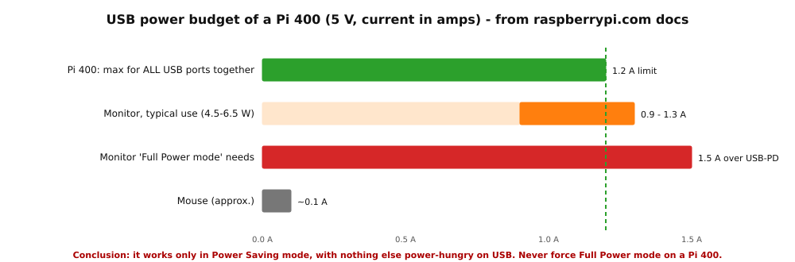
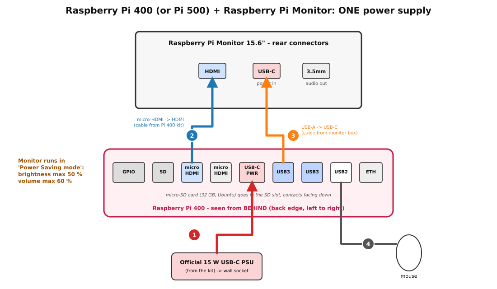
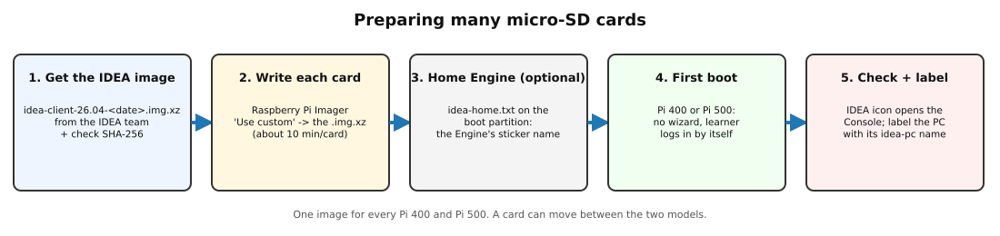

**Status:** Authoritative (follows the student client image proposal and the student client browser proposal; the client image is not yet boot-tested on hardware, see the README) · **Maintained by:** Marco (with Atlas) · 15 October 2026 (IDEA client image, Pi 400 and Pi 500, Chrome, IDEA shortcut)

# How to use this manual

This manual sets up one classroom computer: a Raspberry Pi 400 or Raspberry Pi 500 keyboard computer with the official 15.6" Raspberry Pi Monitor, running the **IDEA client image** (Ubuntu Desktop 26.04 with everything already set up). The same image works on both models. The computer opens the school's IDEA Console. Each step has:

1. **Do:** what to do.
2. **✔ Check:** how to see that it worked.

<b>No secrets in this manual.</b>
<ul>
<li>Every school uses the same addresses (<i>IDEA School Server: Installation Manual</i>). The Console is at <code>http://idea.local</code>, whichever and however many Engines the school has.</li>
<li>IDEA default passwords follow the public convention <code>&lt;name&gt;911!</code>: the account or network name followed by <code>911!</code>. The student account <code>learner</code> has <b>no</b> password.</li>
<li><code>&lt;SCHOOL&gt;</code>: the school name, for labels only. <code>&lt;STICKER&gt;</code>: the two-word sticker name of an Engine, for example <code>brave-otter</code>.</li>
</ul>

# 1. What is in the boxes

## 1.1 Raspberry Pi 400 kit (or Pi 500 kit) (bol.com, "Raspberry Pi 400 kit, muis, 16GB microSD, English guide, QWERTY")

The bol.com page could not be opened from our tools (bol.com blocks automated access). The list below is the
<b>official Raspberry Pi 400 kit</b> contents from raspberrypi.com [1]. Check it against the box.

| ☐ | Item | Use it? |
|---|---|---|
| ☐ | Raspberry Pi 400 (English QWERTY keyboard, 4 GB) | Yes |
| ☐ | Official 15 W USB-C power supply (5.1 V / 3 A) | Yes: it powers the Pi **and** the monitor |
| ☐ | Raspberry Pi USB mouse | Yes |
| ☐ | 16 GB microSD card with Raspberry Pi OS on it | **Keep it** as a rescue card (EEPROM update, 6.1). The IDEA image goes on Koen's **32 GB** cards. |
| ☐ | micro-HDMI to HDMI cable | Yes: Pi 400 → monitor |
| ☐ | *Beginner's Guide* book | Optional |

**Raspberry Pi 500 kit:** the same items, but with the **27 W** USB-C power supply (5.1 V / 5 A). Use that supply with a Pi 500. Everything else in this manual is the same for both models; where they differ, it says so.

Check the **plug** of the power supply. Kits sold in Belgium usually have the European (Type C/E/F) plug. Zimbabwe uses Type G (UK-style) and Type D sockets, so bring a good adapter for each computer, or a power strip that takes EU plugs.

## 1.2 Raspberry Pi Monitor 15.6" red/white (Kiwi Electronics, SC0940)

From the Kiwi product page [2] and the Raspberry Pi docs [3]:

| ☐ | Item |
|---|---|
| ☐ | Monitor: 15.6", 1920 × 1080 IPS, built-in stand, 2 × 1.2 W speakers |
| ☐ | **USB-A to USB-C cable** (for power). This is the only cable in the box: there is **no HDMI cable** and **no power supply**. |

Monitor connectors: **HDMI** in (standard size, HDMI 1.4), **USB-C** (power in only), **3.5 mm** audio out. On the back are buttons for standby, brightness up/down and volume up/down.

## 1.3 From Koen

| ☐ | Item |
|---|---|
| ☐ | One **32 GB microSD card** for each computer (fast, A1/A2 class is best). |
| ☐ | Stickers or a marker for labels: school name, computer number |

# 2. Power: one power supply for the computer and the monitor

Koen wants **one** power supply per workstation. That works. Here is what the Raspberry Pi documentation says:

* **The monitor can be powered from the Pi.** "If you're using an official Raspberry Pi Monitor, you can connect your monitor to power through a USB cable connected to your Raspberry Pi keyboard computer. When you power on your keyboard computer, it then provides power to the Raspberry Pi Monitor." [1]
* **But only in Power Saving mode.** "When powered from a Raspberry Pi, the Monitor operates in Power Saving mode, since Raspberry Pi devices cannot provide 1.5 A of current over a USB-A connection." In Power Saving mode, brightness is limited to **0-50 %** and speaker volume to **0-60 %**. [3]
* **Full Power mode** (100 % brightness and volume) needs a USB-PD source with **at least 1.5 A** [3]. A Pi 400 can give its USB ports **1.2 A in total** [4].
* The monitor uses **4.5-6.5 W** while on [3], which is about 0.9-1.3 A at 5 V.
* A **Pi 500** on its 27 W supply can give its USB ports more current (1.6 A in total) [4], but the monitor still runs in Power Saving mode from a USB-A port. The rules below apply to both models.

<b>Rules for the one-power-supply setup</b>
<ol>
<li>Use the <b>official</b> Raspberry Pi USB-C supply from the kit: 15 W (5.1 V / 3 A) for a Pi 400 [5], 27 W (5.1 V / 5 A) for a Pi 500. Never use a phone charger.</li>
<li>Plug <b>nothing else power-hungry</b> into the Pi 400's USB ports: only the mouse (and at most a USB stick). The monitor and mouse together are already close to the 1.2 A limit.</li>
<li><b>Never force Full Power mode</b> on a monitor powered by a Pi 400. That is done by holding brightness-up for 3 seconds [3]. It would ask for more current than the Pi can give.</li>
<li>If the monitor <b>flashes on and off</b>, or the Pi shows a lightning-bolt/under-voltage warning, the supply can't keep up. Turn brightness and volume down. If that doesn't help, give the monitor its own USB-C power supply (a second official 15 W supply works) [3].</li>
</ol>

## 2.1 Wiring

The diagram shows a Pi 400. A Pi 500 has the same ports in the same order on its back edge.

| Cable | From | To |
|---|---|---|
| 1 | Official 15 W PSU (wall socket) | Pi 400 **USB-C power** port |
| 2 | Pi 400 **micro-HDMI** port, the one next to the microSD slot | Monitor **HDMI** (cable from the Pi 400 kit) |
| 3 | Pi 400 **USB 3.0** port (blue) | Monitor **USB-C** (USB-A → USB-C cable from the monitor box) |
| 4 | Mouse | Pi 400 **USB 2.0** port (white). Raspberry Pi recommends the white port for the mouse [1]. |

The back edge of the Pi 400, seen from **behind**, left to right: GPIO, microSD, micro-HDMI, micro-HDMI, USB-C power, USB 3.0, USB 3.0, USB 2.0, Ethernet. Small icons are printed next to each port. If you get no picture, move cable 2 to the other micro-HDMI port.

**Do (in this order):**

1. Put the 32 GB microSD card in the slot, contacts facing down (only after section 5).
2. Connect cable 2 (HDMI), cable 3 (monitor power) and cable 4 (mouse).
3. Connect cable 1 (power) **last**. The Pi 400 starts at once. Later you switch it on and off with **Fn + F10** [1].

**✔ Check:**

* The Pi 400's LED lights up. Within 10-20 seconds the monitor shows a picture (rainbow/boot screen or Ubuntu logo).
* Press the monitor's brightness-up button: the on-screen bar stops at 50. That is Power Saving mode, as expected.
* The picture stays stable for 5 minutes with no flashing.

# 3. The IDEA client image

Every classroom computer runs the same **IDEA client image**. It is the official Ubuntu Desktop **26.04.1 LTS** for Raspberry Pi with the IDEA settings built in. There is **no Ubuntu setup wizard** and nothing to configure by hand.

| What | In the IDEA client image |
|---|---|
| Models | **One image for the Pi 400 and the Pi 500.** It picks the right display settings for each model at boot, so a card can move between a Pi 400 and a Pi 500. |
| Student account | `learner`, logs in **automatically**, **no password**. It cannot change Wi-Fi, install software, add users or change the time. |
| Admin account | `admin` (hidden from the login screen), password `admin911!`. The password only works at the keyboard: remote login (SSH) accepts the IDEA support keys only. |
| Browser | **Google Chrome** is the only browser (Firefox is removed). Google is the default search engine. Chrome asks no first-run questions and never offers to save passwords. |
| The IDEA icon | One **IDEA** icon on the desktop and in the dock (the app bar on the left). It opens the IDEA start page, which finds the Console (section 6.3). Chrome also opens the start page as its home page. |
| Apps | LibreOffice (Writer, Calc, Impress), GCompris, Tux Paint, TuxMath, TuxType, KTurtle, Kalzium, Marble, Stellarium and a few games. No app asks first-start questions. |
| No pop-ups | No "choose a password for the new keyring", no Ubuntu welcome tour, no LibreOffice or GCompris first-start questions. |
| Updates | **Off.** The computer never updates itself, so it stays as tested. The IDEA team updates by giving you a new image. |
| Computer name | Set at first boot: `idea-pc-` plus the last 4 characters of the Pi's serial number, for example `idea-pc-3f2a`. |
| Wi-Fi | Joins the school's student Wi-Fi `IDEA` (password `idea911!`) by itself. |
| Keyboard, time zone | English (UK) keyboard layout, time zone Harare (Africa/Harare). |

The IDEA client image needs a Pi 400 bootloader (EEPROM) dated <b>2022-11-25 or later</b> [6]. New kits almost always meet this. If a Pi 400 won't boot, update the EEPROM with the kit's 16 GB Raspberry Pi OS card (6.1). A Pi 500 is always new enough.

# 4. Install Raspberry Pi Imager (on Ubuntu, Mac or Windows)

| Your computer | How |
|---|---|
| Ubuntu | `sudo snap install rpi-imager` [6], or `sudo apt install rpi-imager` |
| macOS / Windows | Download it from `https://www.raspberrypi.com/software/` and install it |

The current Imager is **2.0.12** (8 Oct 2026).

**✔ Check:** Imager starts and shows the steps *Device → OS → Storage*.

# 5. Write the microSD cards

## 5.1 Get the IDEA client image

The IDEA team (Koen or Atlas) gives you the image file with its checksum file:

* `idea-client-26.04-<DATE>-<VERSION>.img.xz` (a few GB)
* `idea-client-26.04-<DATE>-<VERSION>.img.xz.sha256`

Copy both to your computer once, on a good connection in Belgium. Use the **same file for every card**.

**✔ Check:** in the folder with both files, `sha256sum -c idea-client-26.04-*.img.xz.sha256` prints `OK`.

## 5.2 Write one card with Imager

1. Put a 32 GB card in your card reader.
2. Imager → **Device:** *Raspberry Pi 4* for a Pi 400, *Raspberry Pi 5* for a Pi 500. (The card works in both; this only affects Imager's own menu.)
3. **OS:** *Use custom* → pick the `idea-client-…img.xz` file.
4. **Storage:** the 32 GB card. Check the size so that you don't overwrite your own disk!
5. If Imager offers **OS customisation**, choose **No**: the image already has all its settings.
6. Click **Write**, confirm that the card will be erased, and wait for **writing and verification** to finish (about 10-15 minutes).

**✔ Check:** Imager says *Write successful*.

## 5.3 (Optional) Give the computer a home Engine

A computer can have a **home Engine**: the Engine its IDEA icon tries first. Without one, the start page simply uses `idea.local`, which works at every school. Later the Console's Flash step will write the home Engine for you; until then you can do it by hand:

1. Take the card out and put it back in, so your computer shows the small boot partition (called `system-boot`).
2. In it, create a plain text file **`idea-home.txt`** with one line: the sticker name of the Engine, for example `brave-otter` (no `http://`, no `.local`).
3. Eject the card safely.

**✔ Check:** after the first boot, the IDEA start page opens that Engine's Console (6.3).

## 5.4 Batch tips for many cards

* Imager writes one card at a time. With 2-3 USB card readers you can run a second Imager window on a second reader. Watch the **Storage** choice every time.
* On Linux you can also write from the command line with `rpi-imager --cli <image.img.xz> /dev/sdX`. Check `/dev/sdX` with `lsblk` first: a wrong letter erases the wrong disk. **Test first** on one card.
* No "golden card" is needed any more: every card written from the IDEA image is already complete, and each computer gives itself its own name and identity at first boot.
* Keep the kit's **16 GB Raspberry Pi OS cards** in a labelled bag. They are your EEPROM-rescue cards.

# 6. First boot

## 6.1 (Only if a Pi 400 won't boot) Update the EEPROM with the kit card

1. Put the kit's **16 GB Raspberry Pi OS** card in the Pi 400 and boot it. Its own setup wizard will appear: complete it with any user.
2. Open a terminal and run `sudo rpi-eeprom-update`. It shows the current bootloader date.
3. If the date is older than 2022-11-25, run `sudo rpi-eeprom-update -a`, then `sudo reboot` (the reboot does the flashing) [6].

**✔ Check:** `sudo rpi-eeprom-update` now shows a date of 2022-11-25 or later. Swap back to the IDEA card.

## 6.2 Start the computer

1. Put the IDEA card in (contacts facing down). Wire it as in 2.1 and connect power last.
2. The first boot takes a few minutes: the card's partition is grown, and the computer gives itself its name and new keys. It may restart once.
3. The desktop of the `learner` account opens by itself. There is no wizard and no password.

**✔ Check:** you see the desktop with the **IDEA** icon, and the IDEA icon in the dock on the left. No pop-up asks for anything.

## 6.3 The IDEA icon and the start page

Click the **IDEA** icon (desktop or dock). Chrome opens the **IDEA start page**, which looks for the Console in this order, and opens the first one that answers:

1. the computer's **home Engine** (5.3), if it has one;
2. the **last Engine** that worked on this computer;
3. **`http://idea.local`**: the IDEA router answers it with the Engines that are switched on, so it works with one Engine or many.

The start page always has a **sticker-name field**. If no Engine answers, it says so in plain words (never a browser error) and asks for a sticker name: type the name on any Engine's sticker, for example `brave-otter`, and press Enter.

The Console lists **every** Engine of the school, whichever one you opened.

**✔ Check:** the IDEA Console opens within a few seconds and lists every Engine of the school.

## 6.4 The manual way: open the Console by its sticker name

This always works, also on a laptop, a phone or a computer without the IDEA image:

1. In any browser, type **`http://<STICKER>.local`**, the sticker name of any Engine, for example `http://brave-otter.local` (http, not https).
2. Set that address as the browser's **home page**, or ★ **bookmark** it.

`http://idea.local` works the same way. Sticker names work from the Wi-Fi too: the IDEA router passes them on between the wired network and the Wi-Fi.

## 6.5 Wi-Fi: IDEA or IDEA-Teachers

The pre-flashed IDEA school router creates two Wi-Fi networks (*IDEA School Server: Installation Manual*, "The school router's Wi-Fi networks and default passwords"). The passwords are the IDEA defaults until the school changes them:

| Who uses this computer | Network |
|---|---|
| Students (default) | `IDEA`, password `idea911!`: Console and apps only, no internet |
| Teacher's computer | `IDEA-Teachers`, password `idea-teachers911!`: Console and apps, plus internet when the teacher rule is on (off by default) |

The IDEA image already joins `IDEA`. Only a computer that the head teacher names for a teacher gets `IDEA-Teachers`. The learner account cannot change Wi-Fi, so an admin adds it: top-right menu → Wi-Fi → `IDEA-Teachers`, and give the `admin` password when Ubuntu asks. Never type the `IDEA-Teachers` password on a student computer.

If the school has changed the `IDEA` password (*IDEA School Server: Installation Manual*, "Tell the school, and change the default passwords"), an admin enters the new one on each computer: top-right menu → Wi-Fi → `IDEA` → forget, then join again.

**Preparing in Belgium:** the IDEA network isn't there yet. You can test with a laptop hotspot or a spare IDEA router. No updates are needed: the image is complete.

**✔ Check:** at school, the Wi-Fi icon shows "IDEA". Ubuntu may say "limited connectivity" or show no internet: that is **normal** on IDEA.

## 6.6 The admin account

You need `admin` only for repairs. On the login screen choose **Not listed?**, type `admin` and the password `admin911!`. Or, in a terminal of the learner account: `su - admin`.

Change it later like every IDEA default: the head teacher can pick a new admin password (`passwd` as admin).

## 6.7 Final touches

* Power off with **Fn + F10** (both models), or the system menu → Power Off. Wait until the screen is black before you pull the plug.
* The monitor's speakers work over HDMI. If there is no sound, choose *HDMI* under **Settings → Sound → Output**.
* Label the card and the computer: `<SCHOOL> - idea-pc-____` (the name from **Settings → System → About**).

# 7. Checklist for each computer

| ☐ | Test | Expected |
|---|---|---|
| ☐ | Wiring as in 2.1, power plugged in last | Picture within about 20 s, no flashing |
| ☐ | Monitor brightness up | Bar stops at 50 (Power Saving mode, expected) |
| ☐ | First boot | Learner desktop opens by itself, no wizard, no pop-ups (no keyring question) |
| ☐ | About | Settings → System → About: Raspberry Pi 400 or 500, Ubuntu 26.04.1 LTS, name `idea-pc-____` |
| ☐ | Wi-Fi | Connected to `IDEA` (or `IDEA-Teachers` on a teacher's computer) |
| ☐ | IDEA icon (desktop and dock) | Opens the Console, which lists **every** Engine of the school |
| ☐ | Sticker name | `http://<STICKER>.local` in Chrome opens the Console |
| ☐ | Apps open from the Console | Kolibri / Kiwix / Nextcloud open |
| ☐ | LibreOffice Writer | Opens straight away, no first-start questions |
| ☐ | No internet on IDEA | `https://example.com` fails (expected) |
| ☐ | Power stable | No lightning-bolt or under-voltage warning during 10 minutes of use |
| ☐ | Label | Card and computer labelled `<SCHOOL> - idea-pc-____` |

# Appendix A. Troubleshooting

| Problem | Try |
|---|---|
| No picture | Move cable 2 to the other micro-HDMI port. Check that the monitor isn't in standby (press ⏻). |
| Monitor flashes on and off | Turn brightness and volume down [3]. Unplug extra USB devices. Last resort: a separate USB-C supply for the monitor. |
| Rainbow screen / no boot on a Pi 400 | EEPROM too old: section 6.1. Rewrite the card and check the SHA-256. |
| Very slow first boot | That is normal: the first boot resizes the card. Give it 5 minutes. |
| Wi-Fi 'IDEA' not shown | Is the router on? (*IDEA School Server: Installation Manual*, "Router: check the pre-flashed IDEA router".) |
| Start page says no Engine found | Is an Engine switched on? Type a sticker name in the field, or try `http://<STICKER>.local` (6.4). Check that the computer is on IDEA/IDEA-Teachers. |
| Desktop IDEA icon shows a red cross | Use the IDEA icon in the dock; log out and in once. Report it to the IDEA team. |
| Something is broken beyond repair | Write the card again from the IDEA image (section 5). Nothing on the computer needs saving: students keep their work on the Engine (Nextcloud). |

# Appendix B. Sources (read on 12-15 October 2026)

1. Raspberry Pi documentation, *Keyboard computers* (Pi 400 kit contents, setup, monitor powered from the keyboard, Fn + F10): `raspberrypi.com/documentation/computers/keyboard-computers.html`.
2. Kiwi Electronics, *Raspberry Pi Monitor 15.6" Rood/Wit* (KW-3393, SC0940; package: monitor + USB-A to USB-C cable): `https://www.kiwi-electronics.com/nl/raspberry-pi-monitor-15-6quot-rood-wit-20221`.
3. Raspberry Pi documentation, *Raspberry Pi Monitor* (Power the Monitor, Power Saving mode 0-50 % brightness / 0-60 % volume, 1.5 A USB-PD, 4.5-6.5 W): `raspberrypi.com/documentation/accessories/monitor.html`.
4. Raspberry Pi documentation, *Power supply* table (Pi 400: 3.0 A PSU, 1.2 A total USB peripheral current; Pi 500: 5.0 A PSU, 1.6 A): `raspberrypi.com/documentation/computers/raspberry-pi.html#power-supply`.
5. Raspberry Pi documentation: "For Raspberry Pi 4 and Raspberry Pi 400, we recommend the 3A USB-C Supply".
6. Ubuntu, *Install Ubuntu on the Raspberry Pi* (support table, minimum EEPROM dates, desktop image first-time setup wizard): `https://ubuntu.com/hardware/docs/boards/how-to/ubuntu_supported/raspberry-pi/`, and `ubuntu.com/download/raspberry-pi`.
7. Ubuntu 26.10 release schedule: `https://documentation.ubuntu.com/release-notes/26.10/schedule/`.
8. Raspberry Pi Imager OS list `os_list_imagingutility_v4.json` (Ubuntu Desktop 26.04.1: `init_format: none`). rpi-imager issue #862 (Ubuntu Desktop customisation, Wi-Fi regulatory domain via `cfg80211.ieee80211_regdom`).
