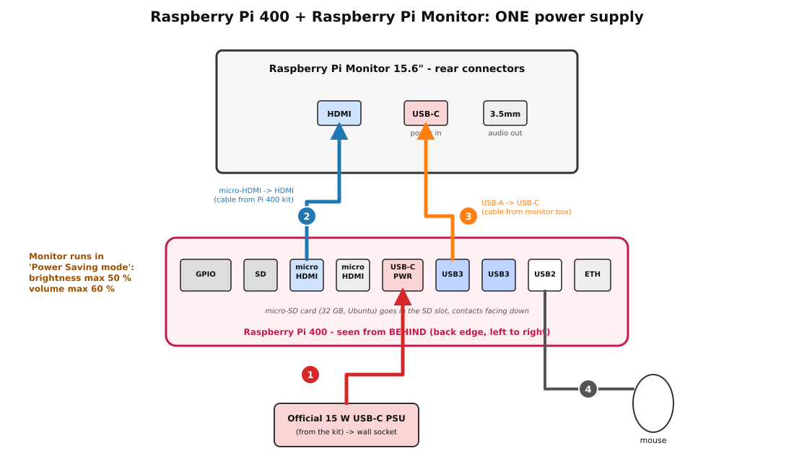
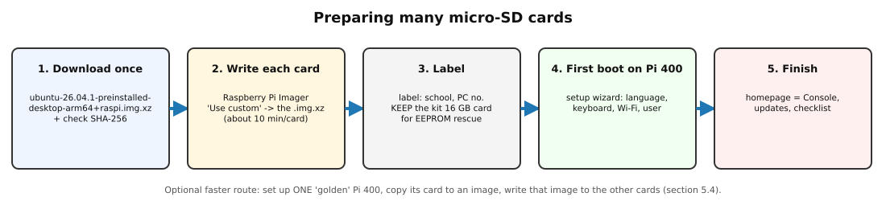

**Status:** Authoritative (follows idea#184; see the README for what is not yet installed on hardware) · **Maintained by:** Marco (with Atlas) · 15 October 2026 (router Wi-Fi defaults)


# How to use this manual

This manual sets up one classroom computer: a Raspberry Pi 400 keyboard computer with the official 15.6" Raspberry Pi Monitor, running Ubuntu Desktop. The computer opens the school's IDEA Console. Each step has:

1. **Do:** what to do.
2. **✔ Check:** how to see that it worked.

<div class="note">
<b>Placeholders, no real secrets.</b>
<ul>
<li>Every school uses the same addresses (*IDEA School Server: Installation Manual*). The Console is always at <code>http://10.42.0.2</code>.</li>
<li><code>&lt;STUDENT-USER-PASSWORD&gt;</code>: the password for the Ubuntu user on the Pi 400.</li>
<li><code>&lt;SCHOOL&gt;</code>: the school name, for labels only.</li>
</ul>
</div>

# 1. What is in the boxes

## 1.1 Raspberry Pi 400 kit (bol.com, "Raspberry Pi 400 kit, muis, 16GB microSD, English guide, QWERTY")

<div class="note">
The bol.com page could not be opened from our tools (bol.com blocks automated access). The list below is the
<b>official Raspberry Pi 400 kit</b> contents from raspberrypi.com [1]. Check it against the box.
</div>

| ☐ | Item | Use it? |
|---|---|---|
| ☐ | Raspberry Pi 400 (English QWERTY keyboard, 4 GB) | Yes |
| ☐ | Official 15 W USB-C power supply (5.1 V / 3 A) | Yes: it powers the Pi **and** the monitor |
| ☐ | Raspberry Pi USB mouse | Yes |
| ☐ | 16 GB microSD card with Raspberry Pi OS on it | **Keep it** as a rescue card (EEPROM update, 6.1). Ubuntu goes on Koen's **32 GB** cards. |
| ☐ | micro-HDMI to HDMI cable | Yes: Pi 400 → monitor |
| ☐ | *Beginner's Guide* book | Optional |

Check the **plug** of the power supply. Kits sold in Belgium usually have the European (Type C/E/F) plug. Zimbabwe uses Type G (UK-style) and Type D sockets, so bring a good adapter for each computer, or a power strip that takes EU plugs.

## 1.2 Raspberry Pi Monitor 15.6" red/white (Kiwi Electronics, SC0940)

From the Kiwi product page [2] and the Raspberry Pi docs [3]:

| ☐ | Item |
|---|---|
| ☐ | Monitor: 15.6", 1920 × 1080 IPS, built-in stand, 2 × 1.2 W speakers |
| ☐ | **USB-A to USB-C cable** (for power). This is the only cable in the box: there is **no HDMI cable** and **no power supply**. |

Monitor connectors: **HDMI** in (standard size, HDMI 1.4), **USB-C** (power in only), **3.5 mm** audio out. On the back are buttons for standby, brightness up/down and volume up/down.

## 1.3 From Koen

| ☐ | Item |
|---|---|
| ☐ | One **32 GB microSD card** for each Pi 400 (fast, A1/A2 class is best). Use the same brand/batch if you want to clone cards (5.4). |
| ☐ | Stickers or a marker for labels: school name, computer number |

# 2. Power: one power supply for the Pi 400 and the monitor

Koen wants **one** power supply per workstation. That works. Here is what the Raspberry Pi documentation says:

* **The monitor can be powered from the Pi.** "If you're using an official Raspberry Pi Monitor, you can connect your monitor to power through a USB cable connected to your Raspberry Pi keyboard computer. When you power on your keyboard computer, it then provides power to the Raspberry Pi Monitor." [1]
* **But only in Power Saving mode.** "When powered from a Raspberry Pi, the Monitor operates in Power Saving mode, since Raspberry Pi devices cannot provide 1.5 A of current over a USB-A connection." In Power Saving mode, brightness is limited to **0-50 %** and speaker volume to **0-60 %**. [3]
* **Full Power mode** (100 % brightness and volume) needs a USB-PD source with **at least 1.5 A** [3]. A Pi 400 can give its USB ports **1.2 A in total** [4].
* The monitor uses **4.5-6.5 W** while on [3], which is about 0.9-1.3 A at 5 V.


<div class="warn">
<b>Rules for the one-power-supply setup</b>
<ol>
<li>Use the <b>official 15 W (5.1 V / 3 A)</b> Raspberry Pi USB-C supply from the kit [5]. Never use a phone charger.</li>
<li>Plug <b>nothing else power-hungry</b> into the Pi 400's USB ports: only the mouse (and at most a USB stick). The monitor and mouse together are already close to the 1.2 A limit.</li>
<li><b>Never force Full Power mode</b> on a monitor powered by a Pi 400. That is done by holding brightness-up for 3 seconds [3]. It would ask for more current than the Pi can give.</li>
<li>If the monitor <b>flashes on and off</b>, or the Pi shows a lightning-bolt/under-voltage warning, the supply can't keep up. Turn brightness and volume down. If that doesn't help, give the monitor its own USB-C power supply (a second official 15 W supply works) [3].</li>
</ol>
</div>

## 2.1 Wiring



| Cable | From | To |
|---|---|---|
| 1 | Official 15 W PSU (wall socket) | Pi 400 **USB-C power** port |
| 2 | Pi 400 **micro-HDMI** port, the one next to the microSD slot | Monitor **HDMI** (cable from the Pi 400 kit) |
| 3 | Pi 400 **USB 3.0** port (blue) | Monitor **USB-C** (USB-A → USB-C cable from the monitor box) |
| 4 | Mouse | Pi 400 **USB 2.0** port (white). Raspberry Pi recommends the white port for the mouse [1]. |

The back edge of the Pi 400, seen from **behind**, left to right: GPIO, microSD, micro-HDMI, micro-HDMI, USB-C power, USB 3.0, USB 3.0, USB 2.0, Ethernet. Small icons are printed next to each port. If you get no picture, move cable 2 to the other micro-HDMI port.

**Do (in this order):**

1. Put the 32 GB microSD card in the slot, contacts facing down (only after section 5).
2. Connect cable 2 (HDMI), cable 3 (monitor power) and cable 4 (mouse).
3. Connect cable 1 (power) **last**. The Pi 400 starts at once. Later you switch it on and off with **Fn + F10** [1].

**✔ Check:**

* The Pi 400's LED lights up. Within 10-20 seconds the monitor shows a picture (rainbow/boot screen or Ubuntu logo).
* Press the monitor's brightness-up button: the on-screen bar stops at 50. That is Power Saving mode, as expected.
* The picture stays stable for 5 minutes with no flashing.

# 3. Which Ubuntu?

| Release | Status on 12 Oct 2026 | Pi 400 support | Choice |
|---|---|---|---|
| **Ubuntu 26.04.1 LTS** "Resolute Raccoon" (Desktop, 64-bit) | Latest **LTS**, 5 years of updates. Listed in Raspberry Pi Imager (released 27 Aug 2026). | **Desktop supported** on Pi 400 (Ubuntu's support table: "SD") [6] | **Use this one** |
| Ubuntu 26.10 "Stonking Stingray" | Final release planned for **15 Oct 2026** [7]. An interim release, 9 months of support. | Probably, but not yet released | Not for schools |
| Ubuntu 24.04.5 LTS | Older LTS | Supported | Only as a fallback |

Ubuntu marks the Pi 400 as **supported** for Desktop, but **not certified** (certification for 26.04 covers the Pi 4B and Pi 5) [6]. The Pi 400 has 4 GB of RAM, which is enough for a browser-based Console, but don't expect it to be fast.

<div class="warn">
<b>Minimum bootloader (EEPROM) date.</b> Ubuntu 24.04 and 26.04 need a Pi 400 EEPROM dated <b>2022-11-25 or later</b> [6].
New kits almost always meet this. If a Pi 400 won't boot Ubuntu, update the EEPROM with the kit's 16 GB Raspberry Pi OS card (6.1).
</div>

# 4. Install Raspberry Pi Imager (on Ubuntu, Mac or Windows)

| Your computer | How |
|---|---|
| Ubuntu (also Ubuntu on a Pi) | `sudo snap install rpi-imager` [6], or `sudo apt install rpi-imager` |
| macOS / Windows | Download it from `https://www.raspberrypi.com/software/` and install it |

The current Imager is **2.0.12** (8 Oct 2026).

**✔ Check:** Imager starts and shows the steps *Device → OS → Storage*.

<div class="warn">
<b>Imager cannot pre-set the hostname, user, Wi-Fi or locale for Ubuntu Desktop.</b> In Imager's own OS list, "Ubuntu Desktop 26.04.1 (64-bit)" has
<code>init_format: none</code>, so Imager offers <b>no OS customisation</b> for it. That only works for Raspberry Pi OS and Ubuntu <i>Server</i>. Ubuntu Desktop
asks for these settings in its <b>first-boot wizard</b> (section 6) [6][8]. This manual sets them there.
</div>

# 5. Write the microSD cards

## 5.1 Download the image once (saves time and data)

Download it once on a good connection in Belgium:

* URL: `https://cdimage.ubuntu.com/releases/26.04.1/release/ubuntu-26.04.1-preinstalled-desktop-arm64+raspi.img.xz`
* Size: about 3.1 GB. It unpacks to 9.6 GB, so it fits a 32 GB card.

**✔ Check:** `sha256sum ubuntu-26.04.1-preinstalled-desktop-arm64+raspi.img.xz` prints
`8216f54cc1df2fcf7de37530a7edccdd200abd7dcfbc5d4f0407df7513544d6a`. This value is from Ubuntu's `SHA256SUMS` and from Imager's OS list.

## 5.2 Write one card with Imager

1. Put a 32 GB card in your card reader.
2. Imager → **Device:** *Raspberry Pi 4* (this covers "Pi 4 Model B, **400**, and CM4").
3. **OS:** *Use custom* → pick the downloaded `.img.xz`. Or choose *Other general-purpose OS → Ubuntu → Ubuntu Desktop 26.04.1 (64-bit)*, but then Imager downloads it again.
4. **Storage:** the 32 GB card. Check the size so that you don't overwrite your own disk!
5. Imager offers no customisation for this image (see the box above). Click **Write** and confirm that the card will be erased.
6. Wait for **writing and verification** to finish (about 10-15 minutes), then remove the card.

**✔ Check:** Imager says *Write successful*. Put a label on the card: `<SCHOOL> - PC __`.

## 5.3 Batch tips for many cards



* Use the **same downloaded `.img.xz`** for every card ("Use custom"), not a fresh download each time.
* Imager writes one card at a time. With 2-3 USB card readers you can run a second Imager window on a second reader. Watch the **Storage** choice every time.
* On Linux you can also write from the command line with `rpi-imager --cli <image.img.xz> /dev/sdX`. Check `/dev/sdX` with `lsblk` first: a wrong letter erases the wrong disk. **Test first** on one card.
* Keep the kit's **16 GB Raspberry Pi OS cards** in a labelled bag. They are your EEPROM-rescue cards.

## 5.4 Faster: one "golden" card, then copies

Fresh cards each need the first-boot wizard (about 10 minutes per Pi). A golden card lets you do the wizard, the updates and the homepage **once**:

1. Set up one Pi 400 fully, sections 6.1 to 6.6, on your **home Wi-Fi**, with all updates.
2. Before you shut it down, make the copy "anonymous" so that each clone gets its own machine ID:

```bash
sudo truncate -s 0 /etc/machine-id
sudo rm -f /var/lib/dbus/machine-id
sudo shutdown -h now
```

3. On your Ubuntu machine, read the card into an image, then shrink and compress it:

```bash
lsblk                                   # find the card, e.g. /dev/sdb
sudo dd if=/dev/sdb of=golden-pi400.img bs=4M status=progress conv=fsync
# optional: PiShrink (github.com/Drewsif/PiShrink) so it fits cards that are a few MB smaller
xz -T0 -v golden-pi400.img
```

4. Write `golden-pi400.img.xz` to each card with Imager → *Use custom*, as in 5.2.
5. On each clone, give it its own name after the first boot: `sudo hostnamectl set-hostname idea-pc07` (PC 07 of this school).

<div class="warn">
<b>Test first</b> on two cards before you make 20. Check that both clones boot, each have a different <code>cat /etc/machine-id</code>, and both reach the Console.
Without PiShrink, the target card must be at least as large as the golden card. Two "32 GB" cards of different brands often differ by a few MB.
</div>

# 6. First boot and setup on the Pi 400

## 6.1 (Only if it won't boot) Update the EEPROM with the kit card

1. Put the kit's **16 GB Raspberry Pi OS** card in the Pi 400 and boot it. Its own setup wizard will appear: complete it with any user.
2. Open a terminal and run `sudo rpi-eeprom-update`. It shows the current bootloader date.
3. If the date is older than 2022-11-25, run `sudo rpi-eeprom-update -a`, then `sudo reboot` (the reboot does the flashing). The Ubuntu documentation describes the same procedure from an Ubuntu 24.04 image [6].

**✔ Check:** `sudo rpi-eeprom-update` now shows a date of 2022-11-25 or later. Swap back to the Ubuntu card.

## 6.2 The first-boot wizard

1. Put the Ubuntu card in. Connect power. First boot takes a few minutes: the card's partition is grown and services are set up.
2. The wizard asks for these settings. The exact screens can differ a little between Ubuntu versions:
   * **Language:** English
   * **Keyboard:** English (US). The kit is a QWERTY "English" keyboard.
   * **Wi-Fi:** see 6.3
   * **Location / time zone:** Harare (Africa/Harare)
   * **User:** for example name `Student`, username `student`, password `<STUDENT-USER-PASSWORD>`. Make one shared user per PC. Do **not** tick *log in automatically*: the class teacher gives students the password.
   * Skip Ubuntu Pro / online accounts / location services.
3. The computer name: if the wizard doesn't ask, set it afterwards in **Settings → System → About → Device Name**, for example `idea-pc07`.

**✔ Check:** you reach the Ubuntu desktop, and **Settings → About** shows *Raspberry Pi 400*, *Ubuntu 26.04.1 LTS* and your device name.

## 6.3 Wi-Fi: IDEA or IDEA-Teachers

The pre-flashed IDEA school router creates two Wi-Fi networks (*IDEA School Server: Installation Manual*, "The school router's Wi-Fi networks and default passwords"). The passwords are the IDEA defaults until the school changes them:

| Who uses this PC | Network |
|---|---|
| Students (default) | `IDEA`, password `idea911!`: Console and apps only, no internet |
| Teacher's PC | `IDEA-Teachers`, password `idea-teachers911!`: Console and apps, plus internet when the teacher rule is on (off by default) |

Use `IDEA` on every PC unless the head teacher names a PC for a teacher. Only that PC gets `IDEA-Teachers`. Never type the `IDEA-Teachers` password on a student PC.

If the school has changed the passwords (*IDEA School Server: Installation Manual*, section 10), ask the head teacher for the new ones.

**At school:** choose the network in the wizard, or later from the top-right menu → Wi-Fi.

**Preparing in Belgium:** the IDEA network isn't there yet. Join your **home Wi-Fi** for updates (6.5), then add IDEA in advance from a terminal.

```bash
nmcli connection add type wifi con-name IDEA ssid IDEA \
  wifi-sec.key-mgmt wpa-psk wifi-sec.psk 'idea911!' connection.autoconnect yes
# when done with updates, forget your home network:
nmcli connection delete '<HOME-WIFI-NAME>'
```

**Wi-Fi country (recommended).** Ubuntu Desktop on the Pi doesn't keep a Wi-Fi country setting, and some 5 GHz channels need it [8]. Add `cfg80211.ieee80211_regdom=ZW` to the **end of the single line** in `/boot/firmware/cmdline.txt`:

```bash
sudo sed -i '1 s/$/ cfg80211.ieee80211_regdom=ZW/' /boot/firmware/cmdline.txt
cat /boot/firmware/cmdline.txt     # still ONE line, ending in ...regdom=ZW
```

**✔ Check:** at school, the Wi-Fi icon shows "IDEA" and `ip -4 addr show wlan0` shows `10.42.1.x`. Ubuntu may say "limited connectivity" or show no internet: that is **normal** on IDEA. After a reboot, `iw reg get` shows `country ZW`.

## 6.4 Homepage = the school Console

The homepage is the Console on Engine 1, **by IP address: `http://10.42.0.2`**. The port is 80 (the IDEA Engine's `config.yaml` `httpPort: 80`), so no `:port` is needed.
Do not use the sticker name here: the PCs are on the Wi-Fi network, and `.local` names do not cross from the wired network to Wi-Fi.

The Console reads the list of all Engines from the IDEA database, so both Engines appear on this one page. If Pi #1 is ever off, type `http://10.42.0.3` by hand: it shows the same Console. Keep the homepage on `10.42.0.2`.

**Firefox (Ubuntu's default browser) for all users, set once by the admin.** The Firefox snap reads enterprise policies from `/etc/firefox/policies/policies.json`:

```bash
sudo mkdir -p /etc/firefox/policies
sudo tee /etc/firefox/policies/policies.json > /dev/null <<'JSON'
{
  "policies": {
    "Homepage": { "URL": "http://10.42.0.2/", "StartPage": "homepage", "Locked": false },
    "OverrideFirstRunPage": "",
    "OverridePostUpdatePage": "",
    "DisableTelemetry": true
  }
}
JSON
```

(The address is the same at every school. Restart Firefox.)

**Or by hand, in Firefox:** ☰ → **Settings → Home** → *Homepage and new windows* → **Custom URLs** → `http://10.42.0.2/`.

**Chromium** (only if you install it: `sudo snap install chromium`): ⋮ → **Settings → On start-up → Open a specific page** → `http://10.42.0.2/`.

**Handy:** put Firefox in the dock (right-click → *Pin to Dash*). Open the Console, then ★ to bookmark it.

**✔ Check:** close and reopen Firefox. The IDEA Console opens straight away, and **about:policies** shows the policy as *Active*.

## 6.5 Updates (in Belgium, on home Wi-Fi)

The IDEA Wi-Fi has **no internet**, so update before you leave:

```bash
sudo apt update && sudo apt full-upgrade -y
sudo snap refresh
sudo reboot
```

**✔ Check:** `sudo apt update` ends with "All packages are up to date".

## 6.6 Final touches

* Power off with **Fn + F10** or the system menu → Power Off. Wait until the screen is black before you pull the plug.
* The monitor's speakers work over HDMI. If there is no sound, choose *HDMI* under **Settings → Sound → Output**.

# 7. Checklist for each computer

| ☐ | Test | Expected |
|---|---|---|
| ☐ | Wiring as in 2.1, power plugged in last | Picture within about 20 s, no flashing |
| ☐ | Monitor brightness up | Bar stops at 50 (Power Saving mode, expected) |
| ☐ | Ubuntu desktop reached, device name set | Settings → About: Raspberry Pi 400, Ubuntu 26.04.1 LTS |
| ☐ | Wi-Fi | Connected to `IDEA` (or `IDEA-Teachers`), address `10.42.1.x` / `10.42.2.x` |
| ☐ | Wi-Fi country | `iw reg get` → `country ZW` |
| ☐ | Firefox opens the Console | `http://10.42.0.2` loads and lists **both** Engines of the school |
| ☐ | Apps open from the Console | Kolibri / Kiwix / Nextcloud open |
| ☐ | No internet on IDEA | `https://example.com` fails (expected) |
| ☐ | Power stable | No lightning-bolt or under-voltage warning during 10 minutes of use |
| ☐ | Label | Card and PC labelled `<SCHOOL> - PC __` |

# Appendix A. Troubleshooting

| Problem | Try |
|---|---|
| No picture | Move cable 2 to the other micro-HDMI port. Check that the monitor isn't in standby (press ⏻). |
| Monitor flashes on and off | Turn brightness and volume down [3]. Unplug extra USB devices. Last resort: a separate USB-C supply for the monitor. |
| Rainbow screen / no boot with Ubuntu | EEPROM too old: section 6.1. Rewrite the card and check the SHA-256. |
| Very slow first boot | That is normal: the first boot resizes the card. Give it 5 minutes. |
| Wi-Fi 'IDEA' not shown | Is the router on? (*IDEA School Server: Installation Manual*, section 2.) The 5 GHz network may need the Wi-Fi country (6.3). |
| Console doesn't open | Check the address: `http://10.42.0.2` (http, not https). Is the PC on IDEA/IDEA-Teachers? Run `ping 10.42.0.2`. |

# Appendix B. Sources (read on 12 October 2026)

1. Raspberry Pi documentation, *Keyboard computers* (Pi 400 kit contents, setup, monitor powered from the keyboard, Fn + F10): `raspberrypi.com/documentation/computers/keyboard-computers.html`.
2. Kiwi Electronics, *Raspberry Pi Monitor 15.6" Rood/Wit* (KW-3393, SC0940; package: monitor + USB-A to USB-C cable): `https://www.kiwi-electronics.com/nl/raspberry-pi-monitor-15-6quot-rood-wit-20221`.
3. Raspberry Pi documentation, *Raspberry Pi Monitor* (Power the Monitor, Power Saving mode 0-50 % brightness / 0-60 % volume, 1.5 A USB-PD, 4.5-6.5 W): `raspberrypi.com/documentation/accessories/monitor.html`.
4. Raspberry Pi documentation, *Power supply* table (Pi 400: 3.0 A PSU, 1.2 A total USB peripheral current): `raspberrypi.com/documentation/computers/raspberry-pi.html#power-supply`.
5. Raspberry Pi documentation: "For Raspberry Pi 4 and Raspberry Pi 400, we recommend the 3A USB-C Supply".
6. Ubuntu, *Install Ubuntu on the Raspberry Pi* (support table, minimum EEPROM dates, desktop image first-time setup wizard): `https://ubuntu.com/hardware/docs/boards/how-to/ubuntu_supported/raspberry-pi/`, and `ubuntu.com/download/raspberry-pi`.
7. Ubuntu 26.10 release schedule: `https://documentation.ubuntu.com/release-notes/26.10/schedule/`.
8. Raspberry Pi Imager OS list `os_list_imagingutility_v4.json` (Ubuntu Desktop 26.04.1: `init_format: none`). rpi-imager issue #862 (Ubuntu Desktop customisation, Wi-Fi regulatory domain via `cfg80211.ieee80211_regdom`).
