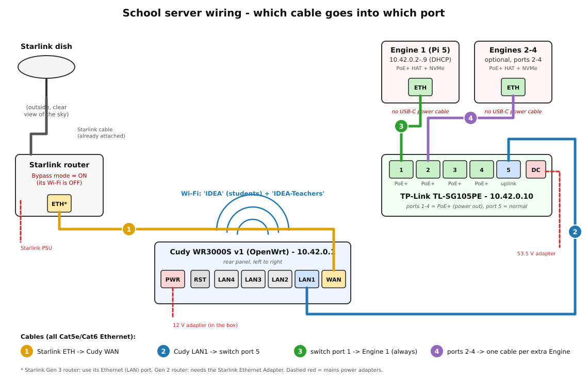
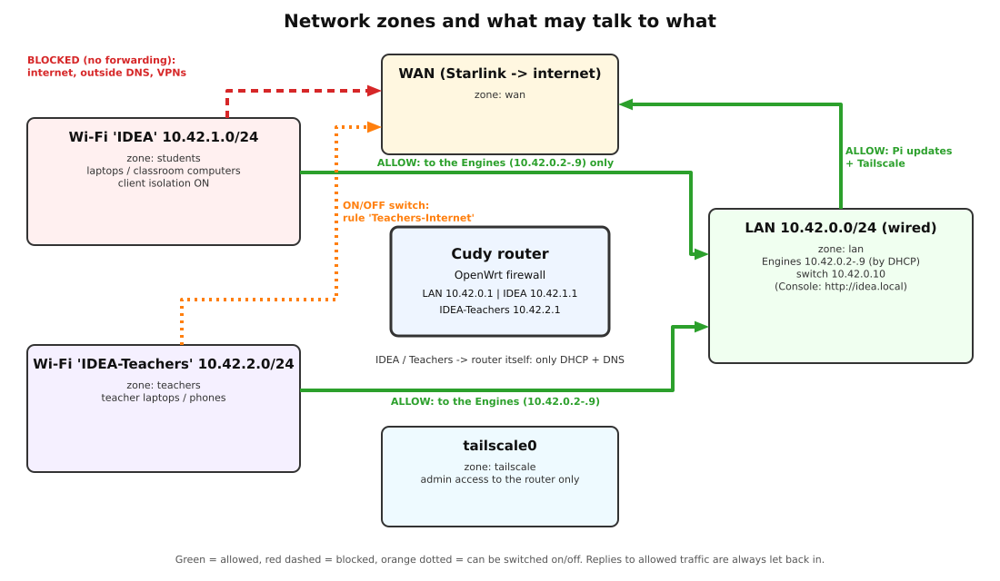
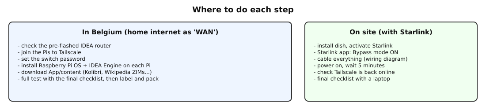
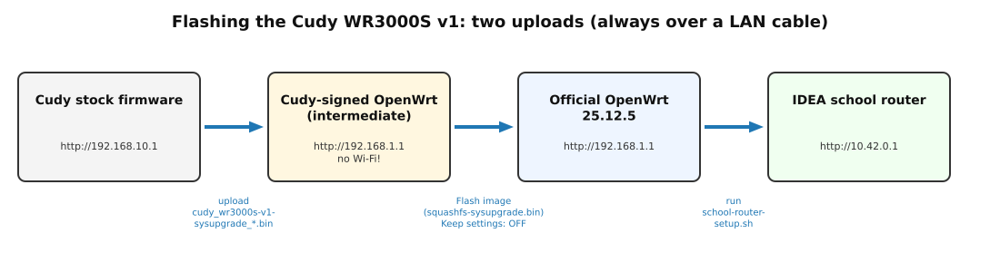
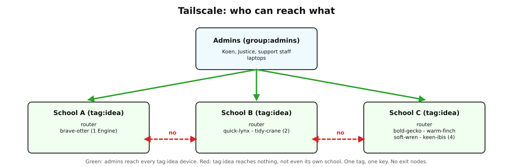

**Status:** Authoritative (follows idea#184; see the README for what is not yet installed on hardware) · **Maintained by:** Marco (with Atlas) · 14 October 2026


# How to use this manual

This manual takes one school from boxes to a working IDEA server. Each step has the same shape:

1. **Do:** what to do.
2. **✔ Check:** how to see that it worked. Do not go on until the check passes.

<div class="note">
<b>Placeholders.</b> This manual has no real passwords, keys or tokens in it. Wherever you see
<code>&lt;SOMETHING&gt;</code>, use your own value. Keep the real values in your password manager, not in this PDF.
<ul>
<li><code>&lt;ROUTER-ROOT-PASSWORD&gt;</code>, <code>&lt;SWITCH-ADMIN-PASSWORD&gt;</code>, <code>&lt;PI-USER-PASSWORD&gt;</code></li>
<li><code>&lt;IDEA-WIFI-PASSWORD&gt;</code> (students) and <code>&lt;IDEA-TEACHERS-WIFI-PASSWORD&gt;</code> (teachers)</li>
<li><code>&lt;TAILSCALE-AUTH-KEY&gt;</code>: the one IDEA fleet key. Koen gives it to you as a file. Never type it on a command line.</li>
<li><code>&lt;STICKER&gt;</code>: the name the installer gives a Pi, for example <code>brave-otter</code> (section 5.6). Write it on the sticker on the case.</li>
</ul>
</div>

<div class="note">
<b>No school numbers.</b> Every school uses the same addresses, and a Pi's name is its sticker name, not a number.
A Pi can move to another school without any change in Tailscale or in this manual.
</div>

## Fill-in sheet for this school

| Item | Value |
|---|---|
| School name | ______________________ |
| Router | `10.42.0.1`, hostname `idea-router` |
| Pi #1 (Engine 1) | `10.42.0.2`, sticker name ______________________, MAC ____:____:____:____:____:____ |
| Pi #2 (Engine 2) | `10.42.0.3`, sticker name ______________________, MAC ____:____:____:____:____:____ |
| Switch | `10.42.0.4`, MAC (on its label) ____:____:____:____:____:____ |
| Wi-Fi students | SSID `IDEA`, subnet `10.42.1.0/24` |
| Wi-Fi teachers | SSID `IDEA-Teachers`, subnet `10.42.2.0/24` |
| Tailscale tag | `tag:idea` (the same for every school) |
| Cudy serial number (label) | ______________________ (date code: ______) |

<div class="note">
<b>Why three subnets?</b> The wired network of the router and the Pis is <code>10.42.0.0/24</code>, the same at every school.
Two separate firewall zones need two separate networks, so the Wi-Fi networks get
<code>10.42.1.0/24</code> (IDEA) and <code>10.42.2.0/24</code> (IDEA-Teachers). Schools are never joined by a network
(IDEA has no subnet routes), so the same addresses everywhere cause no clash.
</div>

# The big picture

## Wiring



| Cable | From | To | Notes |
|---|---|---|---|
| 1 | Starlink router, Ethernet port | Cudy **WAN** port (yellow) | Gen 3 router: built-in LAN port. Gen 2: Starlink Ethernet Adapter needed. |
| 2 | Cudy **LAN1** | Switch **port 5** | Port 5 is the only port without PoE. Use it for the uplink. |
| 3 | Switch **port 1** (PoE+) | Pi #1 Ethernet | This cable powers Pi #1. |
| 4 | Switch **port 2** (PoE+) | Pi #2 Ethernet | This cable powers Pi #2. |

The Pis get **no** USB-C power supply. The PoE+ HAT takes power from the Ethernet cable. Ports 3 and 4 of the switch are free (PoE+) for later, for example an extra access point.

## Network zones



* **IDEA (students):** devices reach only the two Pis (Console, Kolibri, Nextcloud, Kiwix). There is no forwarding to the internet, so outside DNS servers, VPNs and websites are all blocked. Students on the IDEA Wi-Fi cannot reach each other either (client isolation).
* **IDEA-Teachers:** devices reach the Pis. Internet goes through **one** firewall rule, `Teachers-Internet`, which you can switch on or off (section 9). It starts **off**.
* **LAN (wired):** the Pis may reach the internet for updates and Tailscale. They do not route traffic for anyone else.
* **Tailscale:** the router and both Pis join the IDEA tailnet with the one fleet tag `tag:idea`. Admins reach every device. Devices with `tag:idea` reach nothing, not even each other. There are no exit nodes and no subnet routes.

## Where to do each step



Do everything you can **in Belgium**, with your home internet plugged into the Cudy WAN port in place of Starlink. Your home router gives the Cudy a WAN address (for example 192.168.x.x). That does not clash with 10.42.x.x. Then the only jobs left on site are Starlink, cables and checks.

| Section | Belgium | On site |
|---|:---:|:---:|
| 1 Unbox and check contents | ✔ | |
| 2 Check router model and version | ✔ | |
| 3 Flash and configure OpenWrt, install Tailscale | ✔ | |
| 4 Switch password and watchdog | ✔ | |
| 5 Pi OS and IDEA Engine, Tailscale on Pis | ✔ (needs internet) | |
| 6 Tailscale policy (Koen) | ✔ | |
| 7 Starlink and final cabling | | ✔ |
| 8 Final checklist | ✔ (dry run) | ✔ (for real) |

# 1. Unboxing

Do this once for each school kit. Tick each item.

| ☐ | Item | What to look for |
|---|---|---|
| ☐ | Cudy WR3000S router + 12 V adapter + Ethernet cable | Label underneath says **WR3000S** and **V1.0** (see 2.1) |
| ☐ | TP-Link TL-SG105PE switch + 53.5 V adapter | Ports 1-4 marked PoE+ |
| ☐ | 2× Raspberry Pi 5 | |
| ☐ | 2× blank stickers (or labels) and a permanent marker | For the sticker names (5.6) |
| ☐ | 2× PoE+ HAT with NVMe slot (or PoE+ HAT + M.2 HAT) + 2× NVMe SSD | Write the HAT model and its rated output (for example 5 V 4.5 A) on the fill-in sheet. See 5.1. |
| ☐ | 3× Ethernet patch cables (Cat5e/Cat6), 0.5-2 m | One for each Pi plus one for the router-switch link |
| ☐ | Plug adapters for Zimbabwe (Type G / Type D sockets) | Belgian plugs (Type E/F) don't fit Zimbabwe sockets |
| ☐ | Power strip, ideally with surge protection | A small UPS is a good idea where the power often cuts out (optional) |
| ☐ | Starlink kit (dish, router, cable, PSU) | Note the router generation. Gen 3 has an Ethernet port. Gen 2 needs the Starlink Ethernet Adapter: if the kit has no adapter, stop and tell Koen. |

**✔ Check:** every row is ticked. Write the Cudy serial number on the fill-in sheet.

# 2. Router: check model, version and flash chip

## 2.1 Read the label

1. Turn the Cudy over. The label shows the model (**WR3000S**), the hardware version (**V1.0**) and the serial number.
2. If it says anything other than WR3000S V1.x, **stop**. The images below are only for WR3000S v1. (WR3000, WR3000H, WR3000E and WR3000P are different devices with different images.)
3. Find the **date code** in the serial number. The OpenWrt wiki explains it [1]: serials that start with `S000` have the build year and week (YYWW) in characters 9 to 12. For example `S000xxxx2611xxxxx` was built in 2026, week 11.

<div class="warn">
<b>New flash chip (date code 2543 or later, so from November 2025).</b> These units have a different flash chip
(ESMT F50L1G41LC). Per the OpenWrt wiki [1] and Cudy's notice [2] you must use the <b>new</b> Cudy-signed intermediate image
(the 20251119 build), and OpenWrt 24.10.5 or later. 25.12.5 is fine. Never install Cudy stock firmware 2.3.x or older on these units.
<b>If you are not sure, treat the unit as a new-flash unit.</b>
</div>

**✔ Check:** you know the model (WR3000S), version (V1) and date code (old or new flash).

## 2.2 Download the two files (on your laptop)

| File | Where | How to check it |
|---|---|---|
| **Cudy-signed intermediate image**: `WR3000S 1.0.zip`. Unzip it and use the `.bin` inside, **not** the .zip. As of Sept 2026 it is `cudy_wr3000s-v1-sysupgrade_20251119.bin`. | Cudy's Google Drive folder, linked from the OpenWrt wiki [1] and Cudy's "OpenWrt Software Download" page [2] | Size 14,945,872 bytes, MD5 `403e276f74fd29917fd4260294d1a137` [1]. Run `md5sum` on the file. The WR3000H/P files have almost the same name, so check the MD5! |
| **Official OpenWrt 25.12.5** sysupgrade image: `openwrt-25.12.5-mediatek-filogic-cudy_wr3000s-v1-squashfs-sysupgrade.bin` | Firmware Selector [3]: `firmware-selector.openwrt.org/?target=mediatek%2Ffilogic&id=cudy_wr3000s-v1` | SHA-256 `b0a26c80fa458b4b743508a6a6de8aa9d19867fa3deb1c3c49e40194d61aa8b2` (from OpenWrt's `profiles.json` [4]). Run `sha256sum` on the file. |

<div class="warn">
Do <b>not</b> pick the <code>...-ubootmod-...</code> files. That is an advanced layout which only a serial cable can undo [1].
</div>

**✔ Check:** `md5sum cudy_wr3000s-v1-sysupgrade_20251119.bin` and `sha256sum openwrt-25.12.5-...-sysupgrade.bin` print exactly the values above.

# 3. Router: flash OpenWrt and configure it



Do all of this with a **network cable** between your laptop and a Cudy **LAN** port. After the first upload the router has no Wi-Fi at all, which can look as if it is broken [1].

## 3.1 First upload: Cudy-signed intermediate image (source: OpenWrt wiki [1])

1. Connect the 12 V adapter. Connect your laptop to **LAN2**. Leave WAN empty.
2. Browse to `http://192.168.10.1` (or `http://cudy.net`). Recent stock firmware (2.4.6) asks you to **create an admin password** first [1]. Pick any password: this firmware will be replaced in a moment.
3. If a setup wizard turns on automatic upgrades, switch that off [1].
4. Go to **Advanced Settings → Firmware** (on 2.4.6 the upload is called **Local Update**). Upload the unzipped `.bin` intermediate image.
5. If the confirmation screen shows an MD5, compare it with `403e276f...1a137`. Confirm and wait 3-5 minutes. Do not unplug.

**✔ Check:** your laptop gets an address `192.168.1.x`. `http://192.168.1.1` opens an OpenWrt LuCI page that says "OpenWrt 23.05-SNAPSHOT-CUDY" [1]. There is no Wi-Fi network: that is normal.

<div class="note">
"File is invalid"? Others have seen this too [1]. Check the MD5 and make sure you uploaded the <code>.bin</code>, not the <code>.zip</code>. Then try again.
</div>

## 3.2 Back up the per-unit calibration data (recommended, 2 minutes)

The OpenWrt wiki [1] recommends saving the `Factory` and `bdinfo` partitions now. They hold this unit's own Wi-Fi calibration and MAC address, and no download can replace them. The intermediate image runs SSH as `root` with no password. From your Ubuntu machine:

```bash
mkdir -p ~/idea-backups/<CUDY-SERIAL> && cd ~/idea-backups/<CUDY-SERIAL>
ssh root@192.168.1.1 'cat /dev/mtd2' > Factory.bin
ssh root@192.168.1.1 'cat /dev/mtd3' > bdinfo.bin
ssh root@192.168.1.1 'sha256sum /dev/mtd2 /dev/mtd3'
sha256sum Factory.bin bdinfo.bin
```

**✔ Check:** the two hash pairs match.

## 3.3 Second upload: official OpenWrt 25.12.5

**Option A (web):** in LuCI at `http://192.168.1.1` go to **System → Backup / Flash Firmware → Flash image**. Pick `openwrt-25.12.5-mediatek-filogic-cudy_wr3000s-v1-squashfs-sysupgrade.bin`. **Untick "Keep settings"** [1]. Continue and wait 3-5 minutes.

**Option B (command line)**, which the wiki [1] also gives:

```bash
scp -O openwrt-25.12.5-mediatek-filogic-cudy_wr3000s-v1-squashfs-sysupgrade.bin root@192.168.1.1:/tmp/
ssh root@192.168.1.1 'sysupgrade -n /tmp/openwrt-25.12.5-mediatek-filogic-cudy_wr3000s-v1-squashfs-sysupgrade.bin'
```

(`-O` makes scp use the old protocol, which OpenWrt needs. `-n` means "do not keep settings".)

**✔ Check:** after a reboot, `http://192.168.1.1` shows LuCI with **"OpenWrt 25.12.5"** at the bottom. **Status → Overview** says *Model: Cudy WR3000S v1*.

## 3.4 Set the router root password

1. LuCI: **System → Administration → Router Password**. Enter `<ROUTER-ROOT-PASSWORD>` twice and save. (Or run `passwd` over SSH.)
2. Optional but good: in **System → Administration → SSH-Keys**, add your SSH public key.

**✔ Check:** log out of LuCI and log in again with the new password. `ssh root@192.168.1.1` asks for the password (or uses your key).

## 3.5 Apply the IDEA school settings (script)

The script `scripts/school-router-setup.sh` (full text in Appendix A) sets everything up in one go:

* LAN `10.42.0.1/24`, with the DHCP pool at `.100-.199`
* the `students` and `teachers` networks and zones
* both SSIDs on 2.4 and 5 GHz, Wi-Fi country `ZW`
* DHCP reservations
* the firewall rules, including `Teachers-Internet` (off)

It was tested with OpenWrt 25.12.5's `uci` and `fw4` (rule set rendered and checked), but not yet on a real Cudy.

1. On your laptop, edit the top of the script:
   * `STUDENT_WIFI_KEY` / `TEACHER_WIFI_KEY`: your real passwords, only in your local copy
   * the MAC addresses if you have them (leave them empty for now; section 5.5 adds them)
2. Copy it to the router and run it:

```bash
scp -O school-router-setup.sh root@192.168.1.1:/tmp/
ssh root@192.168.1.1 'sh /tmp/school-router-setup.sh'
```

3. The router reboots. Unplug and replug your laptop cable (or renew DHCP).

**✔ Check (all four):**

* Your laptop gets `10.42.0.1xx`. `http://10.42.0.1` opens LuCI.
* **Network → Wireless** lists `IDEA` and `IDEA-Teachers` on both radios, all enabled.
* **Network → Firewall → Zones** lists `lan`, `wan`, `students`, `teachers`. The `students` and `teachers` zones have *Input: reject, Forward: reject* and no "allow forward to wan".
* **Network → Firewall → Traffic Rules** lists `Allow-students-to-Pi1/Pi2`, `Allow-teachers-to-Pi1/Pi2`, the DHCP/DNS rules and `Teachers-Internet` (unticked = off).

<div class="note">
If you prefer clicking, every setting in the script can also be made in LuCI. The script is just faster and the same for every school.
To change one value later, for example a Wi-Fi password, use LuCI (<b>Network → Wireless → Edit</b>).
</div>

## 3.6 Connect WAN and test internet on the router

1. Plug your home router (Belgium) or the Starlink router (on site) into the Cudy **WAN** port.
2. LuCI **Status → Overview** should show an IPv4 WAN address.

**✔ Check:** `ssh root@10.42.0.1 'ping -c3 openwrt.org'` gets replies.

## 3.7 Install Tailscale on the router

Source: OpenWrt wiki "Tailscale" [5]. OpenWrt 25.12 uses the `apk` package manager (not `opkg`). Release 25.12.5 ships `tailscale 1.102.3` [6].

1. Check there is space: `ssh root@10.42.0.1 'df -h /overlay'`. The wiki says about 48 MiB is free after install [1]. Tailscale needs about 20-30 MB.
2. Install it and start it:

```bash
ssh root@10.42.0.1
apk update
apk add tailscale
/etc/init.d/tailscale enable
/etc/init.d/tailscale start
```

3. Copy the key **file** that Koen gave you to the router's RAM disk (it is gone after a reboot) and join the tailnet. On your laptop:

```bash
chmod 600 ~/idea-fleet-authkey.txt     # contains <TAILSCALE-AUTH-KEY>, one line
scp -O ~/idea-fleet-authkey.txt root@10.42.0.1:/tmp/tskey
ssh root@10.42.0.1 'tailscale up --auth-key=file:/tmp/tskey --hostname=router-<CUDY-SERIAL> \
   --advertise-tags=tag:idea --accept-dns=false && rm -f /tmp/tskey'
```

4. Give `tailscale0` its own firewall zone so that admins can reach the router over Tailscale. Use `scripts/router-tailscale-zone.sh` (Appendix A.2): copy it with `scp -O` and run it with `sh`. It follows the wiki's "unmanaged interface + zone" recipe [5], except that it has **no forwarding** and no masquerading, because we don't route.

<div class="warn">
Never add <code>--advertise-routes</code> or <code>--advertise-exit-node</code>. IDEA uses neither subnet routers nor exit nodes.
Never put the key itself after <code>--auth-key=</code>. Always use <code>file:</code>, so the key does not end up in the shell history or the process list
(the same rule as in the IDEA Engine, idea#115).
</div>

**✔ Check:** `ssh root@10.42.0.1 tailscale status` shows the router online. In the Tailscale admin console, the machine `router-<CUDY-SERIAL>` has tag `tag:idea`. From your laptop on the tailnet, `ssh root@<router-tailscale-ip>` works.

<div class="note">
The <code>file:</code> form of <code>--auth-key</code> is the one the IDEA Engine's <code>tailscale-debug-activate.sh</code> uses.
Tagged devices have key expiry switched off by default in Tailscale, so the router stays on the tailnet after the auth key itself expires.
</div>

# 4. Switch: TP-Link TL-SG105PE (optional, recommended)

Facts from TP-Link [7][8]:

* 5 gigabit ports. Ports 1-4 are 802.3af/at PoE+, up to 30 W each, **65 W in total**.
* It gets its IP address by DHCP. If there is no DHCP server, it falls back to `192.168.0.1`.
* The factory login is user `admin`, password `admin`. This is a public factory default, printed in TP-Link's guide, and you will replace it.
* **PoE Auto Recovery** pings a device and power-cycles its port when the device stops answering. It is off by default.

**Power budget:** 2 × Pi 5 with NVMe is at most about 2 × 25 W on the HAT side. That fits within 65 W. If the PoE MAX LED is lit or flashing, the switch is near or over its budget [8]: unplug extra PoE devices.

1. Connect switch port 5 to Cudy LAN1. Power the switch. Wait 1 minute.
2. Find the switch in LuCI **Status → Overview → Active DHCP Leases**. Click **Set Static** and give it `10.42.0.4`, or put its MAC in the script. Then power-cycle the switch.
3. Browse to `http://10.42.0.4`. Log in with the factory default. **System → User Account**: set `<SWITCH-ADMIN-PASSWORD>`.
4. Optional watchdog, under **PoE → PoE Auto Recovery**:
   * Enable it globally.
   * Port 1: Ping IP `10.42.0.2`. Port 2: Ping IP `10.42.0.3`.
   * **Startup Delay 300 s** (a Pi takes a few minutes to boot and start the Engine)
   * Interval 60 s, Failure Threshold 5, Break Time 15 s

**✔ Check:** you can log in with the new password and the old one fails. PoE Status shows ports 1 and 2 "on" with a few watts each once the Pis are connected.

<div class="note">
The switch is not on Tailscale, so nobody can reach it from outside the school. The watchdog is the only automatic power reset.
An admin can still reach its web page through a Pi with an SSH tunnel: <code>ssh -L 8080:10.42.0.4:80 pi@&lt;pi-tailscale-ip&gt;</code>, then open <code>http://localhost:8080</code>.
</div>

# 5. The two Raspberry Pi 5 Engines

## 5.1 Assemble

1. Fit the NVMe SSD and the PoE+ HAT, following the HAT maker's instructions. Fit any cooling the HAT comes with.
2. Do **not** connect a USB-C power supply at the same time as PoE.

<div class="warn">
<b>USB power.</b> Background (Raspberry Pi docs [9]): a Pi 5 gives USB devices 1.6 A only when it
detects a 5 A supply. Otherwise it limits USB to 600 mA. Common PoE+/M.2 HATs for the Pi 5 supply 5 V / 4.5 A (for example Waveshare [10]).
So a <b>USB-powered App Disk (SSD)</b> may not get enough current. Do not raise the limit (<code>PSU_MAX_CURRENT</code> in the EEPROM [11])
unless the HAT's label or datasheet says 5 A. If App Disks are USB SSDs, test them under load in Belgium:
copy a large file to the disk and check that <code>vcgencmd get_throttled</code> still prints <code>throttled=0x0</code>.
</div>

## 5.2 Install Raspberry Pi OS Lite (64-bit) on the NVMe

The IDEA Engine runs on **Raspberry Pi OS Lite (64-bit)**. The test fleet runs Debian 13 "trixie" (from `agent-engine-dev/docs/PI_FLEET.md`). Its user must be **`pi`**: the Engine lives in `/home/pi/...` and runs as `pi`.

**Method A (easiest): NVMe in a USB-M.2 enclosure on your laptop.**

1. Install Raspberry Pi Imager on your laptop (Ubuntu: `sudo snap install rpi-imager`). The current version is 2.0.12.
2. **Device:** Raspberry Pi 5. **OS:** Raspberry Pi OS (other) → **Raspberry Pi OS Lite (64-bit)**. **Storage:** the NVMe in the enclosure.
3. Customisation:
   * **Hostname:** leave the Imager default (`raspberrypi`). The IDEA installer gives the Pi its sticker name in 5.6.
   * **Localisation:** time zone `Africa/Harare`, keyboard `us`
   * **User:** username **`pi`**, password `<PI-USER-PASSWORD>`. If Imager asks, **allow passwordless sudo**: the IDEA provisioning script needs it (step 1/5 of the script checks this).
   * **Wi-Fi:** leave it empty. The Pis use the cable only.
   * **SSH:** enabled, **public-key authentication only**. Paste your `~/.ssh/id_ed25519.pub`.
   * **Raspberry Pi Connect:** off
4. Write, then fit the NVMe into the HAT.

**Method B: no enclosure.** If the bootloader is new enough, the Pi 5 **network installer** can run Imager on the Pi itself [12]. Hold **Shift** at power-on, with HDMI, a keyboard and Ethernet with internet connected. Choose the NVMe as storage and make the same choices as above. (Raspberry Pi docs: "Boot from NVMe" [12].)

**✔ Check:** Imager says "Write successful" and verification passed.

## 5.3 First boot

1. Plug Pi #1 into switch **port 1** (Pi #2 into **port 2**). The PoE+ HAT powers it. No SD card should be in the slot.
2. Wait 2-3 minutes. In LuCI → **Status → Overview → DHCP leases** you will see a new `raspberrypi` with a temporary address (`10.42.0.1xx`). Do one Pi at a time, so you know which lease is which. The MAC address tells them apart.

**✔ Check:** `ssh pi@10.42.0.1xx` logs in without a password (key only), and then:

```bash
findmnt /                    # SOURCE must be /dev/nvme0n1p2  -> booted from NVMe
vcgencmd get_throttled       # throttled=0x0 -> power is fine
sudo -n true && echo SUDO-OK # passwordless sudo works
```

If it booted from somewhere else, run `sudo raspi-config` → **Advanced Options → Boot Order → NVMe/USB boot** [12].

## 5.4 Update the bootloader and the OS

```bash
sudo apt update && sudo apt full-upgrade -y
sudo rpi-eeprom-update -a
sudo reboot
```

**✔ Check:** after the reboot, `sudo rpi-eeprom-update` says "BOOTLOADER: up to date".

## 5.5 Fix the IP addresses (DHCP reservations)

1. On the Pi: `ip link show eth0`. The MAC is after `link/ether`. Write it on the fill-in sheet.
2. On the router (LuCI **Status → Overview → DHCP leases → Set Static**, or over SSH):

```bash
ssh root@10.42.0.1
uci set dhcp.pi1=host
uci set dhcp.pi1.mac='<PI1-MAC>'; uci set dhcp.pi1.ip='10.42.0.2'
uci set dhcp.pi2=host
uci set dhcp.pi2.mac='<PI2-MAC>'; uci set dhcp.pi2.ip='10.42.0.3'
uci commit dhcp && /etc/init.d/dnsmasq restart
```

3. Reboot both Pis.

The reservations have no name: the Pis get their names in the next step.

**✔ Check:** `ping 10.42.0.2` and `ping 10.42.0.3` answer. `ssh pi@10.42.0.2 'ip link show eth0'` shows the MAC of Pi #1.

## 5.6 Install the IDEA Engine (and Console)

**Where this comes from:** `koenswings/agent-engine-dev`, read on 12 Oct 2026:

* `README.md`, `docs/SCRIPTS.md`, `docs/PI_FLEET.md`
* `script/provision-fleet.sh`, `script/build-engine.ts`, `config.yaml`

The current, documented way to install a Pi is `script/provision-fleet.sh`. You run it **from your Ubuntu machine** over key-only SSH. It needs nothing but bash and ssh on your side, and it changes nothing on your machine. For each Pi it:

1. checks SSH key login and passwordless sudo;
2. installs apt packages, Node 22.20.0 and the pinned pnpm, and clones `idea`, `agent-engine-dev`, `agent-console-dev` and `agent-app-dev` under `/home/pi/idea/agents/`. It also builds the Console;
3. stores a Tailscale key on the Pi (through stdin, as `/etc/tailscale/debug-authkey`, mode 0600 root), if `--authkey-file` is given;
4. runs `build-engine` on the Pi (Docker, pm2, sudoers, udev, Tailscale in "latent" mode, etc.);
5. waits for the reboot and checks that pm2's `engine` is online and that the Console answers with HTTP 200.

With `auto` instead of a name, the installer makes up a two-word **sticker name** (for example `brave-otter`). It checks that no other Pi on the network, and no Engine in the IDEA database, already has that name. Then it sets it as the Pi's hostname and Engine name.

It takes **15-20 minutes per Pi** and needs internet on the Pi, so do it in Belgium. Install **one Pi per run**: first Pi #1, and when it is done, Pi #2. Then the second Pi can check its name against the first.

```bash
# on your Ubuntu machine
sudo apt install -y git openssh-client
git clone https://github.com/koenswings/agent-engine-dev.git
cd agent-engine-dev
chmod 600 ~/idea-fleet-authkey.txt   # the one fleet key, <TAILSCALE-AUTH-KEY>
./script/provision-fleet.sh --authkey-file ~/idea-fleet-authkey.txt \
    --timezone Africa/Harare --keyboard us  auto=10.42.0.2,model=pi5
# when Pi #1 is done:
./script/provision-fleet.sh --authkey-file ~/idea-fleet-authkey.txt \
    --timezone Africa/Harare --keyboard us  auto=10.42.0.3,model=pi5
```

**Put the sticker on the case.** Near the end of each run the script prints a line `Sticker name: <STICKER>`.
The Pi also keeps it in the file `/home/pi/STICKER.txt` (`ssh pi@10.42.0.2 cat STICKER.txt`).

1. Write the sticker name on a sticker in large, clear letters. Add the Console address below it: `http://<STICKER>.local`.
2. Stick it on the top of the Pi's case, where you can read it without moving cables.
3. Write the sticker name on the fill-in sheet, next to the Pi's MAC address.

**✔ Check:**

* The script's summary line for each Pi is a success (not `FAILED (...)`).
* `ssh pi@10.42.0.2 hostname` prints the sticker name of Pi #1 (the same for .3 and Pi #2). It matches the sticker on that case.
* `ssh pi@10.42.0.2 'pm2 status'` shows `engine` **online** (the same for .3).
* `curl -s -o /dev/null -w '%{http_code}\n' http://10.42.0.2/` prints `200`.
* A laptop on the **wired** LAN opens `http://<STICKER>.local` (the name on either sticker) and sees the IDEA Console, with **both** Engines listed. The Console reads the list of Engines from the IDEA database, so it does not matter which Pi you open.

The Console port is **80**: `config.yaml` → `settings.httpPort: 80` ("serves Console UI"). From the Wi-Fi networks, `.local` names do not work (they do not cross subnets): there you use `http://10.42.0.2` (section 8).

<div class="note">
<b>Use <code>provision-fleet.sh</code>.</b> The older <code>script/install.sh</code> is out of date (it clones <code>koenswings/engine</code> and sets Node 20). Do not use it.
The exact wording of the script's output may still change a little. What counts is the sticker name in the summary and in <code>STICKER.txt</code>.
</div>

## 5.6b Report the sticker names to the IDEA team

Send Koen one short message for each school:

| School | Pi | Sticker name | MAC |
|---|---|---|---|
| (school name) | Pi #1 | (sticker name) | (MAC) |
| (school name) | Pi #2 | (sticker name) | (MAC) |

Send it again whenever a Pi moves to another school. The school is not part of the Pi's name: this report is the only place where the link between Pi and school is kept.

**✔ Check:** Koen confirms that he has the names.

## 5.7 Tailscale on the Pis (always on, tag:idea)

Join both Pis to the tailnet with the same fleet key and tag, using the sticker name as the Tailscale name:

```bash
scp ~/idea-fleet-authkey.txt pi@10.42.0.2:/tmp/tskey
ssh pi@10.42.0.2 'sudo systemctl enable --now tailscaled && \
  sudo tailscale up --auth-key=file:/tmp/tskey --hostname=<STICKER> \
  --advertise-tags=tag:idea --accept-dns=false && shred -u /tmp/tskey'
```

Do the same for `10.42.0.3`, with the sticker name of Pi #2.

**✔ Check:** `ssh pi@10.42.0.2 tailscale status` shows it online. The Tailscale admin console shows both sticker names with `tag:idea`.

## 5.8 Apps and content (Kolibri, Nextcloud, Kiwix)

The Engine starts apps from **App Disks**: drives with Docker Compose apps on them, which the Engine detects when you plug them in (`README.md`, `docs/ARCHITECTURE.md`).

Koen gives you the App Disks for each school, ready to use. Plug them into the Pis in Belgium and check them there.
Do not download content on site: Starlink data and time on site are limited.

**✔ Check:** in the Console, each app shows as *Running* and opens from a laptop on the LAN.

# 6. Tailscale policy (Koen, once for all schools)

Koen manages the tailnet. There is **one** tag and **one** key for the whole fleet, not one per school:

* the tag `tag:idea`, owned by the admins;
* one **fleet auth key** with `tag:idea`: reusable, pre-approved, **not** ephemeral. Koen gives it to the installer **as a file**;
* the access rules: admins reach `tag:idea`, and `tag:idea` reaches nothing.

```json
{
  "groups":    { "group:admins": ["<ADMIN-EMAIL-1>", "<ADMIN-EMAIL-2>"] },
  "tagOwners": { "tag:idea": ["group:admins"] },
  "grants": [
    { "src": ["group:admins"], "dst": ["tag:idea"], "ip": ["*"] }
  ]
}
```

There is no rule with `tag:idea` as the source, so a Pi or router cannot reach any other device on the tailnet. A Pi can move to another school with no change here.



There are no exit nodes: no device advertises one, and the policy does not grant `autogroup:internet`.
Only the people in `group:admins` get access. School staff are not on the list.

**✔ Check:**

* From an admin laptop, `tailscale ping <STICKER>` works.
* From a Pi, `tailscale ping` to any other IDEA device **fails** (no access).

# 7. On site: Starlink and final cabling

1. Install and activate Starlink with the Starlink app (dish outside with a clear view of the sky). Check that it works with a phone on the Starlink Wi-Fi.
2. In the Starlink app, go to **Settings → Router → Bypass mode** and switch it on. This turns the Starlink Wi-Fi off and passes the internet straight to the Cudy.

   <div class="warn">The Starlink app warns that you can only undo bypass mode with a factory reset of the Starlink router. Do it last, after Starlink itself works.</div>

3. Cable everything exactly as in the wiring diagram: cables 1, 2, 3, 4. Plug in the power adapters: Starlink, Cudy, switch. The Pis start by themselves through PoE.
4. Wait 5 minutes.

**✔ Check:**

* LuCI → **Status → Overview** shows a WAN address from Starlink.
* `tailscale status` (on your laptop, on the tailnet) shows the router and both sticker names online.
* The switch's PoE LEDs for ports 1 and 2 are on.

# 8. Final checklist

Do it once in Belgium (dry run) and again on site. Use a laptop with no other network connection (unplug the cable).

| ☐ | Test | How | Expected |
|---|---|---|---|
| ☐ | Laptop on **IDEA** opens Console | Join Wi-Fi `IDEA` with `<IDEA-WIFI-PASSWORD>`, browse to `http://10.42.0.2` | IDEA Console loads, both Engines listed. The laptop has an address `10.42.1.x`. |
| ☐ | Console by sticker name | Wired laptop: browse to `http://<STICKER>.local` (each sticker) | Console loads, both Engines listed |
| ☐ | Second Pi reachable | Browse to `http://10.42.0.3` | Console loads |
| ☐ | **No internet on IDEA** | Browse to `https://example.com`. In a terminal: `ping -c2 1.1.1.1`, `nslookup example.com 1.1.1.1` | All fail (time-out / refused) |
| ☐ | Router admin closed on IDEA | Browse to `http://10.42.1.1` and `http://10.42.0.1` | Fails |
| ☐ | Students isolated | From phone A on IDEA, ping laptop B on IDEA | Fails |
| ☐ | **Teachers: Pis yes, internet off** | Join `IDEA-Teachers`. Open `http://10.42.0.2`, then `https://example.com` | Console yes, internet no |
| ☐ | **Teachers: internet when toggled on** | Turn on `Teachers-Internet` (section 9), then reload `https://example.com` | Internet works. Turn it off again: internet stops. |
| ☐ | Pis have internet (updates) | `ssh pi@10.42.0.2 'curl -sI https://deb.debian.org | head -1'` | `HTTP/... 200` |
| ☐ | **Both Pis visible in Tailscale** | `tailscale status` on an admin laptop, or the admin console | Both sticker names (and the router) online, tagged `tag:idea` |
| ☐ | Stickers and report | Look at both cases | Each sticker matches `hostname` on that Pi. Koen has the report (5.6b). |
| ☐ | Power fine | `ssh pi@10.42.0.2 vcgencmd get_throttled` (the same for .3) | `throttled=0x0` |
| ☐ | Reboot test | Pull the switch's power for 10 s, then plug it back in | After about 5 minutes, all of the above pass again |

# 9. Switching teacher internet on and off

**LuCI** (from a wired laptop at the school, or over Tailscale): **Network → Firewall → Traffic Rules** → `Teachers-Internet` → tick (on) or untick (off) **Enable** → **Save & Apply**.

**SSH:**

```bash
# ON
ssh root@10.42.0.1 "uci set firewall.teachers_internet.enabled='1' && uci commit firewall && service firewall reload"
# OFF
ssh root@10.42.0.1 "uci set firewall.teachers_internet.enabled='0' && uci commit firewall && service firewall reload"
```

**✔ Check:** a teacher laptop on IDEA-Teachers can (on) or cannot (off) open `https://example.com`. Connections that were already open may last a few more seconds.

Switch it on only when the head teacher asks, and off again when the lesson is over. It does not go off by itself.

# Appendix A. Router scripts

## A.1 `docs/manuals/install/scripts/school-router-setup.sh`

```sh
@@INCLUDE ../scripts/school-router-setup.sh@@
```

## A.2 `docs/manuals/install/scripts/router-tailscale-zone.sh`

```sh
@@INCLUDE ../scripts/router-tailscale-zone.sh@@
```

# Appendix B. Troubleshooting

| Problem | Try |
|---|---|
| No LuCI after the first upload | That is normal: there is no Wi-Fi. Use a cable to a LAN port, set your laptop to DHCP and open `http://192.168.1.1`. |
| Cudy won't accept the intermediate image | Check the MD5. Upload the unzipped `.bin`, then try again [1]. |
| The router seems "bricked" | Reset (hold 10 s after boot) [1]. Otherwise use Cudy TFTP recovery with a **recent** stock image (2.4.6 / 2.5.30 for new-flash units) [1][2]. |
| A Pi does not start | Check the PoE LED on that switch port and swap the cable. Look at the PoE MAX LED (budget). Try another port (1-4 only). |
| `throttled` is not `0x0` | Power problem: check the cable and HAT and switch budget. See the 5.1 USB power box. |
| Console doesn't load from Wi-Fi but does from LAN | Check the rules `Allow-students-to-Pi1/2`. Is the Pi at the reserved IP? |
| Tailscale offline after a move | `ssh` in and run `tailscale status`. Check the WAN on the router. Starlink must be in bypass mode. |

# Appendix C. Sources (read on 12 October 2026)

1. OpenWrt wiki, *Cudy WR3000S v1*: `https://openwrt.org/toh/cudy/wr3000s_v1` (installation, flash chip notice, MD5, backup, layout).
2. Cudy, *OpenWrt Software Download* (Transition Firmware notice): `https://www.cudy.com/blogs/faq/openwrt-software-download`.
3. OpenWrt Firmware Selector: `https://firmware-selector.openwrt.org/?target=mediatek%2Ffilogic&id=cudy_wr3000s-v1`.
4. OpenWrt 25.12.5 `profiles.json` (filogic): `https://downloads.openwrt.org/releases/25.12.5/targets/mediatek/filogic/profiles.json`.
5. OpenWrt wiki, *Tailscale*: `https://openwrt.org/docs/guide-user/services/vpn/tailscale/start`.
6. OpenWrt 25.12.5 package index (aarch64_cortex-a53): `tailscale-1.102.3-r1.apk`.
7. TP-Link TL-SG105PE product page: `https://www.tp-link.com/us/business-networking/poe-switch/tl-sg105pe/`.
8. TP-Link Easy Smart switch Installation Guide / User Guide (default IP, PoE Auto Recovery defaults, PoE MAX LED).
9. Raspberry Pi documentation, *Power supply* (USB current limits): `raspberrypi.com/documentation/computers/raspberry-pi.html#power-supply`.
10. Waveshare wiki, *PoE M.2 HAT+* (5 V 4.5 A max): `https://www.waveshare.com/wiki/PoE_M.2_HAT+`.
11. Raspberry Pi documentation, *Bootloader configuration*: `PSU_MAX_CURRENT`.
12. Raspberry Pi documentation, *M.2 HAT+ → Boot from NVMe*: `raspberrypi.com/documentation/accessories/m2-hat-plus.html`.
13. IDEA repos (read only): `koenswings/agent-engine-dev` (`README.md`, `docs/SCRIPTS.md`, `docs/PI_FLEET.md`, `script/provision-fleet.sh`, `config.yaml`) and `koenswings/idea` (`proposals/tailscale-remote-management.md`, `tools/fleet/*`).
