**Status:** Authoritative · **Maintained by:** Marco (with Atlas) · 15 November 2026 (v1.2: sections 3.5 and 3.6 rewritten for *IDEA for Operators: Make a Backup Stick* and every-App backups, engine#424)

# 3. Disks: Files Disk and Backup Disk

## 3.1 A new disk (not yet an IDEA Disk)

1. A new disk appears under the IDEA box with its model and size and an **UNFORMATTED** badge.
   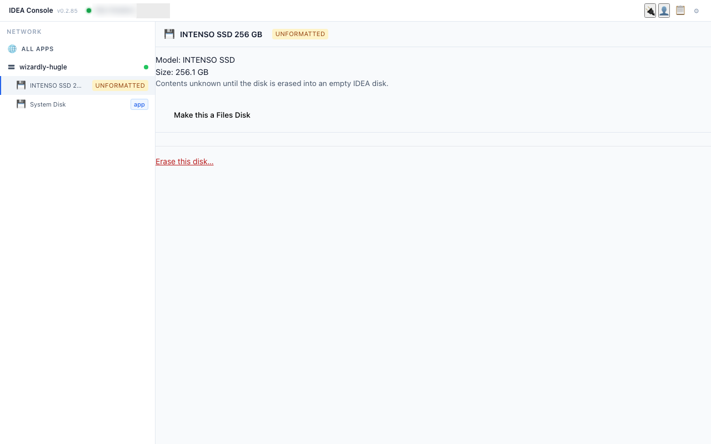
2. Its view shows the model, the size and two buttons: **Make this a Files Disk** and **Erase this disk…**.

**USB sticks.** A teacher's FAT32 or exFAT stick shows as **USB stick: (name) (read-only)**. Do not erase it: **Erase this disk…** turns the stick into an IDEA Disk and deletes the teacher's files, so only do it when asked.

## 3.2 Erase a disk

1. Click **Erase this disk…**. The confirmation shows the disk name, model, size and contents, and the red warning "This erases everything on the disk…".
2. Check the **size and contents**: several disks can have the same name (for example **IDEA Disk**). Make sure it is not the Backup Disk.
3. The box above the text field says **TYPE IDEA DISK TO CONFIRM** (the disk name in capitals). Type the name as it is written on the disk, for example `IDEA Disk`. The **Erase this disk** button stays grey until the name is right. Press **Cancel** if anything looks wrong.
   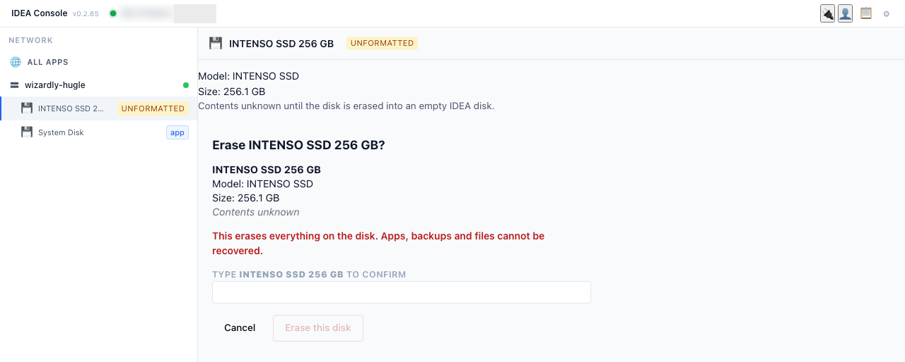
4. After the erase, the disk shows as an **IDEA Disk** with the **empty** badge.

> **A Files Disk that Nextcloud is using cannot be erased.** Ask your IDEA contact to stop Nextcloud first.

## 3.3 Make a Files Disk

1. Select the **IDEA Disk** marked **empty**. The view asks "What would you like to do with this disk?": **Make this a Files Disk**, **Make this a Backup Disk** or **Install App**.
   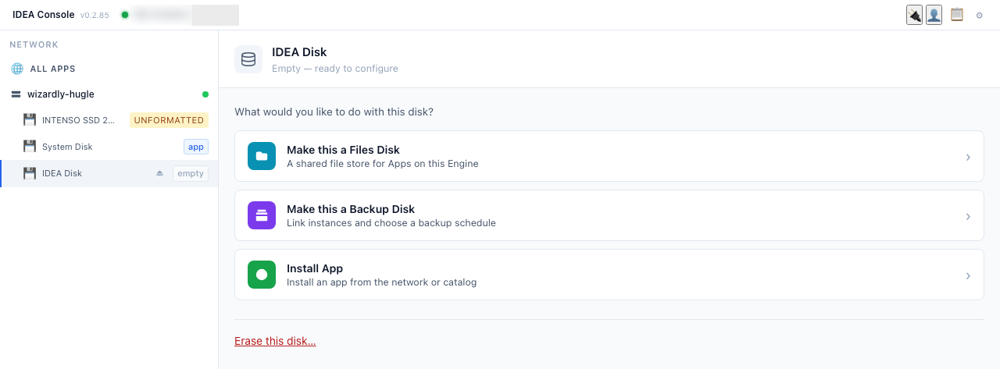
2. Click **Make this a Files Disk**. The panel says "Nothing on the disk is erased", with **SHARE NAME** filled in as **School Files**. Click **Make this a Files Disk**.
   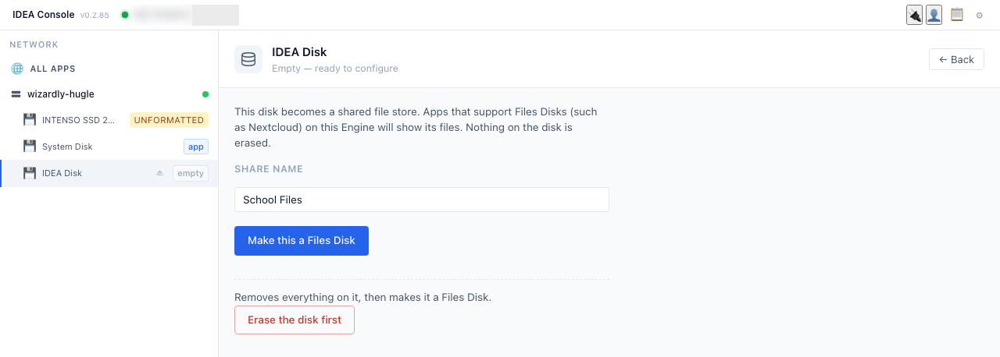
3. After a short wait the disk shows the **files** badge, "Share name: School Files", the free space, an **Eject** button and **Erase this disk…**. Once your IDEA contact has linked it, the view also says **Available in: Nextcloud**. Teachers then find it in Nextcloud (*IDEA for Teachers: Tutorial*, chapter 8).
   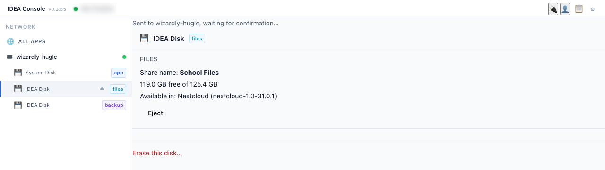

## 3.4 Eject a disk

An IDEA Disk has a small eject icon next to its name in the Network list and an **Eject** button in its disk view. The System Disk has none. Never eject or unplug a disk during a backup.

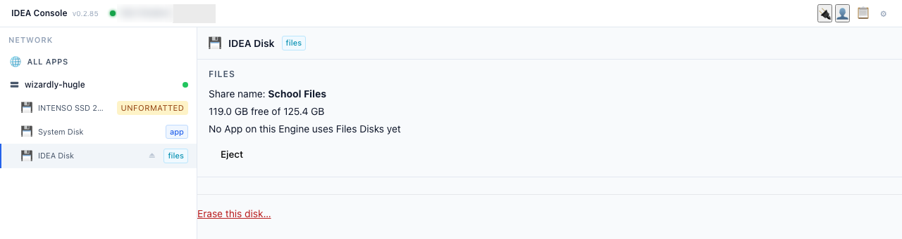

## 3.5 Make a Backup Disk

This section points you to the short operator guide for turning a USB stick, or an empty IDEA Disk, into a Backup Disk.

A Backup Disk backs up **every App** on its IDEA box, including Apps added later. You don't need to pick the apps.

Follow *IDEA for Operators: Make a Backup Stick* for the steps. The Console labels you will see are:

- On a USB stick, the button **Make a Backup Disk**. Under it the Console says: *"Erases this stick, then makes it a Backup Disk with daily backups at 02:30. Needs a disk larger than 8 GB. Choose a disk larger than all the App data on this Pi."* If the stick is too small, the button stays grey and the Console says: *"Too small: needs more than 8 GB. Choose a disk larger than all the App data on this Pi."* A USB stick is erased. The four steps are **Checking the disk**, **Erasing the disk**, **Waiting for the disk to come back**, and **Setting up the Backup Disk**.
- On an empty IDEA Disk, the card **Make this a Backup Disk** (*"Daily backups at 02:30, nothing erased"*). Nothing is erased. The steps shown are **Checking the disk** and **Setting up the Backup Disk**.
- When it is finished: *"Done. This disk is now a Backup Disk."* and *"Backups run every day at 02:30 for every App on this Pi. Apps pause for a moment while a backup runs."* Leave the disk plugged in.

You can change the daily time later on the Backup Disk panel: keep **Scheduled** under **Backup mode**, type the time in **Daily time (24-hour, this Pi's local time)**, and click **Save backup settings**.

If you see a form with **Backup mode** and **Link to instances**, and a **Configure Backup Disk** button, the IDEA box has not been updated for this flow yet. Tick every app of this IDEA box, then click **Configure Backup Disk**.

## 3.6 Run a backup

This section tells you what happens when a backup runs, and how to start one yourself if you need to.

1. A new Backup Disk runs every day at 02:30. You can also start a backup yourself: in **ALL APPS**, each app row has a **Back up** button next to Start, Stop and Open. Click it. The row shows **Backing up…** with a progress bar, and the **OPERATIONS** box at the top shows the same job.
   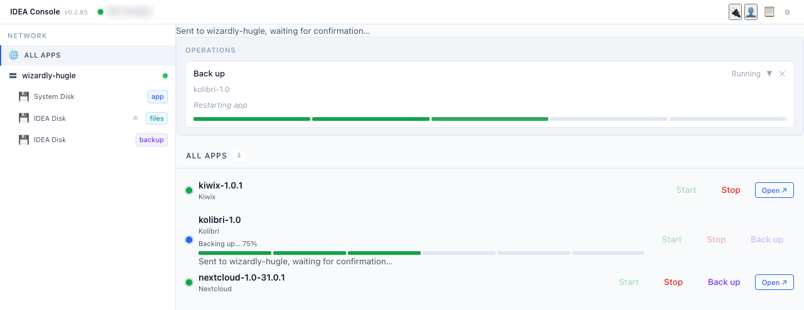
2. **Each App pauses only while it is being copied.** The box copies the apps one after another, so only the app being copied is closed for a short while, and it starts again by itself. The other apps keep working. A small app takes a few minutes, but the first backup of a big one takes much longer: on the kit about 37 minutes for Kolibri, an estimated 1 h 30 for the full Wikipedia and about 2 h 15 for all apps together. Do this outside lesson time. Some apps can be copied while they keep running; if one of them had to be paused after all, the Console says *"Backed up, but the App was briefly stopped"*.
3. When a job is finished the OPERATIONS box shows **Done**; close it with **✕**. The Backup Disk's **Backups** list shows **Last backup** with the date and time for each app. You don't need to repeat this for each app: a Backup Disk already backs up every App, including Apps added later.
   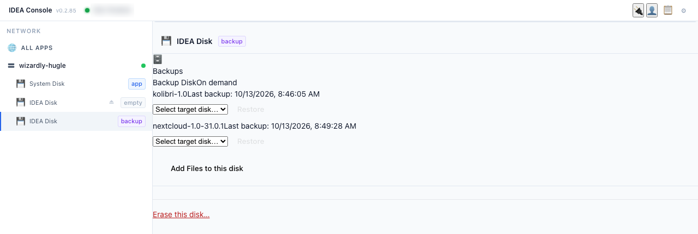

For a missed backup, a full Backup Disk, or changing the daily time, see *IDEA for Operators: Make a Backup Stick*.

## 3.7 Restore after a breakdown

You need a **spare disk** (an empty IDEA Disk) to restore onto.

1. Open the **Backup Disk**. Each app in the **Backups** list shows **Last backup**, a **Select target disk…** list and a **Restore** button (grey until a target is chosen).
2. In **Select target disk…** choose the spare disk. Only spare disks are offered here. Click **Restore**.
   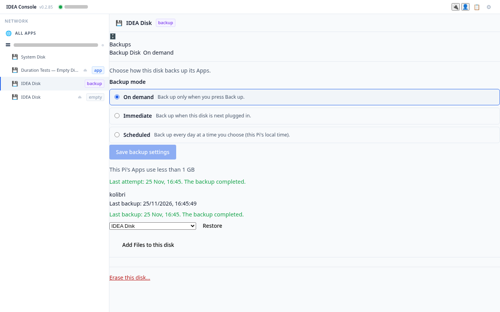
3. The Console asks: "Are you sure? This will overwrite **kolibri-1.0** on **IDEA Disk**." Click **Confirm Restore**.
   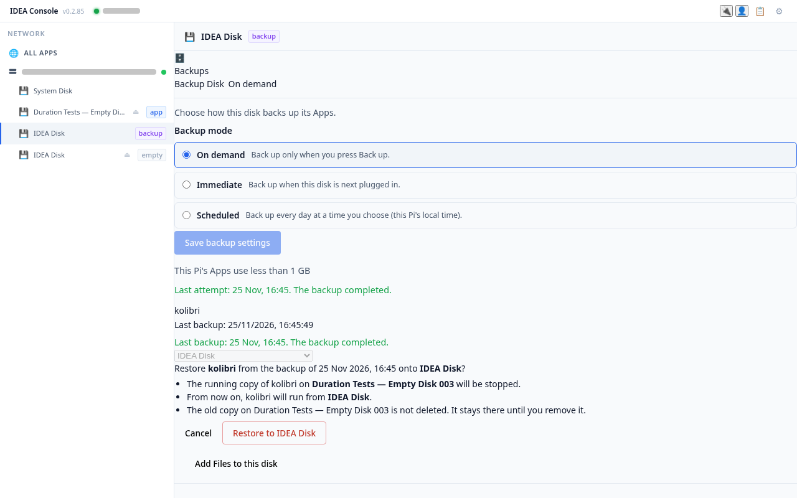
4. When the restore is finished, the spare disk shows the **app** badge and lists the restored app. A small app takes about a minute; Kolibri with its channels or Wikipedia takes much longer, so wait.
   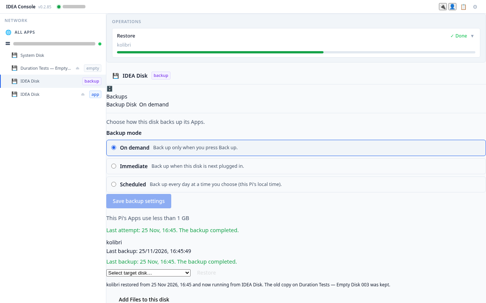
5. The restore **moves** the app: it is no longer listed on its old disk, and the restored app is **stopped** (orange dot, **Start** button). Until you start it, the app cannot be opened. A restore is for a real breakdown, not for practice on a working school box.
6. Click **Start** on the restored app's row. After about 30 seconds it runs again and the row shows **Open ↗**.
   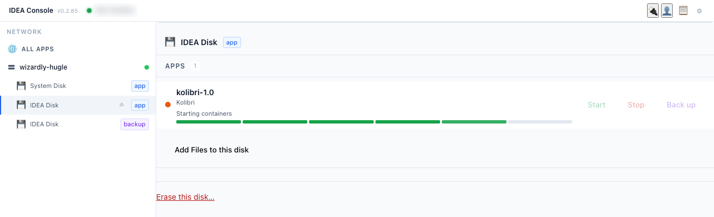
7. Open the app from its card on the **Apps** page (as in *IDEA for Teachers: Tutorial*, 2.3) and sign in as the teacher (coach).
8. Check that the data is back: classes, learners, lessons, quizzes and reports, as at the last backup.
   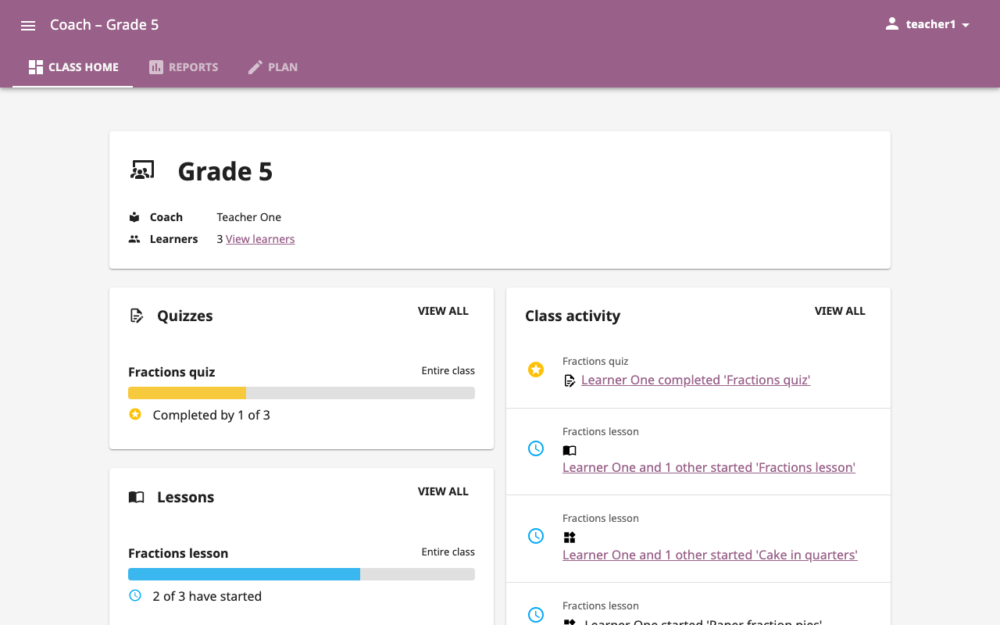
   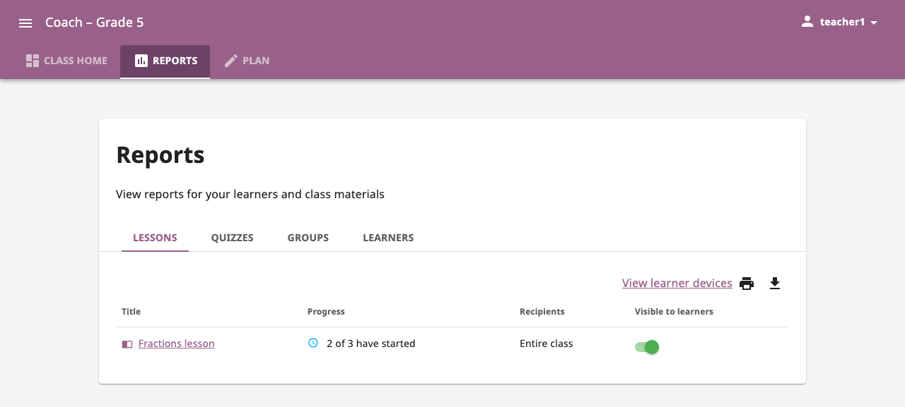
9. Later, your IDEA contact can move the app back to the System Disk and prepare the spare disk again.

> **Important.** Anything done after the last backup is lost. Make a new backup of the restored app as soon as it runs.
