**Status:** Authoritative · **Maintained by:** Marco (with Tapiwa) · 13 November 2026 (v1.2: all pictures retaken on Kolibri 0.19 and the current Console)

# Grade 5A — Add and subtract fractions

Monde Primary School.

Lesson name in Kolibri: **Grade 5A Duration Lesson**.

_Read one step. Do it. Then go to the next step._

The lesson is already on the computer. It has three videos, then three exercises. You do not add resources. You do not remove resources. You open it, check it, and switch on **Visible to learners** for the class.

The pictures and the steps in this manual show Kolibri 0.19 and the current Console, so what you see on the screen should match.

---

## Before class

Do this before the learners come in, so the lesson is ready when they sit down.

### 1. Open Kolibri from the Console

The app is already running. You only open it.

1. On a classroom computer, double-click **IDEA** on the desktop. On your own laptop, tablet or phone, open the browser and type `http://idea.local` (or the address on the second line of the box's sticker, for example `http://brave-otter.local`).
2. The Console opens on the **Apps** page: one card per app, each with a blue **Open** button. Do not type a port number. Do not type a new web address.
3. Find the **Kolibri** card. Click **Open**. Right after the Console opens, **Open** can stay grey for a few seconds while the Console connects to the box. Wait until it turns blue, then click it.

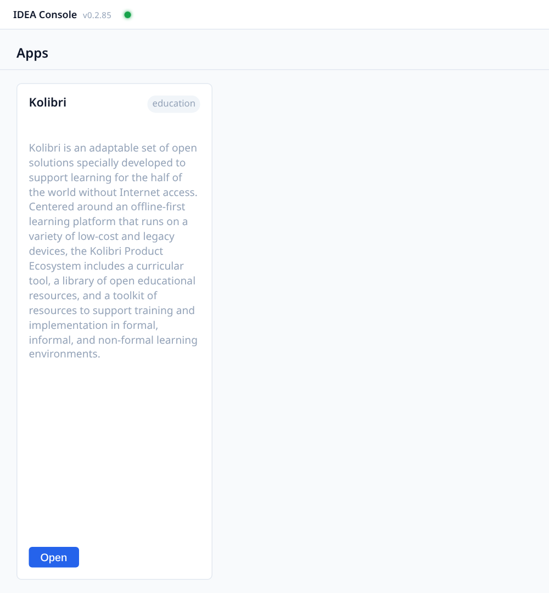

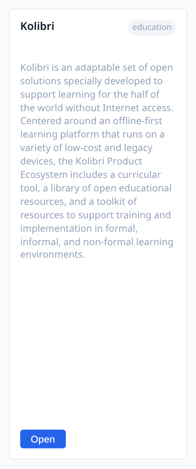

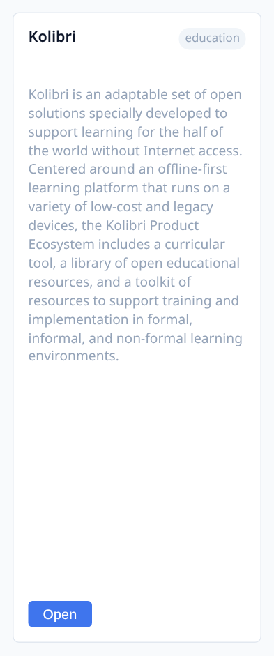

A new tab opens. It uses the same computer you already opened the Console on.

Do not click **Start**. Do not click **Stop**. Do not click **Back up**.

If you do not see **Open**, stop. Do not press anything else. Tell the person walking you through this, or your school operator.

### 2. Sign in

1. On the new tab, type your username and click **NEXT**.
2. If Kolibri then asks for a password, type it and click **Sign in**.
3. You should see **Coach**. If Kolibri shows a list of classes, click **Grade 5A**. You land on **Class home** for that class.

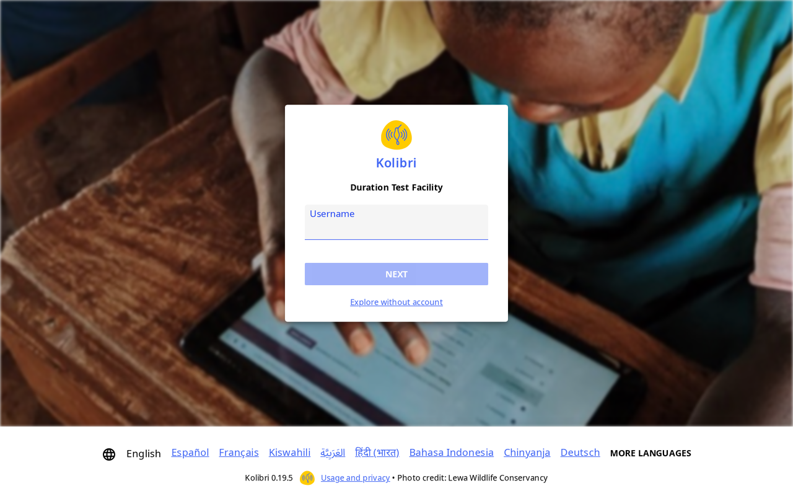

### 3. Open the lesson

1. In **Coach**, click **Lessons**.
2. Click **Grade 5A Duration Lesson**.

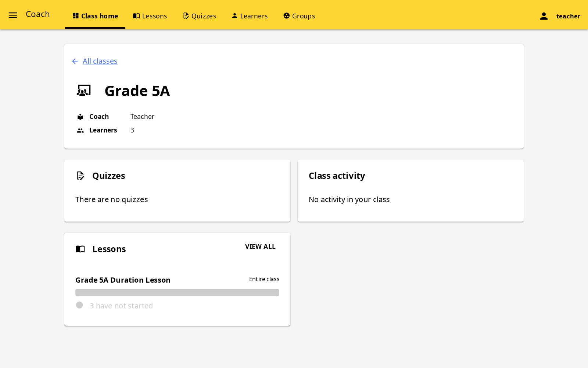

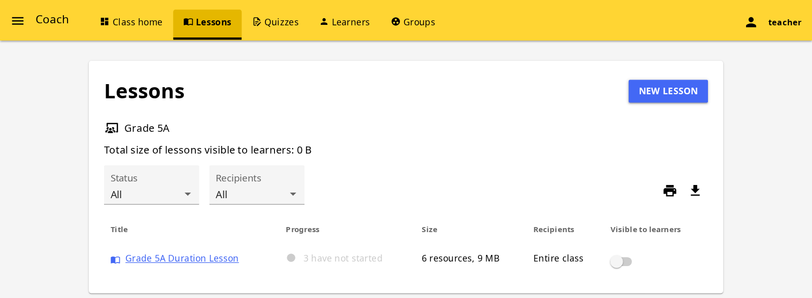

*Lessons. The row is Grade 5A Duration Lesson.*

### 4. Check the resources are in this order

Look at the list inside the lesson. It should be three videos first, then three exercises. Read the names. They should match this list.

**Videos (do these first):**

1. Visually adding fractions: 5/6+1/4
2. Visually subtracting fractions: 3/4-5/8
3. Estimating adding fractions with unlike denominators

**Exercises (do these after the videos):**

4. Visually add and subtract fractions
5. Estimate to add and subtract fractions with different denominators
6. Common denominators

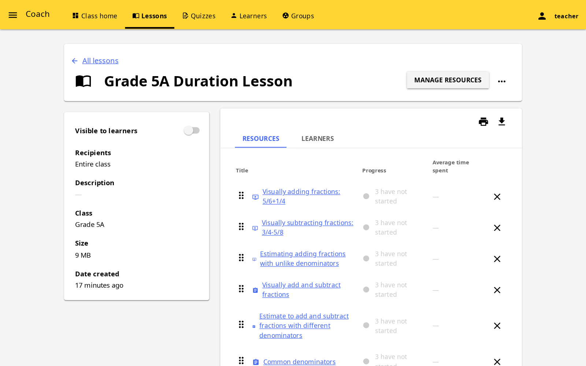

If a name is missing, or the order is wrong, stop. Tell the person walking you through this, or your school operator. Do not add or delete resources yourself.

### 5. Check who the lesson is for

1. On the open lesson, find **Recipients**.
2. It must show your Grade 5A class (or **Entire class** for that class).
3. If the class is not there, stop. Do not try to fix it yourself. Tell the person walking you through this, or your school operator.

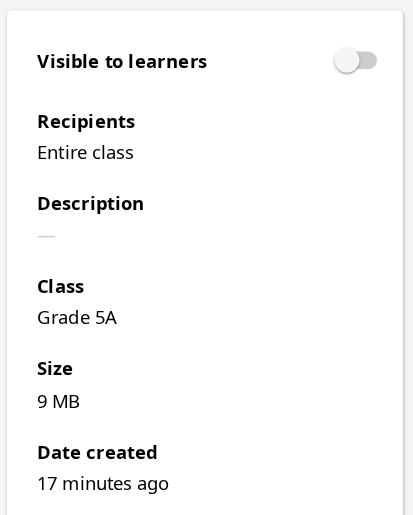

### 6. Make the lesson visible

1. Switch on **Visible to learners**.
2. Learners can see the lesson the next time they sign in.

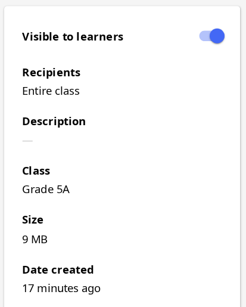

Kolibri shows *Lesson is visible to learners* at the bottom of the screen for a moment. If the switch is already on, leave it. Do not turn it off.

---

## During class

You lead. The learners work on their own screens. Walk the room. Do not do the exercises for them.

### 1. Learners sign in

Each learner:

1. Opens the Console the same way you did (the **IDEA** shortcut, or `http://idea.local`).
2. Finds the **Kolibri** card and clicks **Open**. Does not click **Start**.
3. Types their own username and clicks **NEXT**. If Kolibri asks for a password, they type it and click **Sign in**. Many learners sign in with only their username.

They must sign in with their own name. If they do not sign in, you will not see them in the lesson report later.

### 2. Learners open the lesson

1. On **Home**, under **Recent lessons**, click **Grade 5A Duration Lesson**. (They can also click **Grade 5A** under **Your classes**, then the lesson.)

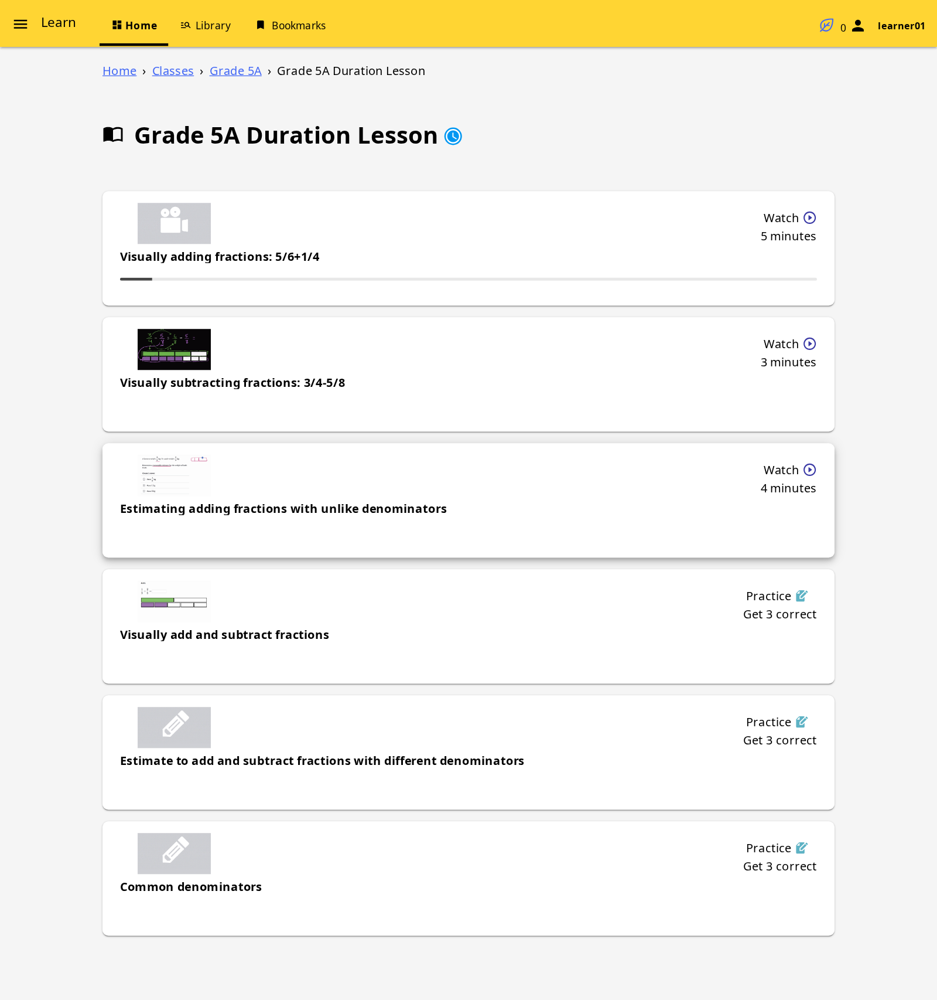

They should see the same six resources, videos first.

### 3. Videos first, then exercises

Say this to the class:

1. Do the three videos first. Do not skip them.
2. Watch **Visually adding fractions: 5/6+1/4**.
3. Then watch **Visually subtracting fractions: 3/4-5/8**.
4. Then watch **Estimating adding fractions with unlike denominators**.

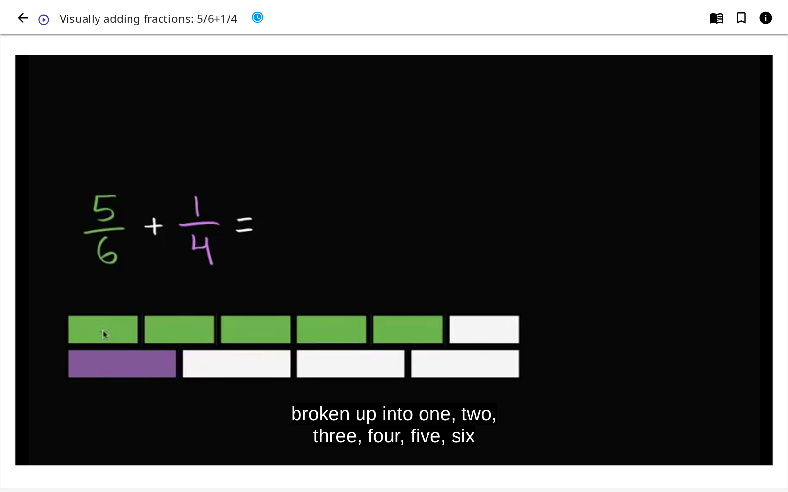

5. After the three videos, do the exercises in this order:
   - Visually add and subtract fractions
   - Estimate to add and subtract fractions with different denominators
   - Common denominators
6. Answer the questions on the screen. Click **CHECK**. Kolibri tells them straight away if the answer is right. Keep going until the goal at the top is reached (for example **Get 3 correct**).
7. Stay in this lesson until the six resources are done, or until you say stop.

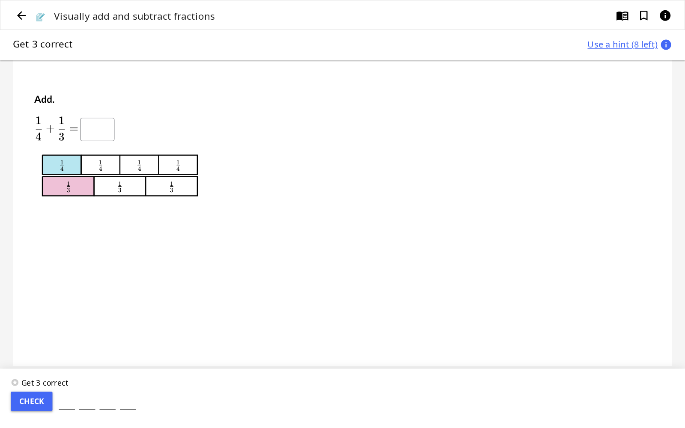

The video plays in the browser. They do not download it.

If a learner cannot find the lesson, check with them: Did they sign in? Is **Visible to learners** on? Does **Recipients** show this class?

---

## After class — see how the class did

Do this when the learners have finished, or at the end of the period. In Kolibri 0.19 you read this on the lesson itself, not on a separate **Reports** tab.

1. You are signed in as the teacher.
2. Open **Coach**, choose the Grade 5A class, and click **Lessons**.
3. Click **Grade 5A Duration Lesson**.
4. Open the **Learners** tab. You see one row for each learner. The **Resources** tab shows time spent on each item.

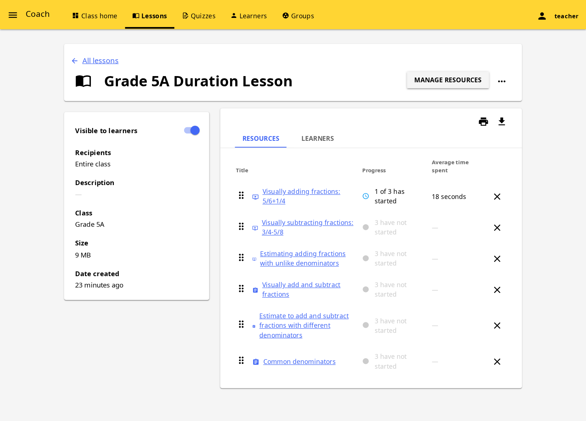

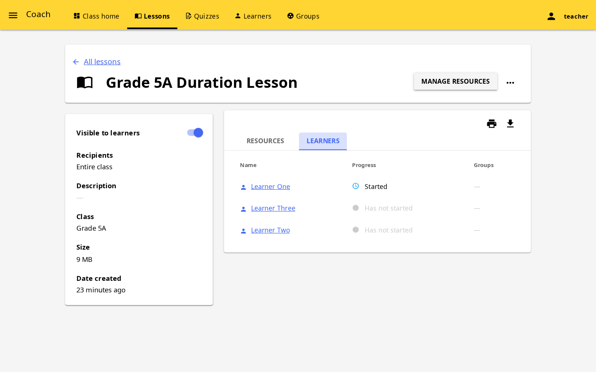

| What you see | What it means |
|--------------|----------------|
| **Has not started** | They have not opened the lesson. Did they sign in? Could they find it? |
| **Started** | They began but did not finish. |
| **Completed** | They finished the resources in the lesson. |

What to do with it:

- **Has not started:** ask the learner. Often they were not signed in, or **Visible to learners** was off.
- **Started:** they can finish next time. Note the name.
- You do not need every learner at 100% today. You need to see that they signed in, watched, and tried the exercises.

Note one thing you saw. Example: "Most of Grade 5A finished the videos. Three learners did not start."

---

## If something is wrong

| What you see | What to do |
|--------------|------------|
| No **Open** on the Kolibri card | Stop. Do not press **Start**. Tell the person walking you through this, or your school operator. |
| A learner cannot sign in | Check that they type their own username. If it still does not work, tell the person walking you through this, or your school operator. |
| Lesson not on the learner's screen | Check **Recipients** shows the class. Switch **Visible to learners** on. |
| Every learner shows **Has not started** | Learners must sign in with their own name before they start. |
| A resource name is missing | Stop. Do not add resources yourself. Tell the person walking you through this, or your school operator. |

---

## Names you click

These are the words on the screen. They are not web addresses.

| Where | The name you click |
|-------|--------------------|
| Console | **Apps**, then the **Kolibri** card and **Open** |
| Lesson | Grade 5A Duration Lesson |
| Class | the Grade 5A class at Monde Primary |
