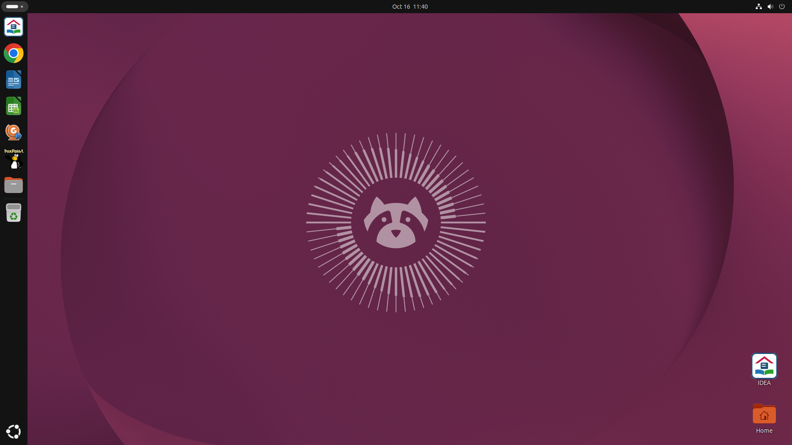
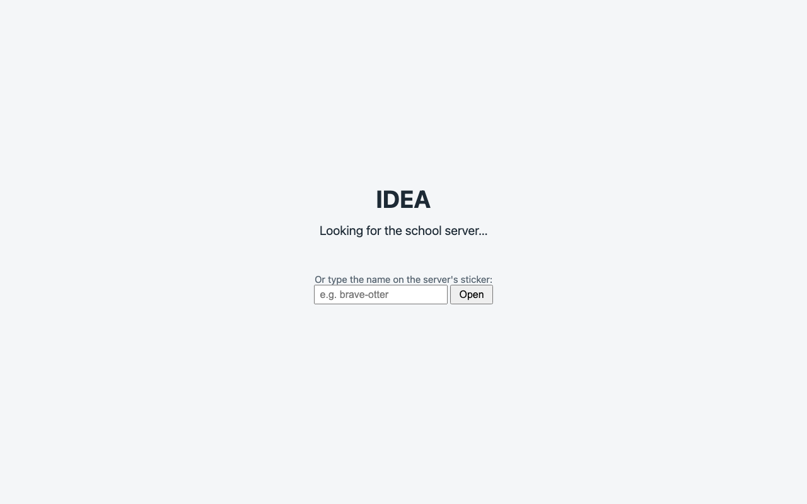
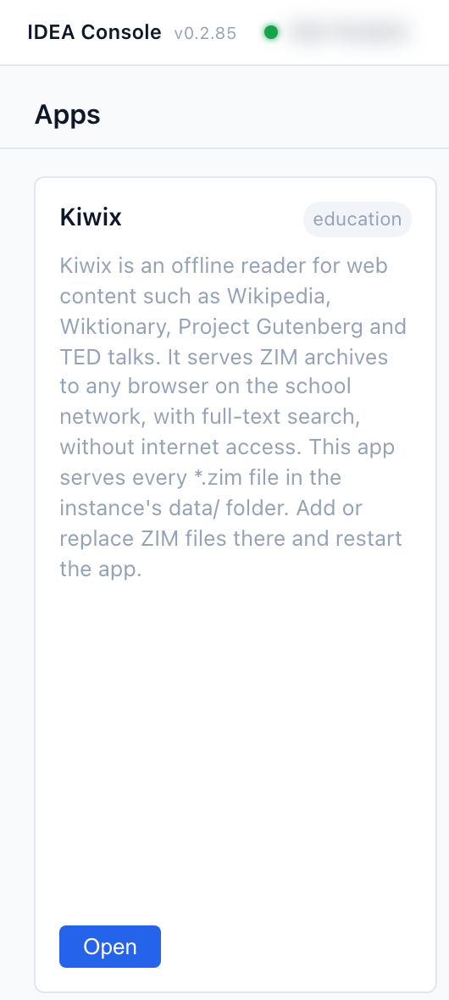
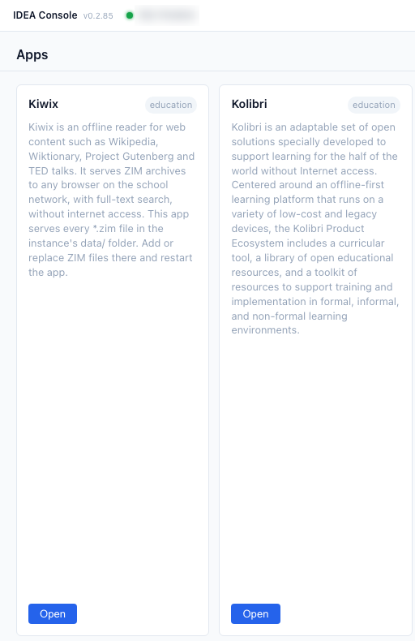
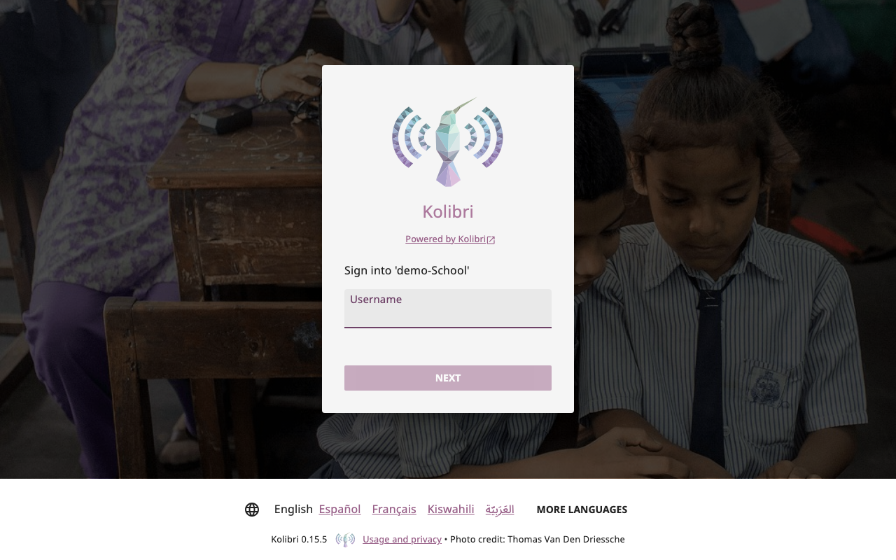

**Status:** Authoritative · **Maintained by:** Marco (with Atlas) · 19 October 2026 (kit: 'on <box>' labels, reset on restart, known problem with switched-off boxes)

# 2. Getting connected and opening an app

All apps open from one web page: the **Console**. How you get to the Console depends on the computer you use.

## 2.1 Connect to the Wi-Fi

The classroom computers are already connected. Do this only on your own laptop, tablet or phone.

The IDEA router at your school makes two Wi-Fi networks. Their names and first passwords are the same at every IDEA school:

| Network | Password (until your school changes it) | Who joins it | What it reaches |
|---|---|---|---|
| **IDEA** | `idea911!` | Students, and the classroom computers | Only the IDEA box: the Console and its apps. No internet. |
| **IDEA-Teachers** | `idea-teachers911!` | Teachers only | The IDEA box, and the internet. Internet is **on**; your IDEA contact can switch it off when the head teacher asks. |

- Give students only the **IDEA** password. Keep the **IDEA-Teachers** password among the teachers.
- The classroom computers stay on **IDEA**. Your IDEA contact or the operator can move a teacher's classroom computer to **IDEA-Teachers**; for now that needs the admin account (*IDEA Classroom Computer: Installation Manual*, 6.5).
- **Change the passwords later.** These first passwords are easy on purpose, but anyone who knows them can join. Once IDEA is running at your school, the head teacher chooses new passwords and asks the IDEA contact to set them on the router. After that, every phone and laptop must join again with the new password.

To connect:

1. Open the Wi-Fi settings on your device.
2. Choose **IDEA-Teachers** (teachers) or **IDEA** (students).
3. Type the password and join.

## 2.2 Open the Console

There are two ways to open the Console. Use the one that fits the device in front of you.

### 2.2.1 On a classroom computer

The classroom computers have **one** shortcut on the desktop, named **IDEA**. There are no separate icons for Kolibri, Nextcloud or the other apps.

1. Double-click **IDEA** on the desktop. You can also find it in the app menu. It opens in Chrome.

   

2. A start page titled **IDEA** appears for a moment and says **Looking for the school server…**.

   

3. The Console opens by itself.

If the start page says **No school server was found**, check that the computer is connected to the school network. Then type the first line of the box's sticker, for example `brave-otter`, in the field **Or type the name on the server's sticker**. Use small letters, with `-` between the words. Press **Open**. The start page remembers that IDEA box.

### 2.2.2 On your own laptop, tablet or phone

1. Connect to the Wi-Fi (2.1).
2. Open the browser.
3. Type `http://idea.local` in the address bar and press Enter.
4. The Console opens.

   

5. Bookmark it, so you can open it again with one click. In Chrome, press **Ctrl+D** (on a Mac **⌘+D**), then **Done**.

If the Console does not open, type the address on the second line of the box's sticker instead, for example `http://brave-otter.local`.

> **Two IDEA boxes at your school?** The Console shows the apps of all of them. Each card says on which box the app runs, for example **on kind-panda**.

## 2.3 First steps in the Console

1. The Console opens on the **Apps** page: one card per app, each with a short description and a blue **Open** button. The green dot at the top shows the Console is connected to the IDEA box.
   
2. Click the blue **Open** button on the card of the app you need. The app opens in a new tab. Here it is Kolibri's sign-in page.
   

Good to know:

- A card that is greyed out and says **Not available** is not running. Do not try to fix it: tell your school operator.
- **Known problem: apps that don't open.** If an IDEA box is switched off, or was once connected to yours and is now at another school, the Console still shows its apps as if they worked. **Open** then gives a page that doesn't load. There is no fix yet. Use the apps that are **on** your own school's IDEA box (the name on its sticker).
- **The classroom computers reset at every restart.** Anything saved on the computer itself is gone after a restart. Save work in Nextcloud (chapter 7).
- Do not type numbers (addresses or ports) into the address bar. Always start from the Console and use **Open**.
- A student computer that no longer works properly is not repaired: the operator resets its card (chapter 13). Students lose only what they saved on the computer itself, so let them save their work in Nextcloud (chapter 7).
- The person icon at the top right (**Operator Login**) is for the operator (Part B). Teachers do not need it.

> **Tip.** You can bookmark the page that opens. If the bookmark stops working, go back to the Console and use **Open** again.
