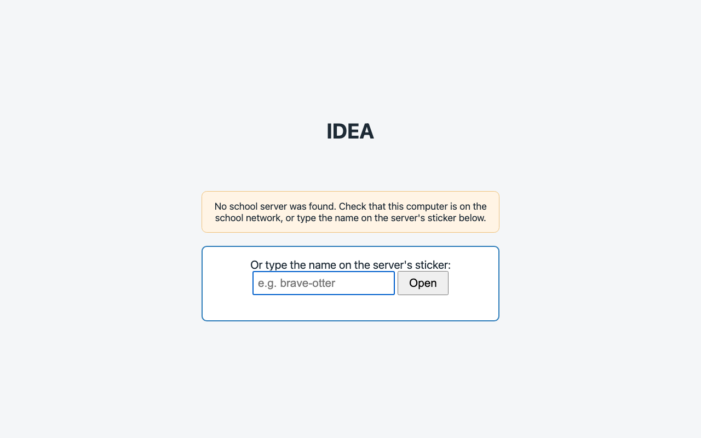

**Status:** Authoritative (2.1 is a draft until the IDEA shortcut is on the student computers, idea#203) · **Maintained by:** Marco (with Atlas) · 15 October 2026 (school Wi-Fi networks, idea#209)

# 2. Getting connected and opening an app

All apps open from one web page: the **Console**. How you get to the Console depends on the computer you use.

## The school Wi-Fi networks

The IDEA router at your school makes two Wi-Fi networks. Their names and first passwords are the same at every IDEA school:

| Network | Password (until your school changes it) | Who joins it | What it reaches |
|---|---|---|---|
| **IDEA** | `idea911!` | Students, and the classroom computers | Only the IDEA box: the Console and its apps. No internet. |
| **IDEA-Teachers** | `idea-teachers911!` | Teachers only | The IDEA box, and the internet. Internet is **on**; your IDEA contact can switch it off when the head teacher asks. |

- Give students only the **IDEA** password. Keep the **IDEA-Teachers** password among the teachers.
- **Change the passwords later.** These first passwords are easy on purpose, but anyone who knows them can join. Once IDEA is running at your school, the head teacher chooses new passwords and asks the IDEA contact to set them on the router. After that, every phone and laptop must join again with the new password.

## 2.1 On a classroom computer: the IDEA shortcut

The classroom computers (the student computers) are already connected to the school network. They have **one** shortcut on the desktop, named **IDEA**. There are no separate icons for Kolibri, Nextcloud or the other apps.

1. Double-click **IDEA** on the desktop. You can also find it in the app menu. It opens in Chrome.

[[pending-shot: IDEA-01 | Student computer desktop with the one IDEA shortcut (text only for now: the screenshot tool captures browser pages, not a computer desktop)]]

2. A start page titled **IDEA** appears for a moment and says **Looking for the school server…**. First it tries the IDEA box this computer belongs to, then the last IDEA box it opened, then any other IDEA box at the school. When it finds one, the Console opens by itself.

3. If the start page says **No school server was found**, check that the computer is connected to the school network. Then type the name on the box's sticker in the field **Or type the name on the server's sticker**, and press **Open** (or Enter). The sticker is hand-written and has two lines:

   - line 1: the name, for example `brave-otter`
   - line 2: the address, for example `http://brave-otter.local`

   Type the first line, for example `brave-otter`: small letters, with `-` between the words. The start page then remembers that IDEA box.

> **Two IDEA boxes at your school?** The Console shows the apps of all of them. You can also open a specific box by typing its sticker name in the field on the start page.

## 2.2 On your own laptop, tablet or phone

1. Connect your device to the Wi-Fi: teachers join **IDEA-Teachers**, students join **IDEA** (see *The school Wi-Fi networks* above).
2. Open the browser and go to `http://idea.local`. The Console opens.
3. If it doesn't open, type the name on the box's sticker: go to the address on the sticker's second line, for example `http://brave-otter.local`.

### Open the Console by hand

Use this on a device without the IDEA shortcut, for example your own laptop, when the steps above don't work.

1. Click in the browser's address bar and type `http://` followed by the name on the box's sticker and `.local`: `http://<sticker-name>.local`, for example `http://brave-otter.local`. Press Enter.
2. The Console opens.

   

3. **Make it your home page** (Chrome): open **⋮ > Settings > On startup**, choose **Open a specific page or set of pages**, click **Add a new page** and paste the Console address.
4. **Bookmark it** (Chrome): press **Ctrl+D** (on a Mac **⌘+D**), or click the star at the right of the address bar, then **Done**.

Steps 1, 3 and 4 take place in the browser's own window, so this tutorial has no screenshots of them. Other browsers have the same settings under similar names.

## 2.3 Open an app in the Console

1. The Console opens on the **Apps** page: one card per app, each with a short description and a blue **Open** button. The green dot at the top shows the Console is connected to the IDEA box.
   
2. Click the blue **Open** button on the card of the app you need. The app opens in a new tab. Here it is Kolibri's sign-in page.
   

Good to know:

- A card that is greyed out and says **Not available** is not running. Do not try to fix it: tell your school operator.
- Do not type numbers (addresses or ports) into the address bar. Always start from the Console and use **Open**.
- A student computer that no longer works properly is not repaired: the operator resets its card (chapter 13). Students lose only what they saved on the computer itself, so let them save their work in Nextcloud (chapter 7).
- The person icon at the top right (**Operator Login**) is for the operator (Part B). Teachers do not need it.

> **Tip.** You can bookmark the page that opens. If the bookmark stops working, go back to the Console and use **Open** again.
