**Status:** Authoritative · **Maintained by:** Marco (with Atlas) · 13 November 2026 (v2.1: Kolibri 0.19.5 paths and screenshots)

# 3. Kolibri for teachers

**About the examples in this chapter.** Every IDEA box comes with the demo setup switched on: the app **Kolibri Demo**, with the school **IDEA Demo School**, the class **Grade 5** and the demo accounts. The screens in this chapter come from it. Open the **Kolibri Demo** card in the Console, not the **Kolibri** card. The steps work the same in the school's own Kolibri, with your own school, class and account names. The demo accounts are listed in *Appendix: demo accounts* at the end of this tutorial.

In the demo, you sign in as `teacher1` (or `teacher2`). The Library has the channels **Maths**, **Grade 5 Science** and **Early Reading**, and also a **Khan Academy (English - US curriculum)** channel if you want more practice later. This chapter uses **Maths**. The ready-made **Maths lesson** for Grade 5 includes the Fractions items (pictures, short videos and **Fractions practice**) and the rest of the Maths channel. Section 3.4 shows how you would make a smaller Fractions lesson of your own from **Maths > Fractions**. The demo quiz is **Grade 5 Practice Quiz**.

## 3.1 Signing in

This is how you sign in to Kolibri Demo as a teacher, so you can try the steps that follow.

Open **Kolibri Demo** from the Console (2.3). Type your username and click **NEXT**, then type your password and click **Sign in**.

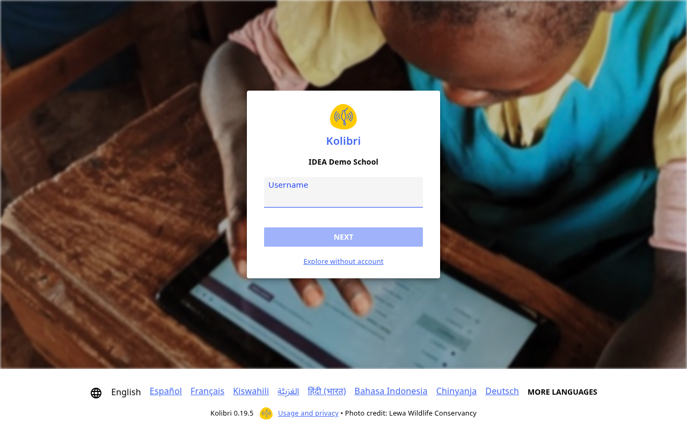

## 3.2 Create a class

A class is the group you teach in Kolibri. This section shows you how to make one.

Creating classes needs a Kolibri admin account (in the demo school, `admin`, password `admin911!`; `teacher1` is the coach of Grade 5).

1. Open **Facility > Classes**. You see the list of classes.
   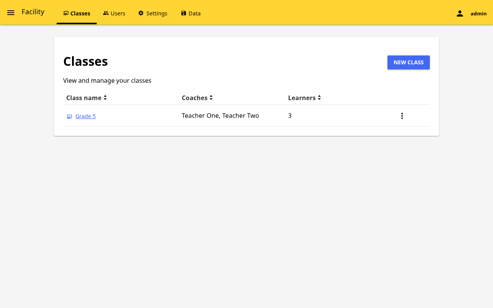
2. Click **NEW CLASS**, type the class name, click **SAVE**. (In the demo we pressed **CANCEL** because `Grade 5` already exists.)
   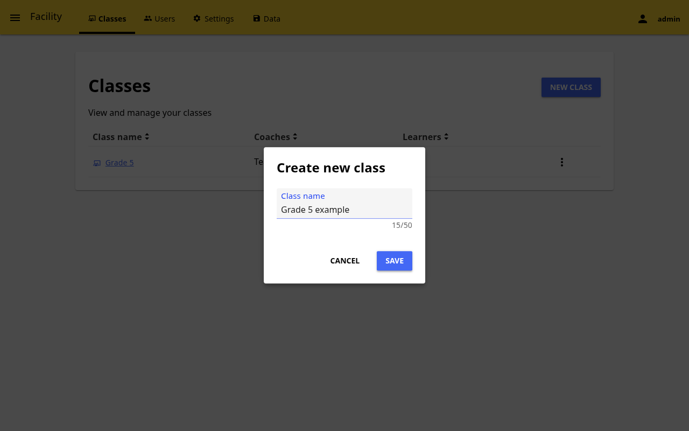

## 3.3 Enroll learners

This is how you add learners to a class.

1. Click the class name. On the class page (with **Coaches** and **Learners**), click **ENROLL LEARNERS**. The enroll page opens. It only lists people who are not yet in the class (in the Demo that includes **Learner Four**, and it may also list the admin account — tick only the learner you want).
   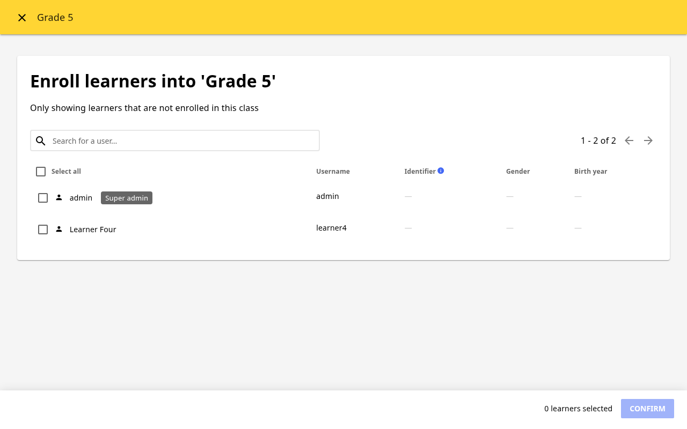
2. Tick each learner you want to add (here: **Learner Four**), then click **CONFIRM**. (In the demo we closed the page without confirming, so Grade 5 stays as it is.)
   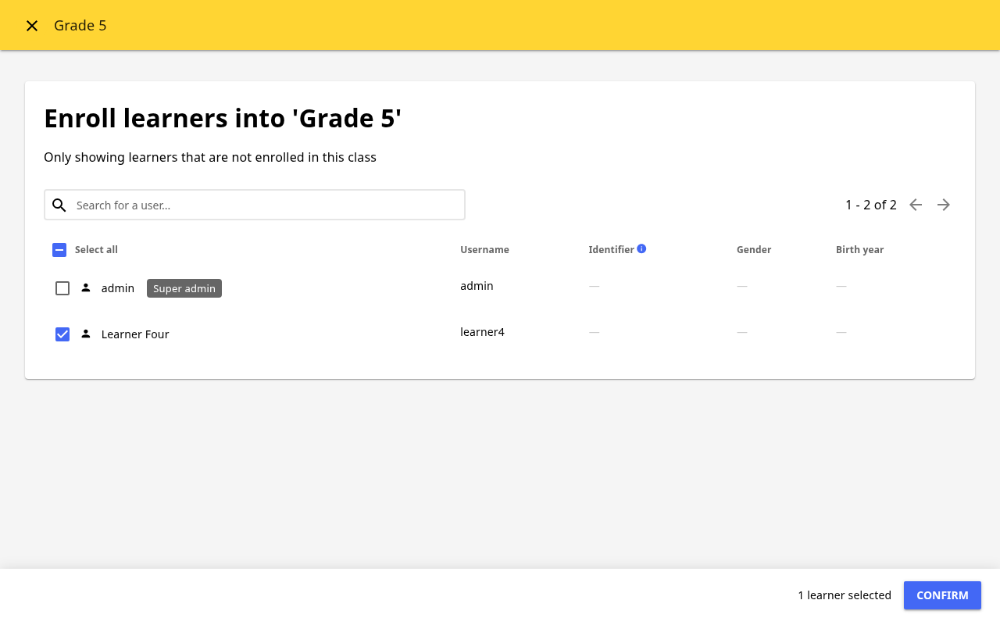
3. Learners already in the class appear under **Learners**. In the Demo, Grade 5 already has Learner One, Learner Two and Learner Three. Learner Four is in the school but not in this class, so you can practise the step above.
   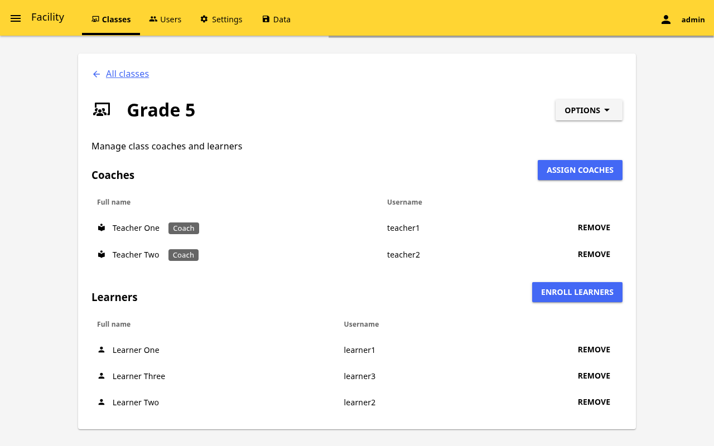

## 3.4 Make a lesson and show it to the class

A good lesson mixes resources that explain (videos, pictures, activities) with resources that let learners practise (exercises). This section shows you how to make a lesson and make it visible to the class.

1. Open **Coach**, choose the class **Grade 5**, and click **Lessons > NEW LESSON**.
   
2. Type a title (`Fractions lesson`). Under **Recipients** keep **Entire class**. Click **SAVE CHANGES**. (In the demo we pressed **CANCEL**, and we use the ready-made **Maths lesson** in the steps below.)
   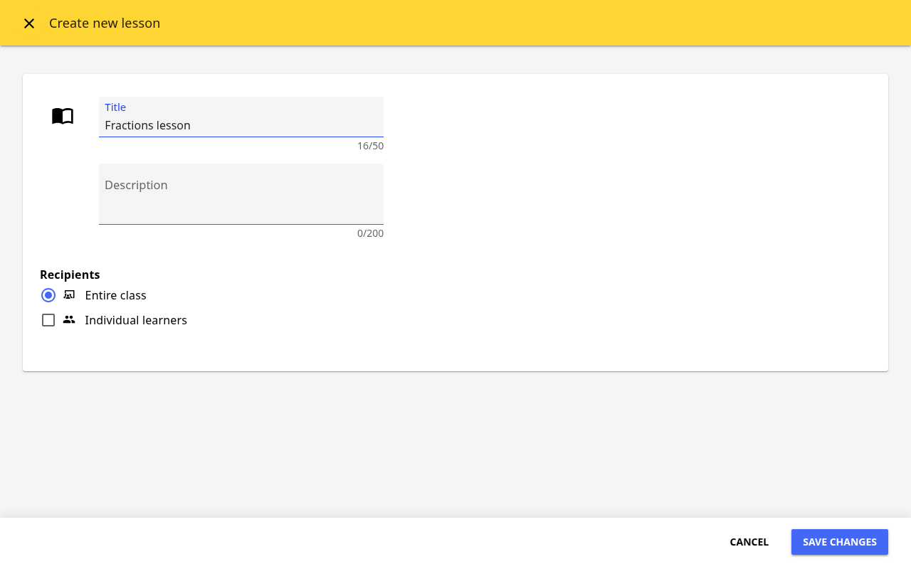
3. On the lesson page, click **MANAGE RESOURCES**.
   
4. The **Add resources to lesson** window opens. Choose the channel (**Maths**). You see its topics: **Fractions**, **Multiplication** and **Times Tables**. Open **Fractions**. You see seven items: three pictures (**Cake in quarters**, **Fraction circles**, **Paper fraction pies**), three short videos, and the exercise **Fractions practice**. Tick a mix, for example the three pictures, one video and **Fractions practice**. When you are done, click **SAVE & FINISH** (or the close **X**, if you did not mean to change anything). In the demo we opened the window and then closed it without adding ticks, because the **Maths lesson** already has these resources.
   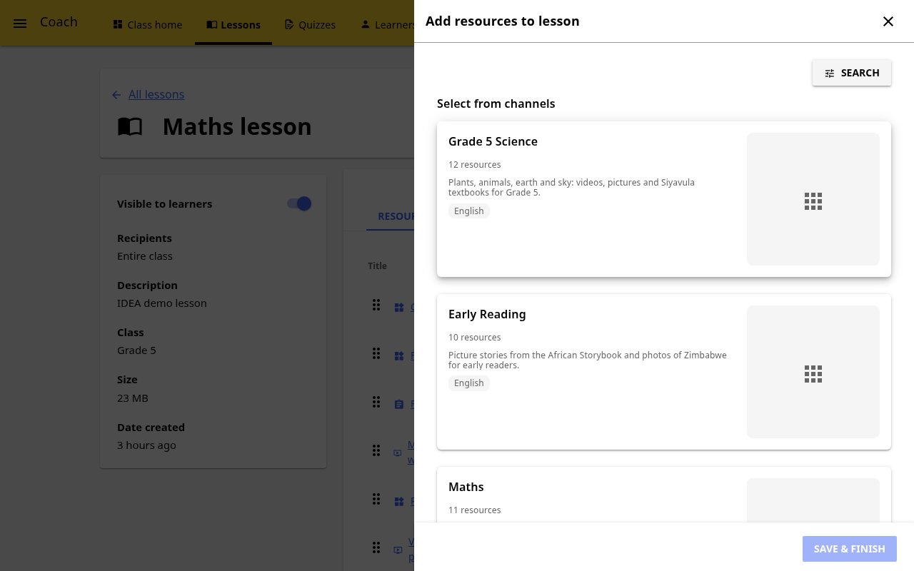
5. Back on the lesson page, check the resources and switch on **Visible to learners**. The ready-made **Maths lesson** is already visible and already includes these Fractions items, together with the rest of the Maths channel (a multiplication video, two times-tables documents and **Times tables practice**).
   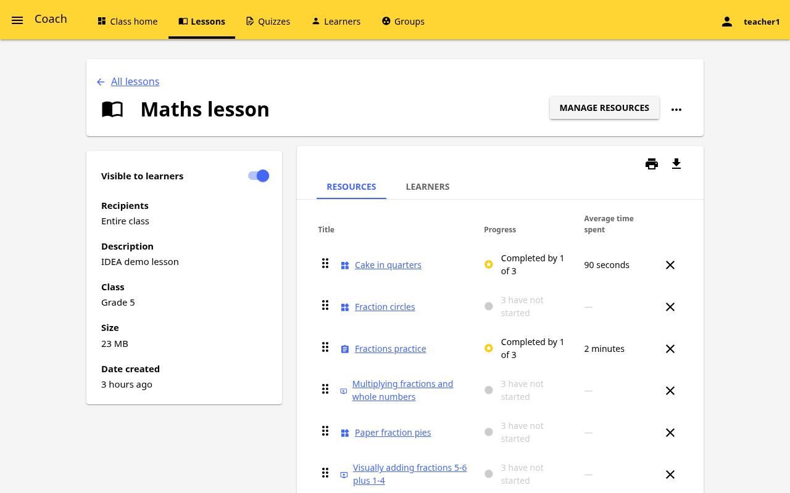

## 3.5 Make a quiz

Quizzes are built from exercises only. This section first lets you try a ready-made exercise and quiz in Kolibri Demo, then shows you how to make a quiz of your own.

### Try it in Kolibri Demo

Kolibri Demo has exercises and a quiz ready for the class **Grade 5**: in **Maths**, **Fractions practice** and **Times tables practice** (the goal for each is **Get 4 correct**); in **Early Reading**, **Reading: Rudo and the goat**; and the quiz **Grade 5 Practice Quiz** (10 questions: 4 from Rudo and the goat, 6 from Fractions practice). Try them first as a learner, then see the results as the teacher. Use a second browser window (private window) for the learner.

**A. A learner does an exercise**

1. **Do:** sign in to Kolibri Demo as `learner1` (no password). Under **Recent lessons**, click **Maths lesson**. 
   **✔ Check:** **Home** shows the class **Grade 5**, three lessons and the quiz **Grade 5 Practice Quiz**.
   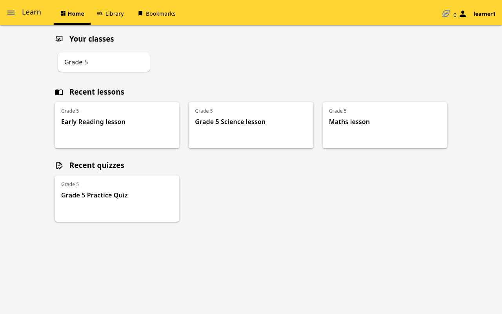
2. **Do:** in the lesson, click **Fractions practice** (marked **Practice**, with the goal **Get 4 correct**). 
   **✔ Check:** the lesson lists its items in order, starting with the Fractions pictures and **Fractions practice**, then videos, documents and **Times tables practice**.
   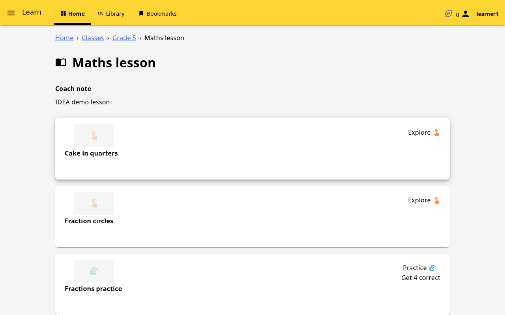
3. **Do:** read the question, click an answer (or type a number), then click **CHECK**. After a right answer, go on to the next question; after a wrong answer, try again. Keep going until the goal **Get 4 correct** is reached. 
   **✔ Check:** the goal **Get 4 correct** is at the top, and **CHECK** is at the bottom. A green tick appears for each right answer, and the exercise is marked **Completed** when the goal is reached. In the Demo, `learner3` has already completed **Fractions practice**, so the screen below already shows the ticks and **Completed**.
   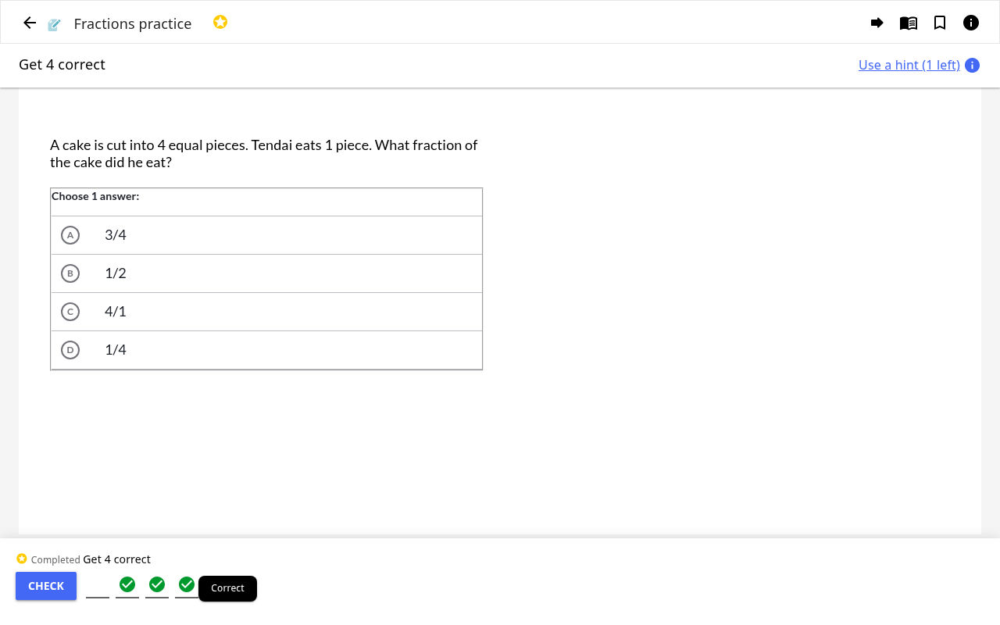

**B. A learner takes the quiz**

1. **Do:** on **Home**, click **Grade 5 Practice Quiz** under **Recent quizzes**. Answer each question and move through them, then **SUBMIT QUIZ** and confirm. Answers cannot be changed after that. 
   **✔ Check:** in the Demo, `learner3` has already submitted the quiz. Opening it as `learner3` shows the result: **Completed**, score **70%** (7 out of 10), and an answer history you can look through question by question.
   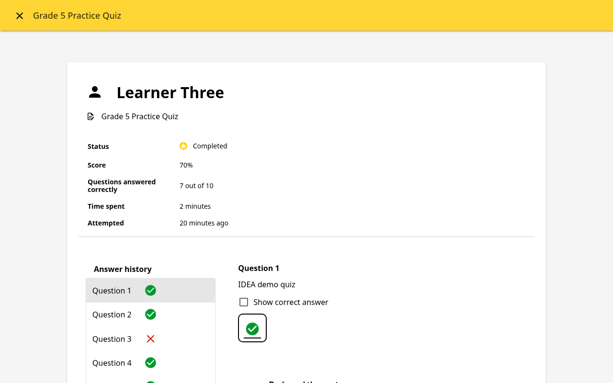
2. **Do:** go back to **Home**. 
   **✔ Check:** **Home** shows the quiz with its score (**Score: 70%** for `learner3`).
   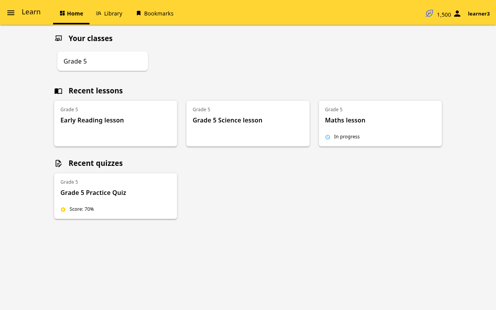

**C. The teacher sees progress**

1. **Do:** in the teacher window, sign in to Kolibri Demo as `teacher1` and open **Coach > Grade 5** (the **Class home** tab). 
   **✔ Check:** **Class home** shows how many learners completed the quiz and started each lesson. **Class activity** lists what learners did.
   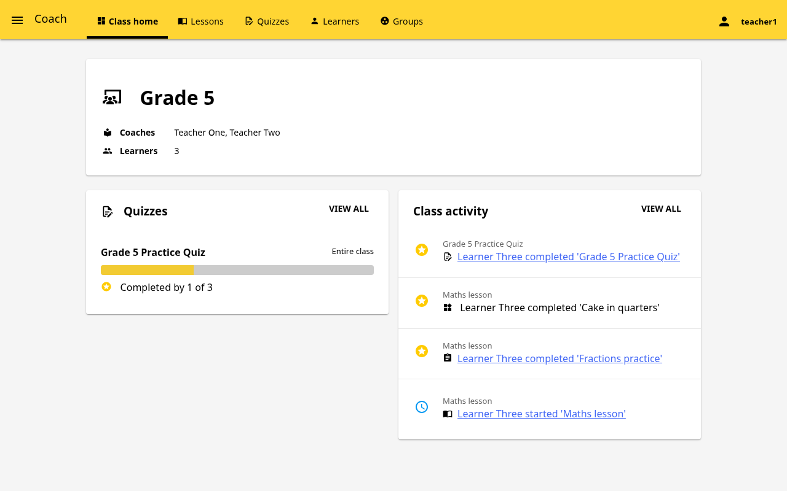
2. **Do:** click **Lessons > Maths lesson**, then the **Learners** tab on the lesson (the **Resources** tab shows time spent on each item). 
   **✔ Check:** each learner is listed as **Completed**, **Started** or **Has not started**.
   
3. **Do:** click **Quizzes > Grade 5 Practice Quiz**. 
   **✔ Check:** each learner's progress and score. The **Difficult questions** tab shows the questions many learners got wrong.
   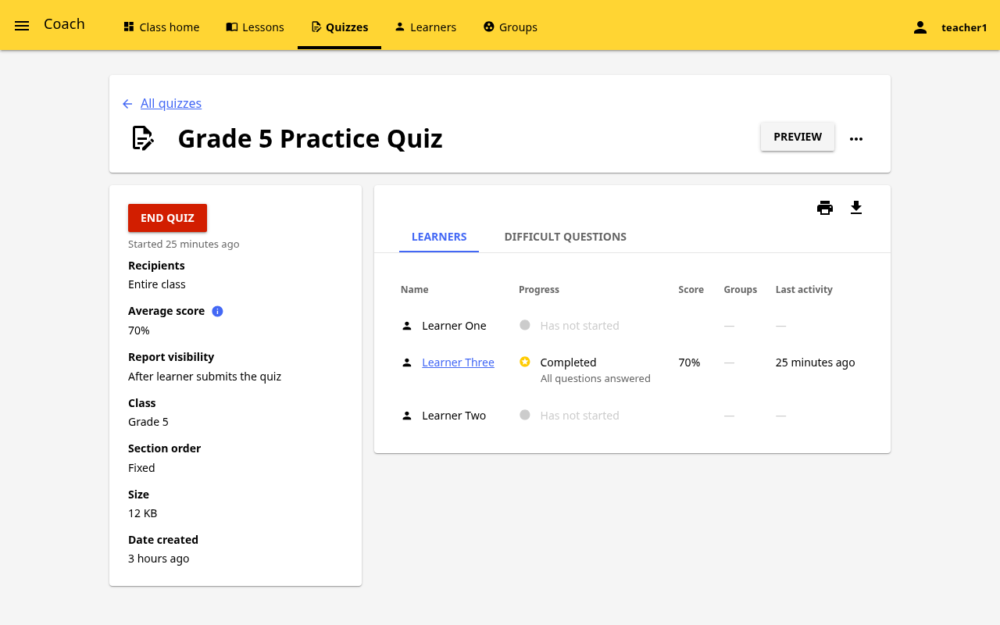

In Kolibri Demo, `learner3` has already done **Cake in quarters**, **Fractions practice** and the quiz, so the reports are not empty. 3.6 explains the reports in more detail.

### Make your own quiz

The steps are the same in Kolibri Demo and in the school's own Kolibri. You pick exercises, and Kolibri can choose the questions, or you can choose them yourself.

1. Click **Quizzes > NEW QUIZ**, then choose **Create new quiz**.
   
2. Type a title (`Fractions quiz`). Choose when learners may see their report, and keep **Recipients** as the entire class unless you want only some learners. A quiz can have one or more sections. Click **+ ADD QUESTIONS**, set how many questions you want, then **CONTINUE**. Browse to an exercise (for example **Maths > Fractions > Fractions practice**), tick it, and add the questions. You can review, replace or reorder questions, then **SAVE** or **SAVE & CLOSE**.
3. Check the questions and the section order (**Randomized** or **Fixed**).
4. A new quiz is not open to learners yet. When the class is ready, click **START QUIZ**. When the class has finished, open the quiz again and click **END QUIZ**, so no more answers come in. In the Demo, **Grade 5 Practice Quiz** is already started, so its status on the Quizzes list shows **END QUIZ**.
   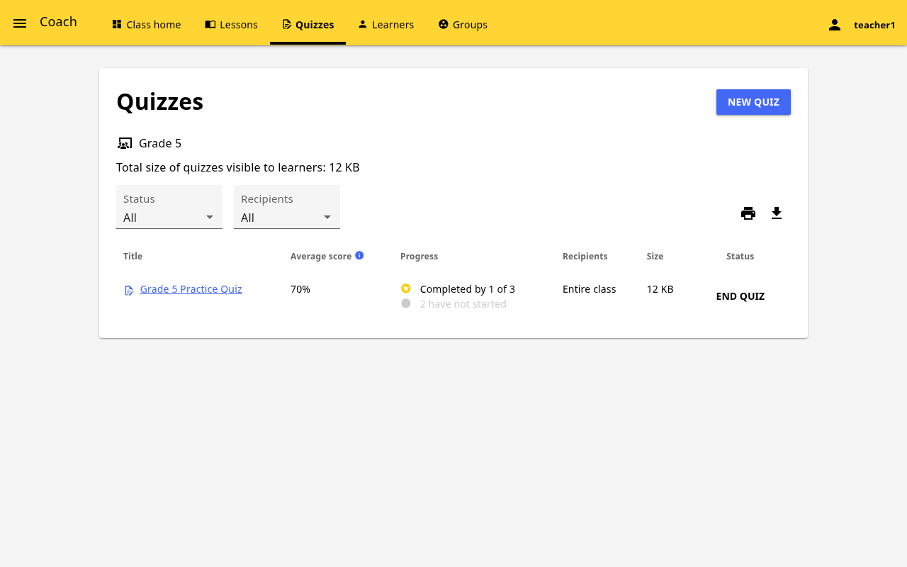

## 3.6 See progress (reports)

This is how you read what the class has done, after learners have worked (chapter 4).

In Kolibri 0.19 you read reports on the lesson, the quiz or the learner, rather than on a separate **Reports** tab.

1. Open **Coach > Grade 5**. Use **Lessons**, **Quizzes** and **Learners** (and **Class home** for the overview).
   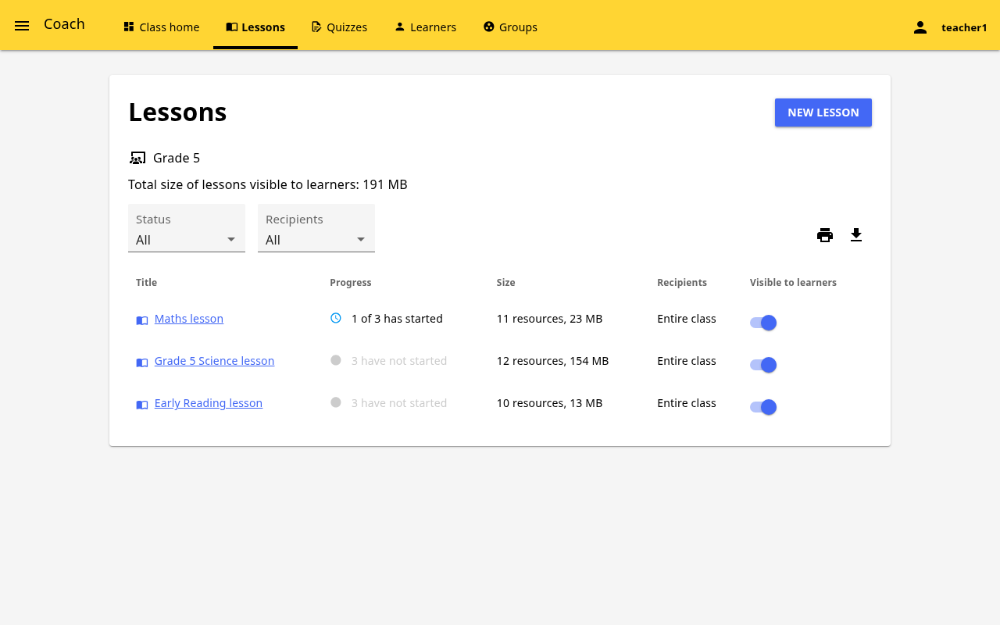
2. **Lessons > (the lesson) > Learners**: who completed, started or did not start.
   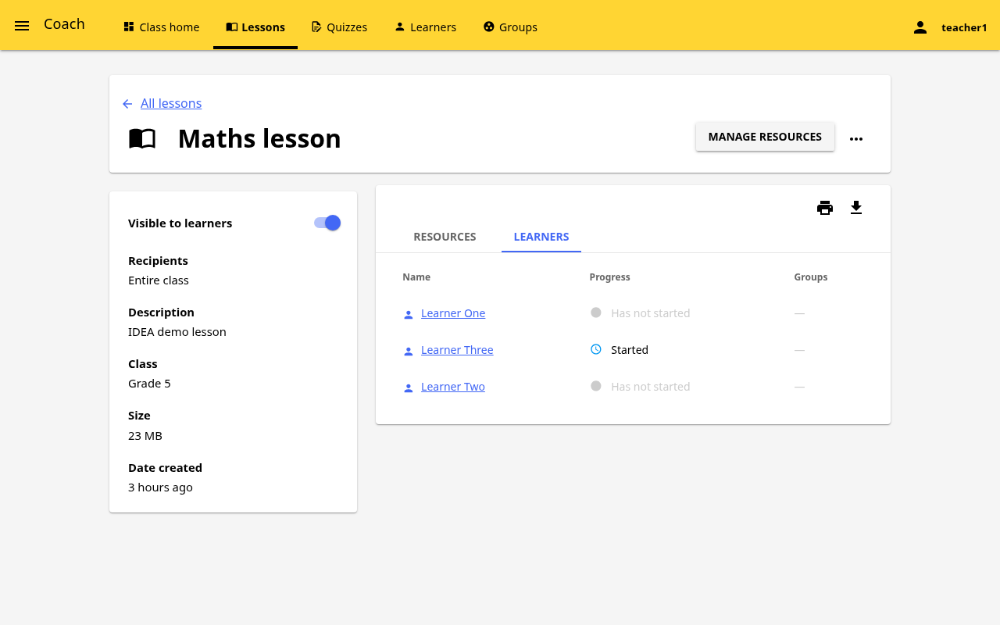
3. **Quizzes > (the quiz)**: status and score per learner; **Difficult questions** shows what to re-teach.
   
4. **Learners > (a name)**: that learner's lessons and quizzes. A lesson that is hidden from learners can still appear on this report.
   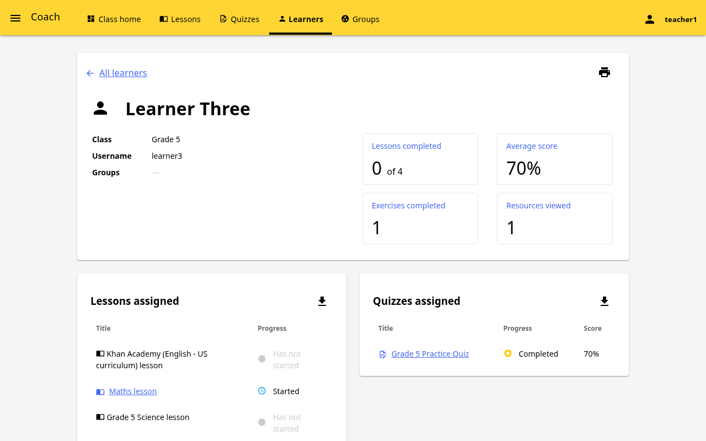
Reports can be printed or exported as CSV (icons top right).

> **Tip.** Do not chase 100%. Look for the question most learners got wrong and teach it again.

### What the lesson report means

| Kolibri shows | What it means | What to do |
|---|---|---|
| **Completed** | The learner finished the resource or the lesson | Nothing. Give them the next lesson or a quiz |
| **Started** | The learner began but did not finish | They can finish next time. Note the name |
| **Has not started** | The learner did not open it | Ask them. Often they did not sign in with their own name, or the lesson was not visible to learners |

You do not need every learner at 100% after one class. Check that they signed in, worked through the explaining resources and tried the exercises.

## 3.7 Teaching one class period

This puts 3.4, 3.6 and chapter 4 together for one lesson. In Kolibri Demo, use `teacher1`, the class **Grade 5** and the **Maths lesson**.

**Before class**

1. **Do:** sign in as `teacher1`, open **Coach > Grade 5 > Lessons** and click **Maths lesson** (3.4). 
   **✔ Check:** the resources are in the order you want: explaining resources (pictures, videos, documents) first, exercises where you want learners to practise.
2. **Do:** check **Recipients**. 
   **✔ Check:** it shows **Entire class**.
3. **Do:** switch on **Visible to learners** (it is already on for the Maths lesson). 
   **✔ Check:** the switch is on. Learners see the lesson the next time they open **Home**.

**During class**

1. **Do:** ask every learner to open Kolibri Demo and sign in with **their own** username (chapter 4). 
   **✔ Check:** each learner sees **Maths lesson** on **Home**. A learner who uses someone else's name, or does not sign in, does not appear in the reports.
2. **Do:** tell the class to go through the explaining resources first, then do the exercises, in the order of the lesson.
3. **Do:** walk the room. Help learners who are stuck, but do not do the exercises for them.

**After class**

1. **Do:** open **Lessons > Maths lesson** (3.6). 
   **✔ Check:** each learner is listed as **Completed**, **Started** or **Has not started**. The table in 3.6 says what to do about each.
2. **Do:** pick the one thing most learners found hard and teach it again next time. Do not chase 100%.

### If something is wrong

| What you see | What to do |
|---|---|
| The lesson is not on a learner's screen | Check that **Recipients** shows the class and that **Visible to learners** is on |
| A learner cannot sign in | Check that they type their own username. If it still does not work, tell your school operator |
| Reports is empty | Learners must sign in with their own name before they start |
| A resource is missing from the lesson | Tell your school operator |
| The Kolibri card in the Console has no **Open** | Tell your school operator. Do not try to fix it yourself |
