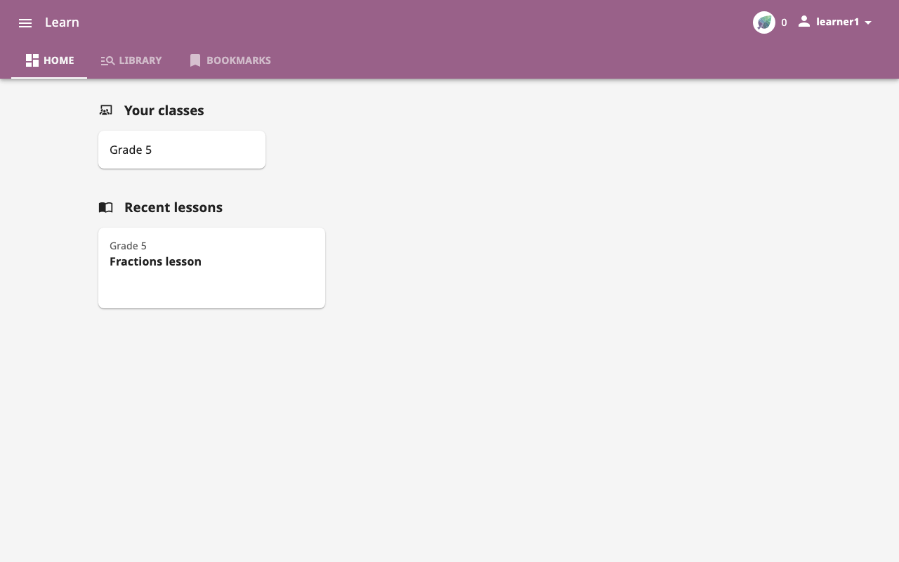
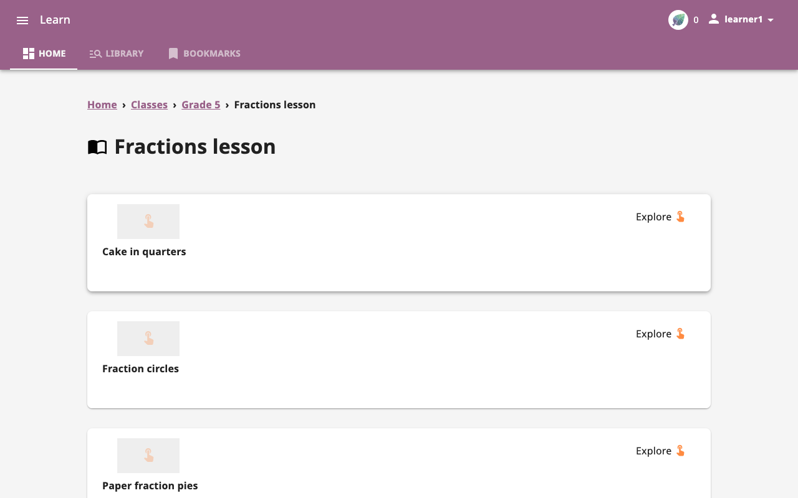
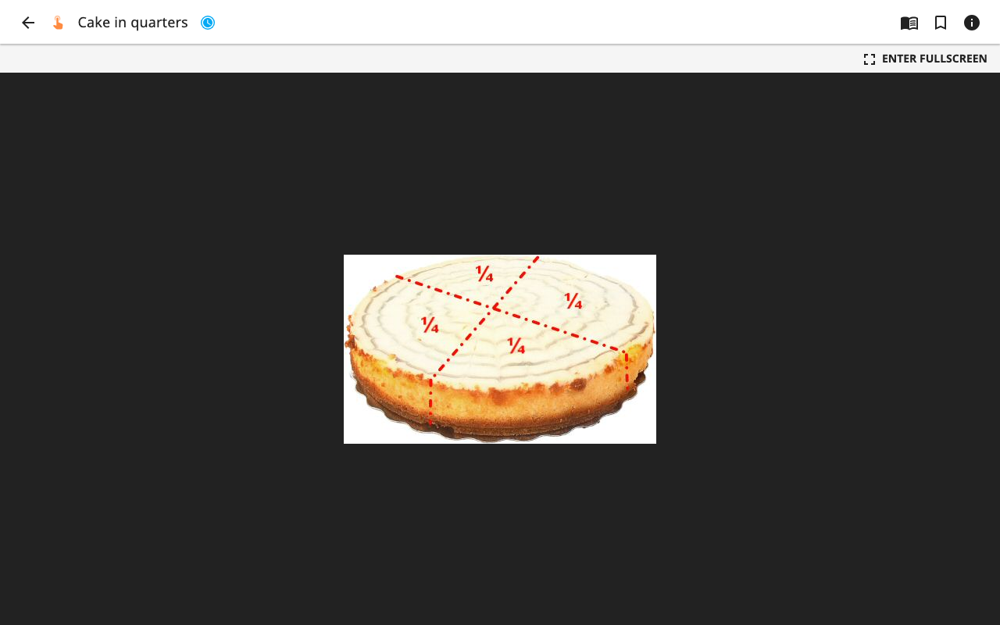
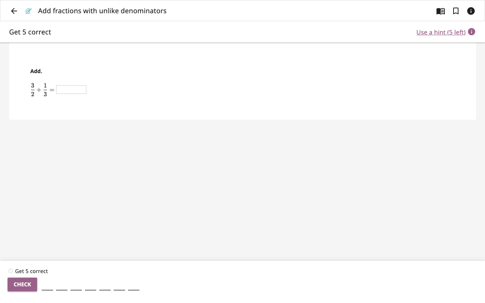
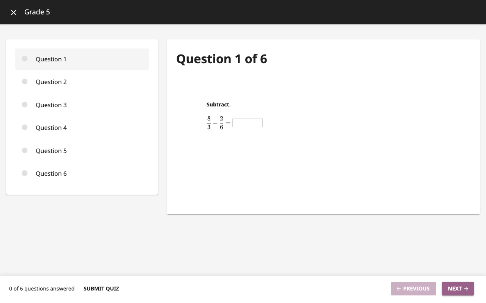
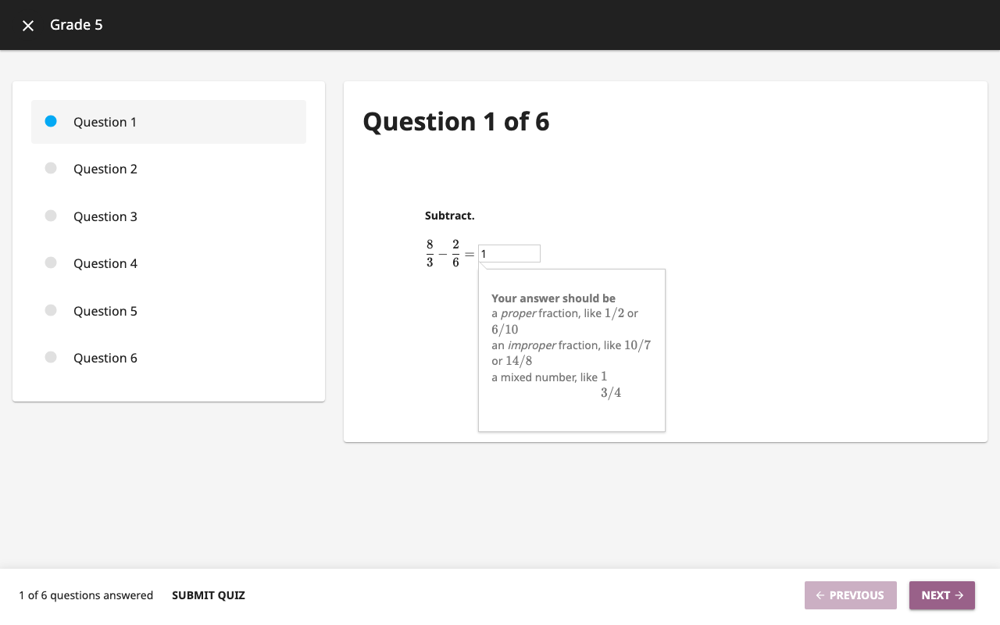
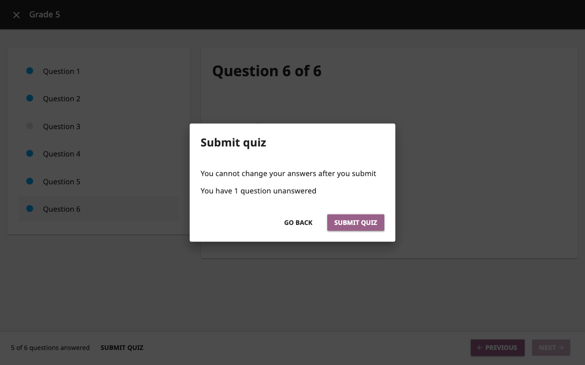
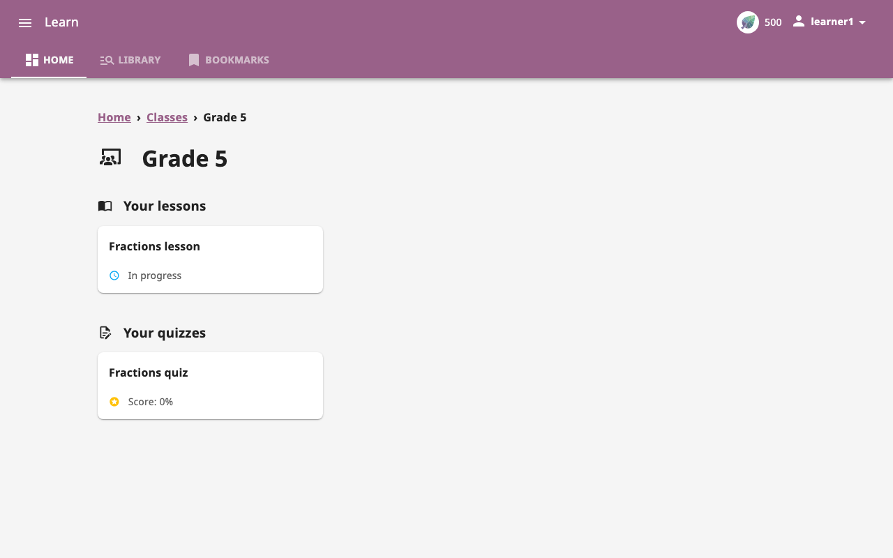

**Status:** Authoritative · **Maintained by:** Marco (with Atlas) · 19 October 2026 (kit: Kolibri Demo)

# 4. Kolibri for learners (try it yourself)

Your learners open Kolibri the same way you do: on a classroom computer they double-click **IDEA** on the desktop and click **Open** on the Kolibri card in the Console (2.2.1). Show them this once. To try it yourself with the demo learners, open **Kolibri Demo**.

Sign in as a learner in a second browser window (private window) to see exactly what your class sees. Learners have no password in Kolibri. They sign in with only their username, for example `learner1`.

> **On every IDEA box**, both **Kolibri** and **Kolibri Demo** already let learners sign in without a password. **At an existing school**, a teacher with admin rights (or the Kolibri admin) turns this on in Kolibri: open **Facility > SETTINGS**, untick **Require password for learners**, then click **SAVE CHANGES**.

## 4.1 Do a lesson

1. Sign in as `learner1`. **HOME** shows **Your classes**, **Recent lessons** and **Recent quizzes**.
   
2. Click **Fractions lesson**. Its items are listed in order.
   
3. Open the first item (**Cake in quarters**, a picture activity). Videos open the same way.
   
4. Exercises work like this (here a Khan Academy exercise; in Kolibri Demo, try **Fractions practice** in the **Maths lesson**, see 3.5): type an answer, click **CHECK**. Keep going until the goal at the top ("Get 5 correct") is reached.
   
5. Sign out. Sign in as `learner2` and open only one item, so the report shows a difference.

## 4.2 Take a quiz

This needs a quiz that has been started. In Kolibri Demo, use **Grade 5 Practice Quiz** (see 3.5).

1. Open the quiz from **Recent quizzes** (or the class page).
   
2. Answer each question and use **NEXT** / **PREVIOUS**. The list on the left shows answered questions.
   
3. Click **SUBMIT QUIZ** and confirm. After submitting, answers cannot be changed.
   
   
Now go back to the teacher window and look at Reports (3.6).
