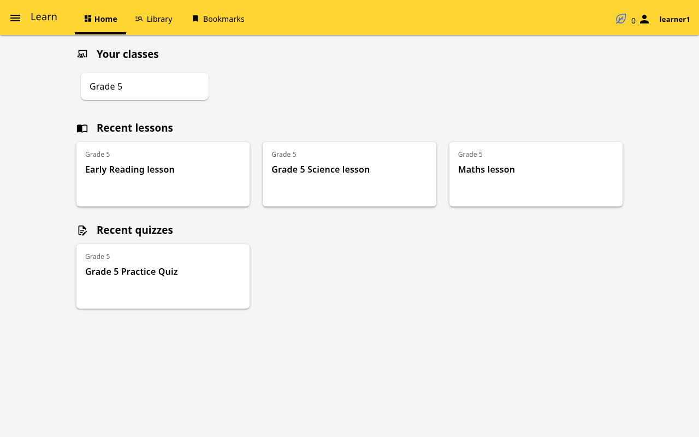
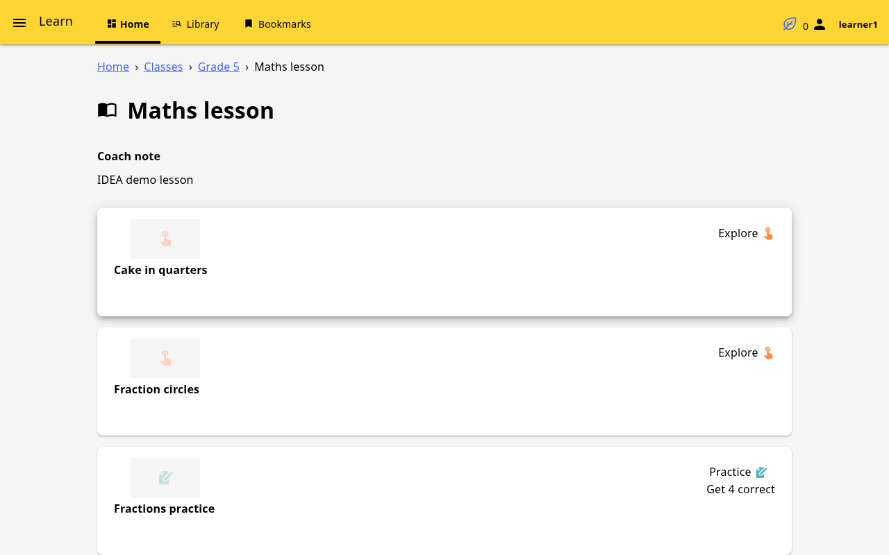
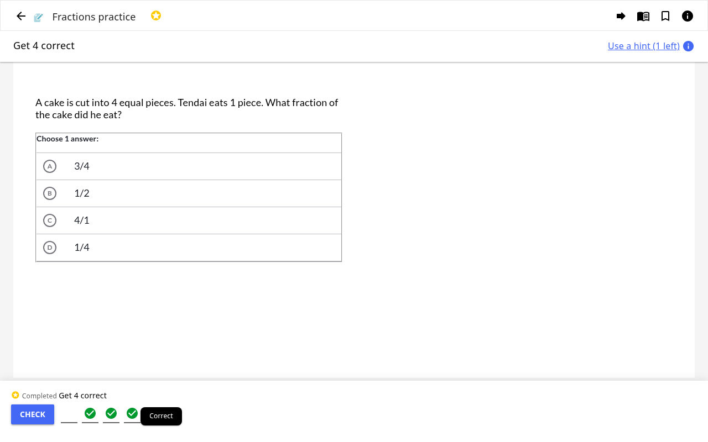
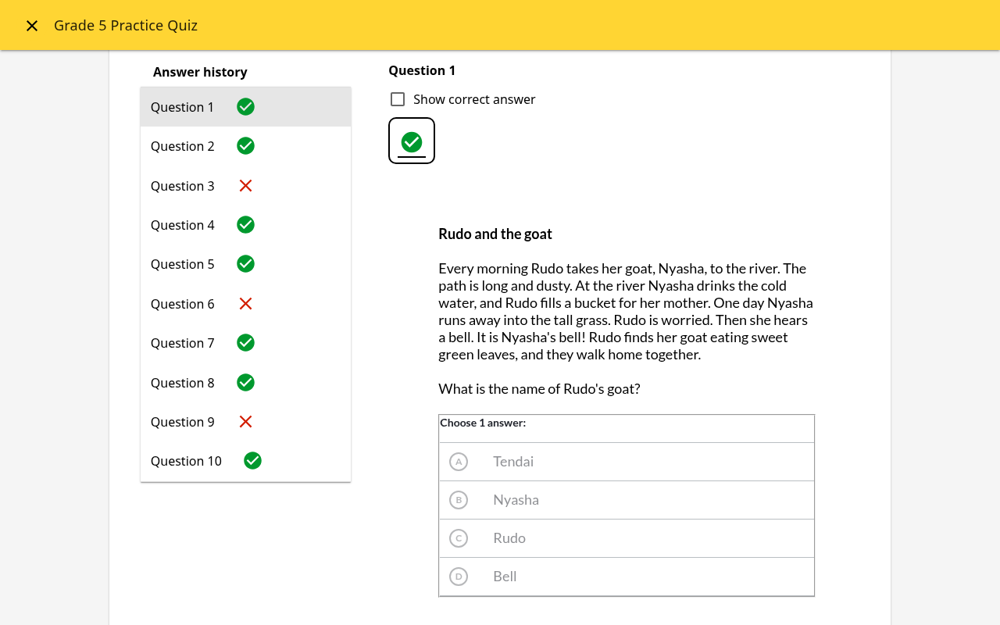
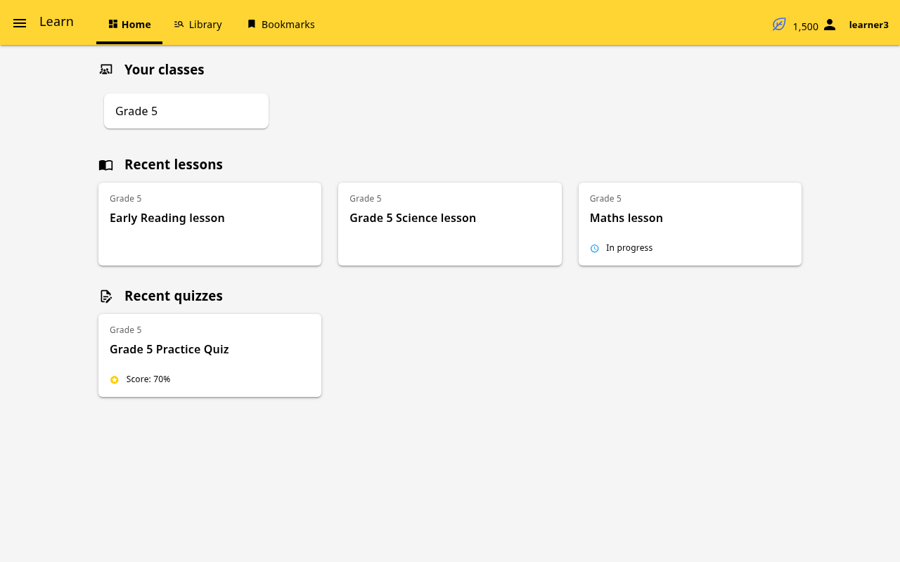

**Status:** Authoritative · **Maintained by:** Marco (with Atlas) · 13 November 2026 (v2.1.1: screenshot fixes; v2.1: Kolibri 0.19.5 paths and screenshots)

# 4. Kolibri for learners (try it yourself)

This chapter is for you to see Kolibri as your class sees it, so you can show them the same steps.

Your learners open Kolibri the same way you do: on a classroom computer they double-click **IDEA** on the desktop and click **Open** on the Kolibri card in the Console (2.2.1). Show them this once. To try it yourself with the demo learners, open **Kolibri Demo**.

Sign in as a learner in a second browser window (private window) to see exactly what your class sees. Learners have no password in Kolibri. They sign in with only their username, for example `learner1`.

> **On every IDEA box**, both **Kolibri** and **Kolibri Demo** already let learners sign in without a password. **At an existing school**, a teacher with admin rights (or the Kolibri admin) turns this on in Kolibri: open **Facility > Settings**, under **How learners sign in** choose **Enter username only**, then click **SAVE CHANGES**.

If a welcome window appears the first time you open Kolibri Demo, close it to go on.

## 4.1 Do a lesson

This is how a learner opens a lesson and works through it.

1. Sign in as `learner1`. **Home** shows **Your classes**, **Recent lessons** and **Recent quizzes**.
   
2. Click **Maths lesson**. Its items are listed in order, starting with the Fractions pictures and **Fractions practice**.
   
3. Open an item, for example the first one (**Cake in quarters**, a picture activity). Videos open the same way.
4. Exercises work like this (in Kolibri Demo, try **Fractions practice** in the **Maths lesson**, or look at it as `learner3`, who has already completed it; see 3.5): type an answer or choose one, click **CHECK**. Keep going until the goal at the top (**Get 4 correct**) is reached.
   
5. Sign out. In the Demo, `learner3` has already completed **Cake in quarters** and **Fractions practice**, so the teacher reports already show a contrast with `learner1` and `learner2`.

## 4.2 Take a quiz

This is how a learner takes a quiz that has been started. In Kolibri Demo, use **Grade 5 Practice Quiz** (see 3.5).

1. Open the quiz from **Recent quizzes** (or the class page). Answer each question, then click **SUBMIT QUIZ** and confirm. After submitting, answers cannot be changed. In the Demo, sign in as `learner3` to see a quiz that has already been submitted: the score is **70%** (7 out of 10) and you can look back at each question.
   
2. Back on **Home**, the quiz shows its score.
   
Now go back to the teacher window and look at the reports (3.6).
