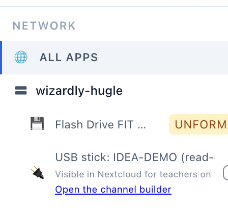
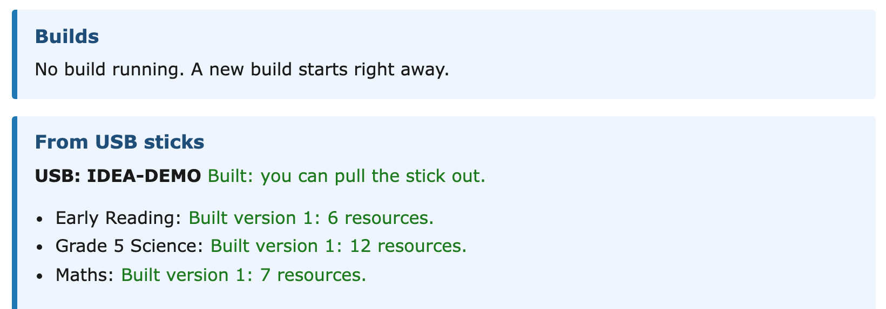
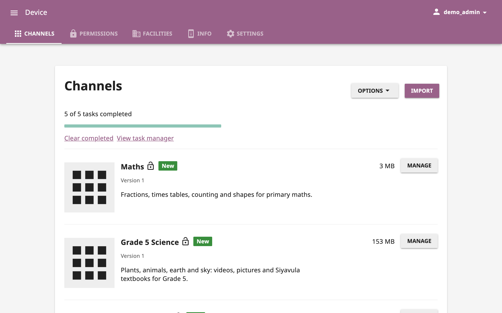
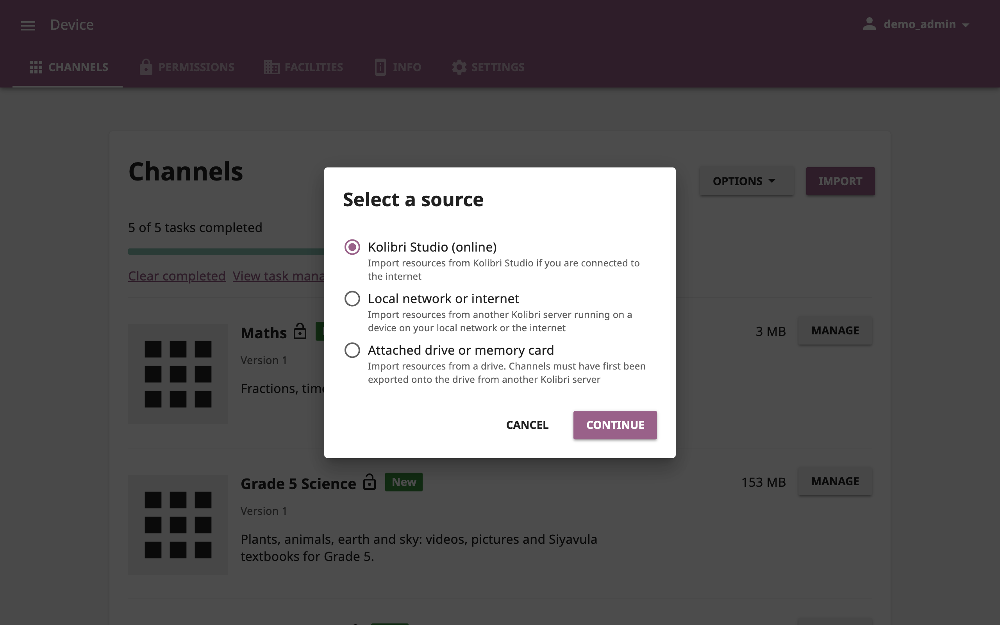
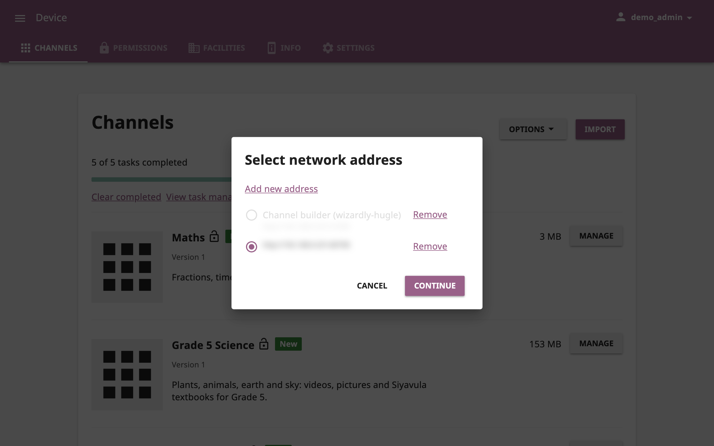
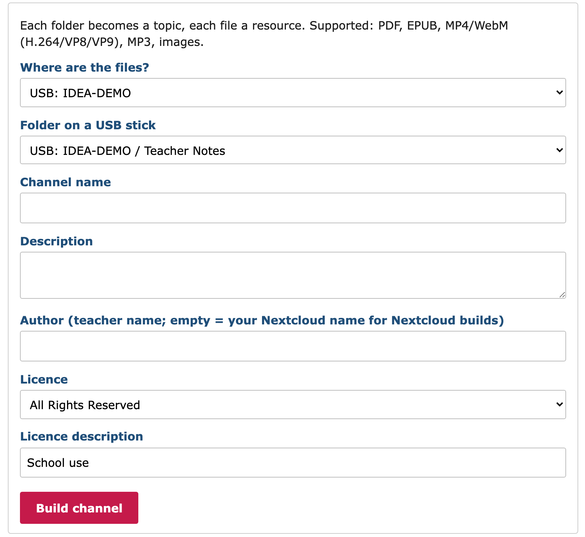
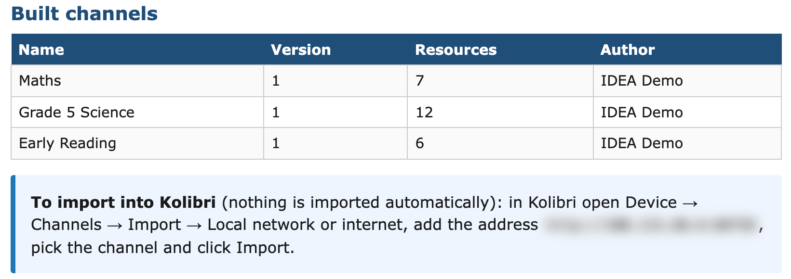
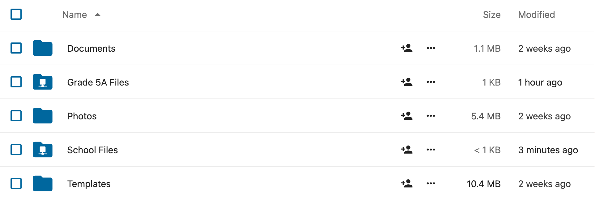
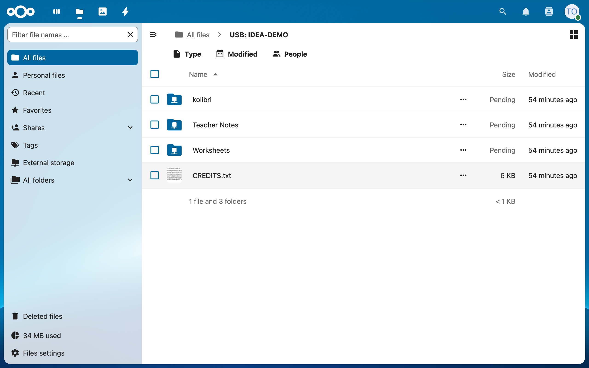

**Status:** Draft (feature live on the demo box; lands with the idea#193 release) · **Maintained by:** Marco (with Atlas) · 15 October 2026

# 5. Make your own Kolibri channel: the channel builder and your USB stick

This is the most useful chapter for teachers. The **channel builder** turns your own videos, PDFs and pictures into a **Kolibri channel**. Your learners then find it in Kolibri next to the Khan Academy lessons, and you can put it in lessons and quizzes (chapter 3).

You do not need internet or an account. Bring your files on a normal **USB stick**, filled at home, in town or from a colleague.

Good to know:

- **IDEA only reads your stick.** It never writes to it, so nothing on the stick changes, and the stick still works in any Windows laptop afterwards. You do not have to prepare or erase it.
- The stick must be **FAT32 or exFAT**. Almost all sticks are, unless someone formatted them as NTFS.
- **Building is not publishing.** A channel reaches learners only after someone imports it in Kolibri (5.2).

## 5.1 From your USB stick to a channel (automatic)

**At home or in town (any computer):**

1. Open the stick and make a folder named **`kolibri`** at the top level of the stick.
2. Inside `kolibri`, make **one folder per channel**, for example `Grade 5 Science`. The folder name becomes the channel name.
3. Inside the channel folder, make **one folder per topic**, for example `Plants` and `Animals`, and copy your files into them. Each file becomes one resource. The builder takes PDF, EPUB, MP4/WebM video, MP3 and pictures.

[[pending-shot: C5-01 | The stick in Windows File Explorer: kolibri > Grade 5 Science > Plants, Animals]]

> **Optional: `channel.json`.** To set the channel's name, author, description or licence yourself, put a small text file named `channel.json` into the channel folder, for example:
> `{"name":"Plants and Water","author":"Mary Okello","description":"Term 2","license":"CC BY","license_description":""}`
> Without it (or if the file has a mistake), the channel gets the folder name, the stick's name as author, and the licence All Rights Reserved.

**At school:**

4. Plug the stick into a free USB port of the IDEA box.
5. The IDEA box starts the channel builder by itself, if the channel builder is on this box. It then builds **one channel for each folder inside `kolibri`**, one after the other. You do not have to click anything.
6. To watch it, open the Console. Under the IDEA box you see the row **USB stick: (name) (read-only, size)** with the line *Visible in Nextcloud for teachers on this Pi* and the link **Open the channel builder**. Click the link. You can also open the app **Kolibri Channel Builder** in the app list with **Open**.

   

   The same stick is also listed once more, by its make and size, as **UNFORMATTED**. That is normal: leave it alone (chapter 12).

7. On the builder's page, the box **From USB sticks** shows each channel. A channel waiting for its turn says **Queued (number N in line)**, a channel being built says **Building N/M files**, and a finished channel says **Built version V: R resources.**

[[pending-shot: C5-03 | Channel builder, From USB sticks box while a channel is Building N/M files]]

8. When the stick's line says **Built: you can pull the stick out.**, you can take your stick out. The channels stay on the IDEA box.

   

> **Don't pull the stick out while it is building.** If you do, nothing breaks: that build stops, and the last good version of the channel stays. Plug the stick in again and the build starts over.

> **Large sticks.** If the `kolibri` folder holds more than 8 GB, the builder does not build it by itself. It says *Too large for an automatic build: use the manual build below.* Build it by hand (5.4).

## 5.2 Import the channel into Kolibri

Your channel is built, but learners cannot see it yet. Someone who may manage channels on the device in Kolibri (on the demo school: `admin`) imports it once.

1. Open Kolibri from the Console and sign in.
2. Open **Device**. The **CHANNELS** tab lists the channels on the IDEA box. Click **IMPORT**.

   

3. In **Select a source**, choose **Local network or internet** and click **CONTINUE**.

   

4. In **Select network address**, pick the channel builder and click **CONTINUE**. The first time, click **Add new address** and type the address shown at the bottom of the builder's page (*To import into Kolibri…*). Kolibri then lists it as **Channel builder (name of your IDEA box)**.

   

5. Pick your channel (for example **Grade 5 Science**) and click **Import**.

[[pending-shot: C5-08 | Kolibri import: the builder's channels listed, Import button]]

6. Choose the topics (or everything) and click **IMPORT**. When the task is finished, the channel is in the **Channels** list with the label **New** (see the figure at step 2).
7. Now use it like any other channel: add its resources to a lesson (3.4) or a quiz (3.5).

[[pending-shot: C5-10 | Learner view: the new channel next to the other channels]]

## 5.3 Update the channel

1. Next term, add or change files **in the same folder** on your stick (for example a new topic folder `Soil`).
2. Plug the stick in again. The builder sees what changed and builds a new version of the **same channel**. If nothing changed, it does nothing.
3. In Kolibri, open **Device > Channels** and import the channel again from the builder, as in 5.2, to get the new version.

[[pending-shot: C5-11 | Kolibri Device > Channels: importing the new version of the channel]]

## 5.4 Build a channel by hand

Use this when your stick has **no `kolibri` folder**, when it is too large for an automatic build, or when your files are in Nextcloud.

1. Open the channel builder from the Console.
2. Under **Where are the files?** choose your stick (**USB: (name)**) or **Nextcloud**. Then choose the folder, for example under **Folder on a USB stick**.
3. Type the **Channel name**, a **Description** and the **Author** (your name), pick the **Licence**, and click **Build channel**.

   

4. When it is done, the box **Builds** says **Built (name) version V: R resources.**, and the channel is listed under **Built channels**. Then import it in Kolibri (5.2).

   

Building from the same folder again makes a new version of the same channel (5.3).

## 5.5 Use your stick in Nextcloud

Your stick also appears in Nextcloud, so you can open its files or copy them into your own folders, without building a channel.

1. Plug the stick in. Open Nextcloud and sign in as a teacher. In **All files** you see a folder **USB: (your stick's name)**. Nextcloud shows its size as *Pending*: that is normal.

   

2. Open the folder to view or play a file. You can't add or change anything in it (Nextcloud says *You do not have permission to upload or create files here*).

   

3. To keep a file, click **⋯** on its row, choose **Copy**, and copy it into one of your own folders (for example a course folder, or **School Files**).

[[pending-shot: C5-16 | Nextcloud: the Copy dialog, copying from the USB folder into a course folder]]

4. Pull the stick out when you are done. The **USB:** folder disappears; the files you copied stay in Nextcloud.

Only teachers (and the Nextcloud admin) see the **USB:** folder. Learners do not.

## 5.6 Questions

| Question | Answer |
|---|---|
| **My stick doesn't show up.** | Is it plugged into **this** IDEA box? A stick only shows on the box it is plugged into. Is it NTFS? NTFS sticks are not read; copy the files onto a FAT32 or exFAT stick, or ask the operator. |
| **Nothing was built.** | Check that the stick has a folder named `kolibri` at the top, with one folder per channel inside it. Check that the channel builder is on this IDEA box and was not stopped by the operator: the Console row then says *Channel builder was stopped by an operator; start it to build from this stick*. Once the operator starts it, it builds the stick without unplugging. Over 8 GB: build it by hand (5.4). |
| **I saved a file, but it's not on my stick.** | IDEA never writes to your stick. Download the file from Nextcloud onto a laptop and copy it to the stick there. |
| **My learners can't see my channel.** | Building is not publishing. Import the channel in Kolibri first (5.2), then add it to a lesson. |
| **I changed my files, but the channel is the same.** | Plug the stick in again, wait for **Built**, then import the channel again in Kolibri (5.3). |
