**Status:** Authoritative · **Maintained by:** Marco (with Atlas) · 14 November 2026 (v2.2: first step, the admin creates the accounts; kit: Nextcloud Demo, groups teachers and learners)

# 5. Nextcloud for teachers

## Before you start: the admin creates the accounts

This first step gives every teacher and learner their own Nextcloud account, so they can sign in and share files. Nextcloud has no self-signup: the sign-in page has no "Create account" button, and teachers and learners cannot make an account themselves. The Nextcloud administrator, the account `admin`, creates the accounts. Do this once, before anyone else uses Nextcloud. Anyone at the school who knows the admin password can do it, and each account takes about a minute.

1. Open **Nextcloud** from the Console (chapter 2). Sign in as `admin` with the password `admin911!` (the IDEA default; if your school has changed it, use the new password). If a welcome window appears, close it.
   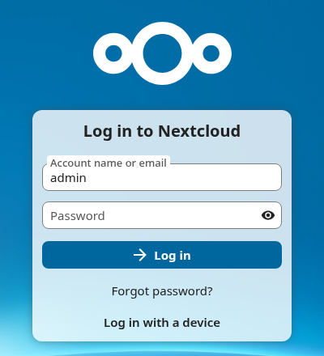
2. Click the round icon with your initial at the top right, and choose **Accounts**.
   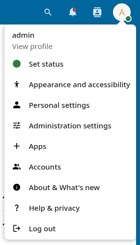
3. The **Accounts** page lists the accounts that already exist. On the left are the groups `teachers` and `learners`.
   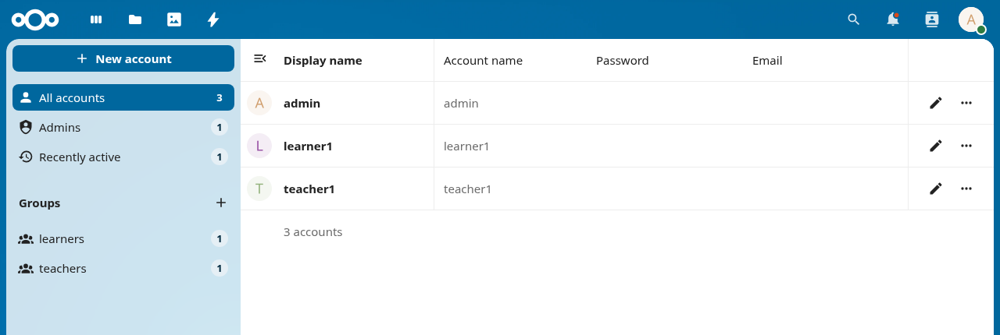
4. Click **+ New account** and fill in:

    - **Account name**: the name the person types to sign in, in lower case and without spaces, for example `teacher2`.
    - **Display name** (optional): the name others see, for example the teacher's full name.
    - **Password**: the account name followed by `911!`, for example `teacher2911!`.
    - **Email**: you can leave it empty; a password is enough.
    - **Member of the following groups**: `teachers` for a teacher, `learners` for a learner.

    Leave the other fields as they are and click **Add new account**.

    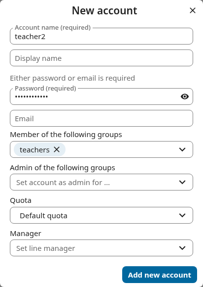

5. The new account appears in the list, and the number next to its group goes up by one.
   
6. Repeat this for every teacher and learner. A learner gets the group `learners`, for example `learner2` with the password `learner2911!`.
7. Give each person their account name and password. They can sign in straight away, and can change their password under **Personal settings > Security**. If someone forgets a password, the admin sets a new one on the **Accounts** page with the pencil icon next to the account.

In **Nextcloud Demo** the demo accounts already exist (see *Appendix: demo accounts*), so you can follow the rest of this chapter right away. The school's own **Nextcloud** starts with only `admin`, `teacher1` and `learner1`; create the other accounts there as described above.

## Using Nextcloud

**About the examples in this chapter.** Every IDEA box comes with the demo setup switched on: the app **Nextcloud Demo**. It has the demo teachers `teacher1` and `teacher2` (group `teachers`), the demo learners `learner1` to `learner3` (group `learners`), and in each teacher's files the folders `Worksheets` and `Teacher Notes`. The screens in this chapter call the class group `Grade 5`: in Nextcloud Demo, pick `learners` wherever the steps say the class group. The steps work the same at your school, but your names will be different. The demo accounts are listed in *Appendix: demo accounts*.

Office documents open in **Nextcloud Office**.

Open **Nextcloud Demo** from the Console (chapter 2) and sign in as `teacher1`. Click **Files** at the top.
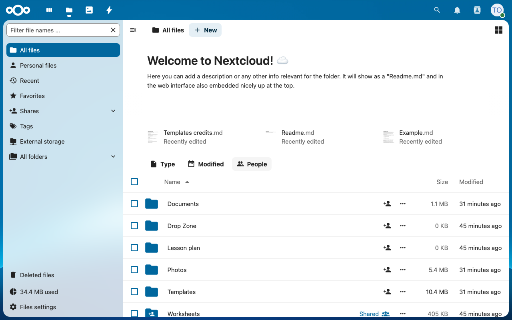

## 5.1 Share worksheets with the class (view only)

1. Next to the folder `Worksheets`, click the share icon (**Show sharing options**). The right panel opens on **Sharing**.
   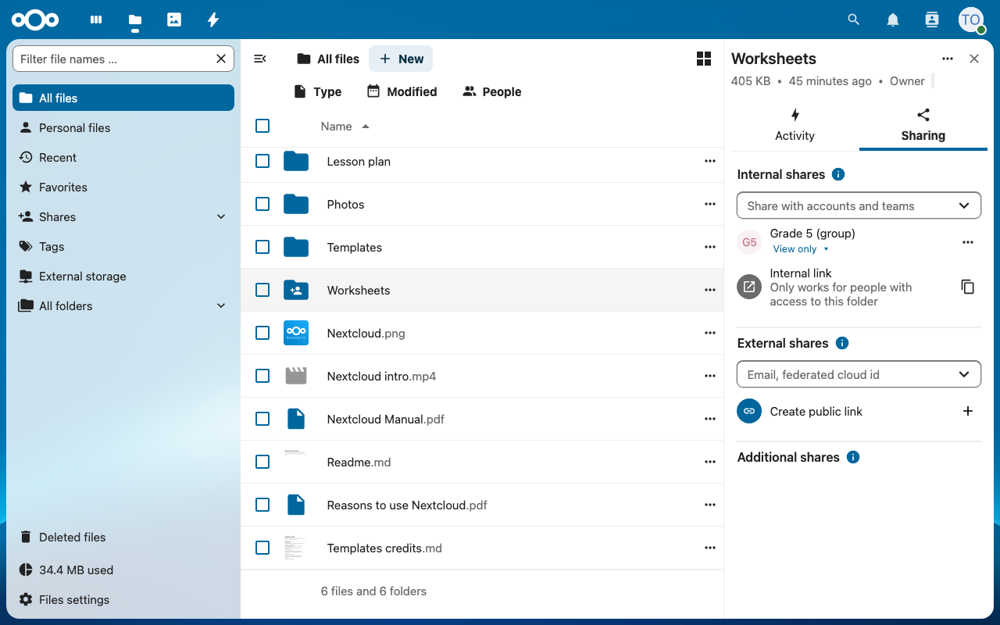
2. In **Internal shares** ("Share with accounts and teams"), type the class group (on the kit: `learners`) and pick the group.
3. Set the permission to **View only**. The group then appears under Internal shares.
   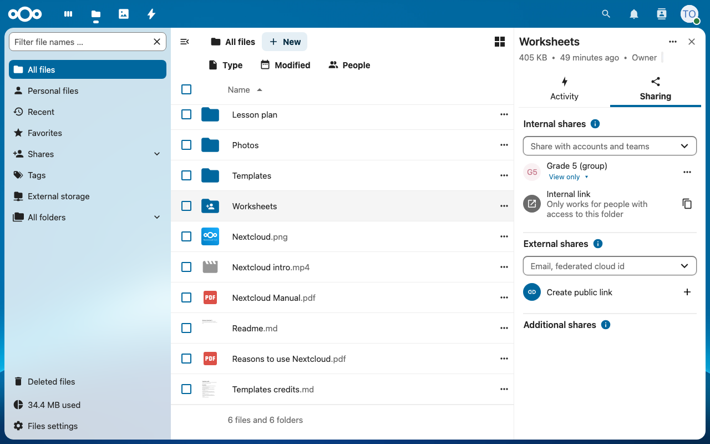
Learners now see the folder but cannot change or delete files.

## 5.2 Write a document together

1. Click **+ New > New document**.
   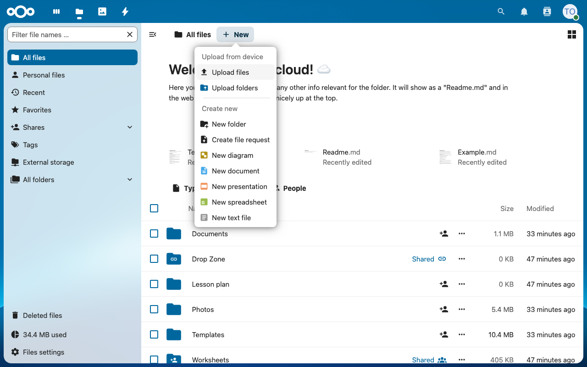
2. Type a name (`Lesson plan`) and click **Create**.
   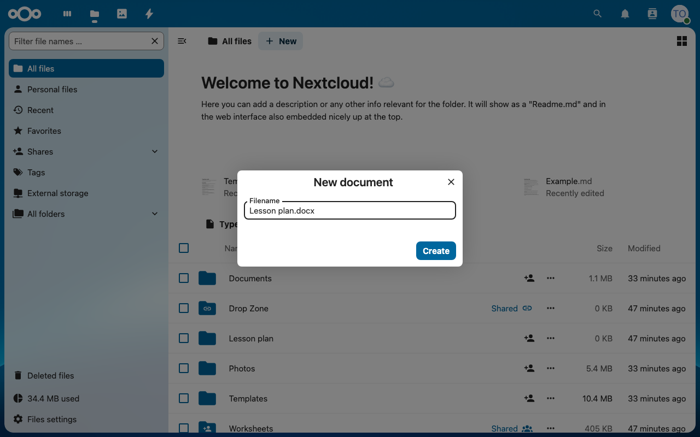
3. Pick a template (Blank is fine) and click **Create**.
   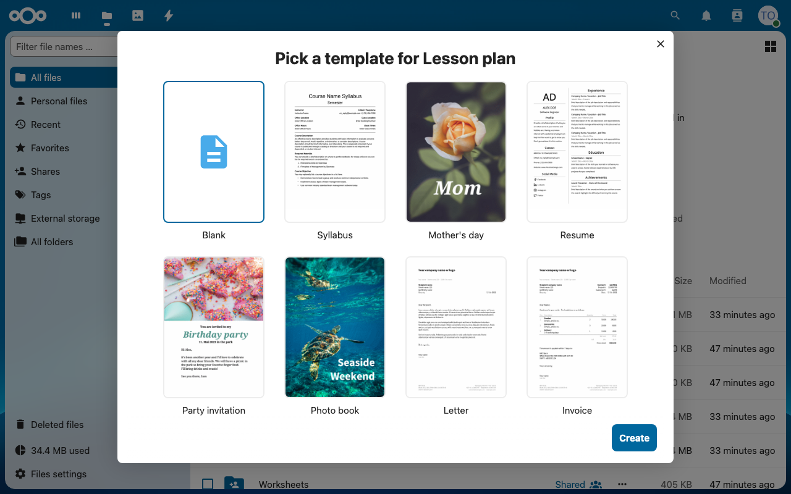
4. Share the file with `teachers` and/or your class group (on the kit: `learners`), with editing allowed.
   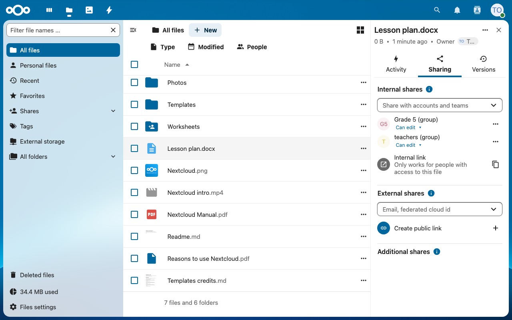
5. The document opens in Nextcloud Office. When others open it at the same time, you see their names and cursors.
   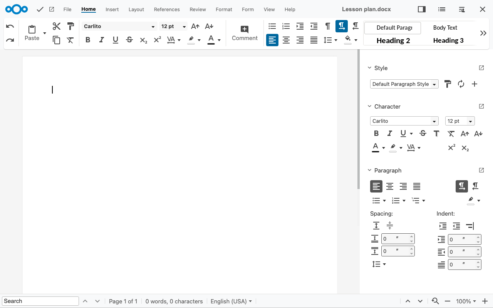

## 5.3 Collect homework (File drop)

Learners upload work, but cannot see each other's work.

1. Make a folder for the homework: **+ New > New folder**, name it `Drop Zone`. Then open sharing for the folder `Drop Zone`.
   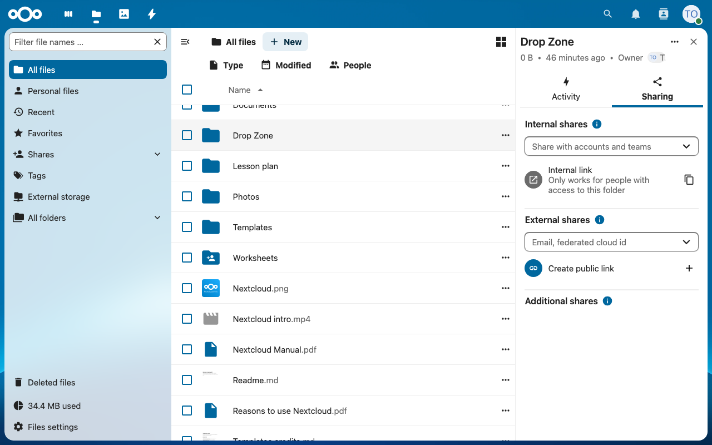
2. Under **External shares**, click **+** next to **Create public link** and choose **File request** (upload only). Copy the link.
   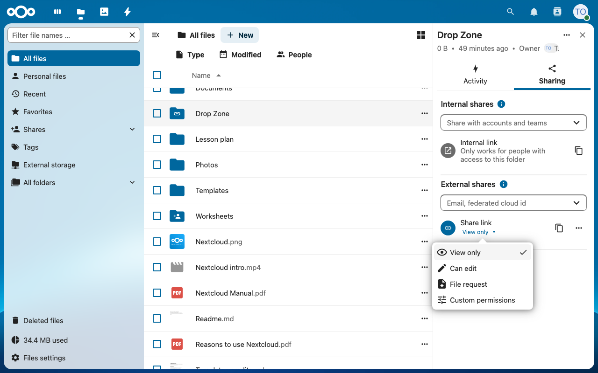
   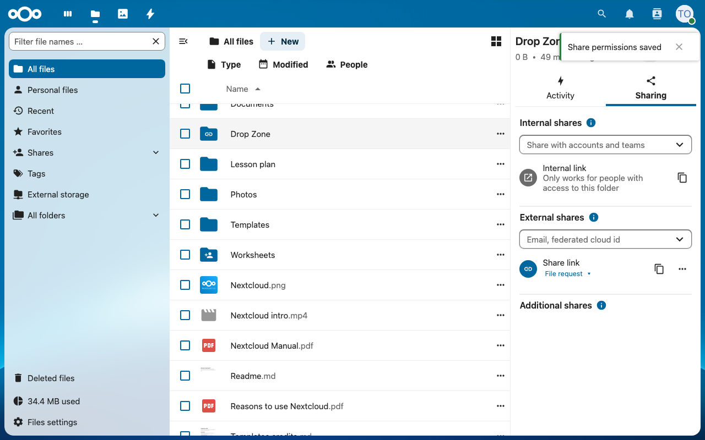
3. Give learners the link (for example, write it on the board). Uploaded files appear in your `Drop Zone` folder.
   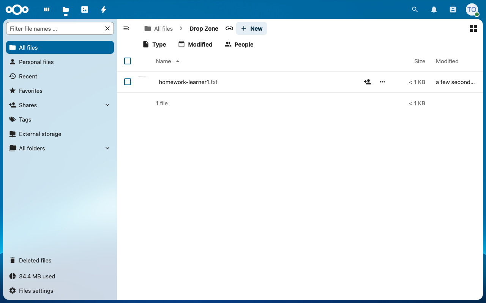
