**Status:** Authoritative · **Maintained by:** Marco (with Atlas) · 14 October 2026

# 5. Nextcloud for teachers

Demo: `demo-teacher1`, groups `demo-Grade5A` (class) and `demo-teachers`. Office documents open in **Nextcloud Office**.

Open Nextcloud from the Console (chapter 2) and sign in. Click **Files** at the top.
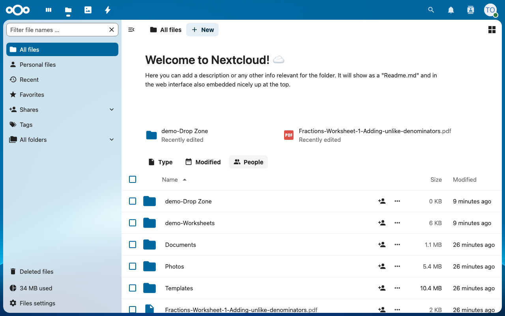

## 5.1 Share worksheets with the class (view only)

1. Next to the folder `demo-Worksheets`, click the share icon (**Show sharing options**). The right panel opens on **Sharing**.
   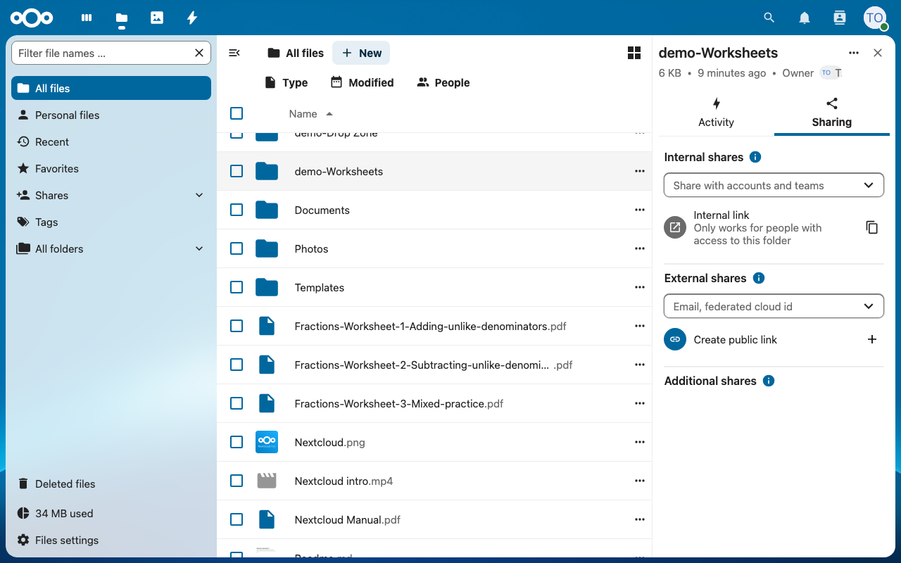
2. In **Internal shares** ("Share with accounts and teams"), type `demo-Grade5A` and pick the group.
3. Set the permission to **View only**. The group then appears under Internal shares.
   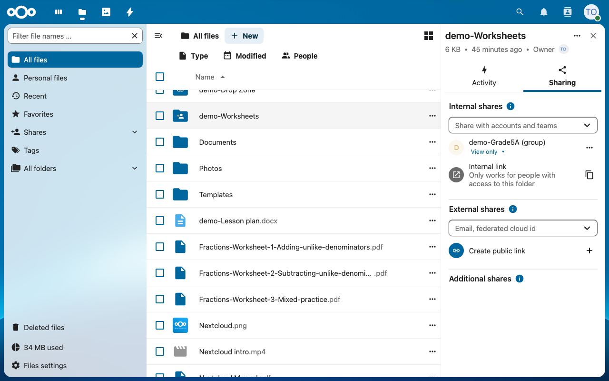
Learners now see the folder but cannot change or delete files.

## 5.2 Write a document together

1. Click **+ New > New document**.
   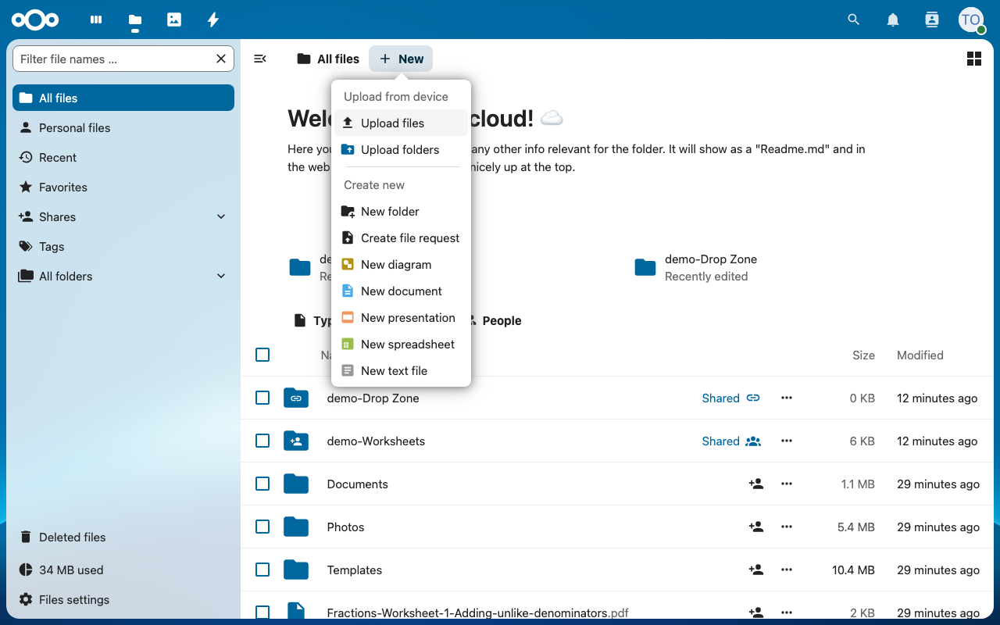
2. Type a name (`demo-Lesson plan`) and click **Create**.
   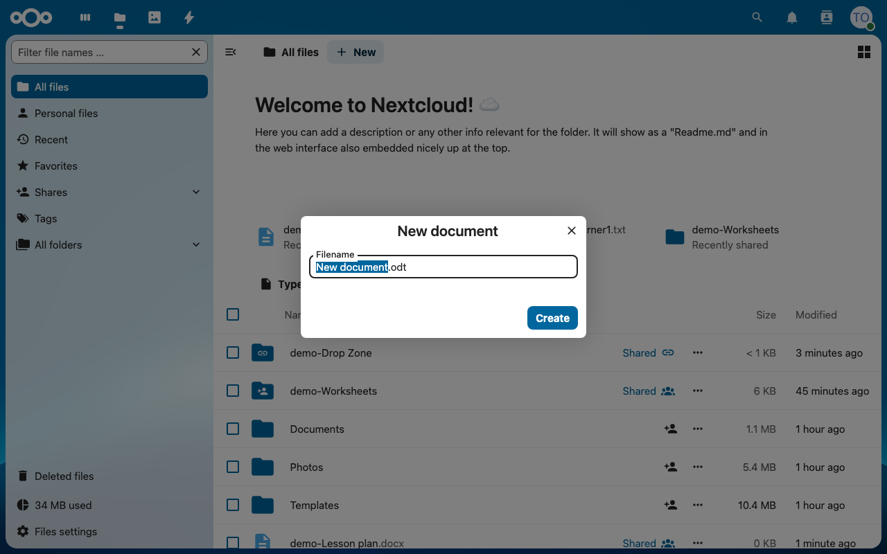
3. Pick a template (Blank is fine) and click **Create**.
   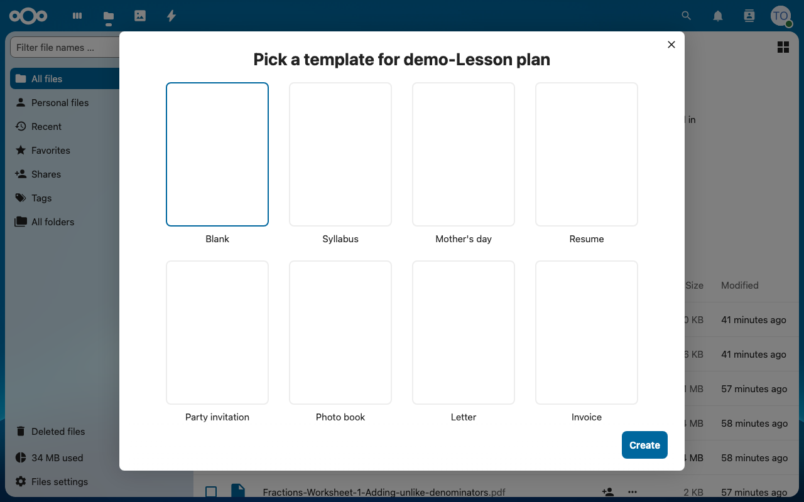
4. Share the file with `demo-teachers` and/or your class group, with editing allowed.
   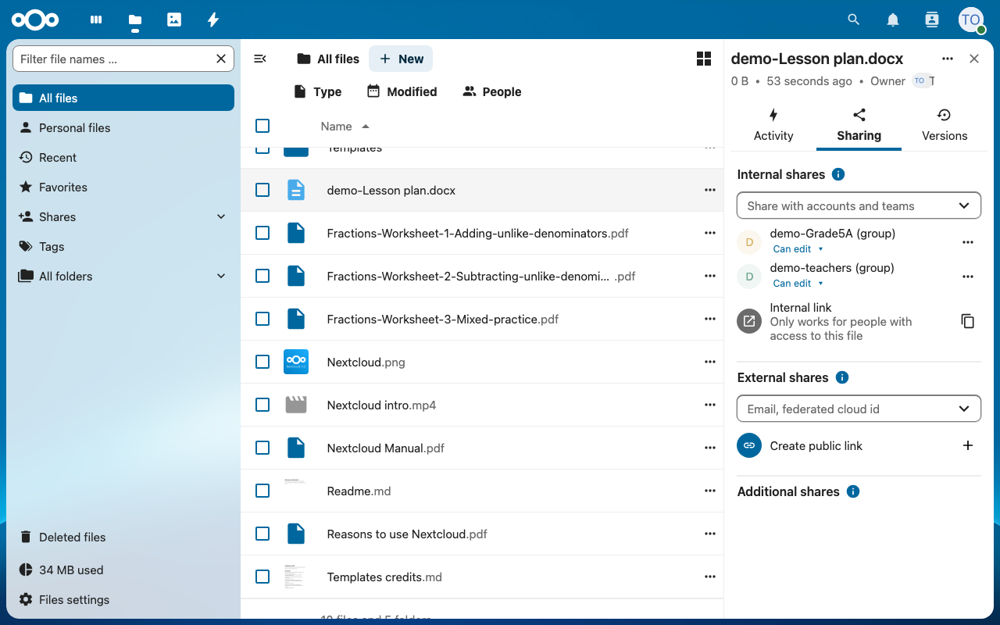
5. The document opens in Nextcloud Office. When others open it at the same time, you see their names and cursors.
   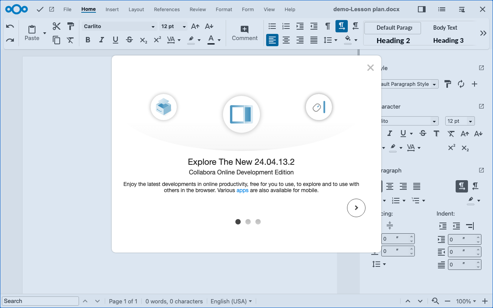

## 5.3 Collect homework (File drop)

Learners upload work, but cannot see each other's work.

1. Open sharing for folder `demo-Drop Zone`.
   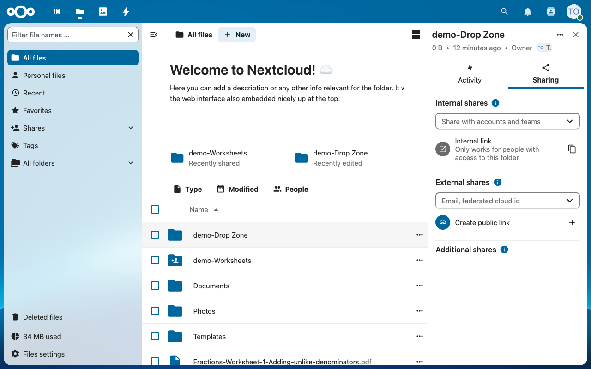
2. Under **External shares**, click **+** next to **Create public link** and choose **File request** (upload only). Copy the link.
   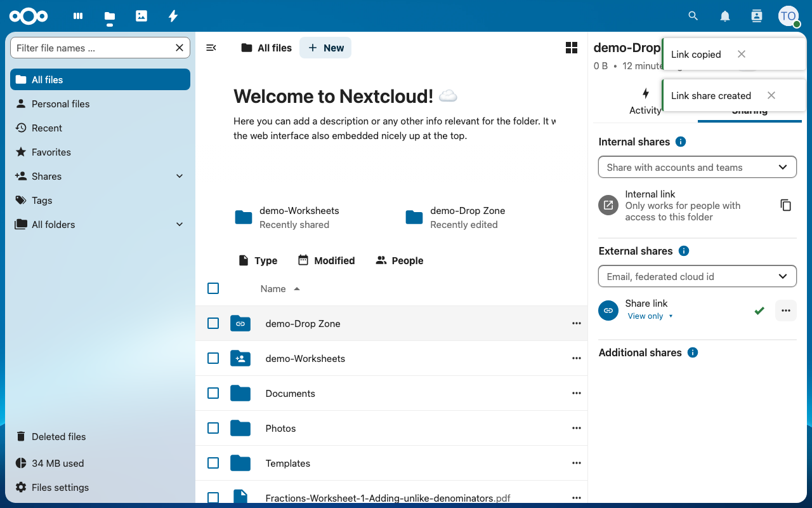
   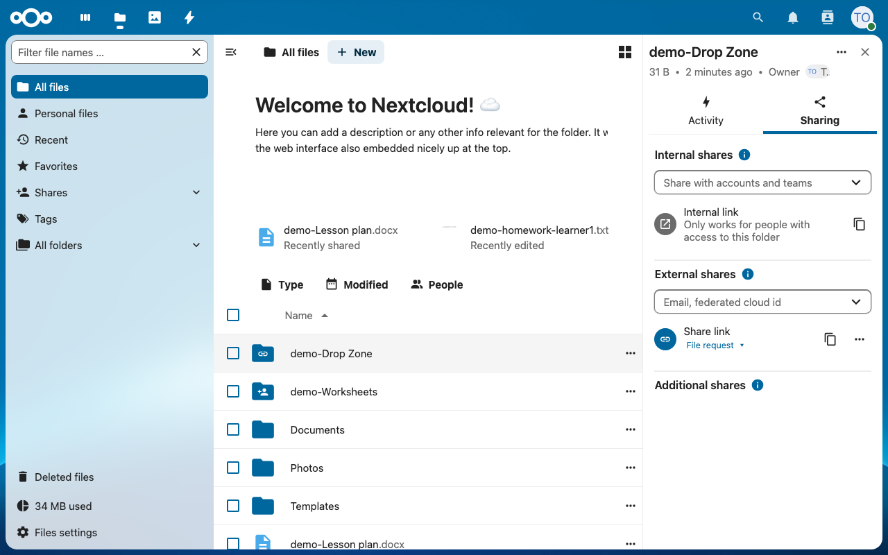
3. Give learners the link (for example, write it on the board). Uploaded files appear in your `demo-Drop Zone` folder.
   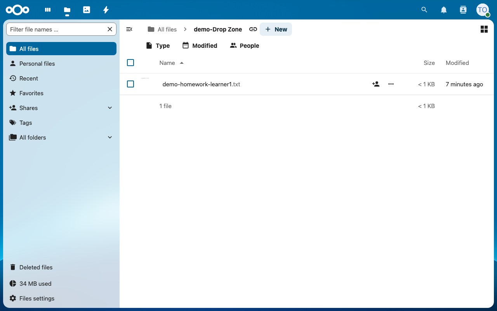
