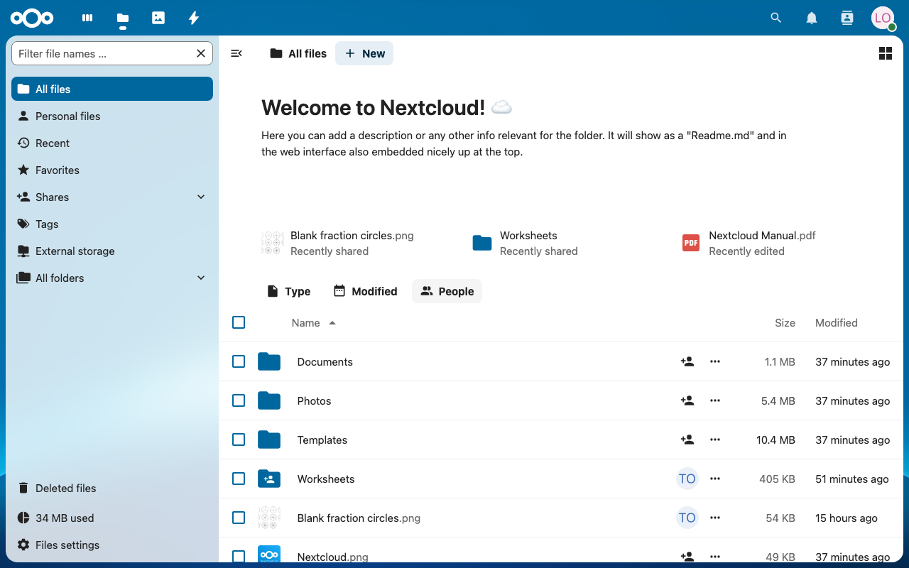
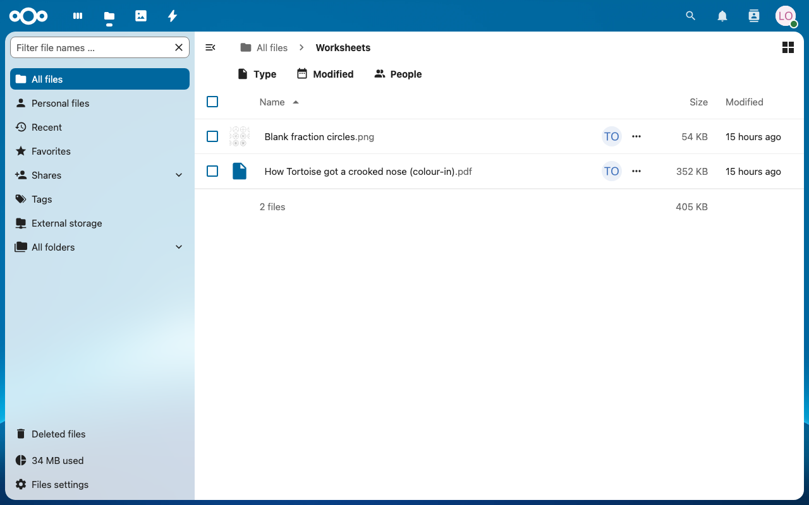
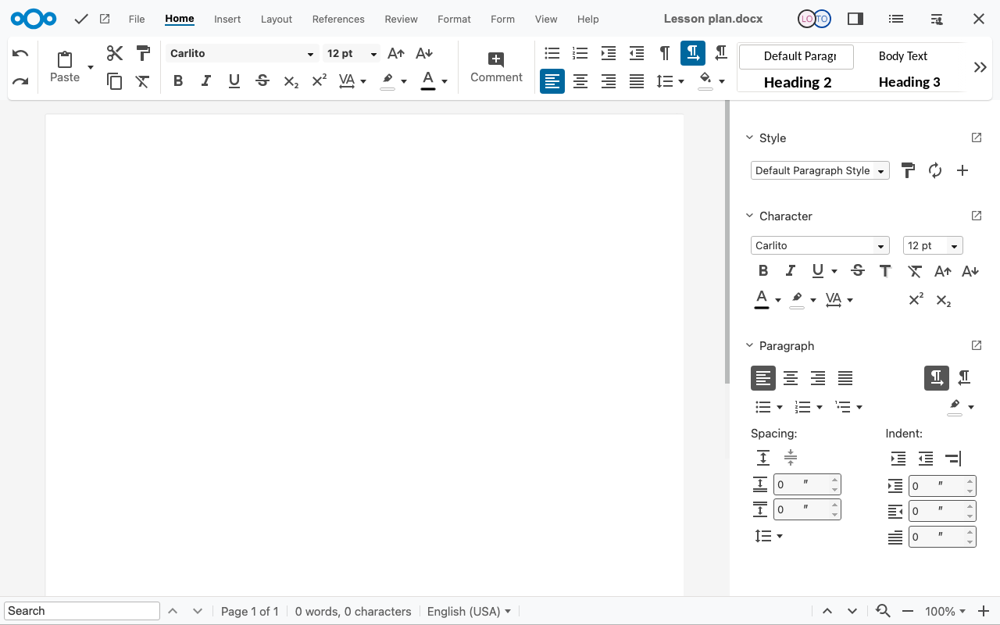
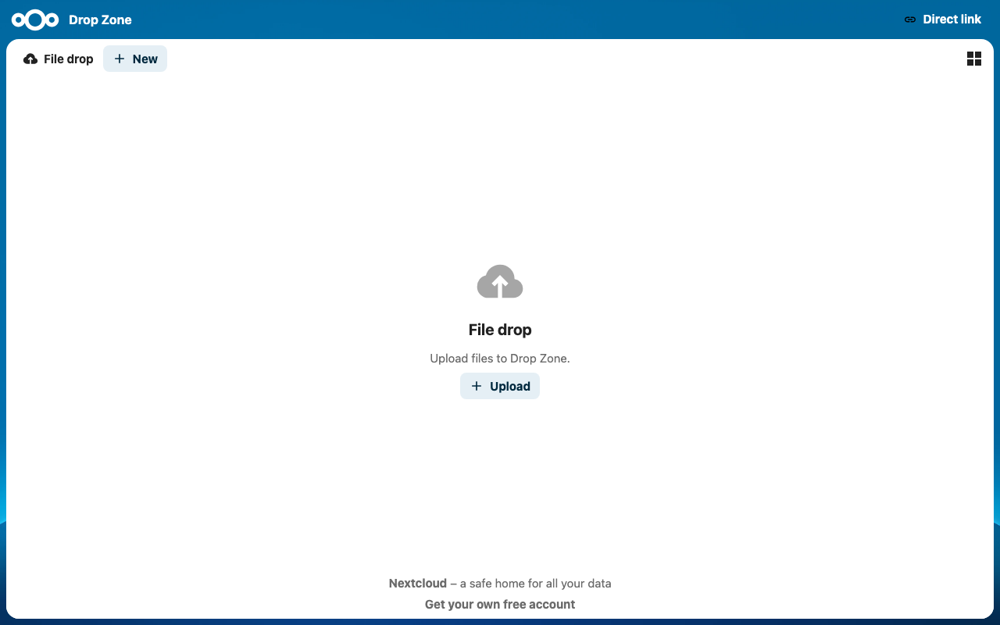
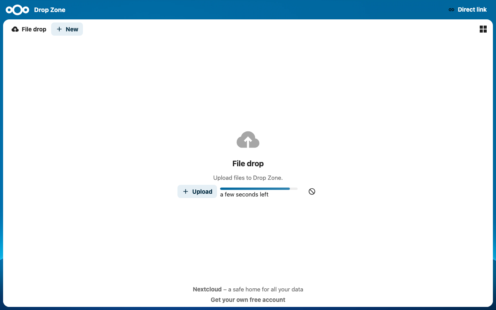

**Status:** Authoritative · **Maintained by:** Marco (with Atlas) · 14 October 2026

# 7. Nextcloud for learners (try it yourself)

Learners open Nextcloud from the Console, like Kolibri: **IDEA** on the desktop, then **Open** on the Nextcloud card (2.2.1). They have no personal Nextcloud app on the classroom computer, so they always work in the browser.

## 7.1 Open class files and co-edit

1. Sign in to Nextcloud as `learner1` (private window). Shared folders and files appear in **Files** with the teacher's name.
   
2. Open `Worksheets`: the learner can open and download the worksheets, not change them.
   
3. Open `Lesson plan.docx`: it opens in Nextcloud Office and the learner can type.
   

## 7.2 Hand in homework

1. Open the File drop link from 6.3. The page says **File drop** and shows an **Upload** button; the learner cannot see other files.
   
2. Click **Upload** and choose the file (e.g. a photo of written work). If asked, type your name.
   
The teacher sees the file in `Drop Zone` (6.3).
