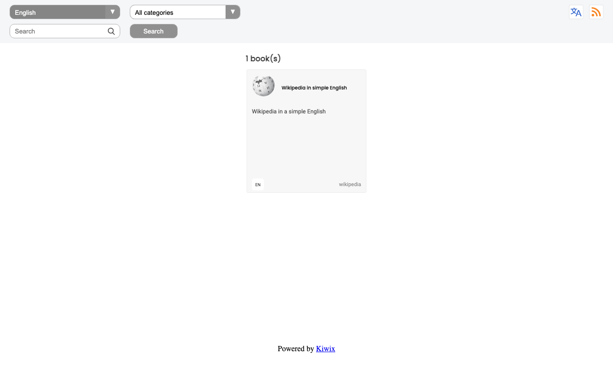
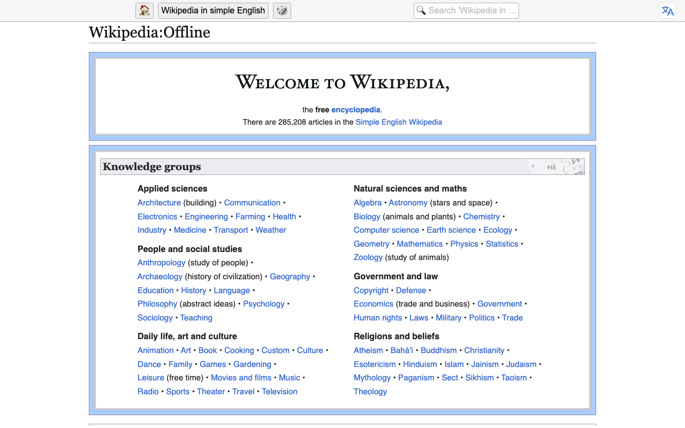
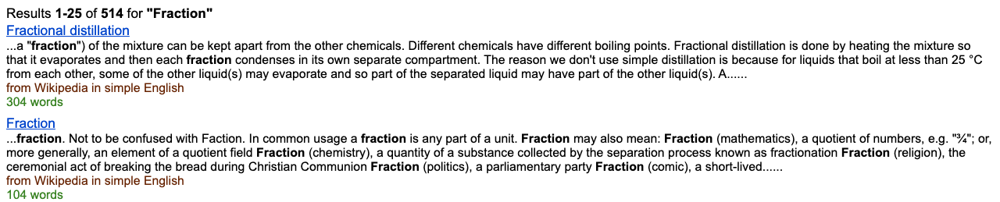
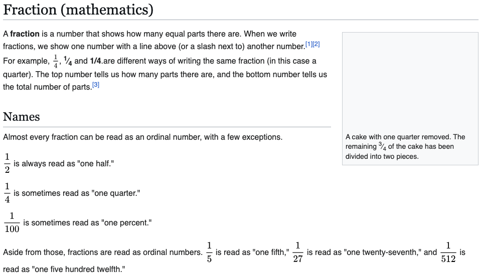
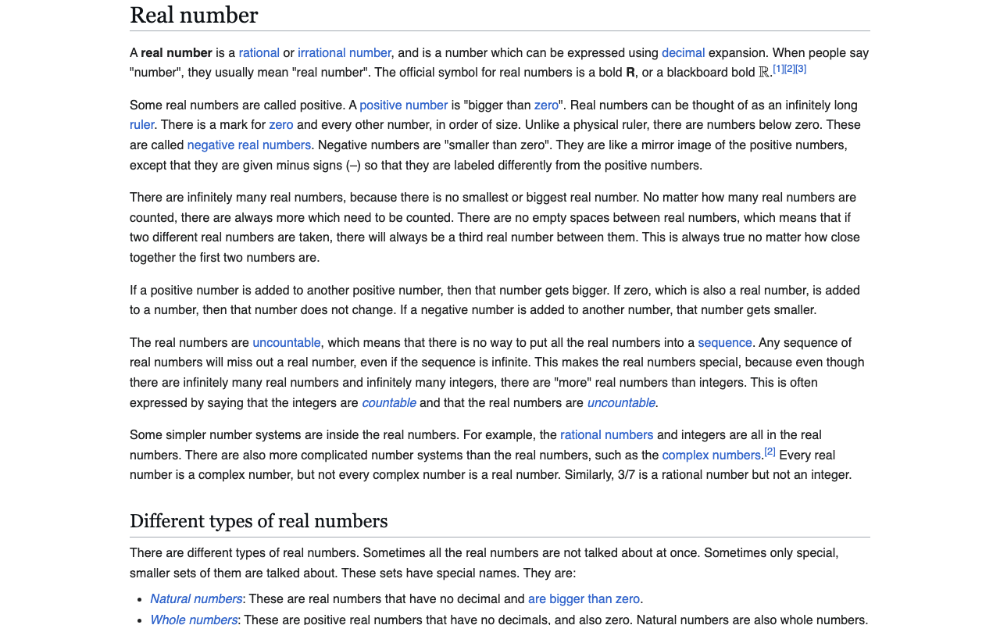

**Status:** Authoritative · **Maintained by:** Marco (with Atlas) · 14 October 2026

# 8. Wikipedia offline (Kiwix)

The demo has **Wikipedia in simple English** (text, no pictures). It works without internet.

## 8.1 Look something up and use it in class

1. Open Kiwix from the Console (chapter 2). The **Kiwix** library shows the books available.
   
2. Click **Wikipedia in simple English**. Its welcome page opens.
   
3. Type in the search box at the top, e.g. `Fraction`. Pick a result.
   
   
4. Follow blue links to related articles.
   

> **Classroom idea.** give learners 3 questions to answer from one article; they read on their own device.
