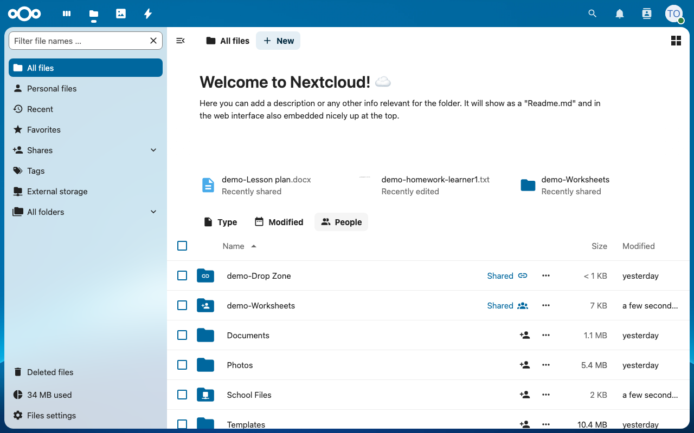
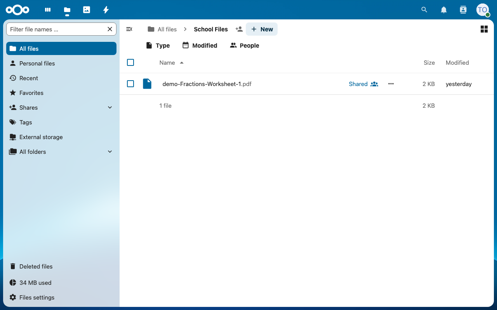
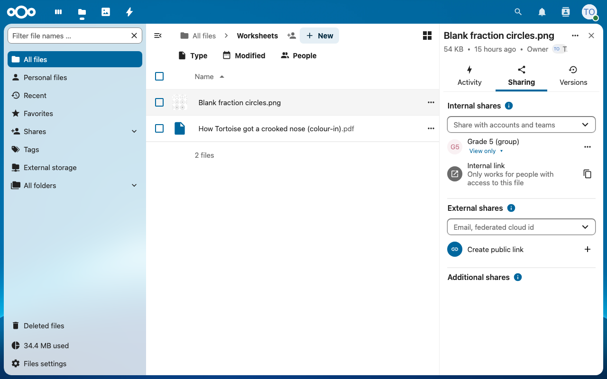
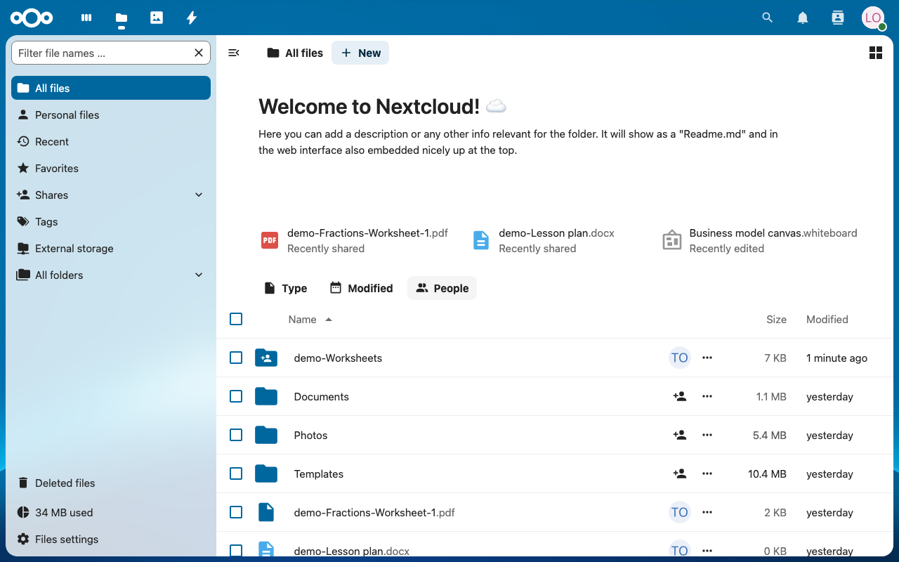

**Status:** Authoritative · **Maintained by:** Marco (with Atlas) · 14 October 2026

# 9. Your own files: the Files Disk

A **Files Disk** is an **IDEA Disk** that the operator prepares in the Console (chapter 12). Its content appears in Nextcloud as the folder **School Files**. Use it to bring in material you downloaded elsewhere, for example worksheets you copied at another school.

> **Only a USB stick?** You can use a normal USB stick without a Files Disk: it appears in Nextcloud as a read-only **USB:** folder (5.5).

Good to know:

- **School Files** is only in **Nextcloud**, not in Kolibri.
- Only teachers see the **School Files** folder. Learners get only the files you share with them.
- **The Backup Disk does not save School Files.** Keep your own copy of important files.

## 9.1 Open School Files

1. Open Nextcloud from the Console and sign in. In **Files** you see the folder **School Files** (marked as **External storage** in the left menu).
   
2. Open **School Files** to see what is on the disk (here `Fractions-Worksheet-1.pdf`).
   

## 9.2 Share a file from School Files with your class

1. On the file's row click **⋯ (Actions) > Show sharing options**, or click the share icon.
2. In **Internal shares**, type the class group name (here `Grade 5`) and choose it from the list. Keep **View only**. The group then appears under **Internal shares**.
   
3. A learner in that group signs in and finds the file in **All files** and under **Recently shared**.
   

## 9.3 Can I put my own files into Kolibri?

Yes, with the **channel builder**: see chapter 5. It turns a folder of your files (on a USB stick, in School Files or in Nextcloud) into a Kolibri channel.
