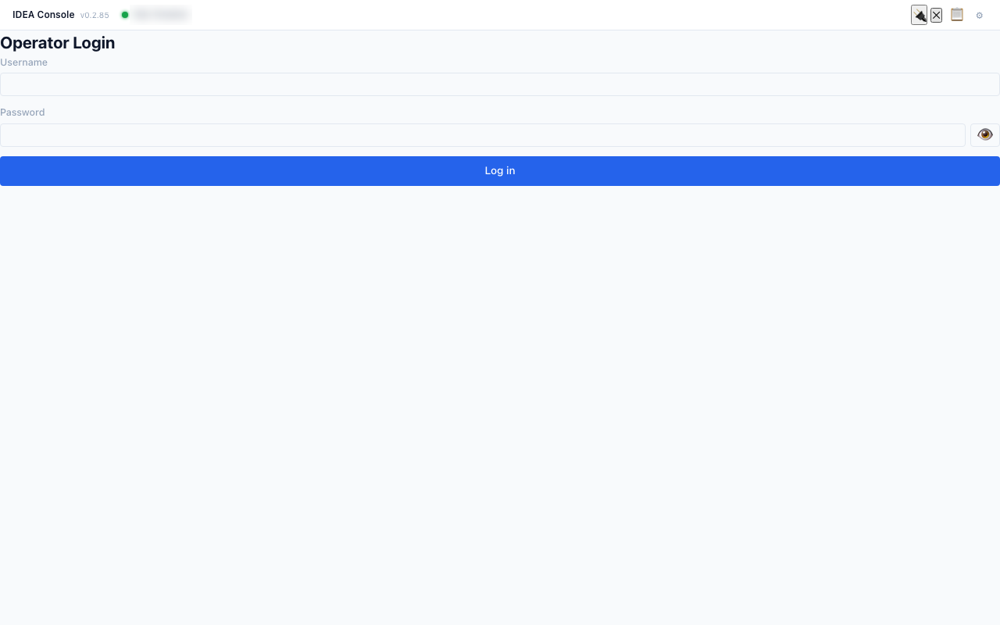
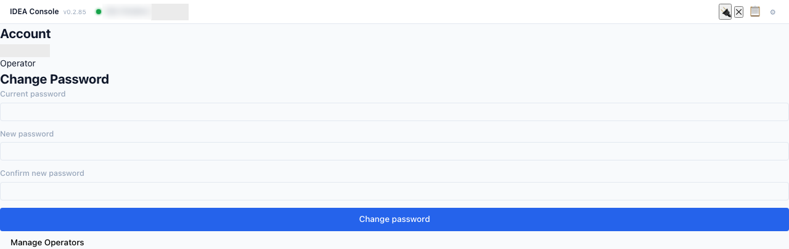
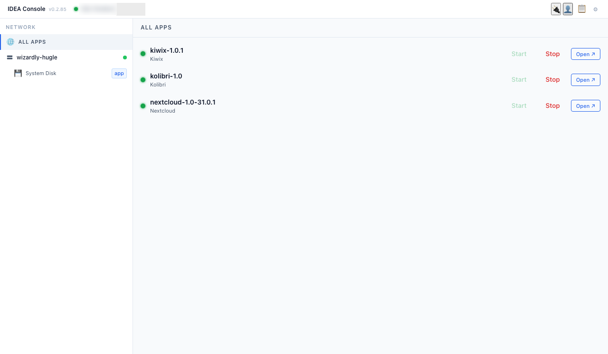
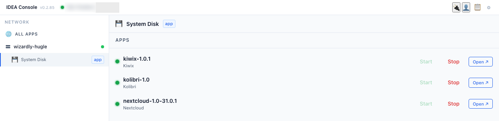
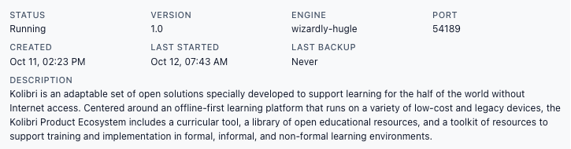

**Status:** Authoritative · **Maintained by:** Marco (with Atlas) · 19 October 2026 (kit: red dot for an absent box)

# 11. The Console for the operator

This chapter is for the school operator.

## 11.1 Operator Login

1. In the Console, click the person icon (top right). The **Operator Login** panel opens with a username and a password field (the eye icon shows or hides the password).
   
2. Type the operator username and password and click **Log in**. The **Account** panel shows your name, the role **Operator**, **Change Password**, **Manage Operators** and **Log out**.
   
3. **Change the default operator password straight away** on a new school box: **Account > Change Password**, type the current password, the new password twice, and click **Change password**. Keep the new password with the school head, not on a sticker on the box.
4. Close the panel with **✕**. Use **Log out** in the same panel when you are done.

## 11.2 The Network view: the IDEA box and its disks

1. After login the left side shows **NETWORK**: **ALL APPS**, then the IDEA box with a green dot (online) and its disks. A box with a **red dot** is offline: switched off, or at another school.
   
2. Click the IDEA box name to select it, then click a disk (here **System Disk**). Each disk shows a role badge: **app**, **backup**, **files** or **empty**. The right side lists the apps on that disk.
   

## 11.3 App status

1. Each app row shows the app name and version, a coloured status dot, and the buttons **Start**, **Stop** and **Open ↗**.
2. Click the status dot (**Show details**) to see **STATUS** (for example **Running**), **VERSION**, **PORT**, **CREATED**, **LAST STARTED**, **LAST BACKUP** and the description.
   
3. To check that an app really works, click **Open ↗**: the app's page must load.
4. Only start or stop an app when your IDEA contact asks you to. Do not touch apps your IDEA contact did not mention.
5. **Known problem.** The apps of an IDEA box with a red dot still show as running, in **ALL APPS** and on the teachers' **Apps** page, but they won't open. There is no fix yet. Do not try to start or stop them: just tell the teachers to use the apps of your own box.

## 11.4 Command History

The clipboard icon (top right) lists recent Console commands with ✓ (done) or ✗ (failed) and how long ago. Read it out to your IDEA contact when you report a problem.

## 11.5 What the buttons do

- **Start** and **Stop** start or stop an app. A stopped app cannot be opened.
- **Install App** puts a new app on a disk.
- **Make this a Files Disk** turns an empty IDEA Disk into a Files Disk for Nextcloud (chapter 12).
- **Make this a Backup Disk** turns an empty IDEA Disk into a Backup Disk (chapter 12).
- **Restore** brings an app back from the Backup Disk onto a spare disk (chapter 12).
- **Erase this disk…** deletes everything on a disk. The System Disk has no Erase button.
- The small **↺** next to the IDEA box name is **Reboot**. It restarts the whole IDEA box, so all apps are away for a few minutes. Use it outside lesson time.
