**Status:** Authoritative · **Maintained by:** Marco (with Atlas) · 19 October 2026 (kit: full backups of every app, timings)

# 12. Disks: Files Disk and Backup Disk

This chapter is for the school operator.

## 12.1 A new disk (not yet an IDEA Disk)

1. A new disk appears under the IDEA box with its model and size and an **UNFORMATTED** badge.
   
2. Its view shows the model, the size and two buttons: **Make this a Files Disk** and **Erase this disk…**.

**USB sticks.** A teacher's FAT32 or exFAT stick shows as **USB stick: (name) (read-only)**. It needs no erasing: the IDEA box only reads it, and teachers use it in Nextcloud and the channel builder (chapter 5). **Erase this disk…** is still offered, but erasing turns the stick into an IDEA Disk and deletes the teacher's files, so only do it when asked. A stick with a `kolibri` folder is built into channels automatically only if the channel builder is on this box and not stopped: if you stopped it, the stick row says so. Start it again to build.

## 12.2 Erase a disk

1. Click **Erase this disk…**. The confirmation shows the disk name, model, size and contents, and the red warning "This erases everything on the disk…".
2. Check the **size and contents**: several disks can have the same name (for example **IDEA Disk**). Make sure it is not the Backup Disk.
3. The box above the text field says **TYPE IDEA DISK TO CONFIRM** (the disk name in capitals). Type the name as it is written on the disk, for example `IDEA Disk`. The **Erase this disk** button stays grey until the name is right. Press **Cancel** if anything looks wrong.
   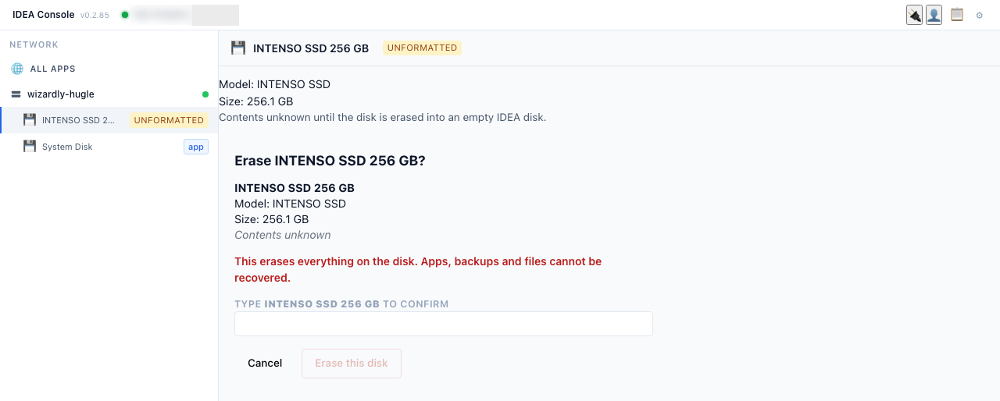
4. After the erase, the disk shows as an **IDEA Disk** with the **empty** badge.

> **A Files Disk that Nextcloud is using cannot be erased.** Ask your IDEA contact to stop Nextcloud first.

## 12.3 Make a Files Disk

1. Select the **IDEA Disk** marked **empty**. The view asks "What would you like to do with this disk?": **Make this a Files Disk**, **Make this a Backup Disk** or **Install App**.
   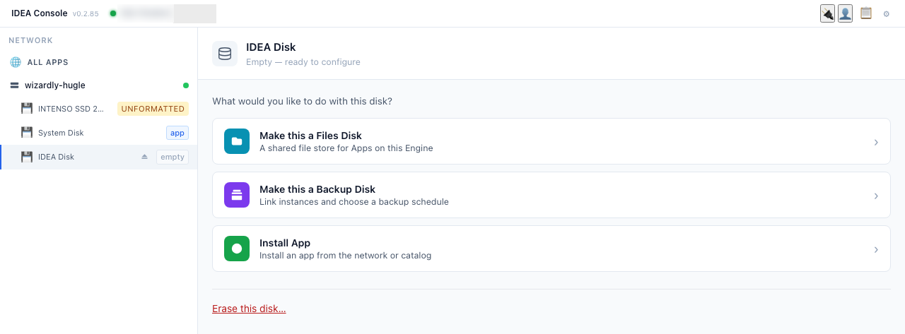
2. Click **Make this a Files Disk**. The panel says "Nothing on the disk is erased", with **SHARE NAME** filled in as **School Files**. Click **Make this a Files Disk**.
   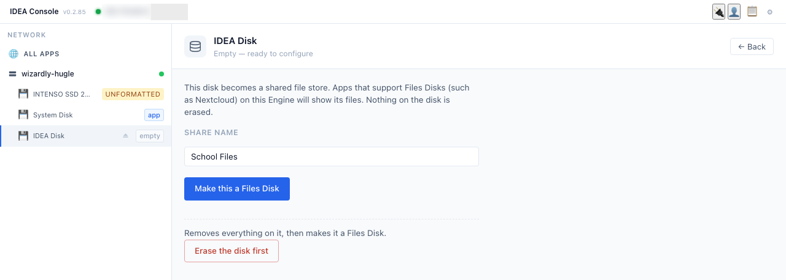
3. After a short wait the disk shows the **files** badge, "Share name: School Files", the free space, an **Eject** button and **Erase this disk…**. Once your IDEA contact has linked it, the view also says **Available in: Nextcloud**. Teachers then find it in Nextcloud (chapter 9).
   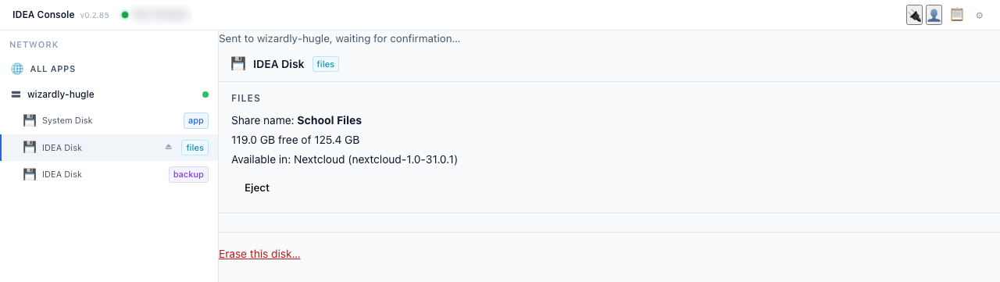

## 12.4 Eject a disk

An IDEA Disk has a small eject icon next to its name in the Network list and an **Eject** button in its disk view. The System Disk has none. Never eject or unplug a disk during a backup.

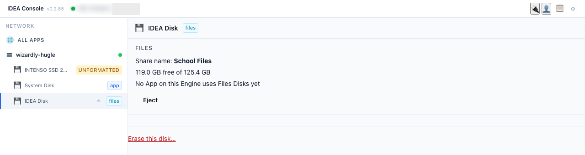

## 12.5 Make a Backup Disk

1. Select an **IDEA Disk** marked **empty** and click **Make this a Backup Disk**.
   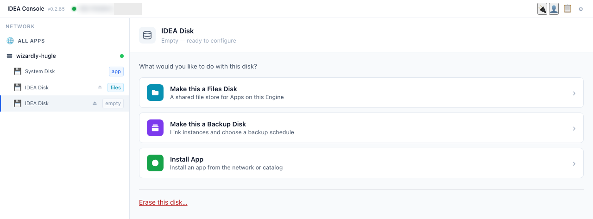
2. Choose when backups run: **On demand** (only when you press **Back up**), **Immediate** (as soon as the disk is plugged in) or **Scheduled**. Your IDEA contact tells you which.
   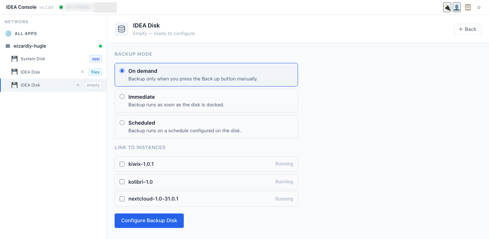
3. Under **LINK TO INSTANCES**, tick every app of this IDEA box (on the kit: all six). Backups are full: they include the Kolibri channels and Wikipedia, so a restore needs no internet.
   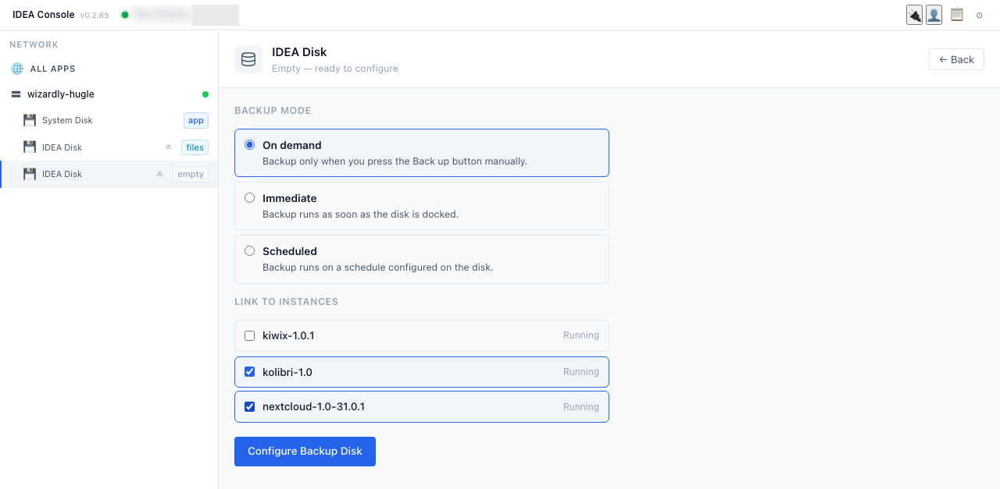
4. Click **Configure Backup Disk**. The disk gets the **backup** badge and a **Backups** list with each linked app.
   

## 12.6 Run a backup

1. In **ALL APPS**, each linked app row has a **Back up** button next to Start, Stop and Open. Click it for Kolibri. The row shows **Backing up…** with a progress bar, and the **OPERATIONS** box at the top shows the same job.
   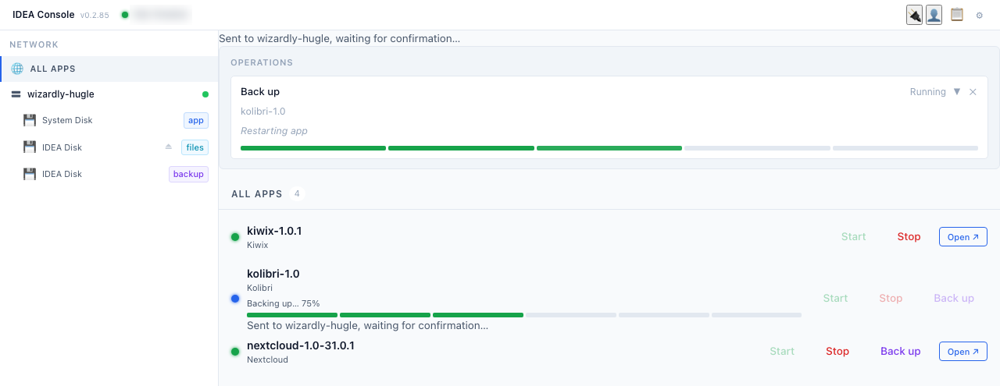
2. The app is stopped while it is copied, then starts again by itself. When the job is finished the OPERATIONS box shows **Done**; close it with **✕**. A small app takes a few minutes, but the first backup of a big one takes much longer: on the kit about 37 minutes for Kolibri, an estimated 1 h 30 for the full Wikipedia and about 2 h 15 for all apps together. Do this outside lesson time.
3. When it is done, the Backup Disk's **Backups** list shows **Last backup** with the date and time for each app. Repeat for each other app.
   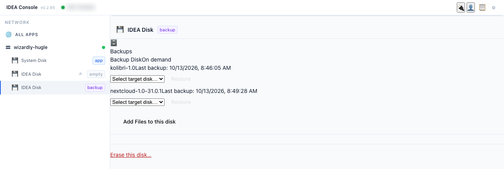

## 12.7 Restore after a breakdown

You need a **spare disk** (an empty IDEA Disk) to restore onto.

1. Open the **Backup Disk**. Each app in the **Backups** list shows **Last backup**, a **Select target disk…** list and a **Restore** button (grey until a target is chosen).
2. In **Select target disk…** choose the spare disk. Only spare disks are offered here. Click **Restore**.
   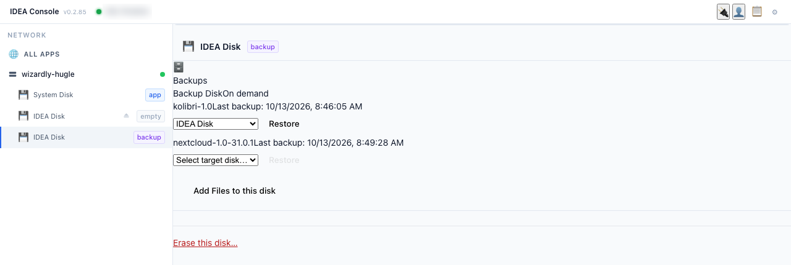
3. The Console asks: "Are you sure? This will overwrite **kolibri-1.0** on **IDEA Disk**." Click **Confirm Restore**.
   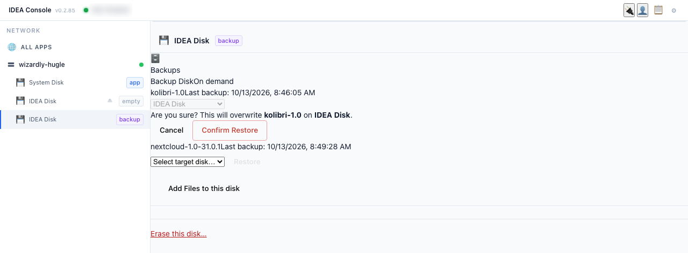
4. When the restore is finished, the spare disk shows the **app** badge and lists the restored app. A small app takes about a minute; Kolibri with its channels or Wikipedia takes much longer, so wait.
   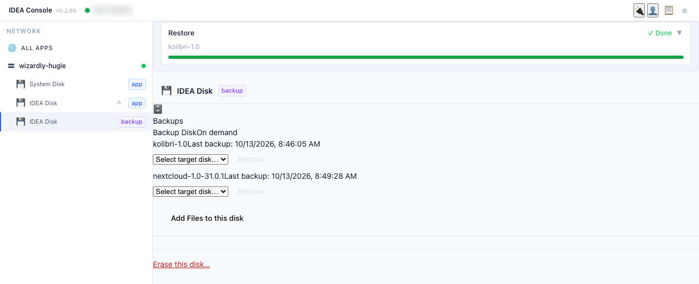
5. The restore **moves** the app: it is no longer listed on its old disk, and the restored app is **stopped** (orange dot, **Start** button). Until you start it, the app cannot be opened. A restore is for a real breakdown, not for practice on a working school box.
6. Click **Start** on the restored app's row. After about 30 seconds it runs again and the row shows **Open ↗**.
   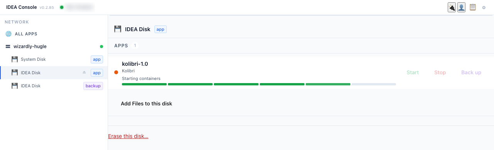
7. Open the app from its card on the **Apps** page (as in 2.3) and sign in as the teacher (coach).
8. Check that the data is back: classes, learners, lessons, quizzes and reports, as at the last backup.
   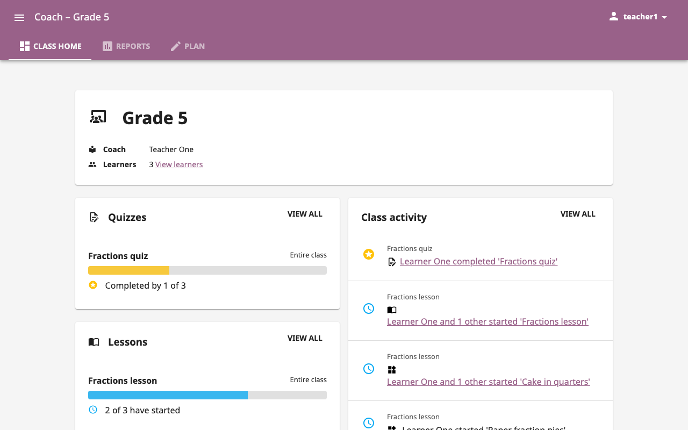
   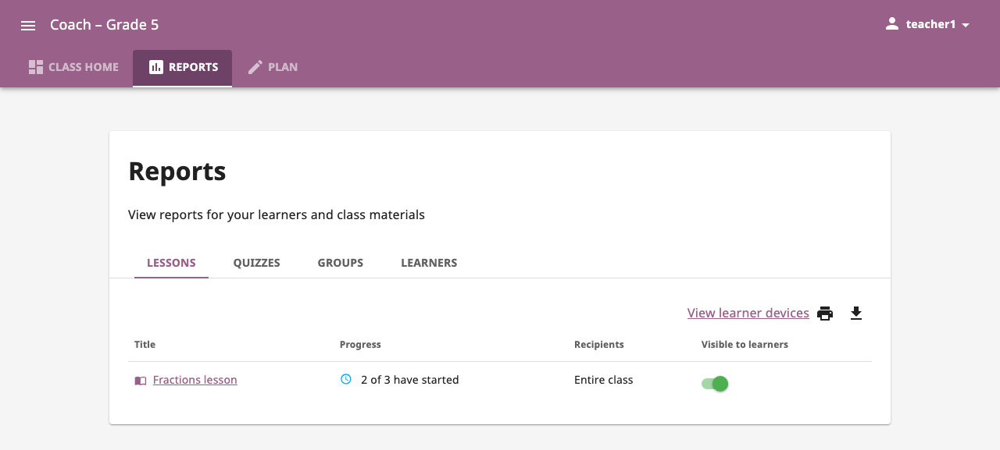
9. Later, your IDEA contact can move the app back to the System Disk and prepare the spare disk again.

> **Important.** Anything done after the last backup is lost. Make a new backup of the restored app as soon as it runs.
