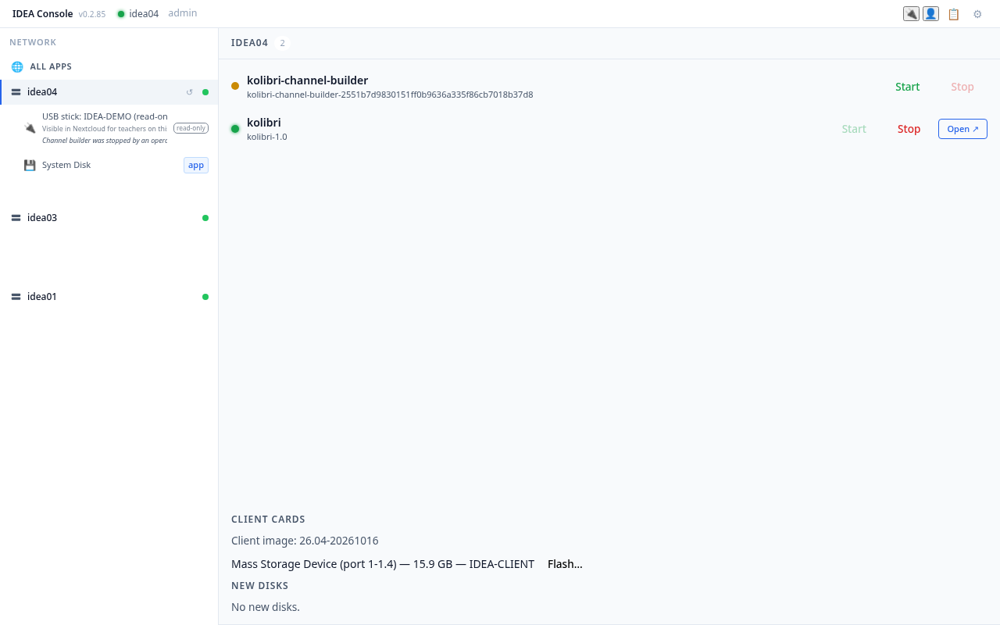
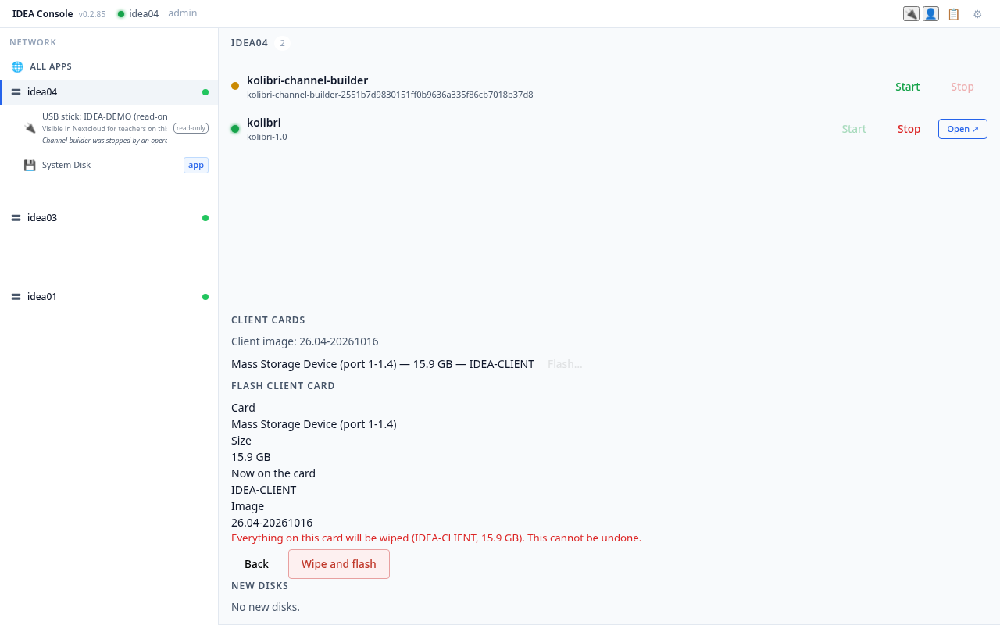
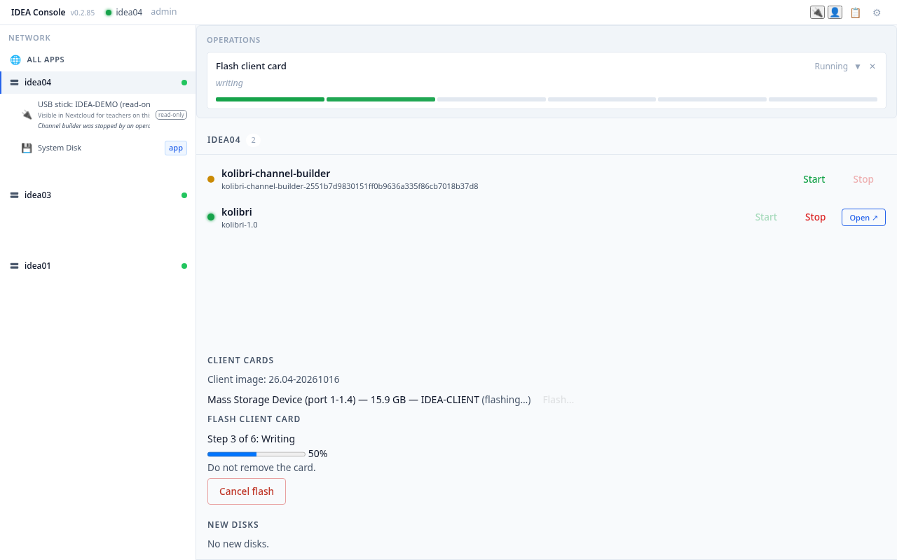
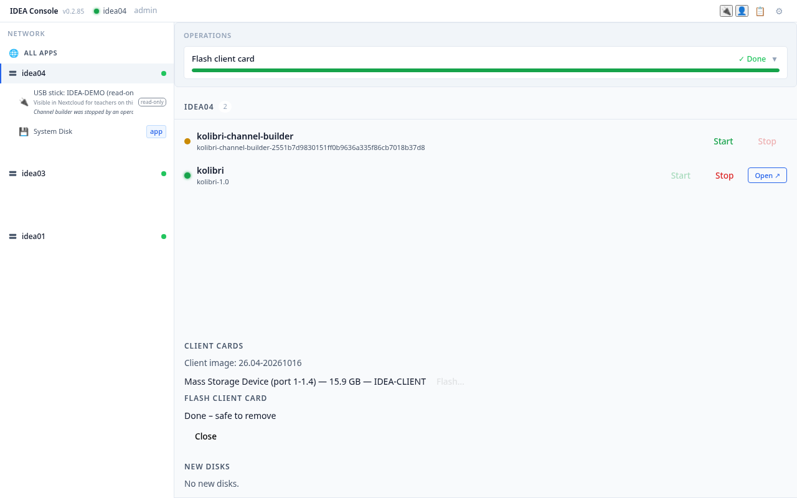

**Status:** Draft (feature not live yet; lands with idea#201 and idea#203: Console Client cards, Flash and the IDEA shortcut) · **Maintained by:** Marco (with Atlas) · 15 October 2026

# 13. Student computers: reset a card from the Console

This chapter is for the school operator, with the IDEA contact on the phone (or the IDEA contact working remotely from the Console).

Every student computer (Raspberry Pi 400 or Pi 500) starts from a **microSD card** with the same IDEA student image. When a computer goes wrong (it no longer starts, the screen looks different, the card is full or a student changed settings), you do not repair it. You **reset the card**: the IDEA box writes a fresh copy of the student image onto it. This takes about 5 to 10 minutes.

Good to know:

- **Resetting wipes the card.** Anything saved on the computer itself (the local *Documents* folder) is gone. Students' work in **Nextcloud** stays: that is why students save there (chapter 7).
- Every card is the same, so a card works in **any** student computer, Pi 400 or Pi 500.
- The student computers **do not update themselves**. New software comes only with a new, tested image version, which you get by resetting the card.
- You need a **USB card reader** plugged into the IDEA box. Any card reader works.

## 13.1 Before you start

1. Switch the student computer off and take the microSD card out. Note the computer's name from its sticker (for example `idea-pc-3f2a`).
2. Put the card into the card reader, and plug the card reader into a free USB port of the IDEA box.
3. Open the Console and sign in with **Operator Login** (chapter 11).

## 13.2 Find the card

1. Click the IDEA box in the list on the left. Scroll down to **CLIENT CARDS**. It shows the client image the box will write, and every card in a card reader: the reader's name, the card's size and what is on it now.

   

2. Check that the **size** matches your card. If the card is not listed, see 13.5.

> **Never pick an IDEA Disk.** The Files Disk, the Backup Disk and app disks are never offered here, but always check the name and size before you continue.

## 13.3 Reset (flash) the card

1. The card belongs to the IDEA box you flash it from: its **IDEA** shortcut tries that box first. Flash it from the IDEA box of the classroom it will be used in.
2. Click **Flash…** on the card's row.
3. Read the panel **FLASH CLIENT CARD**. It repeats the card, its size, what is on it now and the image. It says in red that everything on the card will be wiped. If anything looks wrong, click **Back**.

   

4. Click **Wipe and flash**. The Console shows the progress in steps, for example **Step 3 of 6: Writing**.

   

5. Wait for **Done – safe to remove**. Do not pull the card reader out before that. Then click **Close**.

   

6. Take the card out of the reader and put it back into the student computer. Switch the computer on.

## 13.4 After the reset

1. The first start takes a few minutes longer: the card sets itself up and names the computer after its Pi (the name on the sticker).
2. The computer opens the student desktop by itself, with no password. The desktop has one shortcut, **IDEA**.

3. Double-click **IDEA**. Chrome opens the start page, finds the IDEA box and opens the Console (chapter 2). Check that **Open** on the Kolibri card works.

## 13.5 Questions

| Question | Answer |
|---|---|
| **The card is not listed.** | Check that the card is pushed fully into the reader and that the reader is plugged into **this** IDEA box. Try another USB port. |
| **The Flash button is not there or the Console refuses.** | The IDEA box never writes to an IDEA Disk, the system disk, or a disk that is in use. Check that you picked the card and not another disk. Otherwise call your IDEA contact. |
| **The flash stopped with an error.** | Flash again. If it fails again, the card is probably worn out: use a new card. |
| **The computer does not start after the reset.** | Try the card in another student computer. If it starts there, the computer may need a bootloader update: call your IDEA contact. |
| **Can I install an extra program on one computer?** | No. It would be lost at the next reset. Ask your IDEA contact to add it to the next image version. |
| **The IDEA shortcut says No IDEA server found.** | Check the network connection. Type the name on the IDEA box's sticker in the field on the start page (chapter 2). If it keeps happening, the card may belong to an IDEA box that has been switched off or moved: flash it again from the right box. |
| **Can my IDEA contact do this remotely?** | Yes. Put the card in the reader and tell them. They press Flash from the Console, and you put the card back when the Console says it is done. |
