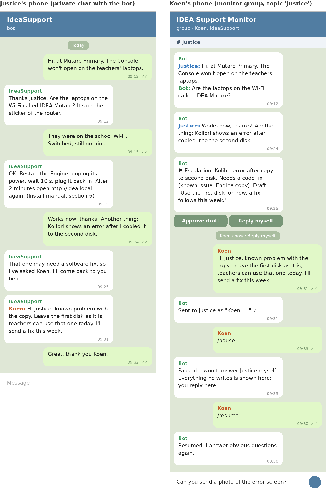
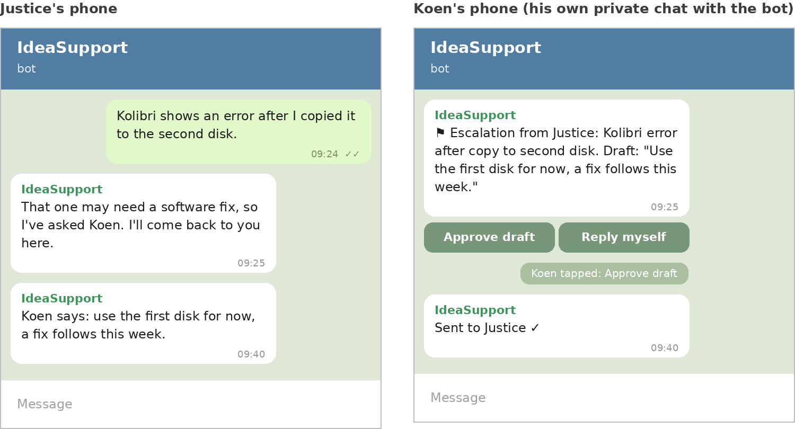
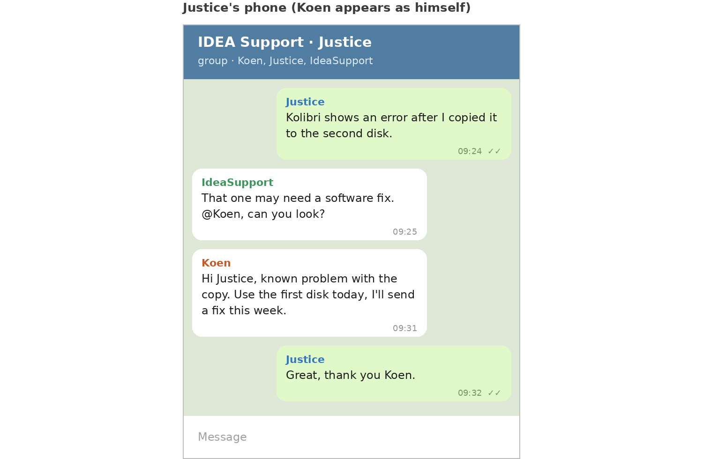
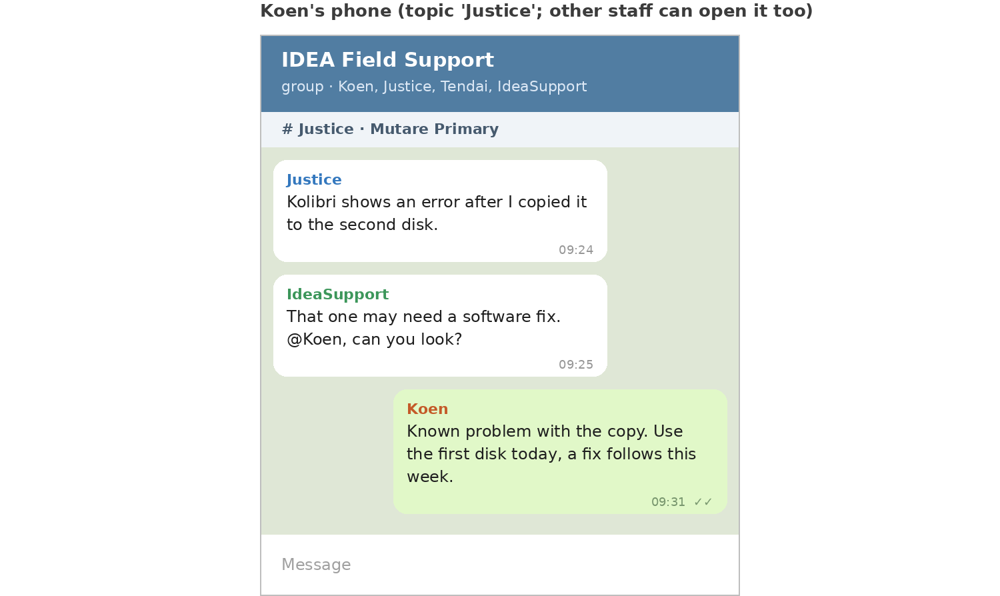

**Author:** Steve (Lead Bot)
**Date:** 2026-10-20
**Status:** Draft, Koen's decisions of 2026-10-20 recorded. Extends the approved [field support channel design](2026-10-14-field-support-channel.md) ([idea#188](https://github.com/koenswings/idea/issues/188)).

# What and why

Today Justice writes to `idea-support@agentmail.to`. Each round trip is an email, picked up by a watcher at most once a minute, then answered by email. That works, but a back-and-forth conversation ("what does the screen show now?") takes many slow rounds.

**Proposal:** add a private **Telegram bot** named **IdeaSupport** (username `@IdeaSupportBot`, see Decisions) as the main field channel. Justice chats with it on his phone like any other chat. Each message reaches the Support Engineer within seconds and the answer comes back in the same chat. Email (`idea-support@agentmail.to`) stays as an alternative channel.

Why Telegram rather than WhatsApp (phase 1 in the earlier design): no business verification, no phone number to buy, no 24-hour window or templates, no per-message fees, and a bot can be created in five minutes. Telegram also works well on weak mobile connections.

**Affected domains:** field support (Support Engineer, Marco, Steve), the box (one small relay script), the routine "Box watcher events". No change to the Engine, Console, apps, client cards or routers.

# Research findings (20 October 2026)

- **No native Telegram channel in Grok Bot.** There is no Telegram connector or tool in the available integrations, and the app shows a Channels section only when a channel connector exists. Grok Bot's own native inbound channel is email (`mail.grokbot.com`).
- **Telegram Bot API** is free. A bot receives messages either by **long polling** (`getUpdates`, the request waits up to 50 s and returns immediately when a message arrives) or by a webhook. It sends with `sendMessage`. No AI is needed for either.
- **Bot chats are not end-to-end encrypted.** They are cloud chats stored on Telegram's servers. Fine for support questions, not for secrets.

# Approach options

| Option | How | Speed | AI cost | Verdict |
|---|---|---|---|---|
| A. Relay script on the box | Script long-polls Telegram; for each allowed message it calls the existing "Box watcher events" webhook (`type: telegram_message`); the bot answers by running a small `tg-send` command on the box, which calls `sendMessage` | 2 to 10 s to wake, plus answer time | Only per real message | **Recommended** |
| B. Telegram MCP connector | Third-party MCP server for Telegram | Polling-based, no instant wake | Each check is an AI run | Not recommended: no trusted connector, costs on empty checks |
| C. Telegram to email bridge | Forward Telegram messages into the support inbox | Same minute delay as email | Per message | Gains little over email |

**Option A in detail**

1. `tg-relay` (systemd service on the box, about 100 lines of Python): long-polls `getUpdates`, drops anything not from the allowlist, stores each message (text, photos as files) under `/workspace/support/telegram/`, and calls the webhook once per message, batching messages that arrive within a few seconds.
2. The webhook routine wakes the Support Engineer with the chat id and message. It answers by running `tg-send <chat> <text|photo>`. Replies are not generated for empty polls; the script polls, not the AI.
3. Night rule: Koen's 07:00 to 24:00 rule applies to messages to Koen, not to Justice. Field messages are answered at any hour (Zimbabwe is UTC+2: the same as Belgium until 25 October, one hour ahead after that).
4. Logging: every in and out message is appended to the support log, as with email, so Steve can report and nothing gets lost.

# Cost

- Telegram: free. Relay script: no AI, runs on the box.
- AI runs: one per real incoming message (or burst), the same as the email channel today. A conversation of 10 messages costs about 10 short runs, roughly the same as 10 emails, but finishes in minutes instead of an hour.
- Once Telegram works, the email watcher can stay (it is free) and the old 30-runs-a-day timer routine is switched off.

# Security

- **Allowlist:** only Koen's and Justice's Telegram user ids (numbers, not usernames). The bot ignores everyone else and logs the attempt. Adding a school later means adding an id.
- **Bot token** is stored on the box only, set through a secret request, never printed or put in chat or Git.
- **No passwords in chat**, either way. If a password is needed, the bot points to the credentials sheet Justice already has.
- **No system access:** same rule as the approved design. The Support Engineer filters and explains; it never deploys, changes configuration or uses SSH writes. Anything else becomes a report to Steve and Koen.
- **Data:** Telegram stores bot chats in its cloud (not end-to-end encrypted). Do not send school pupil data or credentials through it.

# Approval rule (decided 2026-10-20)

Phase 0 was "draft only, Koen approves". For Telegram and email alike, Koen decided:

- **Answer autonomously** when the solution is obvious and needs no code change, typically from merged docs (manuals, tutorial, remote-access guide, known issues): "Which cable goes where", "how do I reflash a card". The bot names the source section.
- **Ask clarifying questions directly** (sticker name, what the screen shows, a photo).
- **Escalate to Koen** everything else: anything that may need a change, a judgement call, a promise, or is not covered by the docs. The bot tells Justice "I've asked Koen, I'll come back to you", and Koen gets the draft answer to approve.

# Setup

**Koen (about 10 minutes):**

1. In Telegram, open `@BotFather`, send `/newbot`, choose a name and username.
2. Paste the token into the secret request Steve sends (not into chat).
3. Send the bot one message, so it learns your user id.
4. Send Justice the bot link (`https://t.me/<username>`) and ask him to press Start and send "hello".

**Bots:**

- Steve: write and install `tg-relay` and `tg-send`, add `telegram_message` to the "Box watcher events" routine, record the two user ids in the allowlist, test with Koen's account, then with Justice.
- Support Engineer and Marco: answer through `tg-send`, following the approval rule above.
- Atlas: watch that the relay service is running (part of the box watchers).

# Decisions (Koen, 2026-10-20)

1. **Replies:** the bot answers autonomously, on Telegram and email, when the solution is obvious and needs no code change. Everything else (code changes, judgement calls, promises, anything not covered by the docs) goes to Koen to approve or decide.
2. **Name:** display name **IdeaSupport**. Telegram usernames must end in `bot`, so the proposed username is `@IdeaSupportBot`. Whether it is free can only be seen in BotFather when it is created. Fallbacks in order: `@IDEA_SupportBot`, `@IdeaSupport_bot`, `@IdeaFieldSupportBot`.
3. **Email:** `idea-support@agentmail.to` stays as an alternative channel and is not retired. The free mail watcher keeps running.
4. **Justice** has Telegram. Photos are accepted from the start; voice notes come later.
5. **Chat structure:** still open. See the options below.

# Chat structure options

Two Telegram facts drive this choice:

- **A bot cannot show its DMs to anyone else.** Koen cannot open the bot's private chat with Justice. In a DM setup Koen only sees what the relay copies to him (a mirror message, a log or a digest).
- **In groups, bots run in privacy mode by default.** They only see commands, replies to the bot and @mentions. To see every message, privacy mode must be switched off in BotFather (`/setprivacy`), or the bot must be a group admin.

| Option | Advantages | Disadvantages | How Koen monitors | Privacy between field staff | Noise for Koen |
|---|---|---|---|---|---|
| **(a) 1:1 DMs** (each person with the bot) | Simplest for the field: a normal chat. Private. No group admin work. | Koen sees nothing unless the relay mirrors it. Koen cannot join in directly. | Escalations only, plus a mirrored copy or daily digest sent to Koen by the relay | Full | Low (escalations only) or high (full mirror in one chat) |
| **(b) One shared group** (Koen, all field staff, bot) | Koen sees everything live and can step in. Staff can help each other. | Conversations mix in one stream. Everyone sees everyone's problems. The bot must work out who it is answering. Messy past 2 or 3 people. | Reads the group | None | High |
| **(c) One group per person** (Koen, that person, bot) | Clean per-person view. Koen sees everything live and can step in. Private between staff. | One group per person to create and manage. Koen's chat list grows with each new person. | Opens each group | Full | Medium (one chat per person) |
| **(d) Topics supergroup** (forum group, one topic per person, school or incident) | One place for Koen, with a per-thread view. Scales well. Bots can post in a specific topic. | All members can read all topics, so there is no privacy between staff. Needs privacy mode off or admin rights for the bot, and someone to open new topics. | Opens the group and reads topic by topic | None | Medium, and can be muted per topic |
| **(e) Hybrid: DMs plus a Koen-only monitor group with Topics** | Field staff get a simple private DM. The relay mirrors every exchange (in, out, photos) into a supergroup where only Koen and the bot are members, with one topic per field person. Escalations are flagged in the topic and also come to Koen directly. | Koen reads a copy, so replying means asking the bot (or a `/reply` command in the topic that the relay forwards). A bit more relay logic (about 30 extra lines). | Opens the monitor group, one topic per person. Live. | Full | Low (topics can be muted; escalations still come through) |

# What it looks like: chat window examples

These mockups all follow one scenario. Justice is at a school and the Console won't open on the teachers' laptops. The bot fixes that on its own (right Wi-Fi network, restart the Engine). A second problem needs a code change (Kolibri shows an error after being copied to the second disk), so the bot escalates it to Koen, and Koen steps in. They are drawings, not real screenshots.

## Option (e) hybrid: Justice's phone and Koen's phone

Justice only ever sees one private chat, "IdeaSupport". Koen has a group, "IDEA Support Monitor", where only he and the bot are members, with one topic per field person. Every message in Justice's chat appears there as "Justice: …" and "Bot: …".

"Stepping in through the bot" means this: when the bot escalates, it posts a card with **Approve draft** and **Reply myself**. If Koen types his own answer in the topic, the relay sends it to Justice as a bot message starting with "Koen:". Justice can see it is Koen talking, even though it arrives in the bot chat.

`/pause` in the topic stops the bot from answering by itself, so Koen can take over the whole conversation. Everything Koen types in the topic then goes to Justice. `/resume` hands the conversation back to the bot.

## Option (a) private chats only

Justice and Koen each have their own private chat with the bot. Koen only sees the escalations, not the rest of the conversation. He approves the draft or types a reply, and the bot passes it on as "Koen says: …".

## Option (c) one group per person

Here Koen, Justice and the bot are in one small group, so Koen sees everything live and answers as himself. Justice sees Koen's own name and photo. A new group is needed for each field person.

## Option (d) shared Topics group

Everyone is in one group, with one topic per person or school. Koen answers as himself inside the topic. Other field staff (here "Tendai") can open Justice's topic and read it.

# Onboarding a new field person

Common steps: the person installs Telegram. The relay only accepts **Telegram user ids** (numbers) on its allowlist. To capture the id, the person opens `https://t.me/IdeaSupportBot` (or the final username) and presses **Start**. The relay sees an unknown user, answers "Waiting for approval", and sends Koen the name, username and id with an approve request. When Koen approves, the id goes on the allowlist and the person gets a welcome message.

- **(a) DMs:** the common steps only.
- **(b) Shared group:** the common steps, then Koen adds the person to the group (or sends an invite link).
- **(c) Group per person:** the common steps, then Koen creates a new group, adds the person and the bot, and the relay records the new chat id.
- **(d) Topics:** the common steps, then Koen adds the person to the supergroup, and Koen (or the bot, as admin with topic rights) opens a topic for them.
- **(e) Hybrid:** the common steps only. On approval the relay opens the person's topic in the monitor group automatically.

**Offboarding:** remove the id from the allowlist, so the bot ignores the person from then on. In (b), (c) and (d), also remove the person from the group. Chat history stays on Telegram. The support log on the box keeps the record.

# Recommendation

**(e) Hybrid**, with **(d)** as the simpler alternative if privacy between field staff does not matter.

- **Near-real-time support:** every option answers within seconds. Only the DM keeps the field side as simple as possible: one chat, no group rules, no other people's messages.
- **Koen monitoring:** (e) gives the same per-person thread view as (d) and (c), in one place, live, and Koen can mute it and still get escalations.
- **Scaling:** a new person is one "Start" and one approve tap. No groups to create. Staff never see each other's problems or school details.
- **Tradeoffs:** Koen reads a mirror rather than taking part in the chat itself, so stepping in goes through the bot or a `/reply` command. The relay is a little bigger. If Koen would rather chat with Justice directly in the same thread, (c) is the better choice while there are one or two field people, and (d) is better once there are more.

# Security reminders

- Never send passwords, credentials or pupil data through Telegram, in any option. Bot chats and groups are cloud chats and are **not end-to-end encrypted**.
- The mirror in (e) and groups in (b) to (d) are extra copies on Telegram. Keep their membership to Koen and the bot (in (e)) or to approved staff.
- The allowlist applies in every option. In groups the bot also ignores members who are not on the allowlist.
