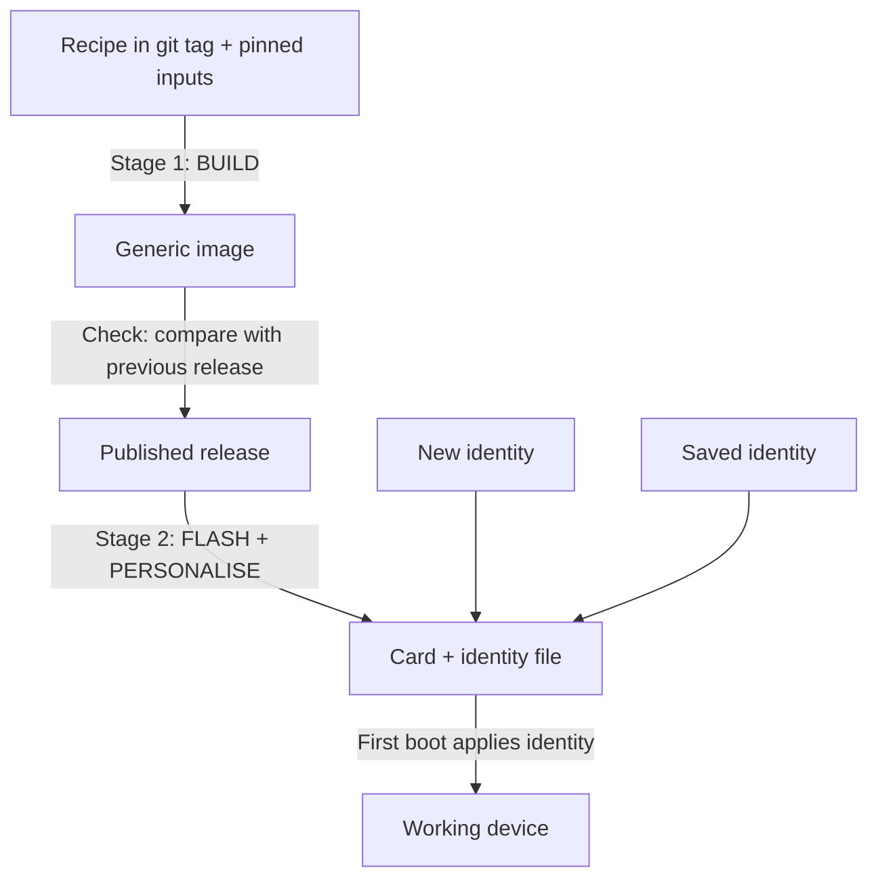

**Author:** Steve (Lead Bot)
**Date:** 2026-10-27 (restructured after Koen's review, 23:07)
**Status:** Accepted by Koen on 2026-10-29 at 12:38; #322 is active work. See section 7.
**Related:** [idea#322](https://github.com/koenswings/idea/issues/322) (reproducible images), [idea#341](https://github.com/koenswings/idea/pull/341) (stage 1, merged as `d927e39`), [idea#319](https://github.com/koenswings/idea/pull/319) and [idea#208](https://github.com/koenswings/idea/issues/208) (time zone set at flash time, the pattern Option B extends)

This proposal builds the argument step by step: first the problem, then what we need, then the simplest answers and where they fall short, and only then the choices. Koen accepted the recommendation (section 6) on 29 Oct 2026. His answers to the open questions are in section 7.

# How a release is made: two stages

Koen approved this way of presenting the release process on 29 Oct 2026.

**Stage 1: BUILD** (slow; only when the code or the updates change)

1. Check out the recipe at a git tag, with all inputs pinned to exact versions.
2. Build one **generic image** per device type (client, router, Engine). It holds no names, keys or other device identity.
3. **Compare its manifest with the previous release** and review the differences.
4. Publish it as a **release**.

**Stage 2: FLASH + PERSONALISE** (fast; once per device)

1. The flash tool writes the published release image to the card, plus a private **identity file** on the boot partition (name, time zone, home mode, Tailscale key).
2. On first boot the device applies the identity file and then deletes it.

**Two entry points**

- **Full route** (from the top): something changed, so build a new release first, then flash.
- **Fast route** (start at the published release): nothing changed. A **new identity** gives a new device; a **saved identity** gives an exact twin or replacement of an existing device.

**Yearly check.** Once a year, or before a handover, rebuild Stage 1 from the old tag on a clean computer and check that it reproduces the content of the published image.

The plain-English version for field staff is in [docs/RELEASES.md](../docs/RELEASES.md).

# 1. The problem

## Devices built from images

Every IDEA device in a school starts from an **image**: a complete copy of a disk or SD card, holding the operating system, the installed programs, the IDEA software and its settings, packed into one file. Writing it onto a card or SSD (**flashing**) gives a device that starts up ready to use.

There are three kinds:

- the **Engine** image, for the school server Pi;
- the **client** image, for the classroom Pi 400s;
- the **router** image, for the OpenWrt Cudy router.

Each image is made by a **recipe** kept in git: build scripts plus lists of what goes in. Images are numbered as they are built, for example client s15 and s16.

## What can go wrong

- A device in the field breaks, or behaves differently from the one we tested.
- We fix one thing, but the new image also brings changes nobody asked for. Between client s15 and s16, Ubuntu's zlib, protobuf and minizip updates came in without anyone choosing them.
- Someone fixes an image by hand, and the change is never written into the recipe. The next build loses it.
- Two devices end up with the same identity because one card was copied. Today two different Pis (serials ending 5b4c and 35f2) were both called *idea-pc-5b4c*.
- A year from now the outside sources the recipe relies on have changed or disappeared, and the recipe no longer builds.

## What we need to be able to do later

We need to know **exactly what is on each field device**, to **change it on purpose and only on purpose**, and to **build it again** when we need to, also by someone other than today's team.

# 2. Use cases

Each need is stated on its own, without assuming a solution.

1. **Fix a field device:** get a broken or misbehaving device working again.
2. **Diagnose a field problem at home:** reproduce the exact software on a device on Koen's desk, to study a problem before touching the school.
3. **Ship changes without surprise side effects:** a new image changes only what we meant to change, and we can prove it.
4. **Enforce "no hand-edited images":** every change goes through the recipe, so the recipe always describes the image.
5. **Rebuild in a year:** build the same image again after the outside world has moved on.
6. **Hand the project over:** someone new can rebuild everything without help from the current team.
7. **Copy a field device exactly:** make a twin, or a replacement for a broken one, with the same name and identity.

# 3. The simplest answers first

## 3a. "Just give the field Pi the latest release (or the latest major version)"

This should be the **strong default for fixing a device** (use case 1). The latest release (the newest image we published) has every known fix, it is the one we tested most recently, and it needs no special tooling. A *major version* is a release line, such as client 2.x, within which updates are meant to be safe to install.

It is not enough when:

- **We must diagnose before acting** (use case 2). To understand a problem, we first need the device's *current* software, not the latest. Upgrading may hide the problem without explaining it.
- **The upgrade isn't safe yet.** A newer release may change data or file formats (a *migration*) or break compatibility with the other devices in that school, which may still run older versions.
- **The download is too big.** Koen avoids large transfers over the weak Zimbabwe school connections. A full image is gigabytes; a small targeted fix may be megabytes.
- **We need to know what changes.** Before giving a school the latest release, we want the list of what is different from what they run now (use case 3).

## 3b. "Check out a git tag and rebuild"

A **tag** is a fixed name in git (for example `client-s16`) for one exact version of the recipe. Checking out the tag and running the build is the right **foundation**: it says exactly which recipe made the image.

But a tag fixes only the **recipe**, not the **ingredients**. The build pulls in a lot from outside git, and all of it drifts over time:

- the **base operating system image** (Raspberry Pi OS or Ubuntu) it starts from;
- the **apt packages** installed on top, which are always whatever version the mirror has *today*;
- **Docker images** for the apps;
- **npm and pip packages** (JavaScript and Python libraries);
- **firmware** for the Pi and the router;
- any **manual step** someone did that isn't in the scripts.

Atlas found exactly this in the paused #322 work: the s16 recipe (commit `13f6917`) **does not pin package versions**, so building it today gives today's packages, not s16's. And s16's final shrink to 14 GB **was done by hand**.

So "tag + build" only gives the same image once the inputs are **pinned** (the recipe names exact versions) and **archived** (we keep a copy, in case the outside source deletes them). That is what reproducibility work actually means.

## 3c. Keep the images themselves

### Option A: publish full images as releases

Each tested image is published as a GitHub Release, and the field flashes exactly that file.

Pros:

- The field gets **exactly the tested image**, not a rebuild that might differ.
- **Fast restore:** download and flash, no build step.
- **Independent of upstream:** if Ubuntu or OpenWrt change or delete packages, the released image still exists.
- The release becomes the **reference** that later images and field devices are compared with.

Cons and watch points:

- **Per-device identity must be taken out** of the image, or every copy is a clone: sticker name, Engine ID, Automerge store (the shared database between Engines), SSH host keys, `/etc/machine-id`.
- **A Tailscale fleet key must never be in a public image.** The `<account>911!` passwords and the Wi-Fi keys are different: Koen ruled those non-secret (see `docs/ops/security-overview.md`).
- **GitHub limits release files to 2 GB each**, so an Engine image has to be split into parts or made leaner.
- **Images go stale** as security updates appear, so they need rebuilding regularly.
- **Images are hard to review:** you can't read a binary the way you read a script.
- The **router is the easy case:** small, and nothing secret in it unless a Tailscale key is added.

### Option B: a generic image plus an identity file at flash time

There is **one generic image per type** (Engine, client, router) with no device identity in it.

- The **flash tool** writes the generic image, then puts an **identity file** on the boot partition. This extends what `idea-flash-card` already does for the time zone and `--home` (#208, #319).
- At **first boot** the device applies the file and deletes it. **With no file it creates a fresh identity**, as `idea-firstboot` already does for clients.

It serves two uses:

1. **A new device:** generic image plus a new identity.
2. **An exact copy of a field device** (use case 7) from its saved identity, to diagnose at home or replace a broken one. An Engine copy doesn't need the Engine's data: **App Disks hold the apps and files**, and the **shared Automerge store fills back in from its peers**.

Watch points:

- **Identities stay private** (SSH host keys, any Tailscale key): on the bot computer or in Koen's admin tool, **never on GitHub**.
- **Never run a copy next to the original.** The tool warns about this and records which identity was used, when and on which card.
- **A replacement appears as a new Tailscale node**, so the old node must be removed.

The admin tool then needs only **a git commit plus an identity file** to describe any field device exactly.

A and B work well **together**: A stores and ships the generic image, and B makes it personal.

# 4. How to check that two images are "the same"

Use cases 3 to 6 all need one test: *is this image the same as that one?* There are two ways to define "same".

## Byte-identical

The two image files match **bit for bit**. This is the strictest test and simple to run (one fingerprint per image). For a full Linux system it is very hard to reach, because many things differ between two honest builds:

- **timestamps** on every file;
- the **order and position** in which files land in the file system;
- **random IDs** created during the build (file-system UUIDs, machine IDs, keys);
- **compression** output, which can vary.

Each one has to be forced to a fixed value, across every tool in the build. Projects that manage this spend a lot of work on it, and a single difference only tells you "not equal", not *what* differs.

## Content-identical

Every file has the **same path, permissions, owner, size and contents**. A **manifest** records this: one line per file with its path, mode (permissions), owner, size, sha256 fingerprint of the contents, and symlink target where there is one.

- **Volatile files** (logs, caches, random seeds) are **listed but not compared**, because they always change.
- **Secrets** appear only as **fingerprints**, never as their contents, so a manifest can be shared safely.

Comparing two manifests gives a **list of exactly which files differ**, which is what a reviewer needs.

## The trade-off and the recommendation

| | Byte-identical | Content-identical |
|---|---|---|
| Strength | Strongest | Strong: everything that affects behaviour |
| Effort to reach | Very high | Moderate |
| When it fails, you learn | Only "different" | Which files, and how |
| Risk | Low | A meaningful change hidden in a file wrongly marked volatile |

**Recommendation: content-identical.** It answers the real question, "is the same software and configuration inside?", at a fraction of the effort, and its output is useful on its own. The one risk is the volatile list, so that list is kept short, in git, and reviewed like code.

This is already built. Stage 1 (#341, `d927e39`) added the manifest and compare tools. The client s16 manifest has about **175,000 lines**. Comparing s15 with s16 found **exactly 14 differences**: the `config.txt` change from #304 plus the zlib, protobuf and minizip updates. Nothing unexpected, and it shows the tool catches real changes.

The same PR (#341) also includes a GitHub Actions workflow (a script GitHub runs on every PR) for the tools' self-tests. Bots can't push into `.github/workflows/`, so it is at `tools/repro/ci/repro-tools.yml`, and **Koen has to copy it to `.github/workflows/repro-tools.yml` himself**.

# 5. Where the checks fit

1. **Build** the generic image from a git tag, with pinned inputs.
2. **Compare its manifest with the previous release** and review the list of differences. This covers use cases 3 and 4. It is cheap.
3. **Reproducibility check** (optional, for example once a year): rebuild from the tag on a clean computer and compare manifests with the published image. This covers use cases 5 and 6.
4. **Flash and patch** per device: the identity file, time zone and home mode.
5. **Optional per-device check:** compare a card's manifest with the generic image; only identity files should differ.

The **patch step doesn't need to be reproducible itself**: it is small, scripted and checked by step 5. Option B also makes step 3 cheaper, because there are **only three generic images to prove**, not one per device.

# 6. Recommendation (Steve)

1. **Latest release as the default way to fix a field device.** It is simplest and best tested. Use something else only for the cases in 3a (diagnosis first, an unsafe migration, a weak link, an unclear change). Confidence: high.
2. **Pin and archive build inputs** (package versions, base image, Docker images, firmware), and take the hand steps into the scripts, so that checking out a tag really rebuilds the image. Confidence: medium; it is the most work, and some sources (the Ubuntu mirror) may need a local archive.
3. **Publish generic images as releases plus identity at flash time** (Options A and B together). Confidence: high for clients and the router; medium for the Engine, because of the 2 GB limit.
4. **A manifest diff against the previous release for every new image**, as a standard release step. Confidence: high; the tool already exists.
5. **The full clean rebuild is optional**: yearly, or before a handover. Confidence: medium.

# 7. Koen's decision (29 Oct 2026, 12:38)

Koen accepted the recommendation in section 6 in full and made #322 active work. In his words: "No, this is exactly how I want it to be presented. So make, you can consider this an item that we are currently doing. So it has to be on the list of items that are currently being worked on. make sure that your diagramming explanation is somehow, somewhere in some document. maybe it should also be explained on the release page of the project."

Answers to the open questions:

1. **Default fix:** the latest release, except in the cases listed in 3a.
2. **Option A or B:** both. One generic release image per device type, plus a private identity file written at flash time.
3. **Pinning inputs:** pin versions now. The full archive (about 2 GB for the client) comes later.
4. **Clean rebuild:** yearly, and before a handover.
5. **Identity files:** kept on the bot computer, never on GitHub.
6. **Engine images:** whether to split them or make a leaner image is decided at the first Engine release.
7. **Tailscale key:** only through the private identity file.

Every new image also gets a manifest comparison with the previous release.

# 8. State of the paused #322 work (Atlas, 27 Oct, around 19:20)

- **Stage 1** (manifest and compare tools): **merged** in #341 (`d927e39`).
- **Stage 2** (clean rebuild of client commit `13f6917`): **paused** while its inputs were being checked. **Nothing was built or pushed.**
  - Kept on Atlas's computer: `/workspace/idea322/s2/s16-pins.tsv` (1,815 pinned packages), the stage-1 evidence in `/workspace/idea322/tmp/`, `APPROACH.md`, and an empty branch `feat/repro-client-rebuild-322` (worktree `/workspace/idea322-s2`).
  - Findings:
    - `13f6917`'s `build.sh` doesn't pin package versions, so a rebuild needs a pin step plus access to the Ubuntu mirror or a Launchpad archive (about 2 GB). The box couldn't reach `ports.ubuntu.com`.
    - s16's final shrink to 14 GB was done by hand, which is outside the recipe.
    - s16's `MANIFEST.txt` package list is missing `gdb`, `screen` and `ubuntu-release-upgrader-core`.
  - Estimate to resume: **1.5 to 3 hours**, with about **60% confidence of 0 differences**.
- **Stage 3** (router `b2f00bc`), **stage 4** (link deployment records to manifests) and **stage 5** (Engine): **not started**.
