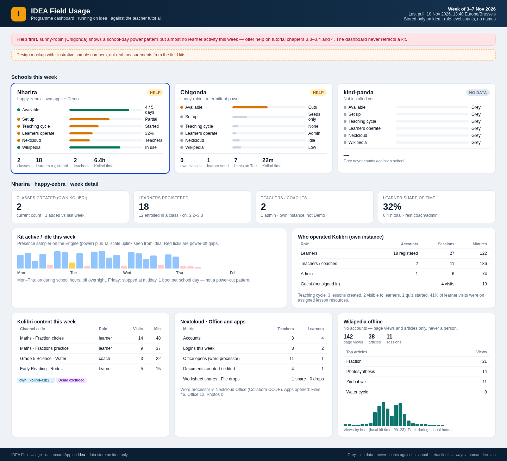

# Field usage monitoring: are donated kits used as taught?

**Author:** Steve · IDEA Lead Bot
**Date:** 2026-11-09, revised 2026-11-10
**Status:** Design Review complete (2026-11-10, Pixel, Kid, Axle, Atlas). Incorporates Koen's decisions of 2026-11-10 and the Design Review outcome in §14. A dependencies, reliability and off-switch section (§10) was added the same evening after Koen's questions. Waiting for Koen's review of the proposals PR. Nothing in this proposal touches a running kit. The field Engines stay pinned at Engine commit `adfd9d3` until Koen approves a field update (idea#374). Implementation starts only after this proposal is merged.

The usage-export helper version moved from v8 to v7 on 2026-11-10; idea#401 takes the next free number after.

Koen asked for this on 2026-11-09 (spoken request to Steve) and revised the scope on 2026-11-10. Related: idea#288 (kit record gaps), idea#374 (field update), idea#375 (Tailscale ACL action items), idea#389 (App backup), `proposals/2026-10-13-store-growth.md`, `proposals/2026-10-13-tailscale-single-fleet-tag.md`, `proposals/ssh-key-management.md`, `docs/manuals/teachers/teacher-tutorial/` (v1.9), `koenswings/app-kolibri`, `koenswings/app-nextcloud`, `koenswings/app-kiwix`.

**Decisions already taken (Koen, 2026-11-10):** Option B (Engine-side collector with per-App usage hooks); E1 (pull over Tailscale); D1 amended (programme dashboard as an IDEA App on the idea computer, with a designed visualisation); D2 (school-local Console panel) later, tracked as a follow-up issue; privacy recommendation accepted (role-level aggregates only). Wikipedia offline is in scope. The programme collector and its data store run solely on idea, with no LLM in the loop: Tailscale is the trigger. How the new modules sit next to the existing Engine, Apps, Tailscale tailnet and the idea computer is shown in the architecture diagram in §7. After Design Review, Koen asked how dependent the existing system is on the new modules, whether monitoring can ship switched off, what residual risk it adds to kit reliability, and how it can be turned off if there is a problem. That is answered in §10, including a persistent per-Engine off switch that ships off.

---

## 1. Motivation

IDEA donated the Zimbabwe kits to schools: an Engine, a router, classroom computers, and Kolibri, Nextcloud and Wikipedia offline. Teachers were trained with the *IDEA for Teachers: Tutorial*. A donation only does its job if the school uses it, so IDEA needs to know whether that happens and to act when it doesn't:

1. **First, add help.** If a school's kit is on but nobody runs lessons, or only one admin account is ever used, IDEA wants to see that early and offer targeted help, such as a refresher on the tutorial chapter that isn't being used.
2. **Then, if help is refused, move the kit.** If a school refuses help and still does not use the kit, IDEA wants evidence to support retracting it and giving it to another school.

Today we can only tell whether a kit is reachable from an admin device. That isn't the same as use:

- A kit that is **offline on Tailscale** may still be serving a full classroom on the school LAN, for example when the Starlink uplink is off.
- A kit that is **online** may be idle all day.

On 2026-11-06, for example, happy-zebra came back on Tailscale after being away for about 52.5 hours (idea#288). We can't tell whether it was powered off, cut off from the uplink, or being used offline the whole time.

So the monitoring has to answer a pedagogical question measured against what we taught: *are teachers and learners doing the tutorial's workflows on this kit?* The technical question, *is the box on?*, is only the first layer.

The standing system that answers this lives on **idea** (the production Engine, formerly wizardly-hugle; Tailscale `idea.tail2d60.ts.net`, `100.115.60.6`). It stores every uplink sample and every usage summary there, and it shows them in a dashboard App. It is a deterministic service: it watches Tailscale and pulls data. It does not involve an LLM, and it is designed from scratch rather than as an extension of any existing watcher.

---

## 2. What the dashboard must answer, and what IDEA does with the answer

| # | Question | Why it matters | Leads to |
|---|---|---|---|
| Q1 | When is the kit on, when does it stop, and does it come back? Is it a school-day pattern, regular power cuts, or has it been dark for weeks? | Separates "abandoned" from "intermittent power" or "holidays" | Dark with no school-day pattern → contact the school (help) |
| Q2 | While the kit is on, is anyone using Kolibri, Nextcloud or Wikipedia offline? | On but unused is the clearest case for offering help | Help |
| Q3 | **Who** operates it: learners, or only teachers and the admin? How many classes exist, how many learners are registered and enrolled, how many teachers and admins are registered? | The tutorial aims at learners working themselves (ch. 3.2–3.3, 4, 6). Only admin or teacher activity means a demo or projector style of use, which is worth help, not retraction | Targeted help (ch. 3.3 enrol learners, ch. 4) |
| Q4 | **What** is used: which Kolibri channels and content, for how long, and how much? How many lessons and quizzes were created and assigned? Assigned lessons or free browsing? | Shows whether the teaching cycle (lesson → learners → Reports) happens | Help on the missing step |
| Q5 | In Nextcloud: how many users there are per role; which apps are opened; how often the word processor (Nextcloud Office / Collabora CODE) is opened; how many documents are created or edited, and for how long; and whether the tutorial workflows happen (share worksheets, co-edit, File drop, School Files) | Koen asked for this explicitly | Help on ch. 5, 6, 8 |
| Q6 | Is the school using its **own** Kolibri, Nextcloud and Wikipedia, or only the **Demo** instances from the tutorial? | Practice in the Demo apps is good; staying there for weeks means the school never set up its own classes | Help with ch. 3.2–3.3 on the real instance |
| Q7 | Did use change after IDEA offered help? | This is the evidence for the last step | Koen decides on retraction. The dashboard never decides |
| Q8 | Is Wikipedia offline used: how many page views, distinct articles, sessions, which articles, and at what time of day? | Tutorial chapter 7. There are no Wikipedia accounts, so this is activity, not people | Help on ch. 7 |

Rule: the dashboard **informs** a human decision. It never triggers a retraction, an email to the school, or a change on the kit by itself.

## 3. Metric coverage audit

Every promise in §2 is mapped below to a concrete metric. Legend (same as §6): **✅** the apps already keep the underlying data (needs a read or a hook, no new instrumentation) · **🟡** needs new collector, sampler or logging code in an approved update · **🔴** needs app instrumentation (App Dev / Kid) · **⛔** not obtainable, and why.

This audit was the gap in the 9 November draft. That draft implied setup ("classes, learners enrolled, coach accounts") inside the Kolibri table and the JSON sketch, but it did not give Q3 a metric for *teachers registered*, *learners registered as distinct from enrolled*, or *classes created over time*. Q7 had no metric at all (no place to record that help was offered). Wikipedia was marked optional. Those holes are closed here, or called out as unmeasurable.

| Q | Promise | Metric | Source | Per | Status |
|---|---|---|---|---|---|
| Q1 | When the kit is on, stops, comes back (power) | `boot_id`, `uptime_s`, wall time, NTP-synced flag, every 5 min. Gaps = power-off; new `boot_id` = reboot | Engine presence sampler, local file on the kit | kit / 5 min | 🟡 field update |
| Q1 | When the kit is reachable from IDEA (uplink) | Tailscale `Online` and `LastSeen`, one row per state change and one row per periodic check | idea collector, Tailscale LocalAPI | kit / change + 5 min | 🟡 idea App + ACL so idea can see the peers |
| Q1 | School-day pattern vs power cuts vs weeks dark | On-minutes per school-day hour; boots per day; longest gap | Derived on idea from the sampler (power) joined with Tailscale (uplink) | kit / day and week | 🟡 derived |
| Q1 | "Offline to us but serving the LAN" vs "powered off" | Sampler kept writing while Tailscale was down → powered on, uplink down. No sampler rows and a new `boot_id` after a gap → powered off | Both sources, after the next successful pull | kit / each gap | 🟡 both needed. Live LAN use while dark to us is invisible until the kit next contacts idea |
| Q2 | Anyone using Kolibri while the kit is on | Sessions, session minutes, content visits that day, all roles plus guest, intersected with presence windows | Kolibri `UserSessionLog`, `ContentSessionLog` via the instance hook | instance / day | ✅ data · 🟡 hook |
| Q2 | Anyone using Nextcloud while the kit is on | Logins, Office opens, file activity that day, intersected with presence | Nextcloud last-login / tokens (snapshot); `admin_audit` for every login; Office sampler | instance / day | last login ✅ · every login 🔴 · Office 🟡 |
| Q2 | Anyone using Wikipedia while the kit is on | Page views that day (see Q8) | Kiwix access log via the instance hook | instance / day | 🟡 app-kiwix logging + hook |
| Q3 | How many classes have been created | Current classroom count: `Collection` rows with `kind = classroom`. There is **no** `date_created` on `Classroom` / `Collection` (verified in Kolibri 0.15.5 auth models) | Kolibri DB, per instance | instance / daily snapshot | ✅ current count. Period "created" is a 🟡 day-over-day net change only (a deletion looks like a negative). Not an event log of creations |
| Q3 | How many learners have been registered | `FacilityUser` rows that are not admin, coach or `classroom assignable coach` and not a device superuser. `date_joined` exists, so "registered this week" is available | `FacilityUser` + `Role` + device permissions | instance / snapshot and period | ✅ |
| Q3 | How many learners are enrolled in a class | Distinct memberships whose collection `kind = classroom` (enrolment is separate from registration: tutorial 3.2 then 3.3) | Membership joined to Collection | instance / snapshot | ✅ |
| Q3 | How many teachers / coaches are registered | Distinct facility users with role `coach` or `classroom assignable coach` | Role table | instance / snapshot | ✅ current count. No "role granted at" timestamp, so "new teachers this week" is 🟡 day-over-day |
| Q3 | How many admins are registered | Role `admin` or device superuser | Role + device permissions | instance / snapshot | ✅ |
| Q3 | Nextcloud users per role | Members of groups `admin`, `teachers`, `learners` (and any class group the school added) | Nextcloud group membership tables | instance / snapshot | ✅ |
| Q3 | Who actually operates it (not only who exists) | Kolibri sessions and minutes by role (learner / coach / admin / guest); Nextcloud logins and Office opens by group | Same sources as Q2, grouped by role | instance / day | ✅ Kolibri · Nextcloud logins 🔴 for a full history |
| Q3 | Who really sits at the screen | Not obtainable when accounts are shared (a single learner account, the admin account, or the client OS user `learner`) | — | — | ⛔ Flag only: one learner account with overlapping sessions from different devices, or admin-only activity |
| Q4 | Which channels and content, for how long, how much | Per channel + content title + kind + role: visits, `time_spent` seconds, completions | Content session log + content DB titles; content summary log for completions | instance / day | ✅ |
| Q4 | Assigned lesson content vs free browsing | Match content ids against resources of lessons that are visible to learners | Lesson + content session log | instance / day | ✅ computed |
| Q4 | Lessons created and assigned (made visible) | Count of lessons (`date_created` exists); count that are visible; resources per lesson | Lesson table | instance / day and cumulative | ✅ |
| Q4 | Quizzes created, started and ended | Exam `date_created`; `date_activated` / `active`; `archive` / `date_archived` | Exam table (Kolibri 0.15.5) | instance / day and cumulative | ✅ |
| Q4 | Teacher opened Reports (tutorial 3.6) | No Kolibri log of report views. Session `pages` exists but is probably empty (to verify) | — | — | 🔴 optional plugin. The teaching cycle is otherwise visible from lessons/quizzes plus learner sessions on that content |
| Q5 | Nextcloud users per role | See Q3 Nextcloud census | group membership | instance / snapshot | ✅ |
| Q5 | Which Nextcloud apps are opened | No built-in per-user app-open counter. The app container access log gives `/apps/<app>/…` counts **without** role. Honest fix: a tiny IDEA Nextcloud app that counts `(day, group, appId)` | container logs (partial) or IDEA counter | instance / day | 🔴 / partial 🟡 |
| Q5 | Word processor opened (count, by role, distinct documents, read vs edit) | Nextcloud Office (richdocuments) + bundled Collabora CODE. Each open writes a WOPI token row (editor, owner, file, can-write, token type, expiry). An hourly job deletes expired rows, so the kit sampler must run more often than token lifetime plus one hour. Join file id to mimetype to split text / sheet / slides | WOPI table, sampled | instance / 15 min sample → daily counts | ✅ with 🟡 sampler |
| Q5 | Documents created or edited | Approximate from file-cache times by owner; exact from the audit log | file cache / audit log | instance / day | ✅ approximate · 🔴 exact |
| Q5 | Time spent in the word processor | WOPI rows store expiry, not editing duration | Estimate: same file + editor present across consecutive samples | instance / day | 🟡 estimate only. ⛔ exact editing minutes are not stored |
| Q5 | Tutorial workflows (5.1 worksheet share, 5.2 edit share, 5.3 / 6.2 File drop, 8.2 School Files share) | Share type, permissions, target group, created time; files arriving in an upload-only folder | share + file tables | instance / day | ✅ counts, no names or file contents |
| Q5 | Document contents | — | — | — | ⛔ by design |
| Q6 | Own instance vs Demo | Each running instance is identified separately (see §7.3). Demo if the display name contains `Demo` (tutorial: "Kolibri Demo", "Nextcloud Demo", "Wikipedia (Demo)") or the facility is the seed "IDEA Demo School". Demo-seed classwork is excluded | Engine instance id + display name; Kolibri facility name | instance | ✅ |
| Q6 | School has set up its own classes and accounts | On the non-demo instance: coaches > 0, classes > 0, learners registered > 0 (Kolibri starts with only `admin`); Nextcloud teachers/learners beyond the seeds | Same census as Q3, filtered to `demo = false` | instance / week | ✅ |
| Q7 | Did use change after help was offered? | A help-event record on idea (date, school/deployment, tutorial chapter, note) entered by Koen or Marco. The dashboard compares scorecard lines N weeks before vs after that date | database on idea, not on the kit | school / event | 🟡 idea dashboard feature. "Help was refused" is ⛔ a human judgement; the dashboard never records a retraction decision by itself |
| Q8 | Wikipedia page views | Article-like requests (content and raw-content paths, plus legacy article paths). Static skin, catalog, suggest-as-you-type and media assets are excluded | Kiwix access log | instance / day | 🟡 |
| Q8 | Distinct articles | Unique article paths / titles | Same log | instance / day | 🟡 |
| Q8 | Sessions | Requests grouped on the kit by client address with a 30-minute idle gap; **only the session count** leaves the kit | Same log | instance / day | 🟡 |
| Q8 | Top articles | Title + view count (no identity) | Same log | instance / day | 🟡 |
| Q8 | Time of day | Views per hour 0–23, using the kit clock (same NTP correction as other app timestamps) | Same log | instance / day | 🟡 |
| Q8 | Who read which article | Kiwix has no accounts | — | — | ⛔ by design, and required by the privacy default |

**Still unmeasurable, on purpose or by limitation:**

- The person behind a shared account (Q3).
- Exact minutes spent inside Nextcloud Office (Q5); we estimate from token sampling.
- "Teacher opened Reports" without a Kolibri plugin (Q4).
- Whether Nextcloud apps were opened *by role* without the small IDEA counter (Q5).
- A true "classes created on date D" event (Q3): Kolibri classrooms have no created timestamp. We show the current count and the net change since the previous snapshot.
- Live confirmation that a classroom is in use while the kit is unreachable (Q1): we learn that only after the next pull of the sampler.
- Refusal of help, and any retraction (Q7): human decisions.

## 4. What "proper use" means, from the tutorial

The source is *IDEA for Teachers: Tutorial* v1.9 (27 Oct 2026, `docs/manuals/teachers/teacher-tutorial/`, chapters read from the `.md` sources). Below is a topic summary of what teachers were taught, with the signal each topic leaves behind.

| Tutorial | Workflow taught | Observable signal (source) |
|---|---|---|
| 2 Getting connected | Join `IDEA` / `IDEA-Teachers` Wi-Fi, open the Console, open an app | Client devices on the LAN; requests to the apps |
| 3.1–3.3 Kolibri for teachers | Admin creates a class, enrols learners | Kolibri: classroom count, learner accounts (`date_joined`), enrolments (memberships), coach roles |
| 3.4 Lesson | Coach makes a lesson from channel resources and switches on **Visible to learners** | Kolibri lessons: who created them, whether they are visible, their resources, `date_created` |
| 3.5 Quiz | Coach makes a quiz, **starts** it, ends it | Kolibri exams: `date_created`, whether active, `date_activated`, archived, `date_archived` |
| 3.6 Reports | Coach reads lesson and quiz reports, exports CSV | **Not logged by Kolibri** (gap, §3 and §6.2) |
| 3.7 One class period | Before class, during class (learners sign in, explaining resources first, then exercises), after class (Reports) | Coach activity, then learner sessions on the lesson's resources in the same window |
| 4 Kolibri for learners | Learner signs in with username only, does a lesson and a quiz | Learner session logs, content session logs, exam logs |
| 5.1 Nextcloud | Share `Worksheets` view-only with the class group | A group share to the learners/class group, read-only |
| 5.2 | **+ New > New document**, share with edit, co-edit in Nextcloud Office | File created, shared with edit; Office opens (WOPI tokens) |
| 5.3 / 6.2 | File drop (`Drop Zone`, upload-only public link), learners hand in homework | Public link share with upload-only permission; files arriving in it |
| 6.1 | Learners open class files and co-edit | Learner logins; Office opens by learner accounts |
| 7 Wikipedia offline | Look up an article (search, open, follow a link) and use it in class. Demo = simple English; own app = full English Wikipedia | Kiwix article requests, distinct titles, sessions, hour-of-day (Q8) |
| 8 Files Disk | Open **School Files**, share a file with the class | Share from the external-storage mount |
| Appendix | Demo accounts in Kolibri Demo, Nextcloud Demo and Wikipedia (Demo). The school's own Kolibri starts with only `admin`; its own Nextcloud with `admin`, `teacher1`, `learner1` | Demo vs real instance; shared default accounts |

From this, the **proper use scorecard** per school per school week has six lines. The thresholds are for Koen to set; this proposal sets none.

1. **Available:** kit on during school hours (Q1).
2. **Set up:** the school's own Kolibri has coach accounts, at least one class, registered learners and enrolments. The school's own Nextcloud has teacher and learner accounts beyond the seeds (Q3, Q6).
3. **Teaching cycle (Kolibri):** lessons created and made visible, or quizzes created and started, followed by learner sessions on that content (Q3, Q4).
4. **Learners operate it:** learner-role share of Kolibri sessions and time versus admin and coach (Q3).
5. **Nextcloud workflows:** worksheet shares, co-edited documents, File drop use, Office opens by role (Q5).
6. **Wikipedia offline:** article views and sessions on the school's own Wikipedia, not only the Demo (Q8).

Each line shows green, amber or grey. Grey means "no data" (kit not reachable, or data not collected). Grey never counts against a school.

### How the scorecard lines are measured

Agreed with Koen on 2026-11-10 at 14:59 Europe/Brussels.

The lines do not track progress through the tutorial, or whether anyone read it. Each line checks whether the school actually does, that week, one thing the tutorial teaches, measured from that week's usage data on the kit. The bar shows how far the week's data is from a threshold Koen sets; amber means it is below the threshold.

- **Available:** kit on during school hours. Source: the presence sampler and the uplink history.
- **Set up:** the school's own Kolibri has coach accounts, at least one class, and learners registered and enrolled; its own Nextcloud has teacher and learner accounts beyond the seeds. Source: account and class counts from each App's database.
- **Teaching cycle:** lessons or quizzes created and made visible, then learners open that content. Source: Kolibri lesson, quiz and session records.
- **Learners operate it:** learner-role share of Kolibri sessions and time versus admin and coach. Source: session logs grouped by role.
- **Nextcloud workflows:** worksheet shares, word-processor edits, and File drop hand-ins, by role. Source: share and activity records.
- **Wikipedia offline:** article views and sessions on the school's own Wikipedia. Source: the Kiwix proxy log.

Worked example: in the mockup (§8.2), Nharira's amber "Teaching cycle: Started" means teachers made a few lessons but learners hardly used them. That points to the tutorial chapter on lessons and quizzes as the help to offer.

---

## 5. What the field picture already tells us

These are known facts used as examples. Per Koen (2026-10-29), we ask Justice for nothing.

- **happy-zebra** at Nharira (Steve's brief: about 490 students, 15 teachers; Justice said 4 classroom computers; bots saw 5 client hostnames on that LAN). It runs Kolibri `koenswings/kolibri:1.0-0.15.5-dev`, Nextcloud `1.0-31.0.1`, Collabora CODE `1.0-24.04.13.2` and Kiwix 3.8.2 (`deployments/engines/happy-zebra/capture-2026-10-28/images.tsv`). Its record lists a Kolibri_Demo on :65439 (Engine-managed) and a second Kolibri on :62561 that the Engine does not list (`capture-2026-10-28/record.txt`). **A collector must find every Kolibri, Nextcloud and Kiwix container, not just the Engine-listed ones.**
- **sunny-robin** (school inferred as Chigonda, not observed; idea#288). Two Kolibri and two Nextcloud stacks. The 5 Nov read showed a reboot at about 09:02 CET while `who -b` said 4 Nov 18:23: the kit's boot and clock signals already disagree.
- **kind-panda** is not installed yet.
- There are 4–5 classroom computers for about 490 learners. At that ratio, "distinct learners per week" will be small by design. The useful unit is **class sessions** (several learners in one window), not per-learner coverage.
- The classroom computers have one shared OS account, `learner` (student client image proposal). The OS session says nothing about who sits at the machine; only the app sign-in does.
- Network: students get `10.42.1.0/24` on `IDEA`, teachers get `10.42.2.0/24` on `IDEA-Teachers` (router proposal). Since 2026-10-27 classroom cards may also join `IDEA-Teachers` (idea#285), so the subnet is a hint, never a role. The kit firewall stops the Engine from reaching the student subnet (idea#288, 30 Oct), so **the Engine can't poll clients**. It only sees the requests they send.

---

## 6. Metric layers: what exists today and what needs work

Legend: **✅ available now** in data the apps already keep on the kit (needs a read, no kit change) · **🟡 needs a kit-side collector or idea-side service** (new code; no upstream app change unless stated) · **🔴 needs app instrumentation** (App Dev / Kid) · **⛔ not obtainable**, and why.

### 6.1 Presence: kit, Engine, router, clients

| Metric | Status | Source / how |
|---|---|---|
| Engine reachable from IDEA (Tailscale) | 🟡 standing history on idea | The idea collector records `Online` / `LastSeen` on every state change and every periodic check (§7.5). This measures the **uplink**, not classroom use |
| Engine "last seen", coarse | ✅ | `engineDB[id].lastRun` in the shared store, written at boot and at most hourly (`Liveness.ts` at `adfd9d3`; store-growth proposal) |
| Live online (seconds) | ✅ | Ephemeral heartbeat message every 10 s, never stored. Only useful while someone is connected |
| Power-on windows and stop/resume history, also while offline | 🟡 | **New local sampler** on the Engine: every 5 min append `{boot_id, uptime_s, wall_time, clock_synced, engine_up, instances_up, temp, throttled}` to a local file. Gaps give power-off; a new `boot_id` gives a reboot; a daily on/off pattern gives school hours |
| Boot history from the OS | ⛔/✅ | The systemd journal lists boots only if it is persistent. idea#386 found a volatile journal on another Pi, so don't rely on it. Docker start time and pm2 uptime give only the current boot |
| Router uptime and number of DHCP leases | ✅ when online (router API read) / 🟡 for history | Later: the router samples its lease count per subnet into a file the Engine reads (Ops router-image change) |
| Classroom computers active | 🟡 (approximate) | Distinct source addresses per hour seen by Kolibri (host network) and the Console, per subnet. Whether Nextcloud behind the Docker port map sees the real client address must be checked |
| Per-client boot history | 🔴 (later, optional) | Needs a client-image change: the client posts a ping to the Engine. Out of scope for v1 |

**Clock caveat:** school Pis have no battery-backed clock (store-growth proposal: "school Pis have no RTC"). Without an uplink after a power cut, the wall clock can be wrong. The sampler therefore records `boot_id` + uptime + an "NTP synchronised" flag, and the summariser corrects a boot's timestamps once a synced sample in the same boot is seen. App timestamps (Kolibri, Nextcloud, Kiwix) have the same weakness and get the same treatment. idea itself has internet and NTP, so timestamps stored on idea are reliable.

**"Abandoned" vs "intermittent":** a weekly presence strip per Engine shows on-hours per school day, the number of boots, and the longest gap. Many short boots during the day point to power trouble, which is a help issue for Ops (sunny-robin already logged under-voltage on 5 Nov). Confirmed off, or weeks with no boot after a good sampler history, can mean the kit is dark. Presence alone never puts a school on red.

The strip is built from segments. Each segment has `state` (one of `on`, `off`, `gapUnknown`, `collectorGap`), `start`, `end` and `lengthKnown`. The dashboard draws `on` and `off` as such. It draws `gapUnknown` and `collectorGap` hatched grey, each with its own words (for example "unknown gap" and "collector gap"), and **never** as the kit going dark.

### 6.2 Kolibri: who, what, how long, how much

Checked against Kolibri **0.15.5** source (auth models, role kinds, logger models, lessons, exams, device settings, CSV export). The kits run 0.15.5; app-kolibri `main` is 0.19.5, and the same tables must be checked there (Kid).

What Kolibri already stores (on the kit's own database, kept for its Reports):

- User session log: user, start time, last interaction, device info (OS/browser family), channels, pages. A new row starts after 5 min without interaction. → **sign-ins and session length per user**.
- Content session log: user (**nullable**: guest use), visitor id, channel, content, start/end, `time_spent` (seconds), progress, kind. → **which content, how long, per visit**.
- Content summary log: per user and content: time spent, progress, completion time. → **completions**.
- Mastery / attempt logs (exercises) and exam / exam-attempt logs (quizzes).
- Role kinds: `admin`, `coach`, `classroom assignable coach`. Device superuser via device permissions. Everyone else in a facility is a learner. → **role per user**.
- Classroom collections: name and parent only — **no created timestamp**.
- Facility user `date_joined`: when a user account was registered.
- Membership: enrolment of a user in a classroom (distinct from registration).
- Lessons (who created them, whether visible, resources, `date_created`) and exams (creator, active, `date_created`, `date_activated`, archived, `date_archived`).
- Guest access defaults to **True**, so content can be used without signing in. Those visits appear as content sessions with no user.
- Built-in CSV export (Facility > Data): one row per log with **username**, channel and content **title**, timestamps, time spent, progress. It has **no role column** and includes usernames, so the CSV is **not** what we export; we aggregate instead.

| Metric | Status | Note |
|---|---|---|
| Sign-ins per day by role (learner / coach / admin), distinct users, session minutes | ✅ | Join session log to roles / superuser. Roles are counted on the kit |
| Content used per day: channel, content title, kind × role: visits, total time, completions | ✅ | Titles from the content database (the CSV export does the same lookup) |
| Guest (not signed in) content use | ✅ | User empty; counted as a separate "guest" role |
| Lessons created, made visible; quizzes created, started or ended; resources per lesson | ✅ | Teaching cycle, tutorial 3.4–3.5 |
| Content used that was **assigned** in an active lesson vs free browsing | ✅ (computed) | Match content ids with visible lessons' resources |
| Classes (current count), learners registered (`date_joined`), learners enrolled, coaches, admins | ✅ | Tutorial 3.2–3.3 setup. "Classes created this week" is net change only |
| Demo vs real instance | ✅ | Per instance. The Demo seed's own records (`learner3`'s quiz and exercise) must be left out |
| "Teacher opened Reports" (3.6) | 🔴 | No log. Option: a small Kolibri plugin that counts report API calls by role. Kid's call whether that's worth it |
| Who **really** sits at the screen | ⛔ | A shared account (everyone as one learner, or the admin for everything) can't be told apart. We **flag** it |

### 6.3 Nextcloud: logins, apps, word processor, workflows

Checked against `koenswings/app-nextcloud` (Nextcloud 31.0.1; bundled richdocuments 8.8.3; Collabora CODE 24.04.13.2; IDEA account and Office hooks), Nextcloud 31 admin-audit, and richdocuments 8.8.3 WOPI code.

- The **word processor is Nextcloud Office** (the richdocuments app) backed by the bundled **Collabora CODE** image. The tutorial (5.2) uses **+ New > New document**, which opens in Nextcloud Office. It is not OnlyOffice.
- Roles come from **groups**: `admin`, `teachers`, `learners`. A school may add a class group (the tutorial calls it `Grade 5`).
- Nothing in app-nextcloud turns on audit logging today.

| Metric | Status | Source / how |
|---|---|---|
| Users registered per role (admin / teachers / learners / other groups) | ✅ | Nextcloud group membership |
| Last login per user, active sessions with last activity | ✅ (latest value only) | User preferences (last login) and auth tokens (last activity). A daily sample turns "latest" into a history; done on the kit, counted by group |
| **Every** login with a time, by group | 🔴 small | Ship the built-in `admin_audit` app enabled (it is in Nextcloud 31 core, off by default). It writes login, logout, file and share events to an audit log. The collector reads it and **counts**. A config change in a new app-nextcloud version (Kid) |
| **Word processor opens** (count, by group, distinct documents, read vs edit) | ✅ with a 🟡 sampler | WOPI token rows, sampled more often than token lifetime plus one hour. Join file id to mimetype to split text documents (word processor) from spreadsheets and presentations |
| Time spent in the word processor | 🟡 estimate / ⛔ exact | See §3 Q5 |
| Which Nextcloud **apps** are opened (Files, Office, Text, Photos, …) | 🔴 / partial 🟡 | Nextcloud has no per-user app-open counter. Partial: the app container access log has the URL path (`/apps/<app>/…`), so per-app request counts **without role**. Whether those logs are kept long enough on the kits must be checked. **Honest smallest instrumentation:** a tiny IDEA Nextcloud app (Kid) that counts `(day, group, appId)` page opens and writes nothing else |
| Tutorial workflows: worksheet shared read-only to a learners/class group (5.1); document shared with edit (5.2); upload-only File drop link (5.3); files arriving in it (6.2); a share from **School Files** (8.2) | ✅ | Share and file tables: share type, permissions, target group, created time. Counted, no names or file contents |
| Files created or edited per day by group | ✅ (approximate) / 🔴 exact | File cache times by owner give approximate counts; the audit log gives exact ones |
| Content of documents | ⛔ by design | Never read |

### 6.4 Wikipedia offline (Kiwix)

Tutorial chapter 7. The IDEA App is `koenswings/app-kiwix` (kiwix-serve **3.8.2**). It serves every ZIM file in the instance `data/` folder, mounted read-only. There are no user accounts.

Verified against the App compose and the kiwix-serve 3.8.2 documentation:

- kiwix-serve has **no access-log flag**. The only logging switch is verbose mode, which prints a debug trace of each request to standard output.
- Article views in the current viewer are not hash-only: the UI uses a hash location, which does not itself hit the server, but the viewer then fetches `/content/…` or `/raw/…/content/…`. Legacy article paths redirect to `/content/…`. Search is `/search`. Static assets live under `/skin`.
- Today's compose gives the container **no writable volume** (the ZIM folder is read-only), so we cannot persist a log file without an App change.
- Container logs of verbose output are an unreliable fallback: retention on the kits is unknown.

So Wikipedia metrics are in scope, but they need a small app-kiwix change (Kid) plus a usage hook:

1. Add a writable `./logs` bind mount (idea#141), not a named volume and not under `./data` (that folder is mounted read-only for the ZIM files). The log rolls daily and is cleared after 14 days, so it cannot fill the disk. Backup of the Kiwix App stays `none`.
2. Record HTTP requests in a durable access log. Design Review chose the sidecar: a small arm64 nginx container takes the allocated `${port}`, kiwix-serve stays internal only, and the health check moves to the proxy. A verbose-mode tee of standard output was the alternative and is not used, because that debug trace is not a stable format.
3. The instance hook parses that log for the day and emits Q8 aggregates. It treats content and raw-content paths (and legacy article redirects) as page views, drops skin, catalog, suggestions and media, and sessionises on the kit by client address with a 30-minute idle gap.
4. **Nothing that identifies a person or a client address leaves the kit.** Exported fields: page view count, distinct article count, session count, top article titles with counts, views per hour.

Demo vs own: "Wikipedia (Demo)" serves simple English (tutorial 7.1); the school's own "Wikipedia" serves full English. The hook tags the instance from its Engine display name and from the ZIM filename (simple English vs full English).

## 7. Architecture

The diagram below shows how the new modules sit next to the existing Engine, Apps, school LAN, Tailscale and idea computer. Existing pieces have a navy outline; new pieces in this proposal are amber; the deferred school-local Console panel is dashed.

<div style="page-break-before: always;"></div>

### How the pieces connect


**Figure 1.** Architecture of field-usage monitoring: existing components (navy), new modules in this proposal (amber), and the deferred school-local Console Usage panel (dashed).

Each field kit keeps working as it does today: the Engine (pm2, Automerge store, Console on port 80), the App instances (Kolibri, Nextcloud with MariaDB and Collabora, Kiwix), the router and classroom clients on the school LAN, and the Tailscale client tagged `tag:idea`. The new usage module on the kit — a presence sampler every five minutes and a hook runner — ships behind a persistent per-Engine off switch (`usageMonitoring`, default off; §10). When the switch is on, it calls each App's usage hook (including the Kiwix access-log proxy sidecar) and writes one JSON day summary per instance as `/var/lib/idea/usage/<day>/<instanceId>.json` (the folder is created at install and owned by `pi`); those files hold role-level counts only, usernames never leave the kit, and nothing usage-related is written to the shared Automerge store. The kit does not store a deployment id: idea maps each engine and day to a deployment when it pulls the file.

On idea, the new `app-usage-dashboard` IDEA App runs a collector with no LLM: it watches Tailscale's LocalAPI for uplink events (`Online` / `LastSeen`) and, when a kit is reachable, pulls waiting summaries over SSH through a restricted forced command. That pull is allowed only after the idea#375 ACL gives the dashboard sidecar `tag:idea-hub` (idea itself stays plain `tag:idea`) and permission to reach `tag:idea` kits on port 22, with no kit-to-kit traffic.

The summaries and uplink history then sit in a SQLite file on idea. A consistent snapshot is taken with SQLite `.backup` or `VACUUM INTO` (14 daily copies) and the real backup goes to Borg through the idea#389 hook, away from the 05:00 reboot. The web dashboard that Koen and Marco open over Tailscale is behind a login. idea's existing Engine and MilkWise on ports 3333 and 3334 stay as they are and are not connected to this path; the dashed D2 box is a later school-local Console Usage panel for this kit only and is not in v1.

### 7.1 Hard constraints

1. **One shared Automerge store for all Engines** (Koen, 2026-10-18, recorded by Axle: Engines meet and separate in the field). Anything written there reaches every Engine, at every school. **Per-school learner activity, names and content-watched data never go into that store**, not even aggregated. This is enforced: the `idea-usage` process never opens the Automerge Repo; a unit test fails if anything under `src/usage/` imports Automerge or store modules; and nothing usage-related is added to the ephemeral heartbeat or metrics messages, which stay as they are.
2. **Offline first.** Collection on the kit runs with no internet. Export happens only when a path exists (Tailscale, or a docked disk).
3. **Pinned field Engines.** "Field Engines are on `adfd9d3`" means: the three field kits (happy-zebra, sunny-robin, kind-panda) run a specific build of the Engine, identified by git commit `adfd9d3` (`adfd9d354ffd83c5ecc0a9eea64a474eae08de8f` of `koenswings/agent-engine-dev`, merged 2026-10-17, branch `deploy/kit-229-232`). It is not a product version number and not a setting the school can see. Koen decided on 2026-10-25 that those kits stay on that build, read-only, until he approves a field update (idea#374). Any new Engine code in this proposal — the presence sampler, the hook runner, the restricted export command, the `usageMonitoring` off switch — ships only in that approved update. idea itself runs current Engine `main` and can host the dashboard App without waiting for the field update.
4. **Data minimisation.** Usernames stay on the kit. What leaves the kit is counts by role, content and channel titles, article titles, and app names.
5. **Engines move between schools.** A summary is tied to a **deployment** (Engine + school + date range from `fleet-state.json`). idea sends a second forced-command verb, `archive-and-clear --before <day>`, only after it has confirmed its copy, so one school's data never travels to the next school. The kit does not look up schools or fleet-state.
6. **Programme data lives on idea**, not on a laptop and not in git. MilkWise on idea (ports 3333 and 3334) is out of scope and is never touched.

### 7.2 Collection on the kit: Option B (agreed)

**Option A: pull on contact, no kit change.** When a kit shows up on Tailscale, fixed read-only aggregate queries run inside the Kolibri and Nextcloud containers and only the aggregates are saved.
- + Works on the pinned kits today (if Koen allows it). Kolibri logs are durable, so this shows usage **since installation**.
- − No presence history while offline. Office tokens are gone if not sampled. No durable Wikipedia log. Depends on the uplink. App-specific queries live outside the app repos.

**Option B: Engine-side collector with per-App report hooks (agreed).**
- **Engine** (Axle) adds a separate pm2 process `idea-usage`, running as `pi` from the same repo and build, so a hung hook can never stall the Engine (`idea-usage` never opens the Repo):
  - the presence sampler (every 5 min): one append of `boot_id`, uptime, wall time, NTP-synced flag, Engine/instances up, temperature and throttled state, into a 90-day ring;
  - a hook runner that calls each running App instance's usage hook, one at a time, under `timeout`, `nice` and `ionice`; output is capped and checked against the schema on the kit; hooks are skipped while `/run/idea/backup-running` exists, while an update or move is running, or above 75 °C, and the runner fails open; `day` runs at night by default, apart from the 15-minute Office `sample`;
  - a school-local summary folder at `/var/lib/idea/usage/<day>/<instanceId>.json` (created at install, owned by `pi`, outside the store and outside App data); idea, not the kit, maps engine and day to a deployment;
  - the restricted export command used by E1 (`/usr/local/sbin/idea-usage-export`, helper v7);
  - the capability `usageSummaries` in `ENGINE_CAPABILITIES`, a boolean only (the string is on the list or it is not; no version and no extra fields);
  - a persistent per-Engine setting `usageMonitoring: off | on` in Engine settings, default **off**, that survives a reboot and an Engine update. When off, `idea-usage` exits or idles immediately: no sampler, no hooks, no files written; the export command returns `disabled` (empty) and existing data is left untouched. An operator command over SSH (a helper or Ops script in `tools/fleet`; later optionally from the Console) toggles it. Toggling never restarts the Engine or the Apps. See §10.
- **Apps** (Kid) ship the hook on the App Disk as `x-app.usage: { service, command, timeoutS }`, the same shape as the agreed `x-app.backup` hook. For instances the Engine lists, it runs `docker compose exec -T <service>` inside the instance's compose project. The hook has two modes, both printing to stdout: `day <date>` prints the day summary (a past date is allowed, so after a power-off the Engine can catch up from Kolibri and Nextcloud logs), and `sample` is the 15-minute Office token snapshot. The Engine stores that output in the usage folder, never in App data. The hook runs short, read-only queries inside the container (Kolibri SQLite; Nextcloud via `occ` or the database; Kiwix via its access log) and prints **one JSON day summary in a fixed IDEA schema** (§7.6), with no usernames. That short, read-only rule is a review requirement for Kid's hooks (§10). App knowledge stays in the App repos; the Engine stays generic.
- + Works fully offline. Presence history across offline weeks. Office tokens are sampled in time. One schema for every App, including Kiwix. Fits the domain split.
- − Needs an approved field update (Engine + App versions). The hooks must be tested on Kolibri 0.15.5 and 0.19.5, Nextcloud 31, and Kiwix 3.8.2.

**Option C: instrumentation inside the apps only** (Kolibri plugin, Nextcloud app) that writes its own counters and serves them over HTTP.
- + Richest data (app opens by group, Reports views).
- − Most work and more upstream-coupled code on every app update. Still needs Engine-side presence and export. Best used **inside** Option B as extra hook input, not instead of it.

**Ruled out: a separate Automerge "usage" document.** The CommandLog doc shows that the Engine can host a second doc in the same Repo, and the Console syncs it. But that Repo syncs with every Engine it meets, across schools, so it breaks constraint 1 unless the share policy is changed, and changing it is a new and risky Engine feature. Plain local files plus a pull are simpler and safer.

#### Can the measurement collector also be an IDEA App?

Yes in principle, and the **hooks themselves already are**: each hook ships on the Kolibri, Nextcloud or Kiwix App Disk and is invoked by the Engine, exactly like the existing Nextcloud USB-sync script.

A standalone "measurement" App that discovers sibling instances and queries them is a different thing, and it is **not recommended**:

- To run commands inside another instance's container, or to read another instance's database files, that App would need the Docker control socket or bind-mounts of every other instance directory. Giving an App that socket is root-equivalent on the host. The Engine already manages containers and already has a bounded hook pattern; it also knows the instance list and can scan for unlisted containers (happy-zebra port 62561).
- An App cannot see other instances' data directories unless the Engine specially mounts them, which would be a new Engine feature of similar size to Option B, with a worse privilege story.
- Updating a measurement App would avoid waiting for an Engine release — but field kits are pinned on Engine `adfd9d3` *and* App updates themselves need Koen's approval, so the practical path is the same field update (idea#374).

The programme **dashboard** on idea is a different question, and the answer there is yes: it should be an IDEA App (§8). It does not need the Docker control socket and it must not mount idea's host Tailscale socket (`/var/run/tailscale/tailscaled.sock` is an absolute host path, which the compose rules ban). It reaches the tailnet through its own userspace sidecar, holds a restricted pull key, and keeps a SQLite volume.

### 7.3 Per-instance measurement (verified in Engine and App code)

Yes. Measurements are per App instance, not per App type. A Kolibri created for one class is a separate instance with its own database, and it is reported on its own line.

Verified in `koenswings/agent-engine-dev` and the App compose files (not assumed):

- Each instance gets a unique id `{appName}-{uuid}` (for example `kolibri-3f2a…`) from `createInstanceId` in `Instance.ts`.
- Instance files live at `{disk}/instances/{instanceId}/` with their own compose file, environment file and `data/` folder.
- The Compose project name is the instance id. Container name convention: `<instanceId>-<serviceName>-1`.
- The display name (`installApp --name "Grade 5 Kolibri"`, or "Kolibri Demo") is stored only in `x-app.instanceName` and the store record. It never becomes the folder name or the Compose project name (`InstallApp.ts`). A school can therefore run several Kolibris with different names.
- **Kolibri:** the home directory is a per-instance volume. Host-network ports (`port` and `port_zip`) are allocated per instance. A per-instance Morango system id (`idea-${hostname}-${port}`) keeps two Kolibris on one Engine from sharing an identity.
- **Nextcloud:** files and the MariaDB data directory are per instance, plus its own Collabora service on the instance's compose network (no shared host port).
- **Kiwix:** the ZIM folder is per instance.

The Engine hook runner invokes the usage script once per running instance, inside that instance's container. Each JSON summary carries `instance` (id), `name` (display name) and `demo` (derived). The dashboard can show "Kolibri Demo" next to "Kolibri — Grade 5" as two cards.

Also verified, and easy to miss: happy-zebra already has a Kolibri on port 62561 that the Engine does not list. The runner discovers containers by image, compose project and working-dir labels as well as by the Engine instance list. For a listed instance it uses that instance's `x-app.usage` hook. For an unlisted container it pipes the matching App version's hook in over stdin (`docker exec -i … sh -s`), borrowing it from a disk that has the same App version, or reports a row saying "unlisted, no hook". It is never dropped and never merged into another instance. The Engine has to pick the hook for Kolibri 0.15.5 vs 0.19.5.

What is **not** verified from a live query in this revision: the exact SQL table names as they appear inside the 0.15.5 container on a kit (they follow Django's usual naming, and the hook will confirm them). The field does not yet use "one Kolibri per class" as a pattern; happy-zebra has Demo plus one other Kolibri. The architecture supports that pattern when a school adopts it.

### 7.4 Export: E1 pull (agreed), to idea

| | How | + | − |
|---|---|---|---|
| **E1 Pull over Tailscale (agreed)** | The collector on idea fetches new day summaries through a restricted SSH command on the Engine (the `command=` convention in `ssh-key-management.md`) that can only print summaries since a date | Nothing on the kit needs internet credentials. Read-only. Matches the existing key style | Only when Tailscale is up (fine: summaries wait on the kit). Needs an ACL so idea can reach the kits (see §7.5) |
| E2 Kit pushes | The Engine posts summaries to an endpoint on idea when online | Doesn't need idea to dial out | `tag:idea` is currently denied from initiating any Tailscale connection, so a push needs an ACL change too, plus a credential on every kit |
| E3 Docked disk / USB | The Engine writes the summaries to a docked IDEA disk on request, from the Console | Works with no uplink at all (field visit) | Manual; disks travel |

**Where the dashboard lives:**

- **D1 Programme dashboard as an IDEA App on idea (agreed, amended):** see §8. Cross-school data stays off the school kits and off laptops.
- **D2 School-local "Usage" panel in the Console (later, agreed):** an operator-only panel behind the existing Console login. It appears only when the Engine reports the `usageSummaries` capability, and it reads **only this kit's** summaries from a small read-only local HTTP endpoint on the Engine that serves the summary folder (not through the store). If the programme dashboard is also built in Solid, the scorecard and presence-strip components can be shared, so the school sees exactly what IDEA sees. Useful for a head teacher or field visitor, and it makes the monitoring visible to the school (transparency, §9). Tracked as a follow-up issue; not in v1. Pixel estimates 2 to 3 days once that endpoint exists.
- **Ruled out:** a programme view inside the Console. The Console is served at the schools, and a cross-school view there would show one school's data to another.
- Emailing reports to the Justice support inbox: possible, but that inbox is for Justice ↔ IDEA support, so it isn't the right home for a dashboard.

### 7.5 The idea-hosted collector (new, in scope, from scratch)

This replaces the idea of a bot periodically checking kits. It is a deterministic service that runs on idea, stores everything on idea, and never calls an LLM.

**What it watches.** The dashboard collector runs its own userspace Tailscale sidecar, tagged `tag:idea-hub`, and talks to that sidecar's LocalAPI. It does not mount idea's host Tailscale socket, so a bug in the App can never take idea (or remote access to MilkWise) off the tailnet. A watchdog checks that the sidecar sees itself online before the collector records anything; if not, it restarts the sidecar and records that time as a `collectorGap`, not as kits going offline (Atlas's userspace Tailscale goes stale on about half its runs, so this is a real risk).

- Status (the JSON equivalent of `tailscale status`) for each fleet peer: `Online`, `LastSeen`, DNS name, Tailscale addresses, relay vs direct.
- The IPN/netmap watch endpoint as the event trigger when peers change.
- A safety poll every 60 seconds if the watch stream drops.

On every **state change** (online ↔ offline, or `LastSeen` jumping after a gap) and on every **periodic check** (every 5 minutes, even when nothing changed), it writes one uplink row per known field Engine. When a peer flips from offline to online, it enqueues a pull. While a peer stays online it also pulls at a slower cadence (for example every 6 hours) so new day files are not left waiting for the next reconnect.

The list of kits to watch is a local registry on idea (engine hostname, Tailscale name, school, deployment id), seeded from `fleet-state.json` deployments and editable on idea. It is not a git checkout and not a chat history. The files on the kit do not carry a deployment id: idea maps each engine and day to a deployment when it stores a pulled summary.

**What a pull does.** The collector on idea opens a restricted SSH session to the kit, using plain OpenSSH, not Tailscale SSH. The key cannot live in `~/.ssh/authorized_keys` or in `/etc/ssh/idea_authorized_keys/pi`: the helper's `sync-peers` rewrites that file in one atomic swap, so a line added there is wiped. It also cannot go through `idea-peer-gate`, because every peer Engine key shares that gate and idea is just another peer there — making export a gate verb would let any kit pull another school's summaries (constraint 1). Instead:

- the public key sits in a separate root-owned `/etc/ssh/idea_usage_keys/%u`, referenced from the `10-idea-peer.conf` drop-in;
- the forced command is the root-owned `/usr/local/sbin/idea-usage-export` (not a script under `/home/pi/idea/scripts/`, which `pi` can rewrite);
- the key is installed through a new helper verb, which is helper v7 (pool and main are on v5, agent-engine-dev #307 is v6; idea#401 takes the next free number after v7);
- the key line is `restrict,from="<sidecar Tailscale IPv4>"` with forwarding disabled. The `from=` clause pins the **sidecar node's own Tailscale IPv4**, not idea's Engine address `100.115.60.6`. Atlas fills that address in when he installs the keys during the idea#374 window.

The command accepts only `since YYYY-MM-DD` (print the JSON day summaries and presence samples since that date) and `archive-and-clear --before YYYY-MM-DD` (sent by idea only after it has confirmed its copy). It cannot open a shell, change files, or run anything else. Residual risk: the ACL's port 22 rule also reaches the pool Pis and idea's own SSH; only this restricted key limits what the sidecar can do there. The matching private key lives only on idea, under `./data/keys` (mode 0600), mounted read-only into the dashboard App. It is never placed on a school kit. Changing the key later means reinstalling the public key on every kit, so it can only happen in a field-update window.

**What idea stores** (SQLite, WAL mode, under the dashboard App's instance data, for example `./data/usage.sqlite`, outside git and outside the shared Automerge store):

- `kits` — engine id, Tailscale name, school, current deployment id.
- `uplink_samples` — timestamp, engine, online, last_seen, via (direct or DERP), optional latency.
- `uplink_transitions` — timestamp, engine, from_state, to_state.
- `presence_days` — rolled-up sampler data once pulled (on-minutes, boots, longest gap, school-hours on-minutes).
- `presence_segments` — `state` (`on`, `off`, `gapUnknown`, `collectorGap`), `start`, `end`, `lengthKnown`.
- `daily_summaries` — engine, the deployment idea assigned, day, instance id, app, the JSON payload, pulled_at.
- `help_events` — when help was offered (Q7).
- `pull_log` — success or error of each pull, so a failure is visible rather than silent.

**Retention (same privacy proposal, now attached to idea):** summaries for the deployment plus one year. Uplink samples as a 90-day ring (downsample to hourly after 30 days). Presence samples on the kit as a 90-day ring. On Engine reassignment, kit-local summaries under `/var/lib/idea/usage/` are archived and cleared so they do not travel to the next school; idea keeps the archived copy under the old deployment (idea's mapping, not a field the kit stored).

**Backup.** A plain `cp` of a live SQLite database in WAL mode can be torn. The collector takes a consistent snapshot with `sqlite3 .backup` or `VACUUM INTO` and keeps 14 daily copies. A copy that sits in `./data/backup` on the same disk is not a real backup. The real one goes through the idea#389 `x-app.backup` hook to Borg, scheduled away from idea's 05:00 reboot.

**Secrets in `./data`.** The usage-pull private key lives in `./data/keys`. The sidecar's Tailscale state also lives under `./data`. These are secrets:

- They are **excluded from the Engine's normal App backup** by an `exclude:` list on the idea#389 `x-app.backup` block (at least `keys` and the sidecar Tailscale state directory).
- They are backed up **only** to idea's encrypted Borg repository. Restore of those files is on idea only; the steps are written in the runbook.
- If the sidecar state is lost, Koen re-registers the node and sets its previous 100.x IPv4 in the Tailscale admin console, so the `from=` lines already installed on the kits keep working. That recovery note belongs on idea#375.

**Failure handling.**

- Tailscale socket missing or idea offline: the collector logs the error, the dashboard keeps serving the last stored data and shows a banner. It does not affect the Engine or MilkWise.
- Kit unreachable: record a failed pull, retry after 1, 5 and 15 minutes, then wait for the next online event. Summaries stay on the kit until they succeed.
- Partial or invalid JSON: reject the file, keep the last good one, surface it in `pull_log`.
- Sidecar stale or offline: the watchdog restarts it and records a `collectorGap` rather than marking kits dark.
- Collector process crash: the compose restart policy brings it back. Fail open.
- Schema migrations: a `schema` version field in the JSON and in SQLite.

**ACL — this is the blocker, and it is Koen's.** Today's fleet rule (`proposals/2026-10-13-tailscale-single-fleet-tag.md`) is: admins may reach `tag:idea`; `tag:idea` may initiate nothing. idea is itself `tag:idea`, so it can neither see nor reach the field kits. The sidecar, not idea, carries `tag:idea-hub`; idea stays plain `tag:idea`. Recommended change (an idea#375 action item, not a silent ACL edit):

- Create `tag:idea-hub` and grant admins access to it **first**, then register the sidecar node with a tagged auth key that is not ephemeral and is for this node only, then confirm that Koen can still reach idea's Console and MilkWise on ports 3333 and 3334. Only then add `tag:idea-hub → tag:idea` on tcp/22.
- Allow `tag:idea-hub` to reach `tag:idea` on SSH only (plain OpenSSH, not Tailscale SSH), using the restricted usage-pull key. Do **not** allow general `tag:idea` to `tag:idea`; that would let kits talk to each other over Tailscale, which the original proposal forbids.
- Add ACL `tests` that prove `tag:idea` still cannot reach `tag:idea` and that idea-hub gets nothing except port 22.
- Admins continue to reach both `tag:idea` and `tag:idea-hub`.
- Note on the same issue: if the dashboard sidecar's Tailscale state is lost, Koen re-registers the node and sets its previous 100.x IPv4 in the Tailscale admin console so the kits' `from=` lines keep working.

Without that change, E1 from idea cannot run. (A Tailscale admin API poll from idea could record Online/LastSeen via the internet without an ACL change, but it could not pull summaries, and it would add a cloud credential. It is a fallback for uplink history only, not the design.)

**What has to wait for the field update (idea#374):** the Engine sampler, the hook runner, the `usageMonitoring` off switch (ships **off**), helper v7 with the usage key file and `/usr/local/sbin/idea-usage-export`, the updated Apps with hooks, the idea#389 reboot wrapper, and installing the usage-pull public key on each kit. The Engine update can go to kits with monitoring off and be switched on later, one kit at a time. Until then idea can still record uplink history *after* the ACL change, but the usage panels stay grey ("no data").

### 7.6 Summary schema (sketch for Design Review)

One file per instance per day, at `/var/lib/idea/usage/<day>/<instanceId>.json` (for example `/var/lib/idea/usage/2026-11-12/kolibri-3f2a….json`). The directory `/var/lib/idea/usage/` is created at install and owned by `pi`. There is **no deployment id on the kit**; idea maps engine and day to a deployment when it stores the pulled file. Counts only:

```
{ "schema": "idea-usage-day/1", "engine": "happy-zebra", "day": "2026-11-12",
  "app": "kolibri", "instance": "kolibri-…", "name": "Kolibri", "demo": false,
  "clock": { "synced": true, "correctedBoots": 0 },
  "setup": { "classes": 0, "classesDelta": 0,
             "learnersRegistered": 0, "learnersRegisteredDelta": 0, "learnersEnrolled": 0,
             "teachers": 0, "teachersDelta": 0, "admins": 0 },
  "signins": { "learner": {"users":0,"sessions":0,"minutes":0}, "coach": {"users":0,"sessions":0,"minutes":0}, "admin": {"users":0,"sessions":0,"minutes":0} },
  "content": [ { "channel": "Maths", "title": "...", "kind": "video", "role": "learner",
                 "visits": 0, "seconds": 0, "completions": 0, "assigned": true } ],
  "teaching": { "lessonsCreated": 0, "lessonsVisible": 0, "quizzesCreated": 0,
                "quizzesStarted": 0, "quizzesEnded": 0 },
  "guest": { "visits": 0, "seconds": 0 }, "flags": ["sharedLearnerAccount?"] }
```

Nextcloud and Kiwix each write a sibling file in the same `<day>/` folder (`nextcloud-….json`, `kiwix-….json`) with their own fields: Nextcloud `setup` (group census), `logins`, `office`, `appsOpened` and `workflows`; Kiwix `pageViews`, `distinctArticles`, `sessions`, `topArticles` and `byHour`. Kit-level presence samples stay beside them (not inside an instance file).

Field names are a proposal for Kid and Axle to refine. The numbers above are placeholders, not data.

## 8. The programme dashboard App (D1, amended)

Yes: the visualisation is an IDEA App, and yes: it runs on idea.

idea already runs the Engine, so the dashboard is installed through the Engine, not by hand-placing compose files. The preferred path is that the Engine runs the App from idea's system disk (open question for Axle, §13). The fallback is a small App Disk that stays docked on idea and survives the daily 05:00 reboot. The web port is pinned in the instance environment file and kept off 80 (the Console), 3333 and 3334 (MilkWise; never touched) and 8081 (already served on idea).

Ownership: Pixel builds the `web` UI; Kid owns the collector, the packaging and the read-only API. Kid and Axle settle the API field names in §7.6 before any UI work starts.

Recommended shape: a new repo `koenswings/app-usage-dashboard`, compose services `collector` and `web`, instance data at `./data`. The `web` service is built like the Console (Solid and Vite, static files, one CSS file, no CDN) so it works fully offline on idea's LAN and over Tailscale. The collector reaches the tailnet through a Tailscale userspace sidecar with its own 100.x address (the address Atlas writes into each kit's `from=` line).

- `collector` talks to the sidecar's LocalAPI (no host socket), mounts the usage-pull private key from `./data/keys` read-only, and writes SQLite under `./data`. Its watchdog is described in §7.5.
- `web` serves the dashboard and a read-only HTTP API over that SQLite. Access is through a login that reuses the Console's operator pattern and its standard default passwords.
- The usage-pull private key and the sidecar Tailscale state live under `./data`. They are listed in the idea#389 `x-app.backup` `exclude:` field so a normal Engine backup does not copy them; they go only to idea's encrypted Borg repo (§7.5).
- The usage-pull private key is provisioned only on idea. The App must not be installed on a school kit; the compose README says so, and the key is simply not present there.
- The App is never tested on idea first. The scratch install runs on idea03 or idea04, whichever is idle, and the App goes on idea only with Koen's OK.

This App does **not** need the Docker control socket and does **not** query school App databases itself. It only watches Tailscale, pulls already-aggregated JSON, and displays it.

### 8.1 Pages

1. **Fleet overview.** One card per school/deployment: the six scorecard lines, a Help / OK / No data pill, and the headline setup counts (classes, learners registered, teachers). Each line ends in a word or icon as well as a colour, so the card still reads in print and for colour-blind readers ("No data", never the word "Grey"). Each card shows its own "last pulled" date; data older than a set age is marked “data from &lt;date&gt;”, not shown as current. A week picker and a link on each card open that school's detail view. A banner lists kits that look idle or dark, always phrased as "offer help", never as "retract".
2. **School week.** The scorecard, a presence strip built from segments (`on`, `off`, `gapUnknown`, `collectorGap`, each with `start`, `end` and `lengthKnown`), and the Q3 census: classes, learners registered vs enrolled, teachers, admins. `on` and `off` are drawn as such; `gapUnknown` and `collectorGap` are hatched grey with their own words, never as the kit going dark. The strip has a legend that explains the colours and what one bar stands for. Ticks are in the kit's local time, labelled as such, because the header uses Brussels time.
3. **Kolibri.** Per instance (own vs Demo vs any class-specific instance): who operated it (sessions and minutes by role), lessons and quizzes created/visible/started, content table (channel, title, role, visits, minutes, assigned or free).
4. **Nextcloud.** Users per role, logins, apps opened, Office opens and documents created/edited by role, tutorial workflow counts.
5. **Wikipedia.** Page views, distinct articles, sessions, top articles, views-by-hour. No identity. Hourly charts are hidden below a minimum weekly count, so a tiny school does not get close to the "no per-hour" rule in §9.
6. **Help timeline (Q7).** Dates on which help was offered, annotated on the weekly trend, with before/after comparison. Koen or Marco adds the event; the App does not invent one.
7. **Uplink history.** The raw Tailscale timeline (every state change and every periodic check) next to the power sampler, so "dark to us" and "powered off" stay distinct.
8. **Instance breakdown.** Every discovered container, including Engine-unlisted ones, so two Kolibris never collapse into one number.

Pages 6 to 8 are not in the mockup yet and will be sketched before they are built. Grey is always "no data", never a failing grade.

### 8.2 Design mockup

The image below is a static design of pages 1, 2, 3, 4 and 5 together. The numbers are illustrative samples so the layout can be reviewed; they are not measurements from any kit.



Visual language: navy programme header, one card per school, green / amber / grey scorecard lines, a presence strip with school-day grouping, and separate Kolibri / Nextcloud / Wikipedia panels so an amber line names the tutorial chapter to retrain. The blue border marks the school selected for the detail panels below. Scorecard colours: green is on track, amber needs help, grey means no data.

Pixel's six accepted UI changes (words on every line, a last-pulled date and "old data" marker on each card, a presence-strip legend in the kit's local time, hourly charts hidden below a minimum count, a week picker with links through to each school, and a login) apply to the built App. They are written out in §8.1 and §14. The mockup image above is unchanged.

---

## 9. Privacy, consent and what schools are told

Koen accepted this recommendation on 2026-11-10.

- **Default: role-level aggregates only.** No usernames, no per-learner dossiers, no document contents, no network addresses leave the kit. Counts are computed on the kit. Content **titles**, channel names and Wikipedia article titles leave the kit; they describe curriculum, not people.
- **Small numbers:** a class of three makes even role counts revealing. The programme view shows counts per school week, never per hour per learner.
- **On the kit**, Kolibri and Nextcloud already keep their own detailed logs (that's how teachers see Reports). The collector adds only summaries, plus the presence log. Kiwix sessionisation happens on the kit; client addresses stay there.
- **Shared default accounts:** the default-password convention (`<account name>911!`) and the seeded `admin` / `teacher1` / `learner1` accounts mean one account may be used by many people. The report says "account used by role X", never "person X", and flags shared use instead of guessing.
- **Telling the school:** a short plain statement, written by Marco, in the tutorial's chapter 1 and the handover: IDEA counts how the kit is used (not who or what they write) to offer help, and the donation may move to another school if it stays unused. The Console Usage panel (D2, later) shows the school the same numbers IDEA sees.
- **Retention:** on the kit, summaries under `/var/lib/idea/usage/<day>/` for as long as this Engine stays at this school, archived and cleared on reassignment. On idea, for the deployment plus one year (idea assigns the deployment when it stores the pull). Presence samples on the kit as a ring buffer (e.g. 90 days).
- **Access:** the programme dashboard on idea is for Koen (and Marco for the help step). It is not public and not in git. Because it is reachable over the LAN and Tailscale, it has a login that reuses the Console's operator pattern.

---

<div style="page-break-before: always;"></div>

## 10. Dependencies, reliability and the off switch

This section answers four questions Koen asked after Design Review (2026-11-10): how dependent the existing system has become on the new modules; whether monitoring can be deployed switched off; what residual risk the new work adds to kit reliability; and how it can be turned off if there is a problem. None of this is built yet. The design below is part of this proposal. It was added after the Design Review meeting and has not been back through the review room.

### Dependency direction

The existing system does not depend on monitoring. The Engine, the Console, Automerge sync and the App Disks keep working exactly as they do today if monitoring is absent, switched off, or broken. The dependency only goes the other way: monitoring reads from the Engine and the Apps, and nothing in the Engine, the Console or sync waits for it.

What the existing system gains are small additions that nothing old relies on:

- **A separate process.** Monitoring runs as its own pm2 process (`idea-usage`), separate from the Engine. If it crashes or hangs, the Engine keeps running.
- **Usage hooks in App files.** Apps can declare a usage hook (`x-app.usage`) in their App compose file. Engines without monitoring ignore that field.
- **A capability flag.** The Engine reports `usageSummaries` in `ENGINE_CAPABILITIES`. It only says "this Engine can export usage". Nothing in the Engine, Console or sync requires the flag to be present. (The later school-local Console panel, D2, will use it to decide whether to show the panel; that panel is not in v1.)
- **A restricted export command.** It is added to the root helper (v7) and accepts only two fixed commands (`since YYYY-MM-DD` and `archive-and-clear --before YYYY-MM-DD`). It is reached through one locked-down SSH key.
- **No database link.** Monitoring never touches the shared Automerge store, and a unit test fails if `src/usage/` ever imports Automerge or the store modules. So it cannot bloat the store or disturb sync.
- **On idea itself,** the dashboard is an ordinary App with its own Tailscale sidecar and its own SQLite database. It does not touch MilkWise (ports 3333 and 3334) or idea's Engine.

### Deploying without monitoring

Yes. The Engine changes are inert until the off switch below is on and the usage-pull key is installed. The Engine update can ship to kits with monitoring off, and be switched on later, one kit at a time.

### Risks to reliability

| Risk | Mitigation | Residual |
|---|---|---|
| Load on the Pi from hooks running inside App containers | `day` hooks run at night by default, under `timeout`, `nice` and `ionice`. They are skipped during a backup, an update or a disk move, and when the Pi is above 75 °C. The daytime `sample` hook (every 15 minutes, for Office tokens) is small. | A heavy or slow hook could still briefly slow Kolibri or Nextcloud if the time limit is set too high, or if a hook is not actually cheap. |
| Disk space on the system disk | The presence log is a 90-day ring and the daily files are capped in size, so growth is bounded. | It is still a new writer on the system disk. |
| Locks on App databases | Hooks must use short, read-only queries. This is a review requirement for Kid's hooks, checked on a pool Pi before any kit sees them. | A hook that takes a lock on Kolibri's or Nextcloud's database is the main thing to watch. |
| New SSH path from idea's dashboard node | The path is limited by `from=<sidecar IP>`, the Tailscale ACL on tcp/22 only, `restrict`, and a forced command that accepts only two verbs. If idea were compromised, the pull can only read usage data, or archive and clear usage files older than a given date. | A new way in still exists. The port 22 ACL also reaches the pool Pis and idea's own SSH; the restricted key is the real control. |
| Shared root helper v7 | Proved first on idea03 or idea04, then kits one at a time, only in the idea#374 window, with rollback to `adfd9d3`. | A bug in that rollout could affect other helper commands until the rollback lands. |

### The off switch

A persistent per-Engine setting, `usageMonitoring: off | on`, lives in Engine settings. It survives a reboot and an Engine update. It ships **off**, and it is enabled per kit deliberately. The Engine update can therefore go out with monitoring present but not running.

When the switch is off:

- the `idea-usage` process checks the setting at start and exits or idles immediately, so the sampler and the hook runner do not run;
- no hooks are executed and no usage files are written;
- the export command returns `disabled` and an empty body, so a pull records no new data; existing data on the kit is left untouched unless it is explicitly cleared.

The switch is toggled by an operator command over SSH (a helper or Ops script in `tools/fleet`). A Console control can be added later. Toggling never restarts the Engine or the Apps.

There are three documented levels of turning monitoring off, plus an emergency step:

1. **Fleet-wide, in one step.** Remove the `tag:idea-hub → tag:idea` tcp/22 ACL rule in the Tailscale admin console. No kit can be pulled from any more.
2. **Per kit (persistent).** Set `usageMonitoring` to `off`. The sampler and hooks stop, and the setting survives a reboot and an Engine update.
3. **On idea.** Stop the dashboard App.
4. **Emergency.** Remove the key file `/etc/ssh/idea_usage_keys/%u`. The pull key can no longer authenticate, even if the ACL is still in place.

Stopping the `idea-usage` process by hand is not enough on its own: without the persistent switch, a reboot or an Engine update would start it again.

### Acceptance tests

These tests are part of Axle's Engine test plan and the pool Pi proof:

- With the switch off, Engine behaviour and the cover-all run are identical to the baseline (no monitoring).
- Toggling the switch on or off does not restart the Engine or any App.
- The switch survives a reboot and an Engine update (it stays off if it was off, on if it was on).
- Killing the `idea-usage` process does not affect the Engine.

### Implementation issues

After this proposal is merged, the off switch is part of the Engine and Ops implementation work (not filed until then):

- Engine (Axle, about 0.5–1 day): the persistent `usageMonitoring` setting, default off; the start-of-process check; export `disabled` behaviour; the SSH or helper toggle; the acceptance tests above.
- Ops (Atlas): a script in `tools/fleet` that toggles the switch over SSH, one kit at a time.
- App hooks (Kid): the review requirement that every hook uses short, read-only queries, proved on a pool Pi.
- Console (Pixel, optional, not in v1): a later control for the same switch. Toggling from the Console must also leave the Engine and the Apps running.

---

## 11. Affected domains


| Domain | Work |
|---|---|
| **Engine** (Axle) | Separate `idea-usage` process; persistent `usageMonitoring` setting (default **off**, survives reboot and Engine update; toggle over SSH never restarts the Engine or Apps; §10); presence sampler; `x-app.usage: { service, command, timeoutS }` runner (`day` / `sample`, timeouts, nice/ionice, skip during backup/update/move or above 75 °C, fail open); borrowed hooks for Engine-unlisted containers; local folder `/var/lib/idea/usage/<day>/<instanceId>.json` (created at install, owned by `pi`) and ring buffer; `archive-and-clear --before <day>` (idea maps engine and day to a deployment); `usageSummaries` in `ENGINE_CAPABILITIES` (boolean only); `idea-usage` never opens the Repo (unit test on `src/usage/` imports); helper v7, root-owned `/etc/ssh/idea_usage_keys/%u` and `/usr/local/sbin/idea-usage-export` (returns `disabled` when the switch is off); disk export. **No store schema change** |
| **App Dev: Kolibri** (Kid) | Usage hook on 0.15.5 and 0.19.5 (short, read-only queries; review requirement, §10): setup census (classes, registered, enrolled, teachers, admins), role join, content titles, lessons/quizzes, guest, Demo-seed exclusion by the seed's IDs (not by username), shared-account flag. Optional plugin for Reports views |
| **App Dev: Nextcloud** (Kid) | Usage hook (short, read-only queries; review requirement, §10): group census and logins, Office `sample` from WOPI rows every 15 min (background jobs run in Nextcloud's default AJAX mode today, so expired WOPI rows stay around longer; token lifetime still to confirm on a Pi). Next App version: `admin_audit` on with a `log_rotate_size` cap; optional tiny IDEA app for `(day, group, appId)` counts. Confirm on a Pi that Docker port forwarding keeps the real client address |
| **App Dev: Kiwix** (Kid) | `./logs` bind mount (idea#141); nginx access-log sidecar on `${port}`; usage hook for Q8 aggregates (short, read-only; review requirement, §10); log rolled daily and cleared after 14 days; backup stays `none`. No identity |
| **App Dev: dashboard** (Kid) | Collector, packaging and read-only API of `app-usage-dashboard`; Tailscale sidecar, SQLite (`.backup` / `VACUUM INTO`, 14 copies), E1 pull client. Installed only on idea |
| **Console** (Pixel) | Programme dashboard UI (Solid/Vite, eight pages, login). Later (D2 issue): operator-only Usage panel that appears when the Engine reports `usageSummaries`, reading a local HTTP endpoint; shared scorecard and presence-strip components. Optional later: a Console control for the `usageMonitoring` switch (toggling must not restart the Engine or Apps; §10) |
| **Ops** (Atlas) | After Koen approves: apply the `tag:idea-hub` ACL in the agreed order, with tests, and register the sidecar (idea itself is not retagged; idea#375); scratch-install the dashboard App on idea03 or idea04 (never golden idea01, never idea first) and put it on idea only with Koen's OK; after the field update, install helper v7 and the usage-pull public key on each kit with `from=` set to the sidecar's own Tailscale IPv4 (filled in during the idea#374 window), leaving `usageMonitoring` off until the kit is deliberately enabled; a `tools/fleet` script toggles the switch over SSH (§10). Exclude `./data/keys` and the sidecar Tailscale state from normal App backups (`x-app.backup` `exclude:`, idea#389); back those secrets up only to idea's encrypted Borg repo. Retire the kit part of the fleet-health watcher only after Phase 1 has run next to it for a week |
| **Programme** (Marco) | Map tutorial chapters to scorecard lines (§4); school notice text; help playbook per amber line; enter help events on the dashboard |

---

## 12. Phased delivery

| Phase | What | Kit change? | Who | What Koen sees |
|---|---|---|---|---|
| **0 Definition** (now) | Agree on the scorecard lines (done, pending thresholds) and the privacy default (accepted); Marco maps the help playbook | None | Steve, Marco, Koen | This revised proposal |
| **1 idea uplink history** | Dashboard App on idea (Pixel UI, Kid collector); Tailscale-triggered uplink log stored on idea. Usage panels grey until Phase 2 | No kit change. **Needs the ACL change** so the sidecar can see the peers. Scratch install on idea03 or idea04 first; idea only with Koen's OK | Pixel, Kid, Atlas | A real history of which kits are reachable, from idea, with no LLM |
| **2 Kit collector + first usage** | Option B: Engine sampler + hooks (Kolibri, Nextcloud, Kiwix) + local summaries + E1 pull into the idea dashboard. The Engine update ships with `usageMonitoring` **off**; each kit is switched on deliberately after the update is confirmed (§10) | Yes: in the approved field update (idea#374), after a scratch install and the helper v7 proof on idea03 or idea04 (whichever is idle; never on golden idea01). One kit at a time; pause above 75 °C and resume below 65 °C; Steve pinged at START and FINISH; only when the school has agreed to keep the kit on. Rollback puts `adfd9d3` back | Axle, Kid, Atlas | Daily summaries, presence strip across offline weeks, setup census (classes, learners, teachers), Office and Wikipedia counts, once the kit's switch is on |
| **3 App instrumentation** | Nextcloud audit log, IDEA app-open counter, optional Kolibri Reports-view counter | Yes: new App versions via `updateApp` | Kid | Logins with history, which apps by group, Reports views |
| **4 School panel** | D2 Console Usage panel (follow-up issue); optional router and client presence | D2 and router: yes | Pixel, Atlas | The school sees its own numbers |

Phase 2 is the first point where Q1 is answered honestly while the kit is offline, and where Q3's setup counts and Q8 appear. Phase 1 already replaces ad-hoc uplink notes with a proper history on idea.

The scratch install and the helper v7 proof run on **idea03 or idea04**, whichever is idle. They never run on **idea01**, which is the golden Pi (since 2026-10-28). idea02 is not golden and is not used as a scratch or proof host.

A one-off read-only baseline of Kolibri/Nextcloud on the pinned kits (the old "Phase 1 Option A") is **not** part of the standing system. It would need Koen's explicit OK, would read learner-related aggregates, and should not put an unrestricted operator key into the dashboard App. If Koen wants that snapshot before the field update, it is a separate, named request.

---

## 13. Open questions

**For Koen**

1. **Thresholds and timing:** what counts as "in use" per week (e.g. sessions, school days on), how many weeks before the help step, and how long after help before a kit counts as unused? (This proposal sets none.)
2. **Telling the school:** is there a donation agreement or handover note we can add the monitoring and the "may be moved" sentence to? Who tells the school, Marco through Justice?
3. **Who may open the programme dashboard** on idea besides Koen (Marco?)?
4. **ACL (idea#375):** approve creating `tag:idea-hub` for the dashboard sidecar (idea itself stays `tag:idea`), the admin grant, the sidecar's tagged non-ephemeral auth key, the `tag:idea-hub → tag:idea:22` rule, and the recovery note that a replacement node can be given its old 100.x IPv4?
5. **One-off baseline** of happy-zebra and sunny-robin before the field update? Not recommended as a standing process; only if Koen wants an early snapshot.

Settled on 2026-11-10 and removed from this list: privacy default (accepted); Wikipedia in scope; D1 as a dashboard App on idea; E1; Option B; D2 later (follow-up issue).

**For Design Review**

6. Settled: the collector is a separate pm2 process `idea-usage`, running as `pi` from the same repo and build.
7. Settled: idea maps engine and day to a deployment (kit files have no deployment id; they live at `/var/lib/idea/usage/<day>/<instanceId>.json`). `fleet-state.json` remains the authority for "Engine X is at school Y since date Z". Reassignment is `archive-and-clear --before <day>`, sent only after idea has confirmed its copy.
8. Kid: Kolibri 0.15.5 vs 0.19.5 table differences; is the session `pages` field filled in; cost of the queries on a Pi with all 14 channels.
9. Kid: Office token lifetime on a Pi (background jobs already run in Nextcloud's default AJAX mode). This sets the Office sampling interval.
10. Kid: confirm on a Pi that Nextcloud behind the Docker port map sees the real client address (needed for client-presence counts).
11. Sidecar vs verbose tee is settled (sidecar). Kid still confirms article URL shapes in kiwix-serve 3.8.2's viewer against a running instance.
12. Settled: the dashboard collector uses a Tailscale userspace sidecar with its own 100.x address; each kit's `from=` line pins that address (Atlas fills it in during the idea#374 window). The private key lives in `./data/keys` and the sidecar state under `./data`; both are excluded from normal backups (§7.5).
13. Settled for D2: an operator-only Usage panel fits the operator model. It appears when the Engine reports `usageSummaries` and reads a local HTTP endpoint.
14. Axle: can the Engine run an App from idea's system disk, so `app-usage-dashboard` does not need a separate disk? The fallback is a small App Disk that stays docked on idea and survives the daily 05:00 reboot. No hand-placed compose files outside the Engine.

---

## 14. Design Review outcome (2026-11-10)

Pixel, Kid, Axle and Atlas reviewed this proposal in the IDEA Design Review room on 2026-11-10. Every point below is folded into the design above; this section is the record of who said what, the effort figures, and the items that stay with Koen on idea#375. The dependencies, reliability and off-switch section (§10) was added after that meeting, at Koen's request the same evening, and has not been back through the review room.

### Ownership

Pixel builds the programme dashboard UI. Kid owns the collector, the packaging and the read-only API, and the Kolibri, Nextcloud and Kiwix hooks. Kid and Axle settle the §7.6 API field names before any UI work starts. Atlas owns the ACL, the sidecar registration, the scratch install, helper v7 and the kit-side key rollout. Axle owns `idea-usage`, the hook runner, the export command, the helper verb and the persistent `usageMonitoring` off switch (§10).

### Pixel — dashboard UI

Feasible, nothing blocking. The `web` service is built like the Console: Solid and Vite, static files, one CSS file, no CDN, reading SQLite only through Kid's read-only API.

Six accepted changes to the design:

1. Every scorecard pill and line carries a word or icon as well as a colour, so the card still reads in print and for colour-blind readers. A card must say "No data", never the word "Grey".
2. Each school card has its own "last pulled" date. Data older than a set age is marked "data from &lt;date&gt;", not shown as if it were current. The header's single global last-pull time is not enough.
3. The presence strip has a legend (what the colours mean and what one bar stands for). Ticks are in the kit's local time and labelled as such, because the header uses Brussels time.
4. Hourly charts (the Wikipedia views-by-hour panel, and any similar chart) are hidden below a minimum weekly count, so a tiny school does not get close to the "no per-hour" rule in §9.
5. A week picker, and a link from each school card to its detail view. Pages 6 to 8 (help timeline, uplink history, instance breakdown) are sketched before they are built.
6. A login, because the dashboard is reachable over the LAN and Tailscale. It reuses the Console's operator pattern and its standard default passwords.

**D2 (later).** An operator-only panel behind the existing Console login, shown only when the Engine reports `usageSummaries`. Axle adds a small read-only local HTTP endpoint that serves the summary folder. Shared Solid components mean the school sees exactly what IDEA sees.

**Effort.** 4 to 6 days for pages 1 to 5 as mocked up; 7 to 9 days for all eight pages with tests, once the API field names are settled. D2 is a further 2 to 3 days once the Engine endpoint exists.

### Kid — hooks, logs, Kiwix, Nextcloud

All of it is doable. The five changes:

1. **Hook shape.** `x-app.usage: { service, command, timeoutS }`, run as `docker compose exec -T <service>`. Two modes, both on stdout: `day <date>` for the day summary (a past date is allowed, for catch-up after a power-off) and `sample` for the 15-minute Office token snapshot. The Engine stores the output in its usage folder, never in App data.
2. **Storage.** By idea#141, the Kiwix log goes in a `./logs` bind mount, not a named volume and not under `./data` (that folder is read-only for the ZIM files). Kolibri and the dashboard keep everything under `./data`.
3. **Kiwix.** The sidecar, not a verbose tee. A small arm64 nginx container takes `${port}`, kiwix-serve stays internal, and the health check moves to the proxy. The log rolls daily and is cleared after 14 days. Backup stays `none`. Article URL shapes (Q11) are still checked on a running 3.8.2 instance.
4. **Nextcloud (Q9 and Q10).** `app-nextcloud` never sets the background-job mode, so it runs in Nextcloud's default AJAX mode: jobs only run when someone has a page open. Expired WOPI rows therefore stay around longer, which helps the Office sample. Token lifetime is still checked on a Pi. If `admin_audit` is turned on, it needs a `log_rotate_size` cap. Docker's normal port forwarding usually keeps the real client address; that too is confirmed on a Pi.
5. **Dashboard App.** The collector must not mount `/var/run/tailscale/tailscaled.sock`. It runs its own Tailscale sidecar as a separate node tagged `tag:idea-hub`, so idea itself stays plain `tag:idea`. That needs one tagged, non-ephemeral auth key (an idea#375 item). The pull key lives in `./data/keys` at mode 0600. Daily SQLite copies use the backup API, not `cp`.

**Risks.** Hooks must use short, read-only queries so they do not hold a lock on Kolibri's or Nextcloud's database (review requirement, §10). The Kolibri hook only exists on kits after an App update; on the pinned kits that ties it to the 1.0-0.15.5 to 1.1-0.19.5 upgrade, unless Koen wants a hook-only 1.0.x release. The Kolibri on port 62561 that the Engine doesn't list has no hook of its own, so the runner borrows one from a disk with the same App version (or reports "unlisted, no hook"). Demo seed records are excluded by the seed's IDs, not by username. Kolibri timestamps from before NTP sync cannot be corrected inside the hook.

**Effort.** Kolibri hook on 0.15.5 and 0.19.5 with tests: 3 to 4 days. Nextcloud hook: 3 days, plus 1 for audit logging. Kiwix proxy and hook: 2 days. Collector, packaging and read-only API of `app-usage-dashboard`: 6 to 8 days (this figure was given for the App; after the ownership split the UI is Pixel's, above). Optional Reports counter and app-open counter: 2 to 3 days each. All of it is tested on a scratch instance on a pool Pi.

### Axle — five Engine points

Feasible; Option B fits how the Engine already works. Checked against `main` at `dc0cda2`.

1. **Restricted pull key (the most important change).** The usage key does not go in `authorized_keys` or the peer file (`sync-peers` would wipe it) and does not go through `idea-peer-gate` (that would let any kit pull another school's summaries). It lives in a root-owned `/etc/ssh/idea_usage_keys/%u`, added to the `10-idea-peer.conf` drop-in. The forced command is the root-owned `/usr/local/sbin/idea-usage-export`. Installation is a new helper verb, which makes it helper v7. The ACL is port 22 from `tag:idea-hub` to `tag:idea`, not Tailscale SSH.
2. **Collector process.** Separate pm2 process `idea-usage`, as `pi`, from the same repo and build. Each hook runs alone under `timeout`, `nice` and `ionice`; output is capped and schema-checked on the kit; hooks are skipped while `/run/idea/backup-running` exists, during an update or move, or above 75 °C; fail open. A persistent `usageMonitoring` setting in Engine settings (default **off**, added after Design Review at Koen's request; §10) is checked at start: when off, the process exits or idles immediately, no hooks run and no files are written, and the export command returns `disabled`. An operator command over SSH toggles it; toggling never restarts the Engine or the Apps.
3. **Hook delivery and unlisted containers.** Listed instances use Kid's `x-app.usage` through `docker compose exec -T`. Containers the Engine doesn't list (happy-zebra's Kolibri on :62561) get the matching App version's hook piped over stdin, or a row saying "unlisted, no hook". They are never dropped and never merged. The Engine picks the hook for 0.15.5 vs 0.19.5.
4. **Deployment id.** The Engine does not know schools. Summaries are stored by engine and day only; idea maps `(engine, day)` to a deployment. "Clear on reassign" is the forced-command verb `archive-and-clear --before <day>`, sent only after idea has confirmed its copy.
5. **Clock honesty.** After a power cut with no uplink, the Pi restarts from the last saved time, so an off-gap can look like zero. `boot_id` plus uptime gives reliable on-durations. An off-duration is only known once a synced sample arrives, which is why the dashboard uses `gapUnknown` rather than guessing a length.

Smaller points, accepted: the sampler is one append every 5 minutes to the pi-owned folder (about 26k lines over a 90-day ring); it reads `boot_id` from `/proc`, `timedatectl NTPSynchronized` and `vcgencmd get_throttled`; "distinct IPs per hour" may be computed on the kit but only the counts leave; no store schema change; `day` hooks run at night by default, apart from the 15-minute Office sample.

**Risks.** The key-install path and the helper version chain getting longer. Hooks add CPU load on a fanless Pi during school hours; the mitigations and residual risks, and the off switch, are in §10. All of it reaches the field only through idea#374, and it ships with the switch off.

**Effort.** Sampler 1–2 days; hook runner and discovery 3–4 days; export command, helper verb and key install 2–3 days; local store, retention and clear 1–2 days; persistent off switch, toggle command and its acceptance tests 0.5–1 day; tests plus a pool Pi proof 3–4 days. Roughly 2–3 weeks before the duration test.

### Atlas — Ops

Feasible, and moving uplink history off Atlas's computer onto idea is the right call: the kit watcher there has to rejoin Tailscale about every other run, so its history has gaps.

1. **Sidecar and watchdog.** Kid's sidecar design (supported). The node's state lives under `./data` so it keeps its identity across the 05:00 reboot. It uses one tagged, non-ephemeral auth key for this node only (idea#375). A watchdog checks that the sidecar sees itself online before the collector records anything; if not, it restarts the sidecar and records a `collectorGap`, not kits going offline.
2. **ACL order and tests.** Grant admins access to `tag:idea-hub` first, then register the node, then confirm Koen can still reach idea's Console and MilkWise on 3333 and 3334, then add `tag:idea-hub → tag:idea:22`. Plain OpenSSH, not Tailscale SSH. ACL `tests` prove that `tag:idea` still cannot reach `tag:idea` and that idea-hub gets nothing except port 22.
3. **Export restrictions.** Axle's root-owned key file and `/usr/local/sbin/idea-usage-export`, with `restrict,from="<sidecar IP>"`. The command accepts only `since YYYY-MM-DD` and `archive-and-clear --before YYYY-MM-DD`. Residual risk: the port 22 rule also reaches the pool Pis and idea's own SSH; the restricted key is the real control.
4. **Kit rollout.** Nothing reaches the kits until Koen approves idea#374; they stay on `adfd9d3`, read-only. The kit-side pieces travel together in that overnight window: `idea-usage` and the sampler, the `usageMonitoring` switch (left **off**), helper v7 with the usage key file and the drop-in, the export command, the updated Kolibri, Nextcloud and Kiwix Apps (through `updateApp`), and the idea#389 reboot wrapper. Usual kit rules: one kit at a time; pause above 75 °C and resume below 65 °C; Steve pinged at START and FINISH; only when the school has agreed to keep the kit on. Everything is proved first on a pool Pi (idea03 or idea04). After the update is confirmed, the kit is switched on deliberately with the `tools/fleet` toggle (§10). Before #374 the dashboard still records uplink history and the usage panels show "no data". Risk: the kits are online only a few hours a day over the Johannesburg relay, so plan for one kit per window, with a rollback that puts `adfd9d3` back.
5. **SQLite backup.** `.backup` or `VACUUM INTO`, 14 daily copies, plus Borg through idea#389's `x-app.backup`, scheduled away from 05:00. Secrets under `./data/keys` and the sidecar state are excluded from that normal backup (`exclude:`) and go only to idea's encrypted Borg repo, restored on idea only.
6. **System disk and pinned port.** Preferred: run the App from idea's system disk (Axle's open question). Fallback: a small App Disk that stays docked and survives 05:00. The web port is pinned and kept off 80, 3333, 3334 and 8081.
7. **Never test on idea first.** The scratch install of the dashboard App and the helper v7 key proof run on idea03 or idea04, whichever is idle, never on golden idea01 (idea01 only runs merged main). The App goes on idea only with Koen's OK. idea02 is not golden and is not a scratch or proof host.
8. **Watcher retirement.** The idea#288 kit watch ends at its 11-15 deadline anyway. The kit part of the fleet-health check retires once Phase 1 has run alongside it for a week and the two uplink timelines match. The pool and idea checks stay.

**Effort.** ACL and its tests, plus registering the node: half a day, plus Koen's admin-console step. Scratch install on a pool Pi, then on idea: half a day to a day once Kid's App is ready. Pool Pi proof of helper v7 and the key install: half a day. Each kit in the #374 window: 1 to 2 hours. Retiring the watchers: under an hour. About 3 days spread over the rollout.

### Consolidated effort

| Work | Who | Estimate |
|---|---|---|
| Engine sampler | Axle | 1–2 days |
| Hook runner and discovery | Axle | 3–4 days |
| Export command, helper v7 and key install | Axle | 2–3 days |
| Local store, retention and `archive-and-clear` | Axle | 1–2 days |
| Persistent off switch (`usageMonitoring`), toggle command and acceptance tests | Axle | 0.5–1 day |
| Engine tests and pool Pi proof | Axle | 3–4 days |
| Engine total | Axle | about 2–3 weeks before the duration test |
| Kolibri hook on 0.15.5 and 0.19.5, with tests | Kid | 3–4 days |
| Nextcloud hook | Kid | 3 days, plus 1 for audit logging |
| Kiwix proxy and hook | Kid | 2 days |
| Collector, packaging and read-only API | Kid | 6–8 days |
| Optional Reports-view counter | Kid | 2–3 days |
| Optional Nextcloud app-open counter | Kid | 2–3 days |
| Dashboard UI, pages 1 to 5 | Pixel | 4–6 days |
| Dashboard UI, all eight pages with tests | Pixel | 7–9 days (includes pages 1 to 5) |
| D2 Console Usage panel (later) | Pixel | 2–3 days once the Engine endpoint exists |
| ACL, tests and sidecar registration | Atlas | half a day, plus Koen's idea#375 step |
| Scratch install (pool Pi, then idea) | Atlas | half a day to a day once the App is ready |
| Helper v7 and key-install proof on a pool Pi | Atlas | half a day |
| Each kit in the idea#374 window | Atlas | 1–2 hours |
| Retiring the kit watchers | Atlas | under an hour |
| Ops total | Atlas | about 3 days spread over the rollout |

The Engine work is the long pole on the kit side. The off switch is a small add (0.5–1 day) and does not change that total. The dashboard UI can start once Kid and Axle have settled the API field names, and can run in parallel with the hooks. Ops work is spread across the ACL change, the scratch install and the #374 window.

### Koen's idea#375 items

These stay with Koen; nobody else edits the tailnet ACL or creates the sidecar's auth key.

1. Create `tag:idea-hub` in the Tailscale admin console. Do **not** retag idea itself; idea stays `tag:idea`.
2. Grant admins access to `tag:idea-hub` first, before the node exists.
3. Create one tagged auth key that is not ephemeral, for this sidecar node only.
4. After Atlas registers the node, add `tag:idea-hub → tag:idea` on tcp/22 only (plain OpenSSH, not Tailscale SSH). Atlas adds ACL tests showing that `tag:idea` still cannot reach `tag:idea` and that idea-hub gets nothing except port 22.
5. After the admin grant (and when the node is registered), confirm that you can still reach idea's Console and MilkWise on ports 3333 and 3334.
6. Recovery note, written on the same issue: if the sidecar's Tailscale state is lost, re-register the node with the idea#375 key and set its previous 100.x IPv4 in the Tailscale admin console, so the kits' `from=` lines keep working.

Separately, and not on idea#375: later approve the field update that moves kits off `adfd9d3` (idea#374); set the scorecard thresholds; decide who tells the schools; decide who besides you may open the programme dashboard.

---

## 15. Recommendation

**Build Option B (Engine collector + per-App usage hooks, including Kiwix) with E1 pull into a programme dashboard App that runs on idea, stores SQLite there, and is triggered by Tailscale with no LLM. Privacy default: role-level aggregates. Ship kit-side pieces in the approved field update, with `usageMonitoring` off by default, and enable it per kit deliberately. Record D2 as a later issue.**

The architecture diagram in §7 shows how these new modules interact with the ones already in place. Dependencies, reliability and the off switch are in §10. The Design Review outcome is in §14.

Why:

- Every question in §2 now has a matching metric in §3, including classes, learners registered and enrolled, teachers and admins, Wikipedia, and the before/after-help comparison. Where something cannot be measured, the audit says so rather than implying it.
- Q1 while the kit is offline needs the Engine sampler; Q1 from IDEA's point of view needs a Tailscale history on idea. Neither is an LLM job.
- Learner data stays at the school. Only counts by role, content and article titles travel, and nothing touches the shared Automerge store. The existing Engine, Console and sync do not depend on monitoring; it ships switched off and can be turned off at fleet, kit or idea level if it ever threatens reliability (§10).
- App knowledge stays with App Dev (Kid owns the hooks, the collector, the packaging and the read-only API; Pixel builds the dashboard UI); the Engine stays generic, reusing the hook pattern it already has. A standalone measurement App on the kits is possible but would need host privileges the Engine already has, which we should not give an App.
- Per-instance reporting is supported by how the Engine already isolates instances (separate id, directory, compose project, ports and databases), including a Kolibri created for one class.
- Measuring against the tutorial (§4) makes the result actionable: an amber line names the chapter to retrain, which is the help step Koen wants before any retraction.

Ruled out: always-on remote scraping of school LANs; a usage document in Automerge; a programme view in the Console; exporting Kolibri's CSV (usernames, no roles); any silent change to the running kits; putting an unrestricted SSH key inside the dashboard App; allowing general kit-to-kit Tailscale traffic; extending an LLM-driven watcher instead of running a deterministic service on idea.

What Koen needs to do, when he is ready, and not before this proposal is merged: the idea#375 items listed in §14 (create `tag:idea-hub`, the admin grant, the sidecar's tagged non-ephemeral auth key, the `tag:idea-hub → tag:idea:22` rule, confirm Console and MilkWise still work, and the sidecar-IP recovery note); later approve the field update that moves kits off `adfd9d3` (idea#374); set the scorecard thresholds; decide who tells the schools.
